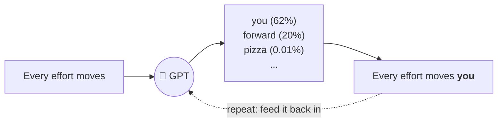
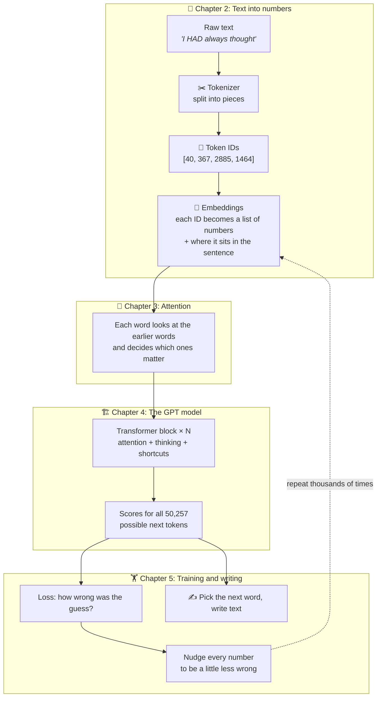
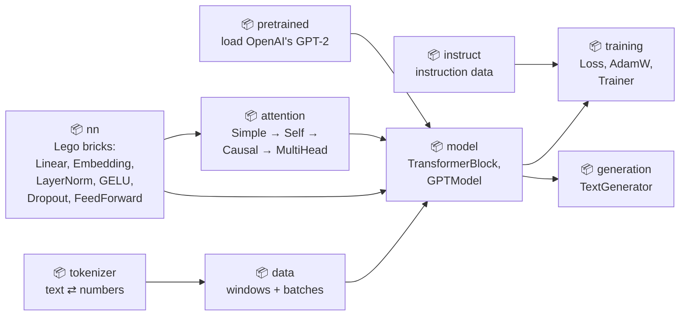

# TinyGPT: build a small ChatGPT-style model in Java, one step at a time

TinyGPT is a **small GPT language model written in Java**. It is built step by step while following the book
[*Build a Large Language Model (From Scratch)*](https://www.manning.com/books/build-a-large-language-model-from-scratch) by Sebastian Raschka.
The book uses Python. This project does the same things in Java.

Every step is a small program you can run. Every idea has a picture.
If you know a little Java, you can follow along. No AI background needed.

```
Before training:  Every effort moves you Hero farmland tenth harness ATL subsidized Contracts fixes
After training:   Every effort moves you know; and I had the craft was vindicated by little Claude Nutley, who...
```

*(Trained for 20 seconds on a laptop, on one short story.)*

---

## What is a language model? (the 30-second version)

A language model plays one game, over and over: **guess the next word**.



1. It reads some text.
2. It gives every possible next word a score.
3. It picks a word, adds it to the text, and goes again.

ChatGPT does the same thing, just much bigger: it trained on far more text, with far more numbers inside.

---

## The whole journey on one page



---

## Quick start

You need **Java 25** (or newer). Maven comes with the project (`./mvnw`).

```bash
git clone <this repo>
cd tinygpt

./run.sh 1                         # run step 1 (try 1 to 12)
./run.sh train                     # train the tiny GPT (about 20 seconds) and save it
./run.sh generate "I had always"   # let your trained model write
./run.sh finetune                  # teach OpenAI's GPT-2 to follow instructions (about 6 minutes)
./run.sh chat                      # chat with it!
./mvnw test                        # run the tests
```

The first run downloads the libraries (mostly PyTorch), so it takes a while. After that it works offline.

On Windows, run the steps with Maven directly:
`mvnw compile exec:java -Dexec.mainClass=com.tinygpt.examples.Step01_SimpleTokenizer`

---

## The guides: read them in order

Each guide follows one part of the book. Each has the same layout: **why we need it → the idea with an everyday picture → the book's example worked step by step →
a diagram of the data moving through our code → how it connects to the other parts → try it yourself**.

| # | Guide | What you'll understand | Book |
|---:|---|---|---|
| 0 | [What is an LLM?](docs/00-what-is-an-llm.md) | the "guess the next word" game, pretraining, what GPT is | 1 |
| 1 | [Tokens](docs/01-tokenization.md) | how text becomes numbers, and why GPT-2 uses word pieces | 2.2–2.5 |
| 2 | [Training data](docs/02-training-data.md) | how a story becomes thousands of quizzes | 2.6 |
| 3 | [Embeddings](docs/03-embeddings.md) | why each token becomes a list of numbers, plus its position | 2.1, 2.7–2.8 |
| 4 | [Attention](docs/04-attention.md) | how words look at each other (Q, K, V, mask, heads) | 3 |
| 5 | [The GPT model](docs/05-gpt-model.md) | LayerNorm, GELU, shortcuts, blocks, the full model | 4 |
| 6 | [Training](docs/06-training.md) | loss, gradients, AdamW, overfitting, saving | 5.1–5.2, 5.4 |
| 7 | [Writing text](docs/07-generating-text.md) | greedy, temperature, top-k | 4.7, 5.3 |
| 8 | [How everything connects](docs/08-how-everything-connects.md) | one sentence through the whole machine | 2–5 |
| 9 | [Chat with GPT-2](docs/09-chat-with-gpt2.md) | load OpenAI's GPT-2 into our model, teach it to follow instructions, chat | 5.5, 7 |

## The steps

Each step is one small program in [`src/main/java/com/tinygpt/examples`](src/main/java/com/tinygpt/examples).
Each guide in [`docs/`](docs) explains that step with pictures.

| Step | What you learn | Run | Guide | Book |
|---:|---|---|---|---|
| 1 | Split text into words and give each a number | `./run.sh 1` | [Tokenization](docs/01-tokenization.md) | 2.2–2.4 |
| 2 | GPT-2's tokenizer: break rare words into known pieces | `./run.sh 2` | [Tokenization](docs/01-tokenization.md) | 2.5 |
| 3 | Turn a story into "guess the next word" exercises | `./run.sh 3` | [Training data](docs/02-training-data.md) | 2.6 |
| 4 | Turn each token into a list of numbers, plus its position | `./run.sh 4` | [Embeddings](docs/03-embeddings.md) | 2.7–2.8 |
| 5 | Attention: words look at each other | `./run.sh 5` | [Attention](docs/04-attention.md) | 3.3 |
| 6 | Attention with learnable Query, Key, Value | `./run.sh 6` | [Attention](docs/04-attention.md) | 3.4 |
| 7 | Causal attention: no peeking at the future | `./run.sh 7` | [Attention](docs/04-attention.md) | 3.5 |
| 8 | Multi-head attention: many lookers at once | `./run.sh 8` | [Attention](docs/04-attention.md) | 3.6 |
| 9 | Build the full GPT-2 model (163 million numbers) | `./run.sh 9` | [The GPT model](docs/05-gpt-model.md) | 4 |
| 10 | Measure how wrong the model is (loss) | `./run.sh 10` | [Training](docs/06-training.md) | 5.1 |
| 11 | Choose the next word: greedy, temperature, top-k | `./run.sh 11` | [Writing text](docs/07-generating-text.md) | 5.3 |
| 🏁 | **Train TinyGPT and make it write** | `./run.sh train` | [Training](docs/06-training.md) | 5.2, 5.4 |
| 12 | Load OpenAI's GPT-2 into our model | `./run.sh 12` | [Chat with GPT-2](docs/09-chat-with-gpt2.md) | 5.5 |
| 🎓 | **Teach GPT-2 to follow instructions** | `./run.sh finetune` | [Chat with GPT-2](docs/09-chat-with-gpt2.md) | 7 |
| 💬 | **Chat with it** | `./run.sh chat` | [Chat with GPT-2](docs/09-chat-with-gpt2.md) | 7.7 |

New words? See the [glossary](docs/glossary.md).

### 🖼️ Every class, explained with pictures

Not great at maths? Start here. **[docs/classes](docs/classes/README.md)** explains every single class in the project. Each one gets:
a one-sentence summary, a real-life comparison, a diagram, and a tiny worked example with small numbers you can check by hand.
Every class's Javadoc also links straight to its picture.

---

## How the code is organised

The packages follow the order of the book. Each package has one job. (Pictures for every class: [docs/classes](docs/classes/README.md).)



```
src/main/java/com/tinygpt/
├── TinyGPT.java                  ← train TinyGPT from scratch, save it, let it write
├── FineTune.java                 ← teach GPT-2 to follow instructions (chapter 7)
├── Chat.java                     ← chat with the fine-tuned GPT-2
├── tokenizer/                    Chapter 2: text ⇄ numbers
│   ├── Tokenizer.java              the interface: encode() and decode()
│   ├── SimpleTokenizer.java        one ID per word, made by us
│   └── BpeTokenizer.java           GPT-2's real tokenizer
├── data/                         Chapter 2: training examples
│   ├── SampleText.java             loads "The Verdict" (the story we train on)
│   ├── GPTDataset.java             sliding window: input + target
│   ├── GPTDataLoader.java          groups examples into batches
│   └── Batch.java                  one box of inputs + targets
├── nn/                           Building blocks (like PyTorch's torch.nn)
│   ├── Module.java                 parent class: keeps the learnable numbers
│   ├── Linear.java                 multiply by a weight matrix
│   ├── Embedding.java              look up a row in a table
│   ├── LayerNorm.java              keep numbers at a steady size
│   ├── GELU.java                   the smooth "bend"
│   ├── Dropout.java                randomly switch numbers off while training
│   └── FeedForward.java            Linear → GELU → Linear
├── attention/                    Chapter 3
│   ├── SimpleAttention.java        no learnable weights
│   ├── SelfAttention.java          Query, Key, Value
│   ├── CausalAttention.java        + mask so nobody peeks ahead
│   └── MultiHeadAttention.java     several heads at once (used by GPT)
├── model/                        Chapter 4
│   ├── GPTConfig.java              all size settings (TINY and GPT2_SMALL)
│   ├── TransformerBlock.java       attention + feed forward + shortcuts
│   └── GPTModel.java               the whole model, plus save/load
├── training/                     Chapter 5
│   ├── Loss.java                   cross-entropy: "how wrong?"
│   ├── AdamW.java                  the optimizer: "which way to nudge?"
│   └── Trainer.java                the training loop
├── generation/
│   └── TextGenerator.java          greedy, temperature and top-k sampling, stop token
├── pretrained/                   Chapter 5.5: borrow OpenAI's GPT-2
│   ├── GPT2Size.java               small (124M) or medium (355M)
│   ├── Downloads.java              download once, keep the file
│   ├── SafeTensors.java            read Hugging Face's weight files
│   └── GPT2Weights.java            OpenAI's numbers → our GPTModel
├── instruct/                     Chapter 7: instruction fine-tuning
│   ├── Instruction.java            one request + answer, in the chat format
│   └── InstructionDataLoader.java  padding and -100 "don't grade" targets
└── examples/                     Steps 1–12, one small program each
```

---

## Our tiny model compared with GPT-2

| | TinyGPT (`GPTConfig.TINY`) | GPT-2 small (`GPTConfig.GPT2_SMALL`) |
|---|---:|---:|
| Transformer blocks | 4 | 12 |
| Attention heads | 4 | 12 |
| Numbers per token | 128 | 768 |
| Longest text it can read | 64 tokens | 1,024 tokens |
| Learnable numbers | 13.7 million | 163 million |
| Training text | 1 short story (5,145 tokens) | 8 million web pages |
| Training time | ~20 seconds on a laptop | weeks on many GPUs |

Same design, just smaller. Change one line in `TinyGPT.java` to try other sizes.

---

## Can I chat with it?

Yes, but not with the TinyGPT you train from scratch. Chatting needs **general knowledge** (from reading billions of words: weeks on big GPUs)
and **manners** (answering a question, then stopping). So, like the book, we:

1. **load OpenAI's trained GPT-2** into our own `GPTModel` (`./run.sh 12`). It matches real GPT-2 word for word;
2. **fine-tune** it on the book's 1,100 instruction examples (`./run.sh finetune`, about 6 minutes on an M4 Pro);
3. **chat** (`./run.sh chat`).

```
You: What is the capital of France?
Bot: The capital of France is Paris.
You: Give me a synonym for happy.
Bot: A synonym for happy is "joyful."
You: Name the author of 'Pride and Prejudice'.
Bot: The author of 'Pride and Prejudice' is Robert Frost.     ← confidently wrong!
```

GPT-2 small (124M numbers) learns the **manners** quickly but knows few **facts**. For better answers, use the book's choice:
`./run.sh finetune medium` (GPT-2 medium, 355M, a 1.5 GB download). The full story is in [docs/09-chat-with-gpt2.md](docs/09-chat-with-gpt2.md).

The downloads go into `models/` and `data/`, which git ignores.

---

## Why Java, and what is DJL?

The book uses PyTorch, a Python library that does two jobs for us:

1. **Tensors**: fast maths on big grids of numbers.
2. **Autograd**: works out automatically how to nudge each number during training.

In Java we use [DJL](https://djl.ai/) (Deep Java Library), which runs PyTorch underneath.
`NDArray` in this project is the same idea as `torch.Tensor` in the book.
Everything else (the layers, attention, the model, the optimizer, the training loop and text generation) is written out by hand, so you can read every step.

---

## Known issue: an occasional skipped step

On some computers, PyTorch's native code sometimes returns a NaN ("not a number") gradient during training. It happens at random,
and the same run can be fine the next time. We tested this a lot: the model's maths is correct, and it happens even on one thread.
If it isn't handled, a single NaN spreads until every weight is NaN.

So the optimizer checks the gradients first, and **skips any step that contains a NaN**. PyTorch's own mixed-precision trainer does the same.
If it happens you will see a line like `(Skipped 1 of 225 steps ...)`. Training is otherwise unaffected.

---

## Credits

- Book: *Build a Large Language Model (From Scratch)* by Sebastian Raschka (Manning, 2024). Python code: [rasbt/LLMs-from-scratch](https://github.com/rasbt/LLMs-from-scratch).
- Training text: *The Verdict* by Edith Wharton (1908, public domain).
- GPT-2 weights: OpenAI ([openai/gpt-2](https://github.com/openai/gpt-2), Modified MIT License), downloaded from [Hugging Face](https://huggingface.co/openai-community/gpt2).
- Instruction data: the book's [instruction-data.json](https://github.com/rasbt/LLMs-from-scratch/tree/main/ch07/01_main-chapter-code) (Apache 2.0), downloaded when you run `./run.sh finetune`.
- Libraries: [DJL](https://djl.ai/) with PyTorch, [JTokkit](https://github.com/knuddelsgmbh/jtokkit) for GPT-2's tokenizer, and [Gson](https://github.com/google/gson) for JSON.
