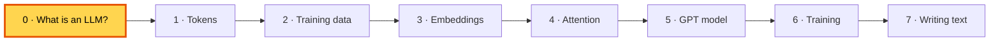
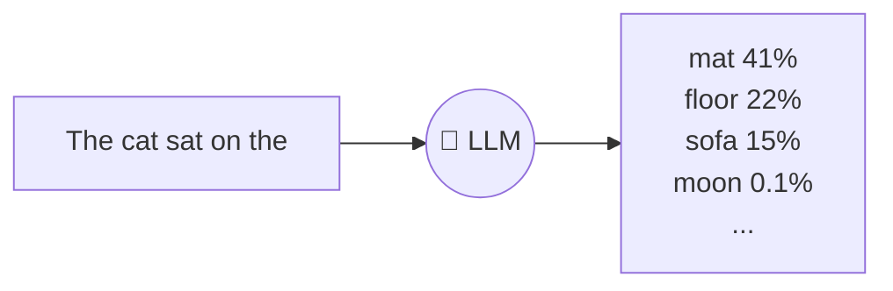
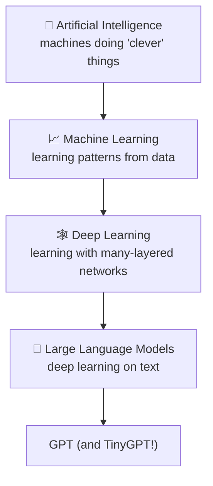
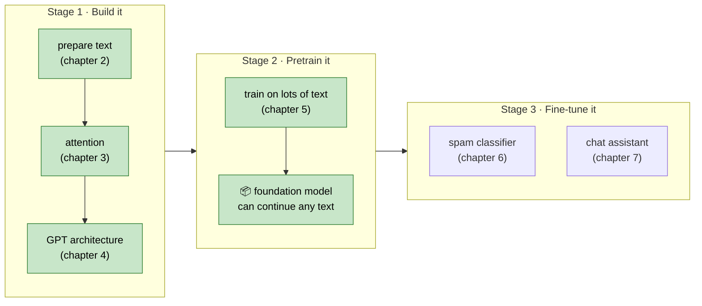
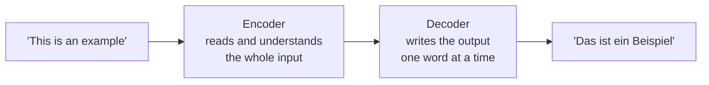
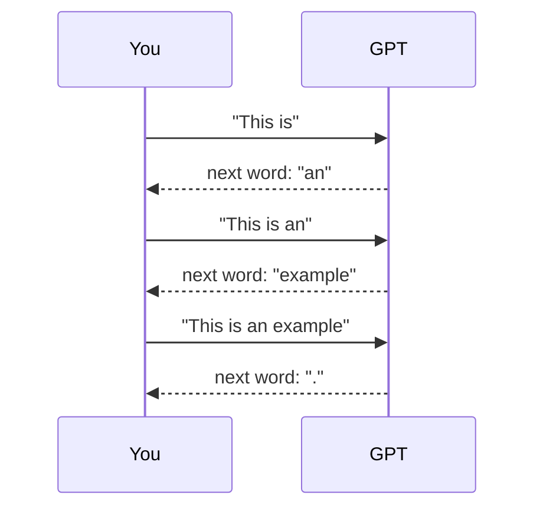
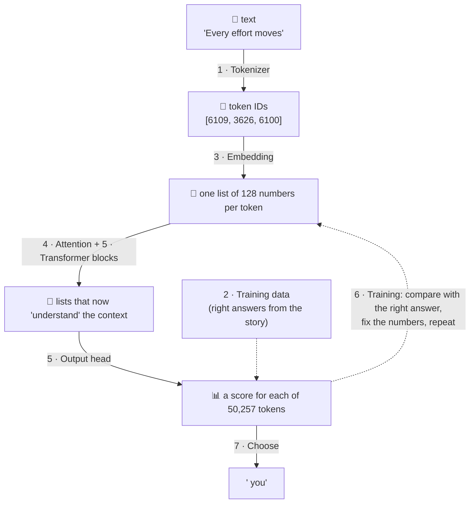

# 0. What is a large language model?

**Book:** Chapter 1 · **Code:** the whole project · **Run:** `./run.sh train` to see one being made

[README](../README.md) · Next: [1. Tokens →](01-tokenization.md)

---

## 🤔 The big question

How can a computer write a sentence that sounds human?

Old programs used **rules written by people** ("if the word is *please*, the tone is polite"). But language has far too many rules and exceptions for anyone to write them all down.

A **large language model (LLM)** does something different. It **learns from examples**: it reads a huge amount of text and slowly discovers the patterns by itself.

---

## 💡 The idea: a game of "guess the next word"

An LLM is trained on one game only:

> **Here are some words. What word comes next?**

You've played this game too. If someone says *"Once upon a..."*, you already know the next word is *"time"*.
You know it because you've heard lots of stories, and that's exactly how an LLM learns.

**Why is this game so powerful?** To guess the next word *well*, the model has to pick up grammar ("a cats" sounds wrong), facts ("Paris is the capital of..."), and even a bit of reasoning.
The book calls skills that appear without being taught directly **emergent behaviour**: the model is only taught to guess the next word, but it ends up able to translate, summarise and answer questions.

---

## 🔤 What does each word in "Large Language Model" mean?

| Word | Meaning | In TinyGPT |
|---|---|---|
| **Large** | lots of learnable numbers ("parameters") and lots of training text | 13.7 million numbers, 1 short story |
| **Language** | it works with human text | English |
| **Model** | a program whose behaviour comes from numbers learned from data, not hand-written rules | the `GPTModel` class |

---

## 🏗️ How an LLM is built: three stages (book figure 1.9)

**This project covers stages 1 and 2** (the green boxes): chapters 2 to 5.

| Stage | What happens | Real-life picture |
|---|---|---|
| **Pretraining** | Read huge amounts of ordinary text and play "guess the next word". No one has to label anything: the text itself contains the answers. | A child reading thousands of books |
| **Fine-tuning** | Train a bit more on a smaller, special set of examples (like questions with good answers) | The same child then training for a particular job |

**Pretraining is expensive.** GPT-3 cost millions of dollars of computer time. That's why TinyGPT trains on a single short story instead: it shows *how* it works in 20 seconds on a laptop.

---

## 🏛️ The transformer: the design behind GPT

In 2017, researchers invented the **transformer**, designed for translating between languages. It had two halves:

| Model family | Uses | Good at |
|---|---|---|
| BERT | the **encoder** only | understanding text (e.g. spotting toxic posts) |
| **GPT** | the **decoder** only | **writing** text, one word at a time |

GPT keeps only the writing half, which makes it simpler. TinyGPT is a GPT, so it is decoder-only too.

---

## 🔁 How a GPT writes: one word at a time

Each new word is added to the input, and the model is asked again.
Models that feed their own output back in like this are called **autoregressive**.

---

## 🗺️ The whole journey in this project

Each numbered box has its own doc. Read them in order. Each one builds on the last.

---

## 🧠 Remember

- An LLM learns by **guessing the next word**, over and over.
- It **learns patterns from examples** instead of following hand-written rules.
- Building one = **build → pretrain → (fine-tune)**. TinyGPT does build + pretrain.
- GPT is the **decoder** half of a transformer: it **writes one token at a time**.

## 📖 In the book

| Section | Topic | Here |
|---|---|---|
| 1.1–1.2 | What LLMs are and what they're used for | 🤔 The big question |
| 1.3 | Pretraining and fine-tuning | 🏗️ Three stages |
| 1.4, 1.6 | Transformer, encoder vs decoder, GPT | 🏛️ The transformer |
| 1.5 | Large datasets | 🏗️ Three stages |
| 1.7 | The plan for the book | 🗺️ The whole journey |
