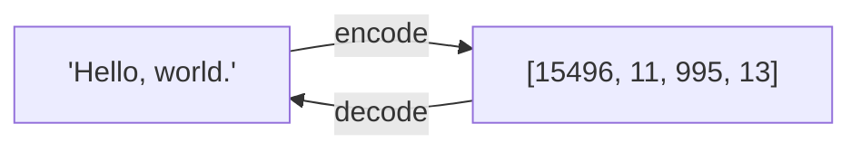
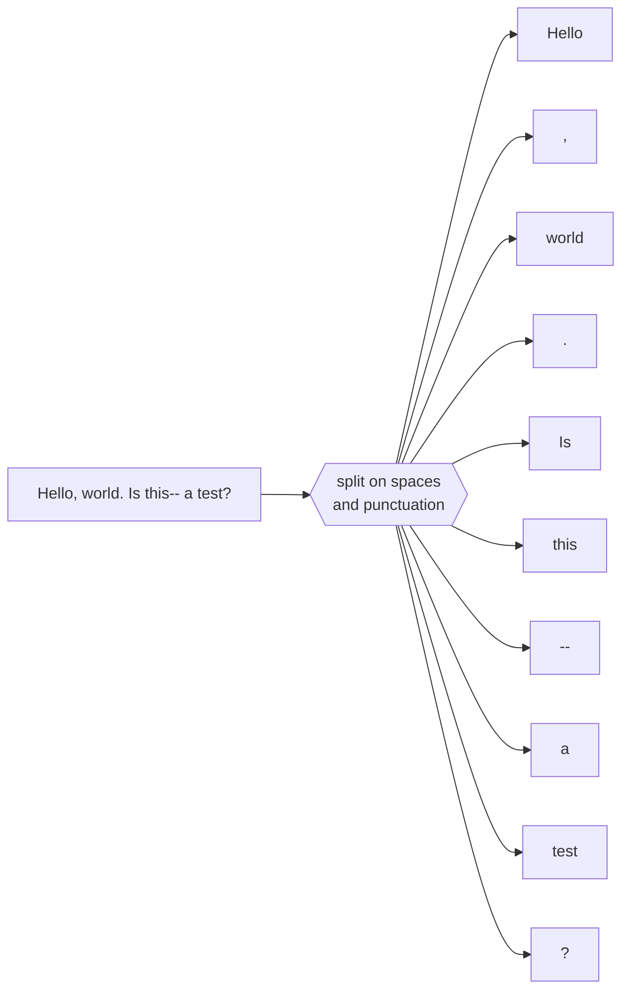
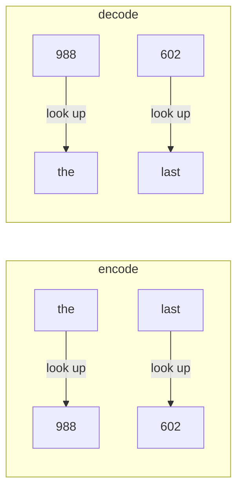
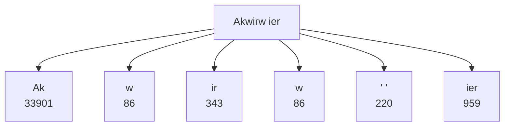
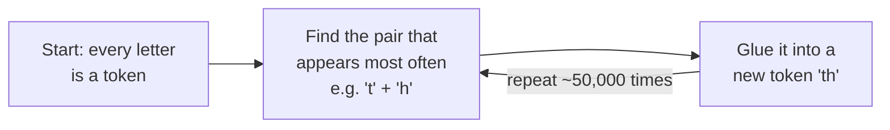

# 1. Tokenization: turning text into numbers

**Steps 1 and 2** · Book chapter 2.2–2.5 · Code: [`tokenizer/`](../src/main/java/com/tinygpt/tokenizer)

← [Back to README](../README.md) · Next: [Training data →](02-training-data.md)

---

## Why?

Computers can't do maths on words, only on numbers.
So before anything else, we swap every word for a number, like giving every word a seat number in a cinema.



The pieces of text are called **tokens**, and their numbers are **token IDs**.

---

## Step 1: our own simple tokenizer

### 1. Split the text into pieces



### 2. Build a vocabulary: every unique piece gets a number

We take every unique word in the story, sort them A→Z, and number them.

| ID | Token |
|---:|---|
| 0 | `!` |
| 1 | `"` |
| ... | ... |
| 56 | `It` |
| ... | ... |
| 1130 | `<\|endoftext\|>` |
| 1131 | `<\|unk\|>` |

"The Verdict" has **1,130 unique pieces**. With the 2 special tokens that makes **1,132**.

### 3. Encode and decode by looking things up



### Two special tokens

| Token | Meaning | Like... |
|---|---|---|
| `<\|unk\|>` | "a word I've never seen" | a blank sticker |
| `<\|endoftext\|>` | "one document ended, a new one starts" | a page break between two books |

**The problem:** "Hello" was never in the story, so it becomes `<|unk|>`, and the model loses that word completely.

---

## Step 2: Byte Pair Encoding (BPE), GPT-2's real tokenizer

BPE uses **pieces of words**, not just whole words. A word it doesn't know is built from smaller pieces it does know,
like building any word out of Lego letters.



- Common words are **one** token: `" the"` → `262`
- Rare words become **several** tokens: `"someunknownPlace"` → `" some" "unknown" "Place"`
- Nothing is ever `<|unk|>`, because in the worst case BPE spells the word out letter by letter.

GPT-2 knows **50,257** tokens. `<|endoftext|>` is the last one: **50256**.

### How does BPE learn its pieces? (simplified)



We don't train BPE ourselves. We use GPT-2's finished list through the JTokkit library.

---

## In the code

| What | Where |
|---|---|
| The `encode`/`decode` interface | [`Tokenizer.java`](../src/main/java/com/tinygpt/tokenizer/Tokenizer.java) |
| Split, vocabulary, `<\|unk\|>` | [`SimpleTokenizer.java`](../src/main/java/com/tinygpt/tokenizer/SimpleTokenizer.java) |
| GPT-2 BPE | [`BpeTokenizer.java`](../src/main/java/com/tinygpt/tokenizer/BpeTokenizer.java) |

## Try it

```bash
./run.sh 1
./run.sh 2
```

**Experiments:**
- In `Step02_BytePairEncoding`, encode your own name. How many pieces does it become?
- Encode `" hello"` and `"hello"` (with and without a space). Are the IDs the same? (No! In GPT-2 the space belongs to the token.)
