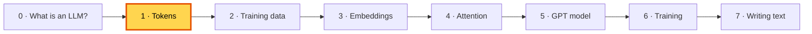
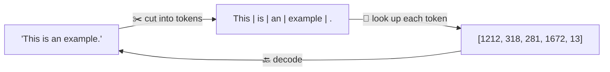
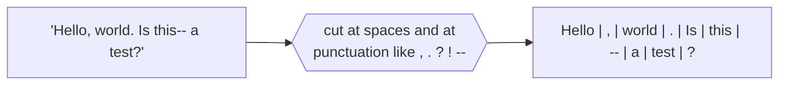
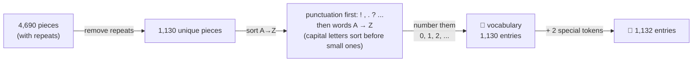
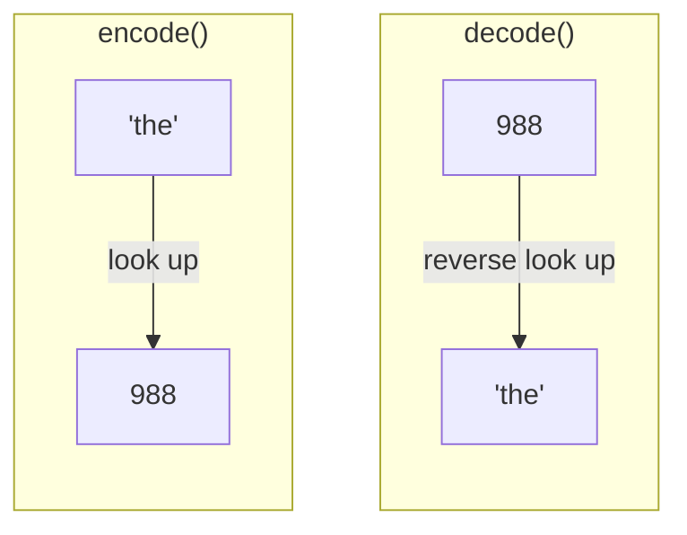
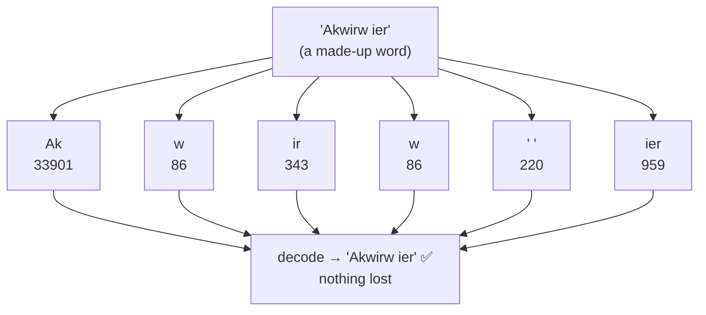
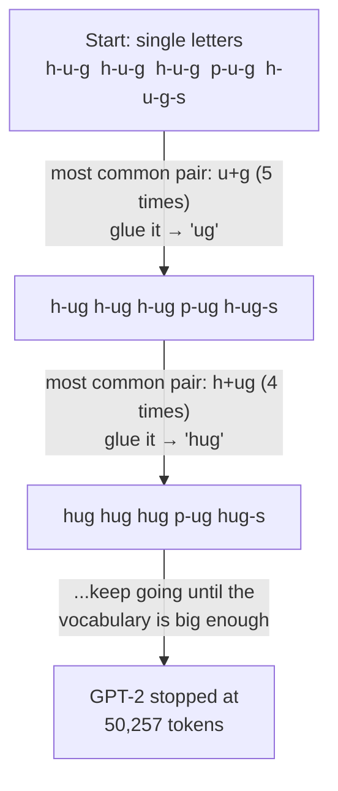
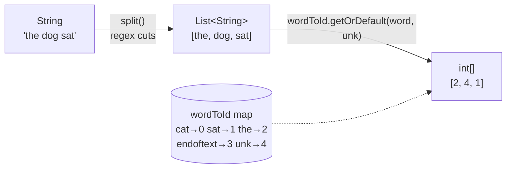
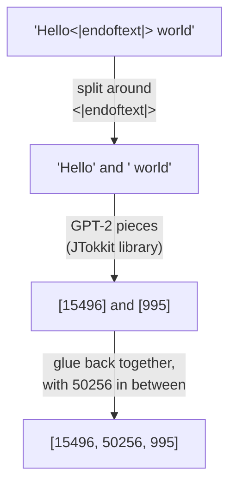
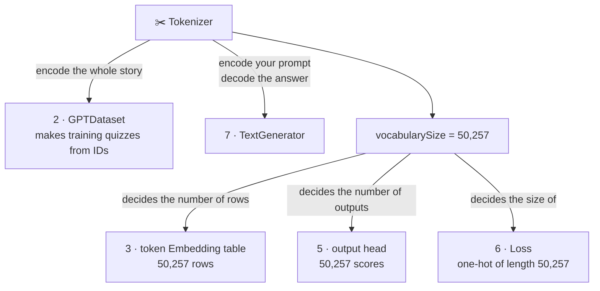

# 1. Tokens: turning text into numbers

**Book:** Chapter 2.2–2.5 · **Code:** [`tokenizer/`](../src/main/java/com/tinygpt/tokenizer) · **Run:** `./run.sh 1`, `./run.sh 2` · **Class pictures:** [tokenizer classes](classes/1-tokenizer.md)

← [0. What is an LLM?](00-what-is-an-llm.md) · Next: [2. Training data →](02-training-data.md)



---

## 🤔 The problem

A computer is a calculator. It can add and multiply numbers, but it has no idea what *"cat"* is.
So before the model can do anything, **every piece of text must become numbers**.

## 💡 The idea

Cut the text into small pieces called **tokens**, and give every possible piece its own number, its **token ID**.

> 🎟️ Like a cinema: every seat has a number. Once you know the number, you can always find the seat again.



*(These are the real GPT-2 numbers for the book's example sentence.)*

This happens in two steps, and the book builds each one by hand:
1. **Our own tokenizer** (`SimpleTokenizer`): one token per word. Easy to understand, but has a weakness.
2. **GPT-2's tokenizer** (`BpeTokenizer`): tokens can be *pieces* of words. This fixes the weakness.

---

## 🔍 Part 1 · Our own tokenizer, step by step (book 2.2–2.4)

### Step 1: cut the text into pieces

We cut wherever there's a space or a punctuation mark, and **keep the punctuation as its own piece**.



**Why keep punctuation?** A full stop or a question mark changes the meaning, and the model needs to learn when to write them.

The story *The Verdict* (20,479 characters) becomes **4,690 pieces**:
`[I, HAD, always, thought, Jack, Gisburn, rather, a, cheap, genius, --, though, ...]`

### Step 2: build the vocabulary (the "word list")

Take every **different** piece, sort them A→Z, and number them from 0.



| ID | Token | | ID | Token |
|---:|---|---|---:|---|
| 0 | `!` | | 988 | `the` |
| 1 | `"` | | 1126 | `you` |
| 5 | `,` | | 1130 | `<\|endoftext\|>` |
| 7 | `.` | | 1131 | `<\|unk\|>` |

### Step 3: encode (text → IDs) and decode (IDs → text)



Real output of `./run.sh 1`:

```
Encode: "It's the last he painted, you know," Mrs. Gisburn said with pardonable pride.
IDs:    [1, 56, 2, 850, 988, 602, 533, 746, 5, 1126, 596, 5, 1, 67, 7, 38, 851, 1108, 754, 793, 7]
```

### Step 4: two special tokens

| Token | Means | Why we need it |
|---|---|---|
| `<\|unk\|>` | "a word not on my list" | Something has to happen when a new word shows up |
| `<\|endoftext\|>` | "one text ended; a different one starts" | Training data is many documents glued together, and the model should know where one stops |

```
Input:   Hello, do you like tea? <|endoftext|> In the sunlit terraces of the palace.
Decoded: <|unk|>, do you like tea? <|endoftext|> In the sunlit terraces of the <|unk|>.
```

### ⚠️ The weakness

"Hello" and "palace" were never in the story, so they became `<|unk|>`, and **that information is lost forever**.
A model can't learn about words it is never allowed to see. Part 2 fixes this.

---

## 🔍 Part 2 · Byte Pair Encoding, GPT-2's tokenizer (book 2.5)

### The idea: pieces of words

Instead of whole words only, BPE's vocabulary has **common words and common word-pieces**, all the way down to single letters.

> 🧱 Like Lego. Popular shapes come as one big ready-made brick (`" the"`). Anything unusual is built from small bricks.
> And since single letters are bricks too, **any** word can be built. There is no "unknown"!



### How BPE learned its pieces (a simplified example)

BPE starts with single letters, and keeps **gluing together the pair it sees most often**.
Let's try it on the text `hug hug hug pug hugs`:



Now `hug` is one token, `pug` is two (`p` + `ug`), and `hugs` is two (`hug` + `s`).
**Common words become one token; rare words become several.** GPT-2 learned its pieces from a huge pile of web text. We just use its finished list.

### Real output of `./run.sh 2`

```
Text:   Hello, do you like tea? <|endoftext|> In the sunlit terraces of someunknownPlace.
IDs:    [15496, 11, 466, 345, 588, 8887, 30, 220, 50256, 554, 262, 4252, 18250, 8812, 2114, 286, 617, 34680, 27271, 13]
Decode: Hello, do you like tea? <|endoftext|> In the sunlit terraces of someunknownPlace.
```

Everything comes back perfectly. `<|endoftext|>` is token **50256**, the very last ID.

### Simple vs BPE

| | SimpleTokenizer | BpeTokenizer |
|---|---|---|
| Vocabulary | 1,132 (from one story) | 50,257 (from the internet) |
| Unknown words | become `<\|unk\|>` ❌ | split into pieces ✅ |
| The story becomes | 4,690 tokens | 5,145 tokens |
| Spaces | thrown away | kept as part of the token: `" world"` |
| Used for | learning (step 1) | **the real model** |

---

## 🏭 Watch the data move through the code

### `SimpleTokenizer.encode("the dog sat")` (vocabulary built from `"the cat sat"`)



### `BpeTokenizer.encode(...)` with `<|endoftext|>` inside



**Why split it out ourselves?** JTokkit would treat `<|endoftext|>` as ordinary letters (`<`, `|`, `end`...). We want it to be the single special token 50256.

---

## 🔗 How tokens connect to everything else



The **vocabulary size** decides the size of three other parts:
- the **embedding table** needs one row per token, so it can look up any ID;
- the **output head** gives one score per token, so the model can choose any of them as the next word;
- the **loss** compares against all of them.

A bigger vocabulary means bigger tables and more numbers to learn.

---

## ▶️ Try it

```bash
./run.sh 1     # our own tokenizer
./run.sh 2     # GPT-2's tokenizer
```

**Experiments**
1. In `Step02_BytePairEncoding`, encode your own name. How many pieces is it?
2. Encode `"hello"` and `" hello"`. Different IDs? (Yes: the space belongs to the token.)
3. Encode a word in another language. Does it take more pieces than English? Why do you think so?

## 🧠 Remember

- Models only understand numbers, so text → **tokens** → **token IDs**.
- A **vocabulary** is the list of every token the model knows.
- Our simple tokenizer loses unknown words (`<|unk|>`). **BPE never does**: it builds rare words from pieces.
- `<|endoftext|>` (ID 50256) marks the boundary between separate texts.
- The vocabulary size (50,257) decides the size of the embedding table, the output head and the loss.

## 📖 In the book

| Section | Topic | Our code |
|---|---|---|
| 2.2 | Splitting text with a regular expression | `SimpleTokenizer.split()` |
| 2.3 | Building a vocabulary, encode/decode | `SimpleTokenizer.buildVocabulary()`, `encode()`, `decode()` |
| 2.4 | `<\|unk\|>` and `<\|endoftext\|>` | `SimpleTokenizer.UNKNOWN`, `END_OF_TEXT` |
| 2.5 | Byte pair encoding with tiktoken | `BpeTokenizer` (JTokkit = Java's tiktoken) |
