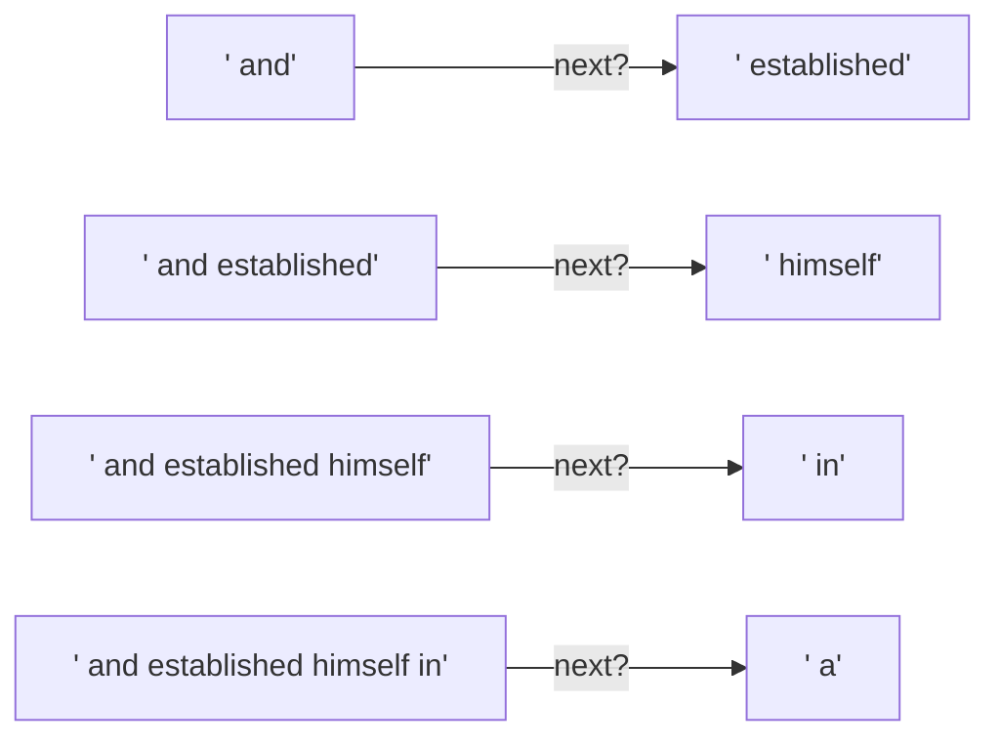
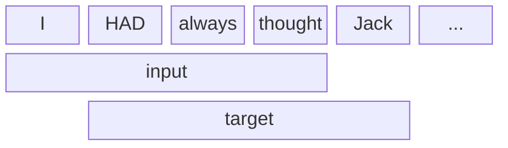
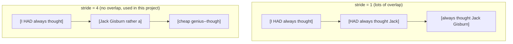
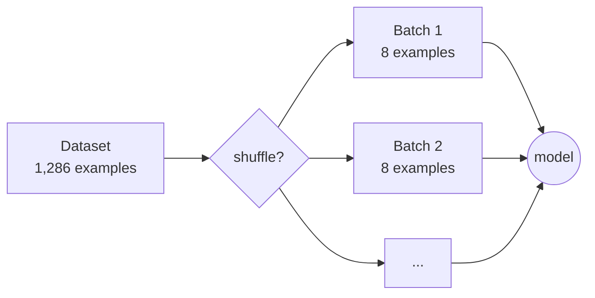

# 2. Training data: "guess the next word" exercises

**Step 3** · Book chapter 2.6 · Code: [`data/`](../src/main/java/com/tinygpt/data)

← [Tokenization](01-tokenization.md) · Next: [Embeddings →](03-embeddings.md)

---

## The one game a GPT plays

A GPT only ever learns one thing: **given some words, guess the next one.**
So we turn our story into thousands of little quizzes, and the story itself holds all the answers.
Nobody has to label anything. That's why this is called *self-supervised* learning.



---

## The sliding window

We slide a window of `maxLength` tokens along the story.
The **target** is always the **input shifted one step to the right**.



| | position 0 | position 1 | position 2 | position 3 |
|---|---|---|---|---|
| **input** | I | HAD | always | thought |
| **target** | HAD | always | thought | Jack |

One window = **4 quizzes at once**:
"I" → HAD, "I HAD" → always, "I HAD always" → thought, "I HAD always thought" → Jack.

### Stride: how far the window jumps



Overlap gives more examples, but they repeat each other, which makes it easier for the model to memorise.

---

## Batches

The model learns faster from several examples at once, so the `GPTDataLoader` groups them into **batches**.



- `shuffle = true`: mix the order every epoch, so the model can't just learn the order.
- `dropLast = true`: skip the last batch if it is smaller than the rest.

A batch is a grid of numbers with **shape `[batchSize, maxLength]`**, e.g. `[8, 4]` = 8 rows of 4 token IDs.

---

## In the code

| What | Where |
|---|---|
| Sliding window | [`GPTDataset.java`](../src/main/java/com/tinygpt/data/GPTDataset.java) |
| Batches, shuffle | [`GPTDataLoader.java`](../src/main/java/com/tinygpt/data/GPTDataLoader.java) |
| Loading the story | [`SampleText.java`](../src/main/java/com/tinygpt/data/SampleText.java) |

## Try it

```bash
./run.sh 3
```

**Experiment:** change `stride` to `1` in `Step03_SlidingWindow`. How many examples do you get now?
