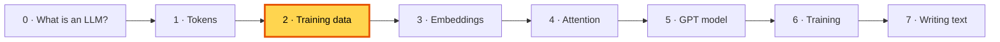
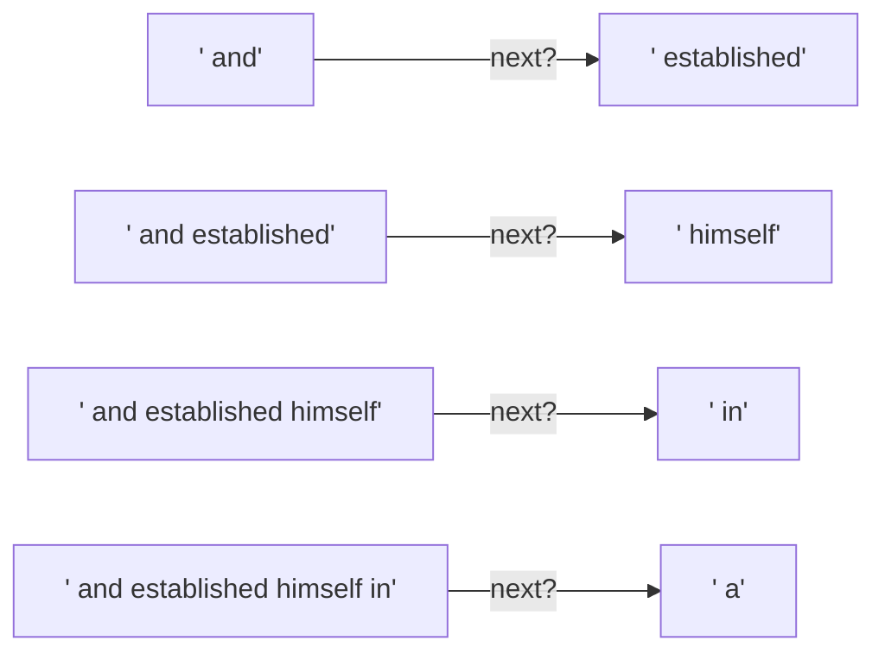
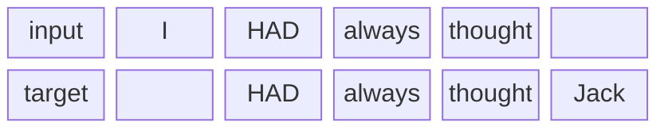
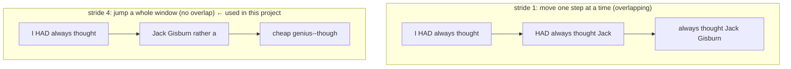
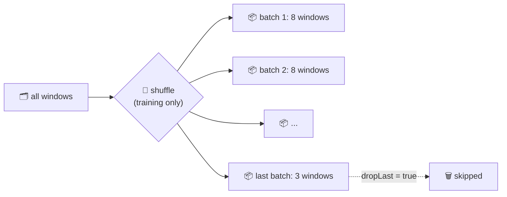
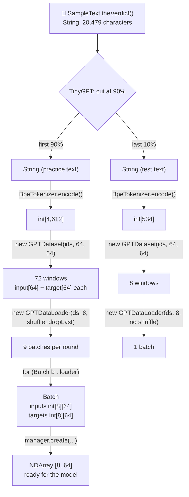
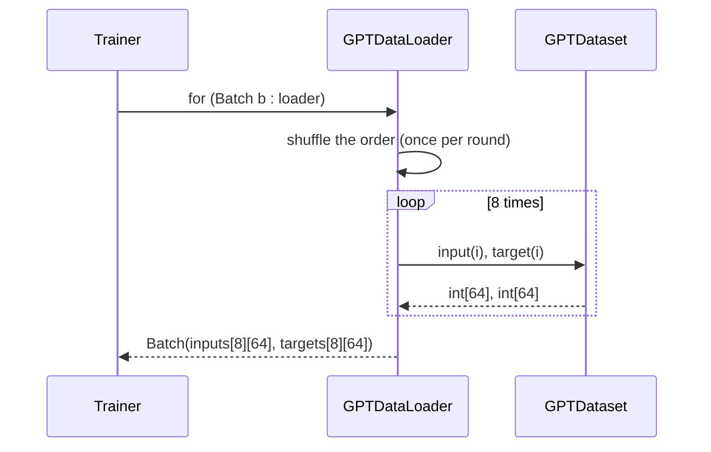
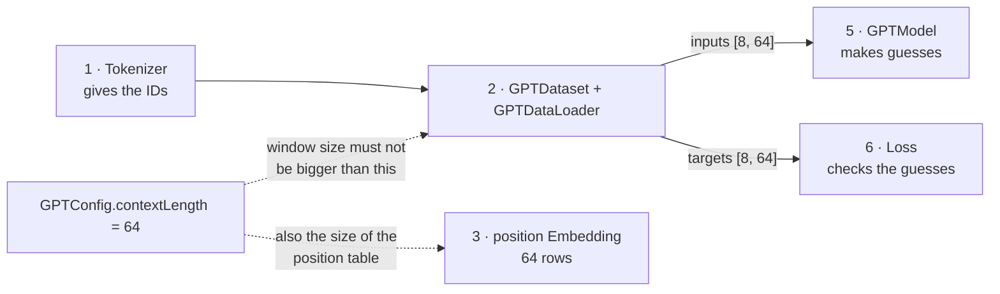

# 2. Training data: making "guess the next word" quizzes

**Book:** Chapter 2.6 · **Code:** [`data/`](../src/main/java/com/tinygpt/data) · **Run:** `./run.sh 3` · **Class pictures:** [data classes](classes/2-data.md)

← [1. Tokens](01-tokenization.md) · Next: [3. Embeddings →](03-embeddings.md)



---

## 🤔 The problem

We now have the story as one long row of 5,145 numbers. But a model learns from **questions with known answers**.
Where do the questions and answers come from? Nobody has time to write millions of quiz questions by hand.

## 💡 The idea: the text is its own answer key

Every piece of text already contains its own answers: **the answer to "what comes next?" is simply the next word.**

> 📝 Cover a book with a card and slowly slide it to the right. Each time you see a few words, guess the next one, then slide the card to check.

This is why pretraining needs **no labelling by people**. The book calls this *self-supervised learning*.

---

## 🔍 Step by step (the book's example)

### Step 1: one window = several quizzes

Take 4 tokens from the story: `and established himself in`, followed by `a`.



*(This is exactly what `./run.sh 3` prints.)*

### Step 2: input and target, side by side

We don't store four separate quizzes. We store **two rows**: the input, and the **same row shifted one step to the right** (the target).



| Position | 0 | 1 | 2 | 3 |
|---|---|---|---|---|
| **input** | `I` (40) | ` HAD` (367) | ` always` (2885) | ` thought` (1464) |
| **target** | ` HAD` (367) | ` always` (2885) | ` thought` (1464) | ` Jack` (1807) |
| **quiz** | after "I" → HAD | after "I HAD" → always | after "I HAD always" → thought | after all 4 → Jack |

Reading down each column gives one quiz. **One window of 4 tokens = 4 quizzes.** With windows of 64 tokens, every window is 64 quizzes!

### Step 3: slide the window along the whole story



| Stride | Windows from the story (size 4) | Good | Bad |
|---|---:|---|---|
| 1 | about 5,140 | lots of examples | they nearly repeat, so the model memorises more easily |
| 4 | **1,286** | every token is used once, no repeats | fewer examples |

### Step 4: pack quizzes into batches

Training one window at a time is slow. Computers are fast at doing **many at once**, so we pack windows into **batches**.



| Setting | What it does | Why |
|---|---|---|
| `batchSize = 8` | 8 windows per batch | faster than 1 at a time, and the learning is steadier |
| `shuffle = true` | mix the order each round | so the model can't learn the *order* of the examples |
| `dropLast = true` | skip a small leftover batch | a tiny last batch would give an unusually jumpy learning step |

Real first batch from `./run.sh 3` (shape `[8, 4]`: 8 rows, 4 columns):

```
inputs  = [[40, 367, 2885, 1464], [1807, 3619, 402, 271], [10899, 2138, 257, 7026], ...]
targets = [[367, 2885, 1464, 1807], [3619, 402, 271, 10899], [2138, 257, 7026, 15632], ...]
```

Notice how the target row is the input row shifted by one, and the last target (`1807`) is the first input of the next window.

---

## 🏭 Watch the data move through the code (during `./run.sh train`)



### Why keep 10% aside as "test text" (validation)?

> 🧑‍🎓 A teacher who tests you on **exactly** the homework questions can't tell if you understood or just memorised.
> So the teacher keeps some questions **secret** for the real test.

The model **never trains** on the last 10% of the story. We only use it to check how well the model handles text it hasn't seen.
That's how we spot **overfitting** (memorising) later, in [6. Training](06-training.md).

---

## 💻 What the code does

```java
// GPTDataset: the sliding window, in 4 lines
for (int start = 0; start + maxLength < tokenIds.length; start += stride) {
    inputs.add(Arrays.copyOfRange(tokenIds, start, start + maxLength));          // the window
    targets.add(Arrays.copyOfRange(tokenIds, start + 1, start + maxLength + 1));  // the same window, one step to the right
}
```



---

## 🔗 How training data connects to everything else



- The **inputs** go into the model, and the **targets** go into the loss. They meet again when the loss compares guess vs answer.
- The window size is tied to `contextLength`: the model has a position-table row for positions 0–63, so it can't read a 65th token.

---

## ▶️ Try it

```bash
./run.sh 3
```

**Experiments** (in `Step03_SlidingWindow`)
1. Change `stride` to `1`. How many windows now?
2. Change `stride` to `2`. Do the windows overlap? By how much?
3. Change the batch size to `2`. How does the printed batch change?

## 🧠 Remember

- The answer to "what comes next?" is always in the text itself. **No labelling needed.**
- **Target = input shifted one step right.** One window of N tokens = N quizzes.
- **Stride** is how far the window jumps; **batch** is how many windows go in together.
- 10% of the text is kept **secret** (validation) to catch memorising.

## 📖 In the book

| Section | Topic | Our code |
|---|---|---|
| 2.6 | Input–target pairs, context size 4 | `Step03_SlidingWindow` part 1 |
| 2.6 | `GPTDatasetV1` | `GPTDataset` |
| 2.6 | `create_dataloader_v1` (batch_size, stride, shuffle, drop_last) | `GPTDataLoader` |
| 5.1.3 | 90/10 train/validation split | `TinyGPT.main` |
