# 3. Embeddings: giving every token a meaning and a place

**Book:** Chapter 2.1, 2.7, 2.8 · **Code:** [`nn/Embedding.java`](../src/main/java/com/tinygpt/nn/Embedding.java), [`GPTModel.forward()`](../src/main/java/com/tinygpt/model/GPTModel.java) · **Run:** `./run.sh 4` · **Class pictures:** [Embedding](classes/3-nn.md#embedding)

← [2. Training data](02-training-data.md) · Next: [4. Attention →](04-attention.md)

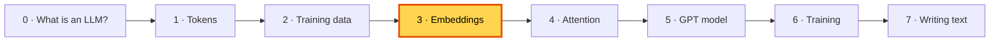

---

## 🤔 The problem: a token ID is just a name tag

The ID for " cat" is `3797` and for " dog" is `3290`. Those numbers say **nothing** about what the words mean.
They're like phone numbers: two friends living next door can have completely different phone numbers.

The model needs numbers that **carry meaning**, so that similar words look similar.

## 💡 The idea: describe each token with a list of numbers

Give every token a **list of numbers** (a *vector*). Think of it as a character card in a game:

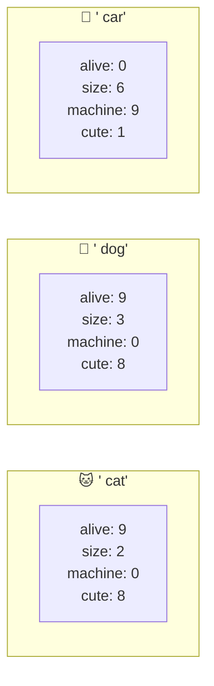

Now **cat and dog have almost the same card**, and car is very different. The model can *see* that cats and dogs are alike.

If we use just 2 of the numbers, we can draw the words on a map (book figure 2.3):

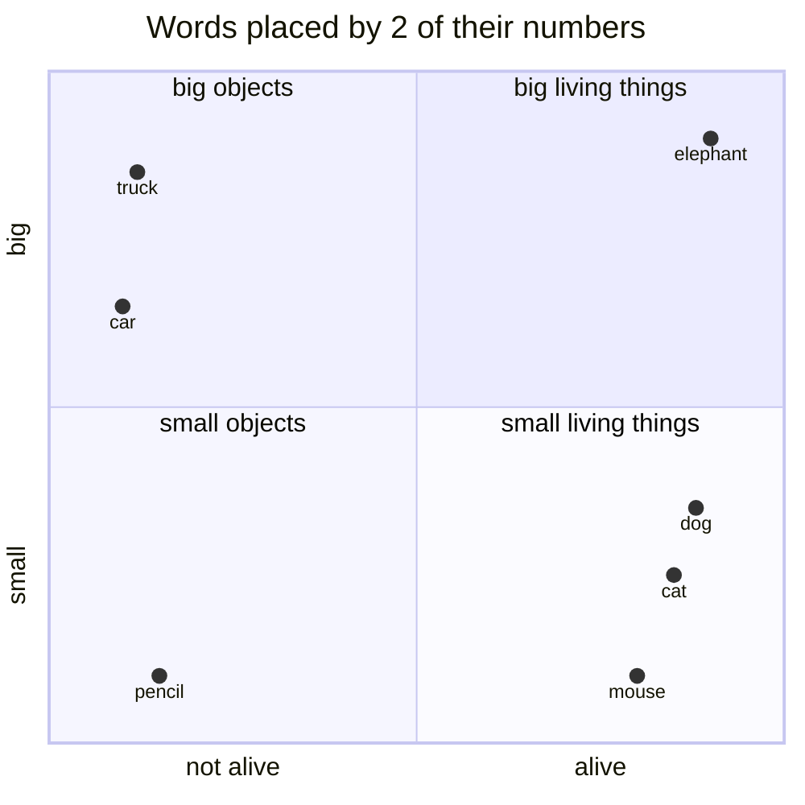

**Similar words end up close together.**

### ⚠️ Important: nobody writes these numbers by hand

The labels "alive", "size" and so on are just to help us imagine. In the real model:
- every token gets **128 numbers** in TinyGPT (768 in GPT-2), with no names;
- they **start out random**;
- **training moves them** a little at a time, until tokens used in similar ways end up with similar numbers.

The book explains that older methods (like Word2Vec) learned embeddings separately. **GPT learns its embeddings as part of its own training**, so they fit exactly the job they're used for.

---

## 🔍 Part 1 · The token embedding: a lookup table (book 2.7)

An embedding layer is simply a **table with one row per token ID**. To embed an ID, you **read that row**.

The book's tiny example uses 6 token IDs and 3 numbers each. Here are the real (random) starting numbers from `./run.sh 4`:

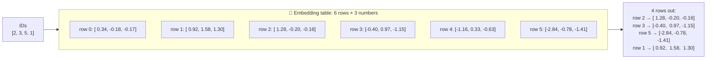

4 IDs in → 4 rows out. **Shape `[4]` became `[4, 3]`**: each ID was swapped for its 3 numbers.

### A lookup is the same as a special multiplication

The book points out that "pick row 2" gives exactly the same result as multiplying a **one-hot** list by the table:

```
one-hot for ID 2 (6 IDs):  [0, 0, 1, 0, 0, 0]
× table                 →  0·row0 + 0·row1 + 1·row2 + 0·row3 + 0·row4 + 0·row5  =  row 2
```

So an embedding is really a `Linear` layer with a shortcut: instead of multiplying by lots of zeros, it just reads the row.
That's why it can **learn the same way** every other layer learns.

---

## 🔍 Part 2 · The position embedding (book 2.8)

### The problem: attention can't see order

In the next chapter, attention compares every token with every other token. But it treats the tokens like **a bag of words**, so the order is lost:

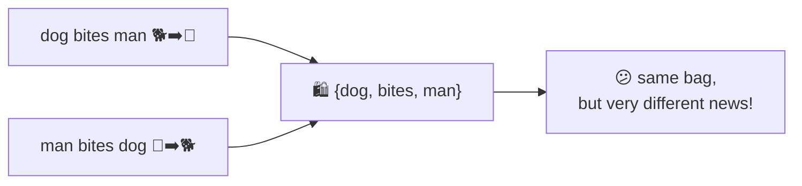

### The fix: a second table, for positions

Make a second table with **one row per position**: 0, 1, 2, ... up to the longest text the model can read (`contextLength`).
Then **add** the position row to the token row.

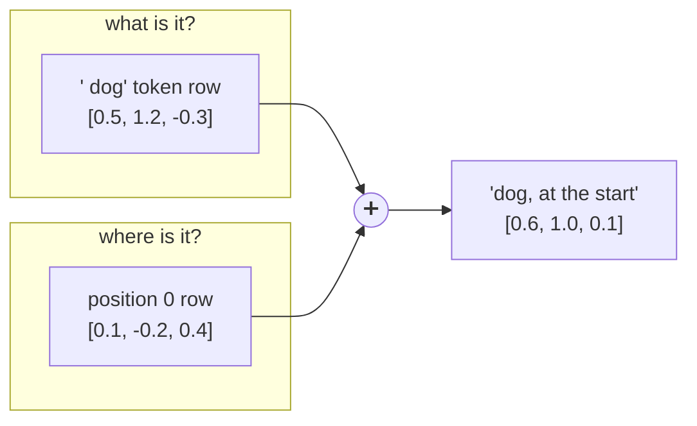

Now `dog` at position 0 and `dog` at position 2 get **different** final numbers, so the model can tell `dog bites man` from `man bites dog`.

| | Token embedding | Position embedding |
|---|---|---|
| Answers | **what** is this token? | **where** is it? |
| Rows | one per token: 50,257 | one per position: 64 (TinyGPT), 1,024 (GPT-2) |
| Looked up by | the token ID | the position number 0, 1, 2, ... |
| Learned? | yes | yes (GPT uses *absolute*, learned positions) |

---

## 🏭 Watch the data move through the code

Inside [`GPTModel.forward()`](../src/main/java/com/tinygpt/model/GPTModel.java), for one training batch:

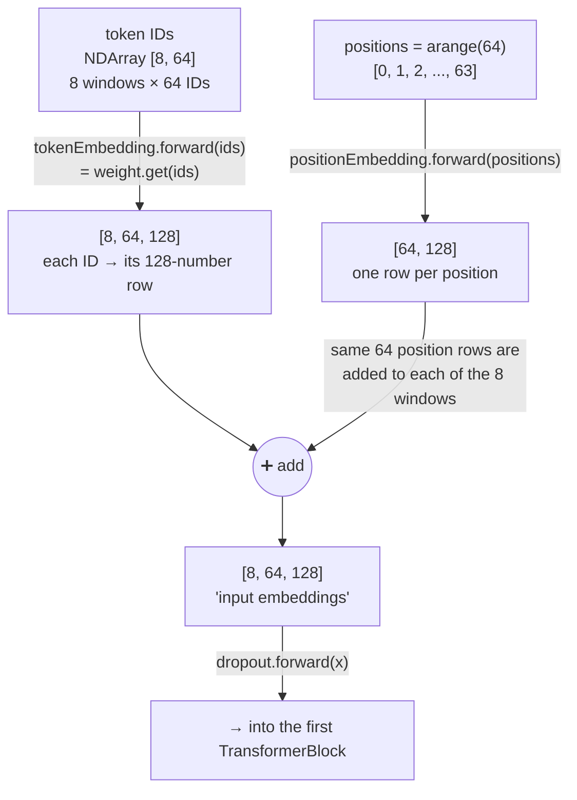

**How can `[8, 64, 128]` + `[64, 128]` work when the shapes are different?**
The smaller one is **reused for every window in the batch** (this is called *broadcasting*). Position 5 is position 5 in every window.

Real shapes printed by `./run.sh 4` (the book's example sizes: batch 8, 4 tokens, 256 numbers):

```
A batch of token IDs:              (8, 4)
Token embeddings  (what):          (8, 4, 256)
Position embeddings (where):       (4, 256)
Token + position = model input:    (8, 4, 256)
```

```java
// GPTModel.forward(): the embedding part
NDArray positions = tokenIds.getManager().arange(tokens);             // 0, 1, 2, ...
NDArray x = tokenEmbedding.forward(tokenIds)                            // what
              .add(positionEmbedding.forward(positions));               // + where
x = dropout.forward(x);
```

---

## 🔗 Why embeddings matter, and where they're used

### Where the `Embedding` class is used

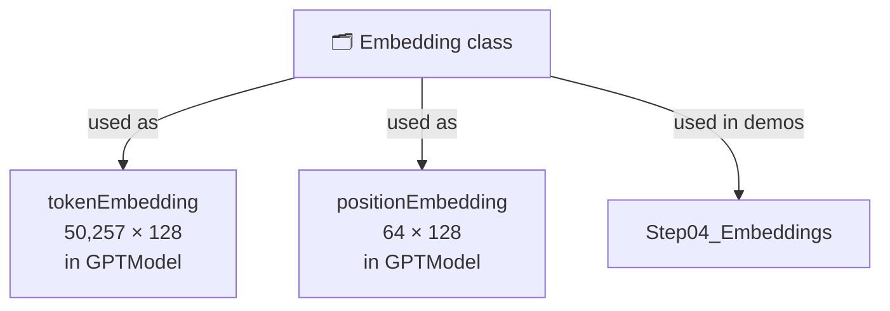

It's used **twice** in the model, both at the very start. Every other part works on the vectors these two tables produce.

### The embedding size (128) travels through the whole model

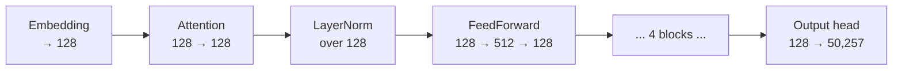

`embeddingDim` (128) is the "width" of the whole model: **every layer reads and writes 128 numbers per token**.
That's why it's in `GPTConfig`. Change it once, and every layer changes size with it.

### The output head is the embedding in reverse

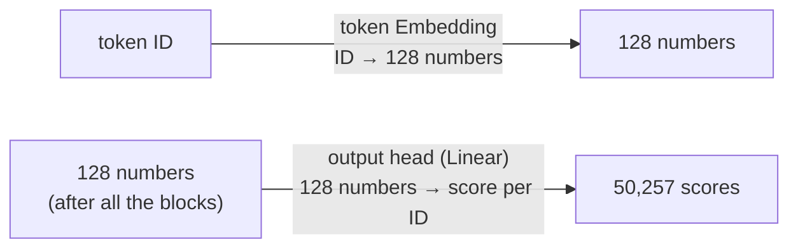

At the start, an ID becomes a vector. At the end, a vector becomes scores for every ID.
OpenAI's GPT-2 even **shares one table** for both jobs (called *weight tying*). The book (and TinyGPT) keep them separate, which is why the book's model has 163M numbers instead of 124M.

### How embeddings learn

During training, only the rows for **tokens that appeared in the batch** get a gradient (a "which way to move" signal).
A token that never appears in the training text never learns anything useful. Its row only slowly shrinks towards 0 (AdamW's *weight decay*; see [6. Training](06-training.md)).
Our story uses only 1,416 of the 50,257 tokens, which is another reason real models need huge, varied training text.

### Embeddings are the biggest part of TinyGPT

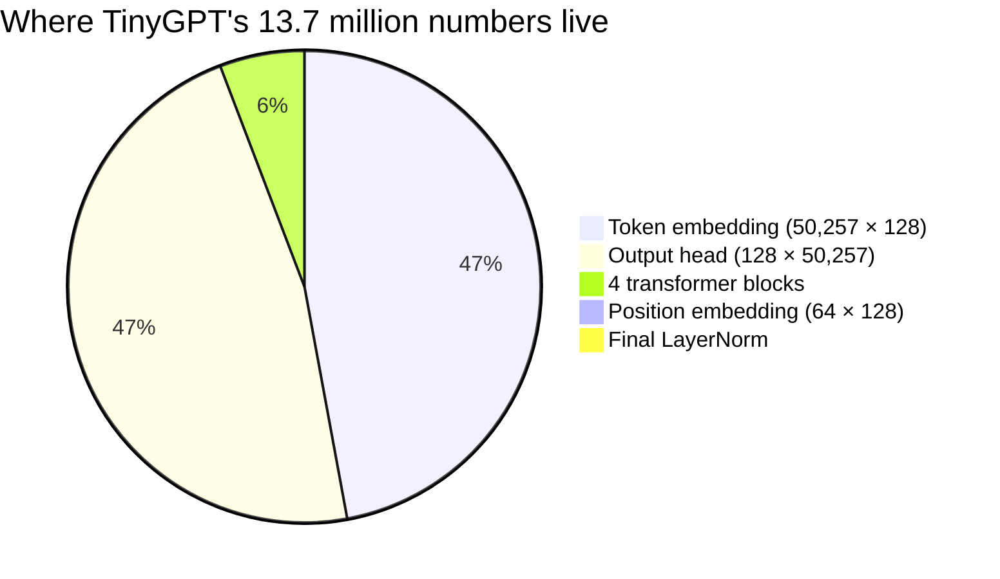

Because our vocabulary is huge (50,257) and our model is narrow (128), **94% of the numbers are in the two vocabulary tables**.

---

## ▶️ Try it

```bash
./run.sh 4
```

**Experiments** (in `Step04_Embeddings`)
1. Look up the same ID twice: `new int[]{2, 2}`. Are the two rows identical? (Yes: same ID, same row.)
2. Change `outputDim` from 256 to 8. Which shapes change?
3. Run it twice. Do the random numbers change? (No: the random seed 123 makes them repeatable.)

## 🧠 Remember

- A token ID is just a name tag; an **embedding** is a list of numbers that carries meaning.
- An embedding layer is a **lookup table**: ID → row. The rows **start random and are learned**.
- **Token embedding** = *what*; **position embedding** = *where*. They're **added** together.
- `embeddingDim` is the width of the entire model; the output head turns vectors back into token scores.

## 📖 In the book

| Section | Topic | Our code |
|---|---|---|
| 2.1 | What embeddings are, Word2Vec, 2-D picture | 💡 The idea |
| 2.7 | `torch.nn.Embedding(6, 3)`, lookup of `[2, 3, 5, 1]` | `Embedding`, `Step04_Embeddings` part 1 |
| 2.8 | Absolute position embeddings, shapes `(8, 4, 256)` | `GPTModel.forward()`, `Step04_Embeddings` part 2 |
| 4.6 | Weight tying in GPT-2 | 🔗 The output head is the embedding in reverse |
