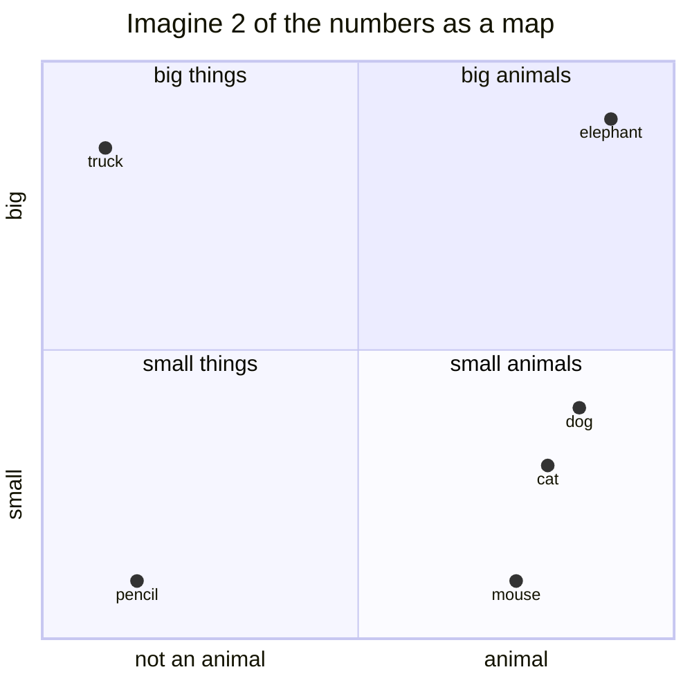
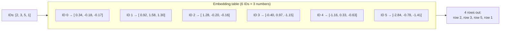
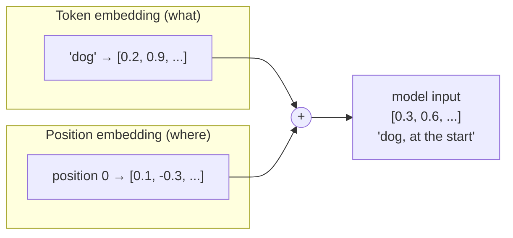
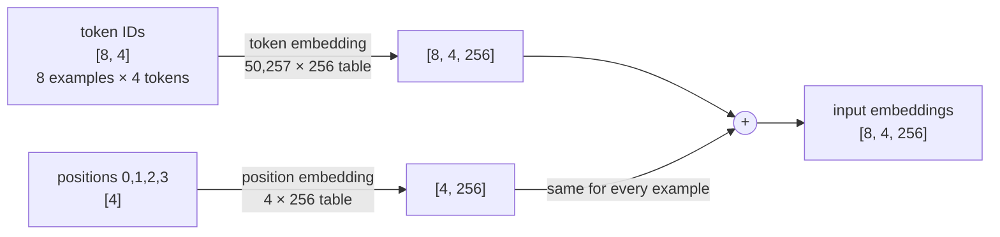

# 3. Embeddings: giving every token a meaning and a place

**Step 4** · Book chapter 2.7–2.8 · Code: [`nn/Embedding.java`](../src/main/java/com/tinygpt/nn/Embedding.java)

← [Training data](02-training-data.md) · Next: [Attention →](04-attention.md)

---

## Why aren't token IDs enough?

The ID `3290` ("cat") isn't "close" to `3290 + 1` in any meaningful way. IDs are just labels, like phone numbers.
The model needs something richer: a **list of numbers (a vector)** for each token, where similar words get similar lists.



Real models use hundreds of numbers per token (TinyGPT: 128, GPT-2: 768), so the "map" has hundreds of directions.
**Nobody decides these numbers by hand.** They start random, and training slowly moves similar words closer together.

---

## Token embedding: a lookup table

An embedding layer is just a table with **one row per token ID**. Looking up an ID returns its row.



## Position embedding: where is the word?

"dog bites man" and "man bites dog" contain the same tokens. Only the **order** changes the meaning.
Attention (next chapter) doesn't know about order by itself, so we add a second table with **one row per position**.



## The shapes



---

## In the code

```java
// GPTModel.forward()
NDArray positions = tokenIds.getManager().arange(tokens);           // 0, 1, 2, ...
NDArray x = tokenEmbedding.forward(tokenIds)                          // what
              .add(positionEmbedding.forward(positions));             // + where
```

`Embedding.forward` is a single line: `weight.get(ids)`, i.e. pick those rows.

## Try it

```bash
./run.sh 4
```
