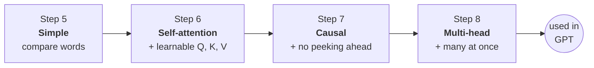
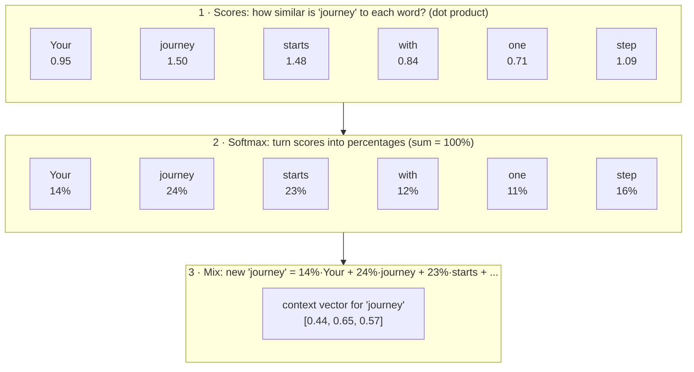
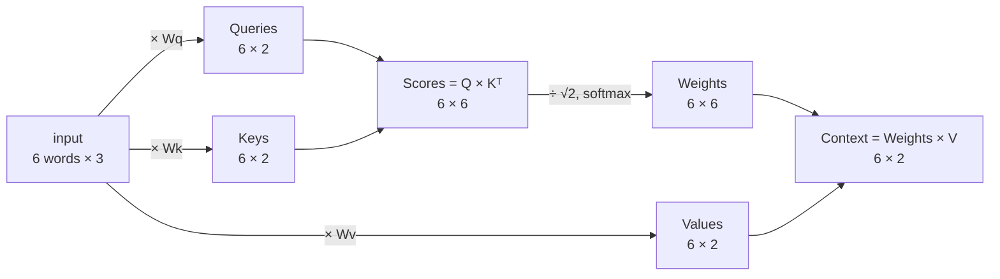
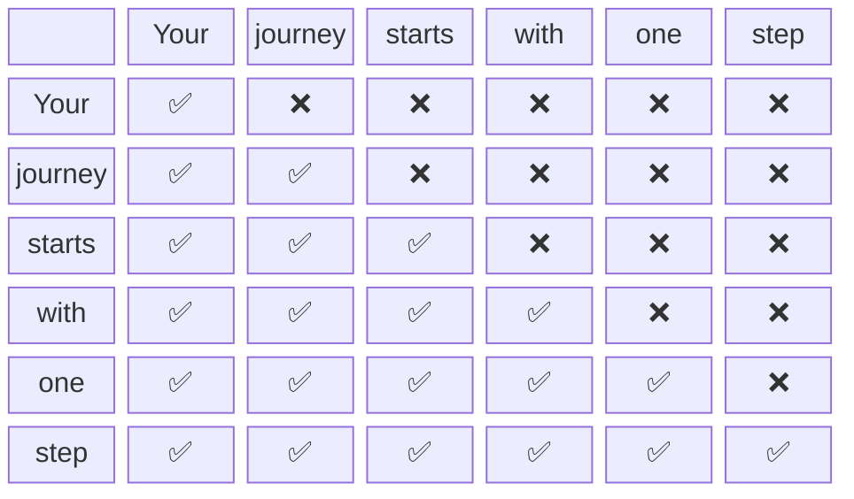
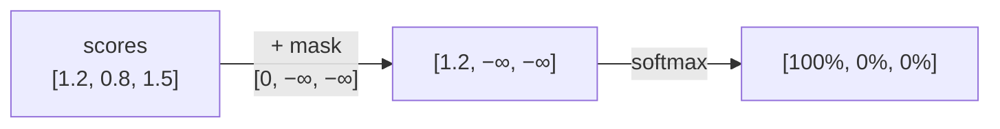
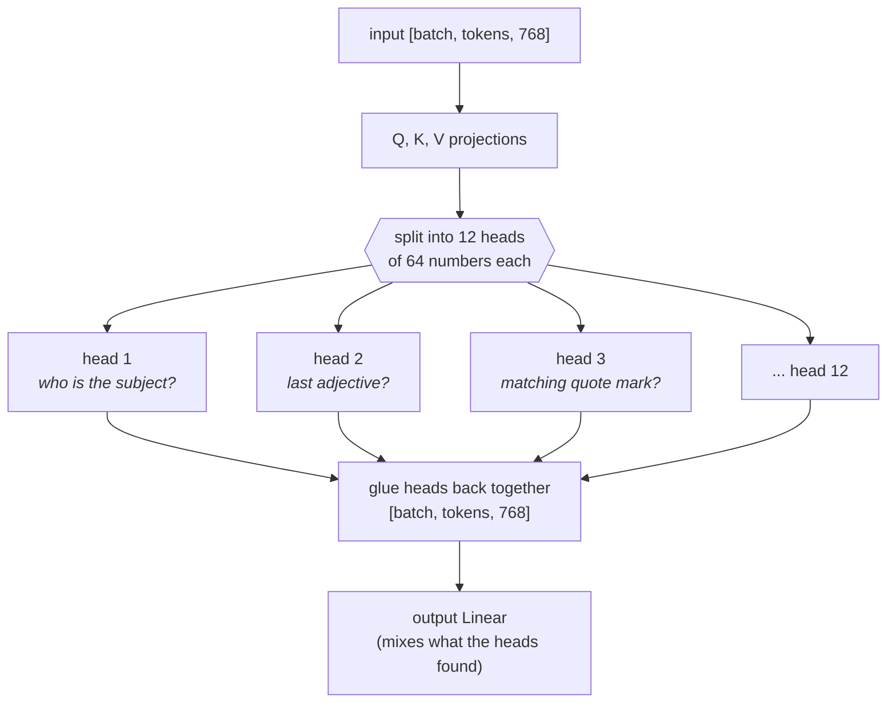

# 4. Attention: words looking at other words

**Steps 5–8** · Book chapter 3 · Code: [`attention/`](../src/main/java/com/tinygpt/attention)

← [Embeddings](03-embeddings.md) · Next: [The GPT model →](05-gpt-model.md)

---

## Why?

Take *"The **bank** of the river"* and *"I put money in the **bank**"*. Same word, different meaning.
To understand a word, you have to look at the words around it.
**Attention** lets every word look at the other words and collect what it needs from them.

We build it in four small steps, each adding one idea:



---

## Step 5: simple attention (no learning)

The example sentence: **"Your journey starts with one step"**, each word with 3 numbers.



**Dot product**: multiply matching numbers and add them up. Similar lists give a big result.
**Softmax**: makes every number positive and makes them add up to 1, so they become percentages.

> Like reading a sentence with a highlighter: for each word, you highlight the other words that help explain it.

Doing it for all 6 words at once is just matrix multiplication: `weights = softmax(X × Xᵀ)`, `context = weights × X`.

---

## Step 6: self-attention with Query, Key, Value

In step 5, "similar" was fixed. Now we let the model **learn** what to look for, using three learnable weight matrices.

> **The library analogy**
> - **Query (Q)**: the question you bring: *"I'm looking for books about space."*
> - **Key (K)**: the label on each book's spine: *"Astronomy", "Cooking", ...*
> - **Value (V)**: what's inside the book, the thing you actually take home.
>
> Compare your question with every label (Q · K) → decide how much to read from each book → take that much of each content (V).



**Why divide by √(dimension)?** With many numbers, dot products get big, and softmax then puts nearly 100% on one word.
Dividing keeps the scores calm, so the model can still spread its attention while learning.

Step 6 uses the book's exact weights, so you get the book's output: `[[0.2996, 0.8053], [0.3061, 0.8210], ...]`.

---

## Step 7: causal attention (no peeking!)

When the model learns to guess the next word, it must not see that word, or it would just copy the answer.
So each word may only look at itself and the words **before** it.



**The trick:** before softmax, set every ❌ score to **−∞** (minus infinity). Softmax turns `e^(−∞)` into exactly **0%**,
and the remaining percentages still add up to 100%.



### Dropout

During training we also randomly hide some attention weights (**dropout**), so the model can't depend too much on any one connection.

> Like a football team practising with random players sitting out: everyone has to learn to play well.

```
Dropout(0.5) on all ones:     [0, 2, 0, 2, 0, 2]   ← half set to 0, the rest doubled to keep the total similar
```

Dropout is switched **off** when we use the model to write text.

---

## Step 8: multi-head attention

One attention can only look for one kind of thing at a time. **Multi-head attention** runs several in parallel,
and each "head" can learn to notice something different.



We don't really build 12 separate modules. We do one big Q/K/V, **reshape** it into heads, run causal attention in all heads at the same time,
then reshape back:

```
[batch, tokens, 768] → reshape → [batch, tokens, 12, 64] → transpose → [batch, 12, tokens, 64]
                                  … attention in every head …
[batch, 12, tokens, 64] → transpose → [batch, tokens, 12, 64] → reshape → [batch, tokens, 768]
```

(The heads' jobs above are just examples. In practice we don't choose them; they come out of training.)

---

## In the code

| Step | Class | Main idea |
|---|---|---|
| 5 | [`SimpleAttention`](../src/main/java/com/tinygpt/attention/SimpleAttention.java) | `softmax(X·Xᵀ)·X` |
| 6 | [`SelfAttention`](../src/main/java/com/tinygpt/attention/SelfAttention.java) | Q, K, V and `÷√d` |
| 7 | [`CausalAttention`](../src/main/java/com/tinygpt/attention/CausalAttention.java) | `causalMask()` + dropout |
| 8 | [`MultiHeadAttention`](../src/main/java/com/tinygpt/attention/MultiHeadAttention.java) | `splitHeads()` + output projection |

## Try it

```bash
./run.sh 5
./run.sh 6
./run.sh 7
./run.sh 8
```

**Experiment:** in `Step05_SimpleAttention`, change the numbers for "journey" to match "step" exactly. Which word does "journey" pay most attention to now?
