# 4. Attention: words looking at other words

**Book:** Chapter 3 · **Code:** [`attention/`](../src/main/java/com/tinygpt/attention) · **Run:** `./run.sh 5` to `./run.sh 8` · **Class pictures:** [attention classes](classes/4-attention.md)

← [3. Embeddings](03-embeddings.md) · Next: [5. The GPT model →](05-gpt-model.md)

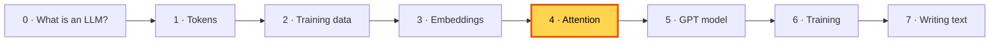

---

## 🤔 The problem: a word alone isn't enough

After embedding, every token has its own vector, but each one knows **only about itself**.
Yet the meaning of a word depends on its neighbours:

- *"I sat on the river **bank**"* 🏞️ vs *"I put money in the **bank**"* 🏦
- *"The animal didn't cross the street because **it** was tired"*: what is "it"?

The book's example is translation (book figure 3.3). Translating German word by word gives nonsense, because words need information from **other** words, sometimes far away:

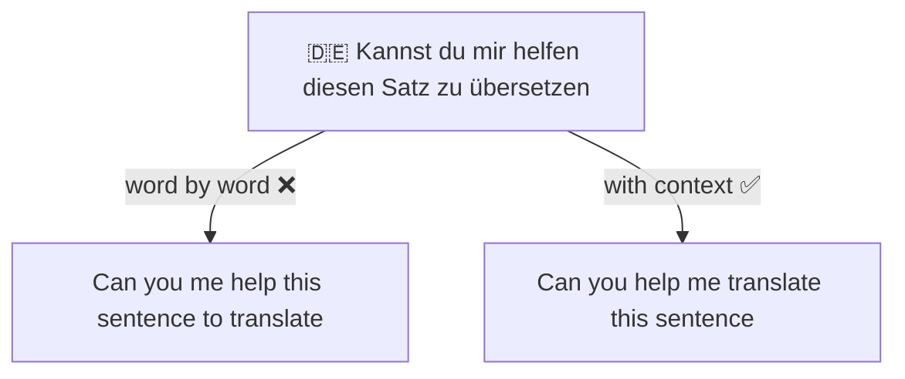

### How older models tried (and struggled)

Before transformers, *recurrent networks* (RNNs) read the sentence one word at a time and squeezed **everything** into a single memory.
For long sentences, the start gets forgotten: like trying to remember a whole page and then answering questions without looking back.

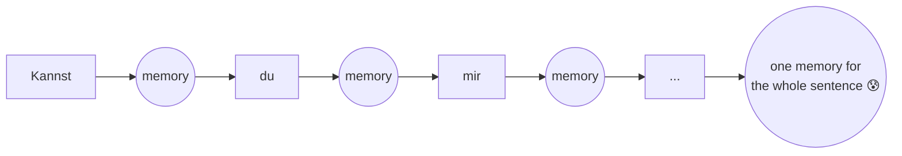

## 💡 The idea: let every word look back at every word

**Attention** lets each word look directly at all the (earlier) words and decide **how much each one matters right now**.
Nothing has to be squeezed into one memory; the model can always "look back at the page".

> 🖍️ It's like reading with a highlighter: for each word, you highlight the other words that help explain it.

We build attention in **four small steps**, exactly like the book:

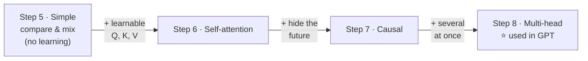

---

## 🔍 Step 5 · Simple attention, no learning (book 3.3)

The book's sentence: **"Your journey starts with one step"**, each word with 3 numbers:

| Word | Numbers |
|---|---|
| Your | `[0.43, 0.15, 0.89]` |
| **journey** | `[0.55, 0.87, 0.66]` |
| starts | `[0.57, 0.85, 0.64]` |
| with | `[0.22, 0.58, 0.33]` |
| one | `[0.77, 0.25, 0.10]` |
| step | `[0.05, 0.80, 0.55]` |

Let's work out the new vector for **"journey"** in three moves.

### Move 1: how much does "journey" match each word? (dot product)

A **dot product** = multiply matching numbers, then add them up. Lists that point the same way give a big number.

```
journey · starts = 0.55×0.57 + 0.87×0.85 + 0.66×0.64
                 = 0.31     + 0.74     + 0.42      = 1.48
```

### Move 2: turn the scores into percentages (softmax)

**Softmax** makes every score positive and makes them add up to 100%. Bigger scores get a bigger slice of the pie.

### Move 3: mix

The new "journey" = each word's vector × its percentage, all added up.

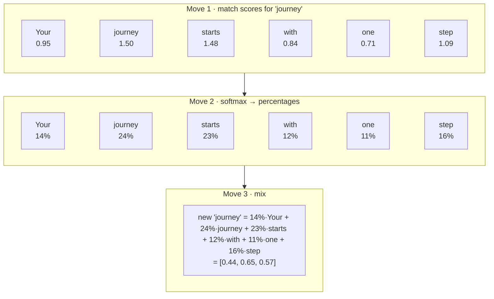

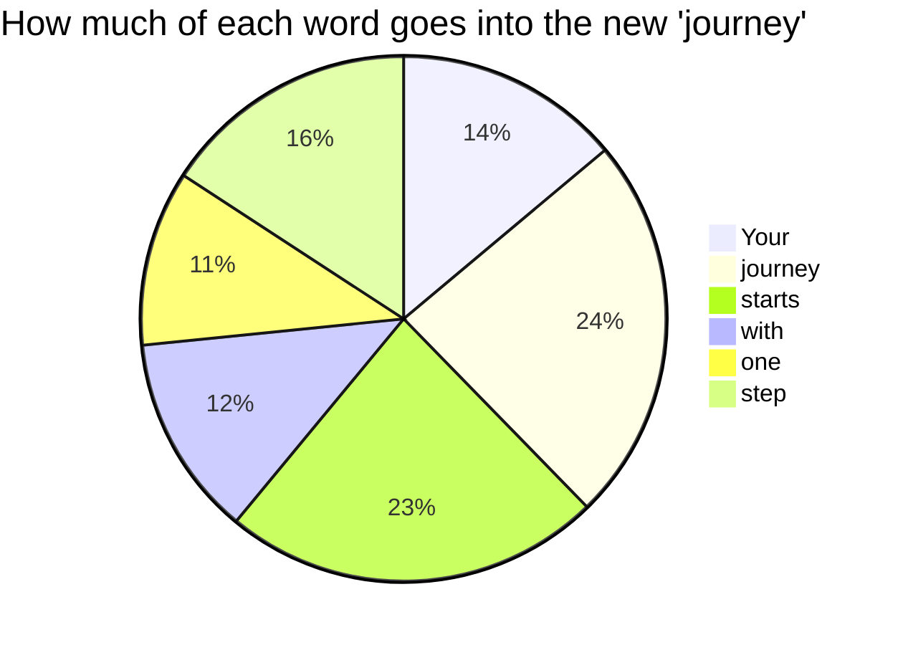

The result is called a **context vector**: "journey" mixed with a bit of its context.

### All six words at once

Doing this word by word needs loops. Grids of numbers (matrices) do it all at once (book 3.3.2):

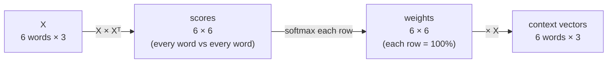

**What's missing?** The model can't learn anything here: "similar" just means "the numbers look alike". Step 6 fixes that.

---

## 🔍 Step 6 · Self-attention with Query, Key and Value (book 3.4)

### The library idea

Each word makes **three versions** of itself, each by multiplying with its own learnable weight grid:

> 📚 **Query (Q)** 🔍: the question you bring to the library: *"I need books about animals."*
> **Key (K)** 🏷️: the label on each book's spine: *"Animals", "Cooking", "Space"...*
> **Value (V)** 📖: what's actually inside each book.
>
> Compare your **question** with every **label** → decide how much to read from each book → take that much of each book's **content**.

**Why three different versions?** What a word *is looking for* is different from what it *offers*, and from what it *hands over*.
For "it" in "the animal ... it was tired": its Query asks "who am I?", and "animal"'s Key says "I'm a noun, a thing that can be tired".

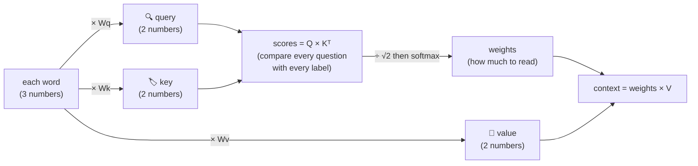

### Why divide by √(size)? (the "scaled" part)

With many numbers per word, the scores get big. Then softmax gives almost 100% to one word and ~0% to the rest, and learning gets stuck.
Dividing by the square root of the size keeps the scores calm.

```
scores [1, 0] → softmax → 73% / 27%     (calm: both words still get attention)
scores [8, 0] → softmax → 99.97% / 0.03% (too extreme: like one word shouting)
```

### Real result (book's exact weights)

`./run.sh 6` uses the same `Wq`, `Wk`, `Wv` numbers as the book, so you get the book's output:

```
Context vectors (book: [[0.2996, 0.8053], [0.3061, 0.8210], ...]):
[[0.2996, 0.8053],
 [0.3061, 0.821 ],
 [0.3058, 0.8203], ...
```

**What's new:** `Wq`, `Wk`, `Wv` are **learned**, so training decides what counts as a good match. Each is just a `Linear` layer.

---

## 🔍 Step 7 · Causal attention: no peeking! (book 3.5)

### The problem: cheating

GPT learns by guessing the next word. If each word could look at the words **after** it, it would just copy the answer:

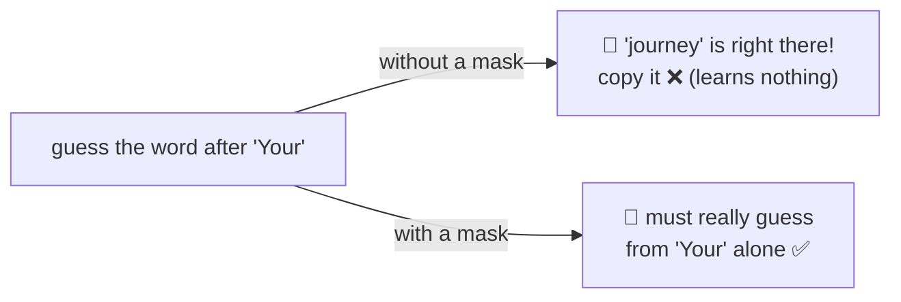

### The fix: a mask that hides the future

Each word may only look at **itself and the words before it**:

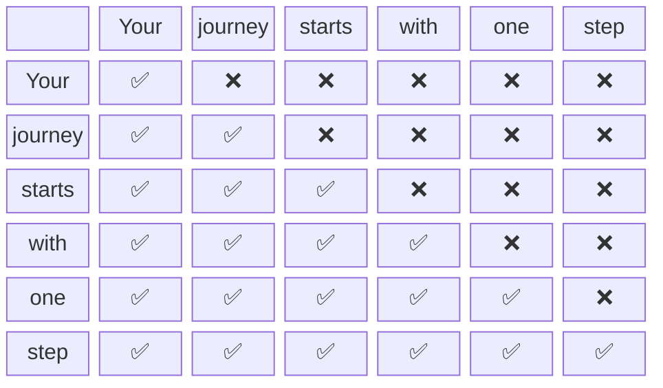

**The trick (book 3.5.1):** before softmax, set each ❌ score to **minus infinity** (−∞).
Softmax turns −∞ into exactly **0%**, and the ✅ percentages still add up to 100%.

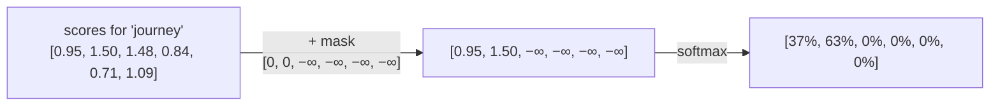

Real weights from `./run.sh 7`: everything above the diagonal is 0, and every row adds up to 1:

```
[[1.    , 0.    , 0.    , 0.    , 0.    , 0.    ],
 [0.368 , 0.632 , 0.    , 0.    , 0.    , 0.    ],
 [0.2284, 0.3893, 0.3822, 0.    , 0.    , 0.    ],
 ...
```

### ⭐ The mask is what makes training efficient

Remember from [2. Training data](02-training-data.md) that one window of 64 tokens holds **64 quizzes**. The mask makes this possible:
position 10 can only see positions 0–10, so it can be asked to guess token 11 **at the same time** as every other position guesses its own next token.
No cheating, and **64 quizzes in one pass**.

### Plus dropout (book 3.5.2)

While training, we also randomly switch off some attention weights, so the model doesn't rely too much on any single connection:

```
Dropout(0.5) on a grid of ones:   [0, 2, 0, 2, 0, 2]   ← about half → 0, the rest × 2
```

> ⚽ Like football practice where random players sit out. Everyone has to learn to play well.

Dropout is switched **off** when the model writes text.

---

## 🔍 Step 8 · Multi-head attention (book 3.6)

### The idea: several detectives at once

One attention can focus on one kind of relationship at a time. **Multi-head attention** runs several side by side, so each **head** can learn to look for something different.

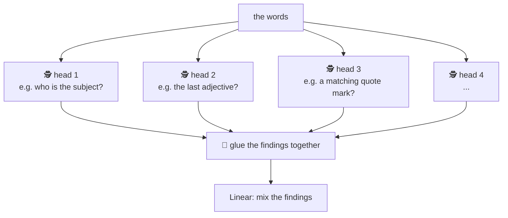

*(The jobs above are just examples. Nobody assigns them; each head finds its own job during training.)*

### Two ways to build it (book 3.6.1 vs 3.6.2)

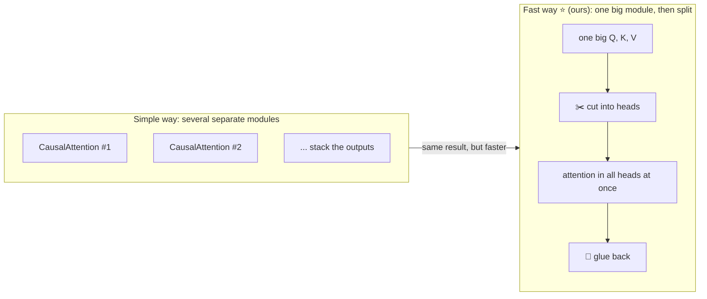

Splitting a word's numbers between heads:

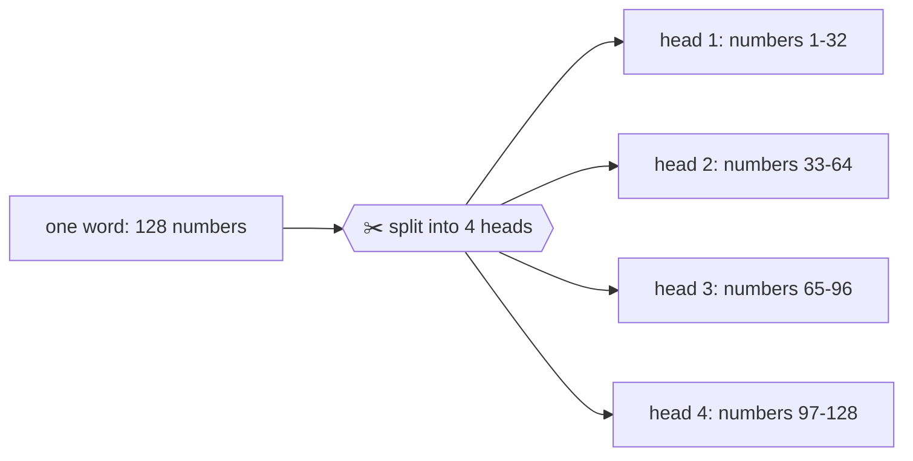

| | TinyGPT | GPT-2 small |
|---|---:|---:|
| numbers per word | 128 | 768 |
| heads | 4 | 12 |
| numbers per head | 32 | 64 |
| learnable numbers per attention | 65,664 | 2,360,064 |

---

## 🏭 Watch the data move through `MultiHeadAttention.forward()`

With TinyGPT sizes, during training (8 windows of 64 tokens):

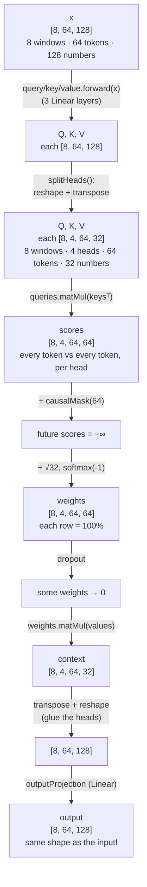

**Same shape in and out**: attention doesn't change *how many* numbers each token has, only *what they mean*: now every token carries information from the tokens before it.

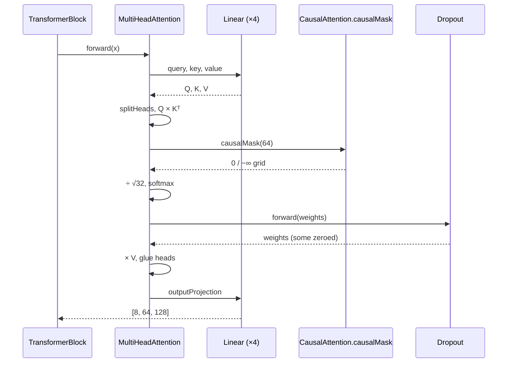

---

## 🔗 How attention connects to everything else

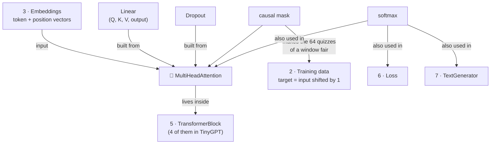

- **Softmax** ("scores → percentages") shows up three times in the project: here, in the loss, and when choosing the next word.
- The **causal mask** is the partner of the **sliding window**: together they let one window teach 64 quizzes at once.
- In TinyGPT there are **4 multi-head attentions** (one per block), each with its own learned weights.

---

## ▶️ Try it

```bash
./run.sh 5    # simple attention: match, percentages, mix
./run.sh 6    # Query, Key, Value with the book's weights
./run.sh 7    # the mask and dropout
./run.sh 8    # multi-head
```

**Experiments**
1. In `Step05_SimpleAttention`, make "journey" exactly the same as "step". Which word does it attend to most now?
2. In `Step07_CausalAttention`, change `Dropout(0.5f)` to `Dropout(0.1f)`. How many zeros now?
3. In `Step08_MultiHeadAttention`, try 768 numbers with 10 heads. Why does it fail? (768 ÷ 10 isn't a whole number.)

## 🧠 Remember

- Attention lets each word **mix in information from other words**, weighted by how relevant they are.
- **match (dot product) → percentages (softmax) → mix (weighted sum)**.
- **Q/K/V** = question / label / content, all learned. Divide by √size to keep scores calm.
- **Causal mask** = no peeking at future words (set to −∞ → 0%).
- **Multi-head** = several attentions side by side, glued together.

## 📖 In the book

| Section | Topic | Our code |
|---|---|---|
| 3.1–3.2 | Why attention, RNN memory problem | 🤔 The problem |
| 3.3.1–3.3.2 | Simple attention, "journey" example | `SimpleAttention`, `./run.sh 5` |
| 3.4.1–3.4.2 | Trainable Wq, Wk, Wv, scaled dot-product | `SelfAttention`, `./run.sh 6` |
| 3.5.1 | Causal mask with −∞ | `CausalAttention.causalMask()`, `./run.sh 7` |
| 3.5.2 | Dropout on attention weights | `Dropout` |
| 3.5.3 | Compact causal attention class, batches | `CausalAttention` |
| 3.6.1–3.6.2 | Multi-head by stacking, then by weight splits | `MultiHeadAttention`, `./run.sh 8` |
