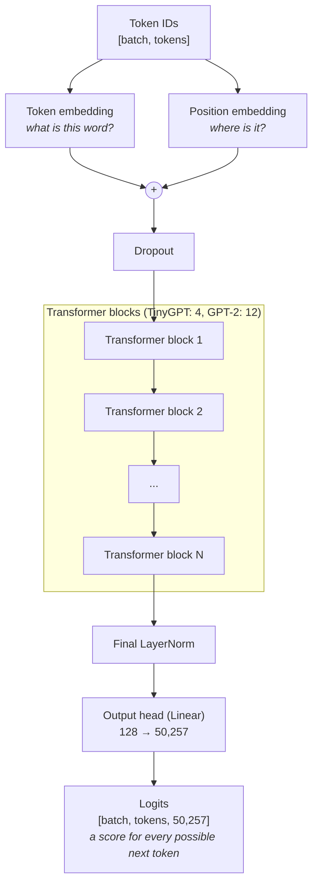
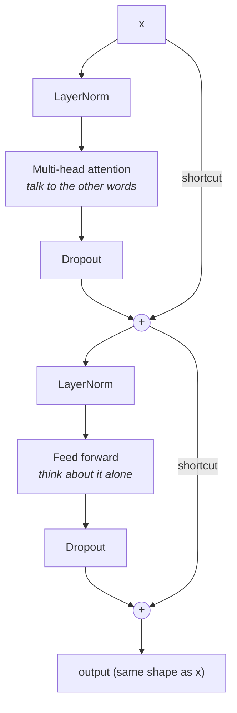
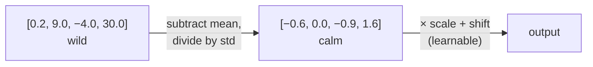
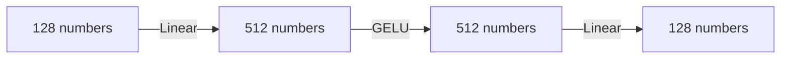
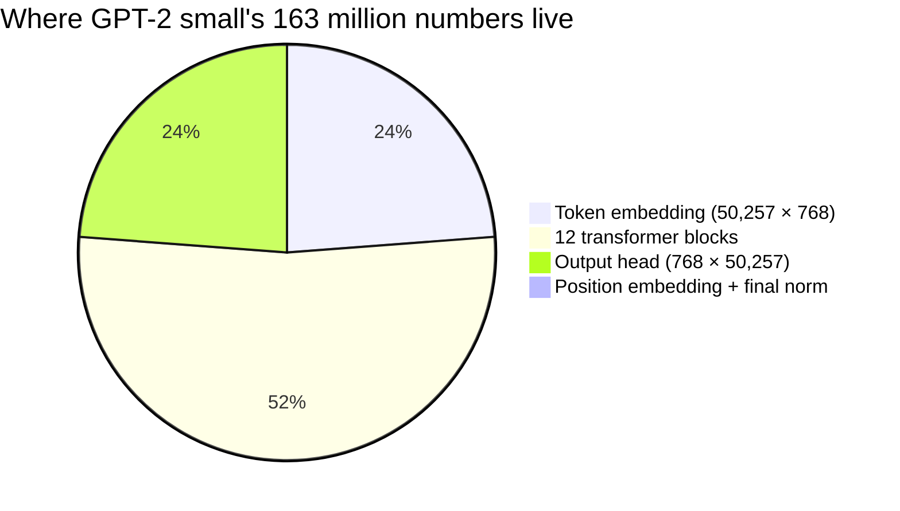

# 5. The GPT model: putting the pieces together

**Step 9** · Book chapter 4 · Code: [`model/`](../src/main/java/com/tinygpt/model) and [`nn/`](../src/main/java/com/tinygpt/nn)

← [Attention](04-attention.md) · Next: [Training →](06-training.md)

---

## The whole model on one page



The output has one score per vocabulary token, **at every position**. Position 3's scores are the model's guess for token 4.
When writing text we only need the **last** position.

---

## Inside one transformer block

The block is the "brain cell" of GPT. GPT stacks many identical blocks on top of each other.



Two halves:
1. **Attention**: every word gathers information from earlier words (a group discussion).
2. **Feed forward**: every word thinks about what it just heard, on its own (quiet thinking time).

Below are the four new pieces that make this work.

---

### 🎚️ Layer normalization: keep the volume steady

After many layers, numbers can drift very big or very small, and training then becomes unstable.
LayerNorm rescales each word's list of numbers to **average 0, spread 1**.



> Like a sound engineer who keeps every instrument at a comfortable volume.

### 〰️ GELU: the smooth bend

If every layer only multiplied and added, 100 layers would be no smarter than 1 (a straight line stays a straight line).
GELU puts a **bend** in: positive numbers pass through, negative ones are mostly blocked, and the curve is smooth so learning works well.

```mermaid
xychart-beta
    title "GELU(x)"
    x-axis "x" ["-3", "-2.5", "-2", "-1.5", "-1", "-0.5", "0", "0.5", "1", "1.5", "2", "2.5", "3"]
    y-axis "output" -0.5 --> 3
    line [-0.004, -0.015, -0.045, -0.100, -0.159, -0.154, 0, 0.346, 0.841, 1.400, 1.955, 2.485, 2.996]
```

### 🧠 Feed forward: think it over

A tiny two-layer network that each word goes through by itself. It first **expands** to 4× more numbers (room to think), then **shrinks** back.



### ↪️ Shortcut connections: keep the original

Each half of the block **adds its input back** to its output (`x + attention(x)`).

> Like editing an essay: you keep the original text and write corrections in the margin, instead of rewriting from scratch every time.

Without shortcuts, the training signal fades as it travels back through many layers (the "vanishing gradient" problem), and deep models barely learn.

---

## How big is it?



Almost half of the numbers are in the two big tables that link to the 50,257-token vocabulary.
OpenAI's GPT-2 **shares** one table between the embedding and the output head, which is why it's called "124M" instead of 163M.

| Setting | TinyGPT | GPT-2 small |
|---|---:|---:|
| `embeddingDim` | 128 | 768 |
| `numberOfHeads` | 4 | 12 |
| `numberOfLayers` | 4 | 12 |
| `contextLength` | 64 | 1,024 |
| Learnable numbers | 13,665,792 | 163,009,536 |

---

## Before training, it writes nonsense

Every number starts random, so step 9's GPT-2 writes:

```
Hello, I amás503 work hol riddledtaker
```

That's expected! Next we teach it.

## In the code

| Piece | File |
|---|---|
| All size settings | [`GPTConfig.java`](../src/main/java/com/tinygpt/model/GPTConfig.java) |
| Transformer block | [`TransformerBlock.java`](../src/main/java/com/tinygpt/model/TransformerBlock.java) |
| Full model, save/load | [`GPTModel.java`](../src/main/java/com/tinygpt/model/GPTModel.java) |
| LayerNorm, GELU, FeedForward, Linear, Dropout | [`nn/`](../src/main/java/com/tinygpt/nn) |
| How parameters are collected | [`Module.java`](../src/main/java/com/tinygpt/nn/Module.java) |

## Try it

```bash
./run.sh 9     # builds the full GPT-2 size (needs ~1 GB of memory)
```
