# 5. The GPT model: putting all the pieces together

**Book:** Chapter 4 · **Code:** [`model/`](../src/main/java/com/tinygpt/model), [`nn/`](../src/main/java/com/tinygpt/nn) · **Run:** `./run.sh 9` · **Class pictures:** [model](classes/5-model.md), [nn](classes/3-nn.md)

← [4. Attention](04-attention.md) · Next: [6. Training →](06-training.md)

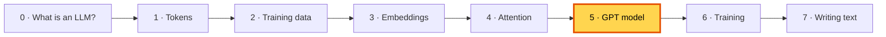

---

## 🤔 The problem

We have the parts: tokens, embeddings and attention. But one attention layer on its own isn't very smart, and if we simply stack lots of layers, training **breaks down**: numbers grow wild and the learning signal fades away.

This chapter adds the "glue" that makes a **deep** stack work, then assembles the full GPT.

## 💡 The idea: a tall building of identical floors

> 🏢 GPT is a building. The ground floor (embeddings) turns words into numbers.
> Then come identical **floors** (transformer blocks), where words discuss and think.
> The roof (output head) announces a score for every possible next word.

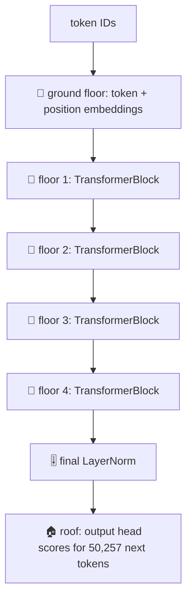

The book starts with an empty skeleton of this building (*DummyGPTModel*, book 4.1), then builds each missing part. We'll do the same.

---

## 🧱 The four new pieces

### 1 · LayerNorm: keep the numbers at a steady size (book 4.2)

**Problem:** after many layers, some numbers become huge and others tiny. Training then becomes unstable, like a car that's either flooring the gas or slamming the brakes.

**Fix:** after each step, rescale every token's numbers so their **average is 0** and their **spread is 1**.

> 🎚️ A sound engineer keeps every singer at a comfortable volume. The *tune* stays the same; only the loudness is fixed.

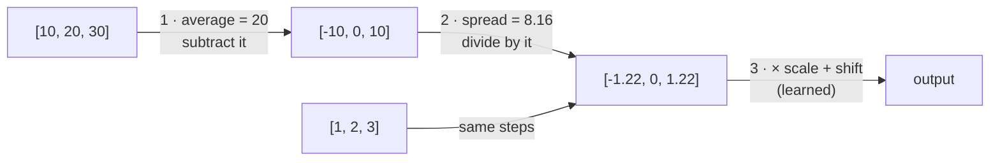

Both a "loud" `[10, 20, 30]` and a "quiet" `[1, 2, 3]` become `[-1.22, 0, 1.22]`.
The learnable `scale` and `shift` let the model choose a different volume if that helps.

### 2 · GELU: the smooth bend (book 4.3)

**Problem:** layers that only multiply and add can only learn straight-line patterns. Stacking 100 of them is still one straight line.

**Fix:** put a **bend** after the expanding layer. GELU lets positive numbers through and squashes negative ones, smoothly.
(The older ReLU makes a sharp corner at 0. GELU's smooth curve makes learning easier.)

```mermaid
xychart-beta
    title "GELU: input → output"
    x-axis "input" ["-3", "-2", "-1", "0", "1", "2", "3"]
    y-axis "output" -0.5 --> 3
    line [-0.004, -0.045, -0.159, 0, 0.841, 1.955, 2.996]
```

### 3 · FeedForward: each word's thinking time (book 4.3)

A small 2-layer network. Every token goes through it **on its own**: expand to 4× the size, bend, shrink back.

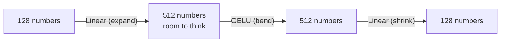

> 💭 Attention = a group discussion. FeedForward = quiet time to think over what you heard.

### 4 · Shortcut connections: keep the original (book 4.4)

**Problem: the vanishing signal.** During training, a "how should I change?" signal (the *gradient*) travels **backwards** from the top floor to the bottom.
Each floor it passes can shrink it, so the bottom floors hear almost nothing and barely learn.

> 📞 Like a game of telephone: by the time the message reaches the 20th person, it has faded to a whisper.

**Fix:** let each floor **add its result to its input**, instead of replacing it: `output = x + layer(x)`.
The signal then has a direct "express lane" around every floor.

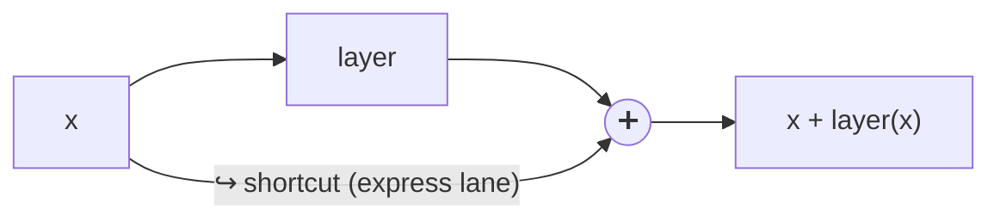

The book measured this on a 5-layer network: the strength of the learning signal reaching each layer.

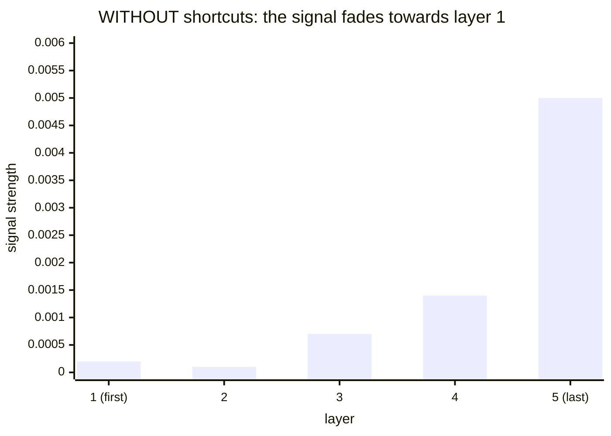

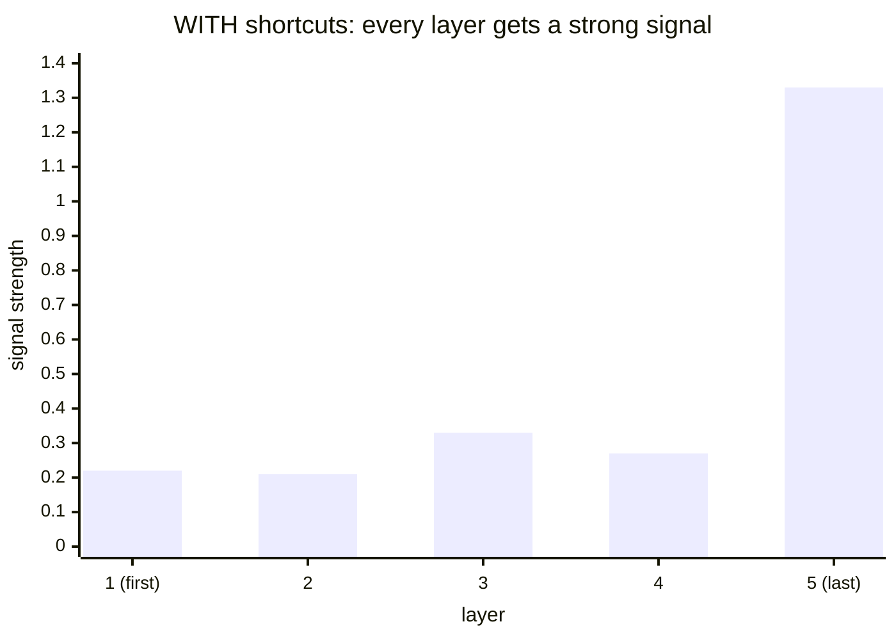

The first layer's signal is **about 1,000 times stronger** with shortcuts (0.22 vs 0.0002).

> 📝 Like editing an essay: keep the original text and write corrections in the margin, instead of rewriting it from scratch each time.

---

## 🧱 One floor: the TransformerBlock (book 4.5)

Now combine everything into one floor:

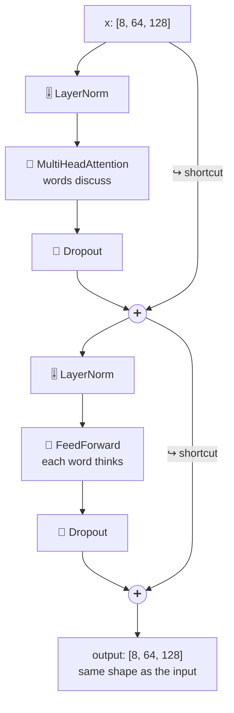

```java
// TransformerBlock.forward(): the whole floor in two lines
x = x.add(dropShortcut.forward(attention.forward(norm1.forward(x))));     // discuss
x = x.add(dropShortcut.forward(feedForward.forward(norm2.forward(x))));   // think
```

**Same shape in and out.** That's what lets us stack as many floors as we like.

A tiny example of the ➕ shortcut for one token:

```
before the floor:        [1.0,  2.0]
the floor's suggestion:  [0.1, -0.2]
after the floor:         [1.1,  1.8]   ← a small correction, nothing thrown away
```

---

## 🏢 The whole building: GPTModel (book 4.6)

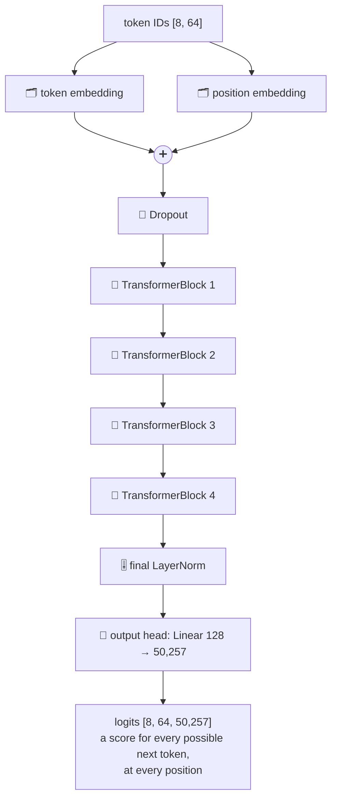

### What are "logits"?

For each position, the model outputs **one score per token in the vocabulary** (50,257 scores). Higher = "more likely to come next".
They're raw scores, not percentages yet (softmax turns them into percentages later).

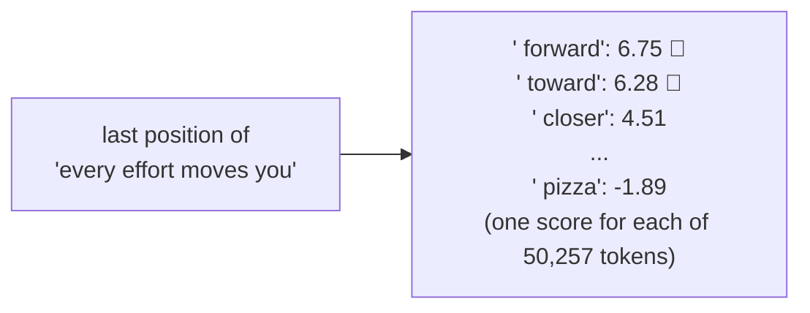

*(These are the book's example scores from chapter 5.3. We use the same ones in [7. Writing text](07-generating-text.md).)*

### How big is it? (book 4.6)

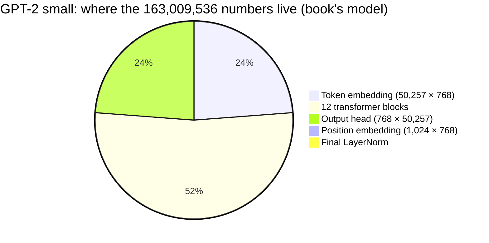

| | TinyGPT (`TINY`) | GPT-2 small (`GPT2_SMALL`) |
|---|---:|---:|
| floors (blocks) | 4 | 12 |
| heads per attention | 4 | 12 |
| numbers per token | 128 | 768 |
| longest input | 64 tokens | 1,024 tokens |
| learnable numbers | **13,665,792** | **163,009,536** |
| file size when saved | 55 MB | 652 MB |

OpenAI calls GPT-2 small "124M" because it **reuses** the token embedding table as the output head (weight tying): 163.0M − 38.6M ≈ 124.4M.

### Before training it writes nonsense (book 4.7)

All the numbers start random, so `./run.sh 9` gives:

```
Hello, I amás503 work hol riddledtaker
```

(The book got `Hello, I am Featureiman Byeswickattribute argue`. Different random numbers, same kind of nonsense.) Training comes next.

---

## 🏭 Watch the data move through `GPTModel.forward()`

One training batch through TinyGPT, with the shape at every stage:

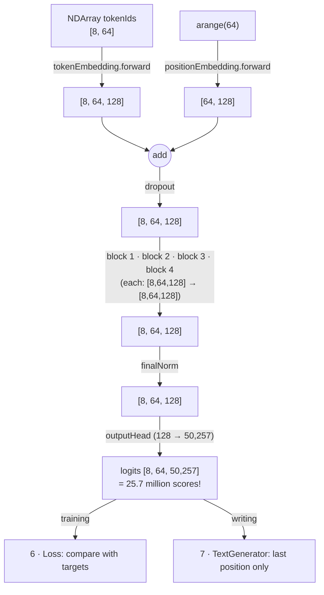

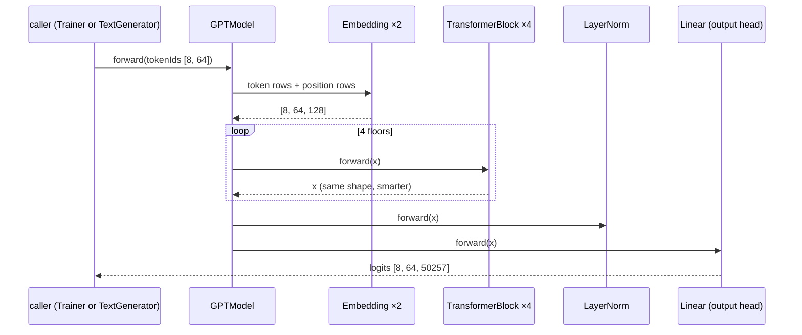

---

## 🔗 Where every building block is used

How many times each brick appears inside TinyGPT:

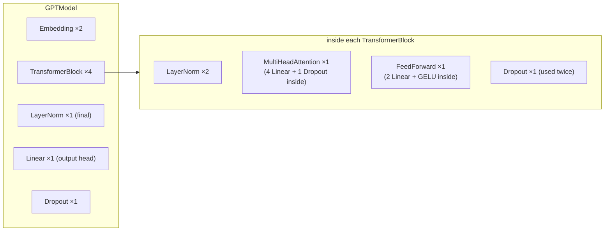

| Brick | Where | Total in TinyGPT |
|---|---|---:|
| `Embedding` | token table, position table | 2 |
| `Linear` | Q, K, V, attention output (×4 per block), FeedForward expand + shrink (×2 per block), output head | 4×6 + 1 = **25** |
| `LayerNorm` | 2 per block + 1 final | 2×4 + 1 = **9** |
| `GELU` | 1 per FeedForward | **4** |
| `Dropout` | after embeddings, attention weights, after each half of a block | 1 + 4×2 = **9** modules |
| `MultiHeadAttention` | 1 per block | **4** |
| `FeedForward` | 1 per block | **4** |

All of them are `Module`s, so `model.parameters()` can collect **every learnable number in the building** for the optimizer.

---

## ▶️ Try it

```bash
./run.sh 9     # builds the full GPT-2 small (needs about 1 GB of memory)
```

**Experiments**
1. In `Step09_GPTModel`, use `GPTConfig.TINY` instead. How many parameters now?
2. Make your own config with 8 layers: `new GPTConfig(50257, 64, 128, 4, 8, 0.1f, false)`. How much does the count grow? (Each block adds 197,888.)
3. In `TransformerBlock.forward`, remove the `x.add(...)` shortcuts and train. What happens to the loss?

## 🧠 Remember

- **LayerNorm** keeps numbers steady; **GELU** adds the bend that makes learning powerful; **FeedForward** is per-token thinking.
- **Shortcuts** (`x + layer(x)`) keep the learning signal strong, so deep models can train.
- A **TransformerBlock** = discuss (attention) + think (feed forward), with a norm and a shortcut around each. Same shape in and out.
- **GPTModel** = embeddings → N blocks → final norm → output head → **logits** (a score per possible next token).

## 📖 In the book

| Section | Topic | Our code |
|---|---|---|
| 4.1 | GPT config, DummyGPTModel skeleton | `GPTConfig` |
| 4.2 | Layer normalization | `LayerNorm` |
| 4.3 | GELU and feed forward | `GELU`, `FeedForward` |
| 4.4 | Shortcut connections, vanishing gradients | `TransformerBlock` (`x.add(...)`) |
| 4.5 | Transformer block | `TransformerBlock` |
| 4.6 | GPT model, 163,009,536 parameters, weight tying | `GPTModel`, `./run.sh 9` |
| 4.7 | Generating text (untrained) | `TextGenerator.generateGreedy`, `./run.sh 9` |
