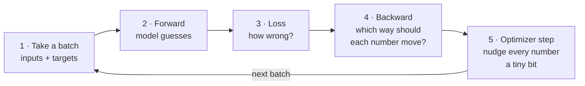
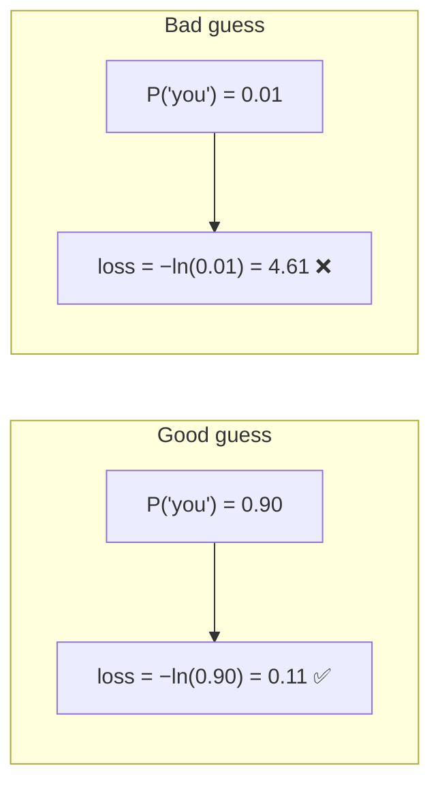
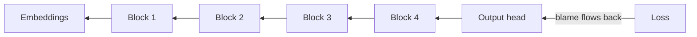
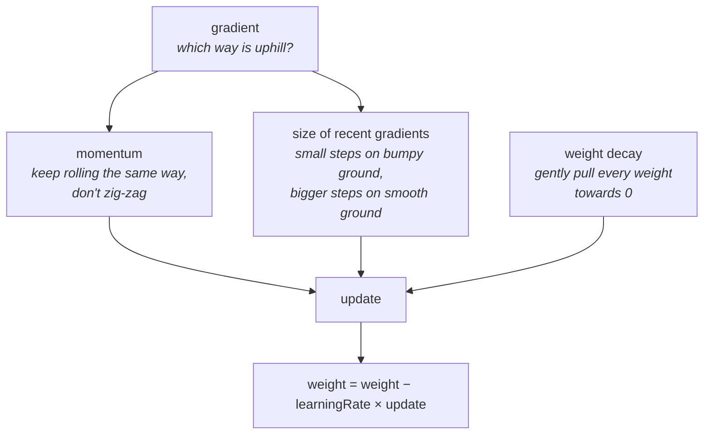
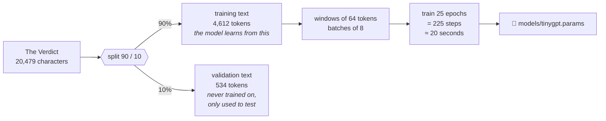
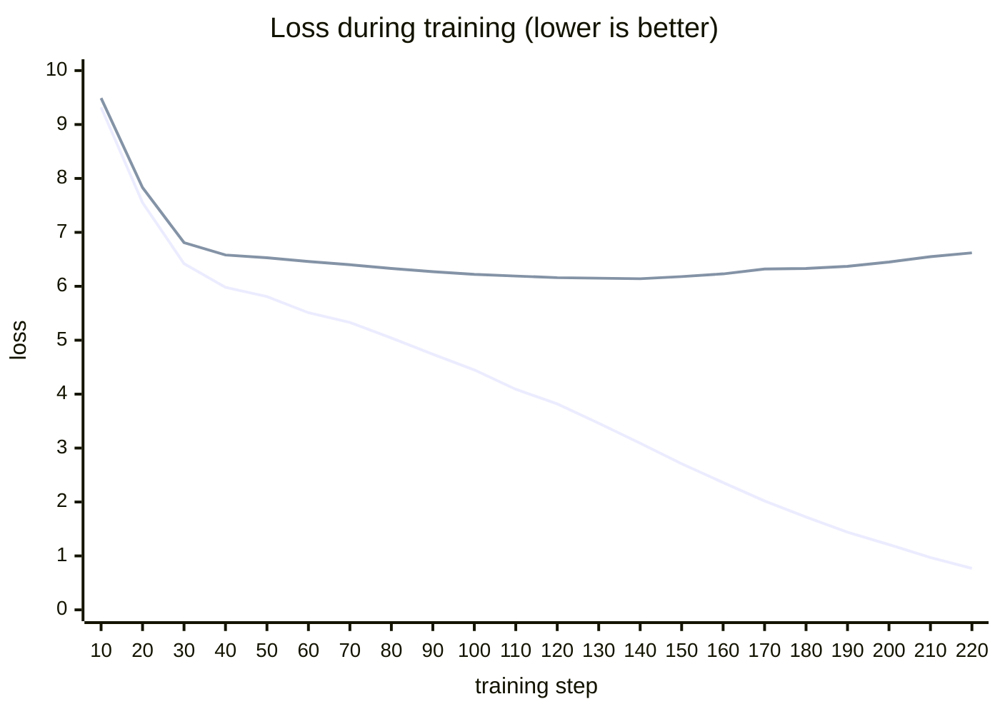

# 6. Training: teaching the model

**Steps 10 and 12** · Book chapter 5.1–5.2, 5.4 · Code: [`training/`](../src/main/java/com/tinygpt/training), [`TinyGPT.java`](../src/main/java/com/tinygpt/TinyGPT.java)

← [The GPT model](05-gpt-model.md) · Next: [Writing text →](07-generating-text.md)

---

## The big idea

Training is a loop of five moves, repeated hundreds of times:



> Like learning to throw darts: throw, see how far you missed, adjust your arm a little, throw again.
> After many throws you hit the middle much more often.

---

## 3 · Loss: one number for "how wrong?"

For every position, look at the probability the model gave the **correct** next token.



This is called **cross-entropy loss**. We average it over every position in the batch.

- **Untrained model**: about **11**. It is basically guessing among all 50,257 tokens (`ln(50257) ≈ 10.8`).
- **Perfect model**: **0**.
- **Perplexity** = `e^loss` ≈ "how many tokens is the model still unsure between". Step 10 shows ~71,000 for a random model.

---

## 4 · Backward: gradients

For **every** one of the 13.7 million numbers, we want to know:
*"If I nudge this number up a tiny bit, does the loss go up or down, and by how much?"*
That answer is the number's **gradient**.



Working this out by hand would be a nightmare. **Autograd** (in PyTorch, which DJL runs for us) does it automatically:
it remembers every calculation in the forward pass and replays them backwards (the chain rule from calculus).
In the code it's one line: `gradients.backward(loss)`.

## 5 · Optimizer: AdamW



> Walking down a foggy hill to reach the valley (lowest loss). You can only feel the slope under your feet (the gradient),
> so you take small steps downhill, keeping your momentum.

The **learning rate** (`0.001` here) controls the step size. Too big and you jump over the valley; too small and you take forever.

---

## Step 12: training TinyGPT for real



**Epoch** = one full pass over the training text.

### What happened (real numbers from `./run.sh train`)



*Lower line: training loss. Upper line: validation loss.*

And what the model wrote along the way:

| After | `Every effort moves you` ... |
|---|---|
| 0 steps | ` Hero farmland tenth harness ATL subsidized Contracts fixes impairment emission` |
| 27 steps (epoch 3) | `,,,,,,,,,,,,,,,,,,,,,,,,,` |
| 54 steps (epoch 6) | `, the, the, the the, the, the.` |
| 108 steps (epoch 12) | ` know the the the that the one of the, and "  "  " of the fact, and I had` |
| 153 steps (epoch 17) | ` know to the Riv of the picture for a smile in a little of the picture.` |
| 225 steps (epoch 25) | ` know; and I had the craft was vindicated by little Claude Nutley, who, in a footstep and my bravura tricks.` |

First it learns the most common tokens (`,` then `the`), then short patterns, then whole phrases from the story.

### ⚠️ Overfitting: memorising instead of learning

Look at the two lines after step 140: **training loss keeps falling, but validation loss starts to rise.**
The model is memorising the story rather than learning English in general.

> Like a student who memorises last year's exam answers: perfect on those exact questions, lost on new ones.

This is expected: 5,000 tokens is a tiny amount of text. Real models train on billions of tokens, so they can't memorise it all.
The book shows the same thing in chapter 5.

---

## In the code

```java
// Trainer.trainStep(): the 5 moves
NDArray inputs  = manager.create(batch.inputs());           // 1. batch
NDArray targets = manager.create(batch.targets());
try (GradientCollector gradients = ...) {
    NDArray logits = model.forward(inputs);                   // 2. forward
    NDArray loss = Loss.crossEntropy(logits, targets);        // 3. loss
    gradients.backward(loss);                                 // 4. backward
}
optimizer.step();                                             // 5. update
optimizer.zeroGradients();                                    //    clear for next time
```

| What | File |
|---|---|
| Cross-entropy loss | [`Loss.java`](../src/main/java/com/tinygpt/training/Loss.java) |
| AdamW optimizer | [`AdamW.java`](../src/main/java/com/tinygpt/training/AdamW.java) |
| Training loop + validation | [`Trainer.java`](../src/main/java/com/tinygpt/training/Trainer.java) |
| Settings (epochs, learning rate, ...) | [`TinyGPT.java`](../src/main/java/com/tinygpt/TinyGPT.java) |

## Try it

```bash
./run.sh 10       # loss of an untrained model
./run.sh train    # train, save, write
```

**Experiments** (edit the constants at the top of `TinyGPT.java`):
- `EPOCHS = 10`: less memorising, more nonsense.
- `LEARNING_RATE = 1e-2f`: too big a step. What happens to the loss?
- Use `new GPTConfig(50257, 64, 64, 2, 2, 0.1f, false)`, an even tinier model. Does it still learn?
