# 6. Training: teaching the model

**Book:** Chapter 5.1, 5.2, 5.4 · **Code:** [`training/`](../src/main/java/com/tinygpt/training), [`TinyGPT.java`](../src/main/java/com/tinygpt/TinyGPT.java) · **Run:** `./run.sh 10`, `./run.sh train` · **Class pictures:** [training classes](classes/6-training.md)

← [5. The GPT model](05-gpt-model.md) · Next: [7. Writing text →](07-generating-text.md)

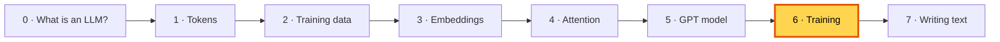

---

## 🤔 The problem

The model is built, but all of its 13.7 million numbers are **random**, so it writes nonsense.
Nobody could set 13.7 million numbers by hand. We need a way for the model to **find good numbers by itself**.

## 💡 The idea: practise, check, adjust, repeat

> 🎯 Learning to throw darts: throw, see how far you missed, adjust your arm **a little**, throw again.
> You never calculate the perfect throw. You just get a bit less wrong each time, thousands of times.

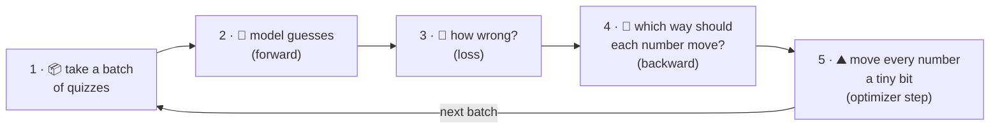

To do this we need three tools:
1. a way to **measure** how wrong the model is: the **loss**;
2. a way to find **which direction** to change each number: **gradients** (backward pass);
3. a rule for **how far** to move each number: the **optimizer** (AdamW).

---

## 🔍 Tool 1 · Loss: one number for "how wrong?" (book 5.1)

### The book's example

Two inputs, with the right answers shifted one token to the right (just like [2. Training data](02-training-data.md)):

| Input | Target (correct next tokens) |
|---|---|
| `every effort moves` | ` effort moves you` |
| `I really like` | ` really like chocolate` |

That's **6 quizzes**: after "every" → "effort", after "every effort" → "moves", ... after "I really like" → "chocolate".

### Look at the probability given to the right answer

The model's scores become percentages (softmax). We only care about the percentage given to the **correct** token.
Real numbers from `./run.sh 10` (the untrained TinyGPT):

| After... | Correct token | Probability the model gave it |
|---|---|---:|
| "every" | " effort" | 0.0000226 |
| "every effort" | " moves" | 0.0000124 |
| "every effort moves" | " you" | 0.0000106 |
| "I" | " really" | 0.0000078 |
| "I really" | " like" | 0.0000130 |
| "I really like" | " chocolate" | 0.0000257 |

A blind guess among 50,257 tokens would be 1/50,257 = 0.0000199. The untrained model is no better than guessing. 🎲

### The six steps from scores to loss (book figure 5.7)

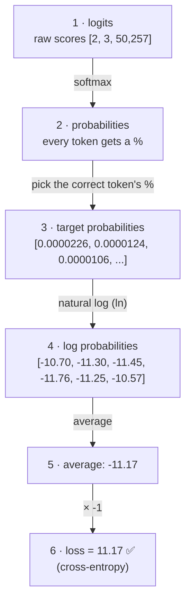

**Why the logarithm?** It turns "tiny probability" into "big penalty" in a smooth way that's easy to learn from:

| Probability of the right answer | Loss (−ln p) | Feels like |
|---:|---:|---|
| 100% | 0.00 | 🎯 bullseye |
| 90% | 0.11 | very close |
| 50% | 0.69 | okay |
| 10% | 2.30 | far off |
| 1% | 4.61 | way off |
| 0.002% (random guess) | 10.82 | blindfolded |

**Training = making this number go down.** A perfect model would score 0.

### Perplexity: the loss in plain words

`perplexity = e^loss` ≈ "**how many tokens is the model still choosing between?**"

```
untrained:  loss 11.17 → perplexity ≈ 71,000   ("could be almost any token")
trained:    loss  0.77 → perplexity ≈ 2.2      ("it's one of about two tokens")
```

### How our code picks the right answer: one-hot

```
correct token is #2 of 5  →  one-hot [0, 0, 1, 0, 0]
log-probabilities          [-3.1, -2.4, -0.9, -4.0, -2.2]
multiply, then add up  →   -0.9   ← the right answer's log-probability
```

```java
// Loss.crossEntropy()
NDArray logProbabilities = logits.logSoftmax(-1);                       // steps 1, 2, 4
NDArray oneHot = targets.oneHot(vocabularySize);
NDArray correct = logProbabilities.mul(oneHot).sum(new int[]{-1});      // step 3
return correct.mean().neg();                                            // steps 5, 6
```

---

## 🔍 Tool 2 · Gradients: which way should each number move?

For **each** of the 13.7 million numbers we ask:

> *"If I nudge this number up a tiny bit, does the loss go up or down? By how much?"*

The answer is that number's **gradient**. Working it out by hand would be impossible, but **autograd** does it automatically.
During the forward pass it remembers every calculation; then `backward()` replays them **in reverse**, passing "blame" from the loss back to every number.

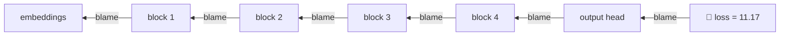

> 🏭 Like a factory that made a faulty product: you walk back along the line, and each station learns how much it contributed to the mistake.

This is why **shortcut connections** matter ([5. The GPT model](05-gpt-model.md)): they keep the blame signal strong all the way down to the embeddings.

---

## 🔍 Tool 3 · The optimizer: AdamW

### The simplest version: walk downhill

> ⛰️ You're on a foggy hill and want to reach the valley (lowest loss). You can't see it. You can only feel the slope under your feet (the gradient).
> So you take a small step **downhill**. Then feel again, and step again.

```
number = 5,  gradient = +2 (uphill is "bigger"),  learning rate = 0.1
new number = 5 − 0.1 × 2 = 4.8          ← one small step downhill
```

### AdamW's extra tricks

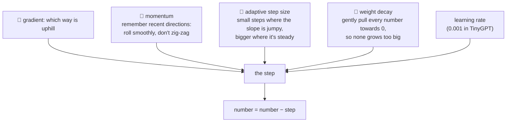

| Learning rate | What happens |
|---|---|
| too small | 🐌 learns very slowly |
| just right | ✅ the loss goes down steadily |
| too big | 🦘 jumps over the valley; the loss bounces or explodes |

### Safety check: skip a broken step

If a gradient ever comes back as NaN ("not a number"), one update would spread it into every number and ruin the model.
So `AdamW.step()` first checks all gradients, and **skips** the step if any is broken. PyTorch's mixed-precision trainer does the same.
(Why this can happen here: see the README's "Known issue".)

---

## 🏋️ The training loop (book 5.2)

### The book's `train_model_simple`, in our `Trainer`

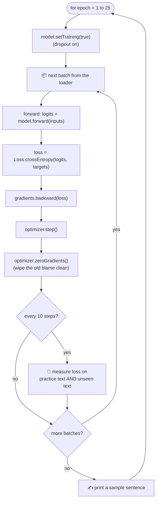

**Why wipe the gradients?** Autograd **adds** new gradients on top of old ones. Without wiping, each step would also use the blame from every earlier step.

### 🏭 Watch the data move through one training step

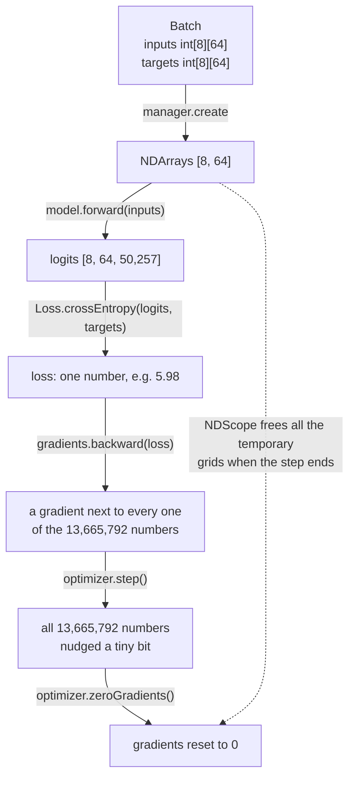

```java
// Trainer.trainStep(): the 5 moves
try (NDScope ignored = new NDScope()) {                        // free temporary grids afterwards
    NDArray inputs  = manager.create(batch.inputs());          // 1. batch
    NDArray targets = manager.create(batch.targets());
    try (GradientCollector gradients = ...) {
        NDArray logits = model.forward(inputs);                // 2. forward
        NDArray loss = Loss.crossEntropy(logits, targets);     // 3. loss
        gradients.backward(loss);                              // 4. backward
    }
    optimizer.step();                                          // 5. update
    optimizer.zeroGradients();                                 //    wipe for next time
}
```

### Counting the work

```
4,612 practice tokens ÷ 64 per window   = 72 windows
72 windows ÷ 8 per batch                = 9 steps per epoch
9 steps × 25 epochs                     = 225 steps
time on a laptop                        ≈ 20 seconds
```

---

## 📈 What happened when we trained (real numbers from `./run.sh train`)

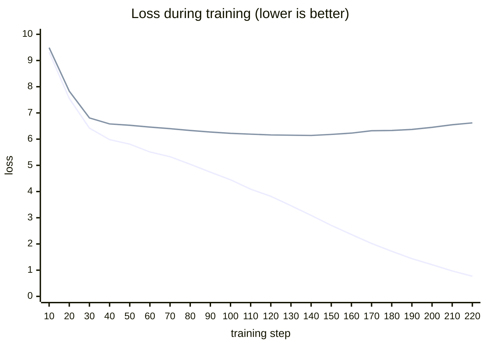

*Lower line: loss on practice text. Upper line: loss on unseen text (validation).*

### What it wrote along the way

| After | `Every effort moves you` ... |
|---|---|
| 0 steps | ` Hero farmland tenth harness ATL subsidized Contracts fixes impairment emission` |
| 27 steps (epoch 3) | `,,,,,,,,,,,,,,,,,,,,,,,,,` |
| 54 steps (epoch 6) | `, the, the, the the, the, the.` |
| 108 steps (epoch 12) | ` know the the the that the one of the, and "  "  " of the fact, and I had` |
| 153 steps (epoch 17) | ` know to the Riv of the picture for a smile in a little of the picture.` |
| 225 steps (epoch 25) | ` know; and I had the craft was vindicated by little Claude Nutley, who, in a footstep and my bravura tricks.` |

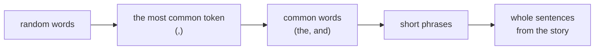

Just like a toddler: first sounds, then common words, then phrases, then sentences.

### ⚠️ Overfitting: memorising instead of learning (book 5.2)

Look at the chart after step 140: the **practice loss keeps falling, but the unseen-text loss starts rising**.

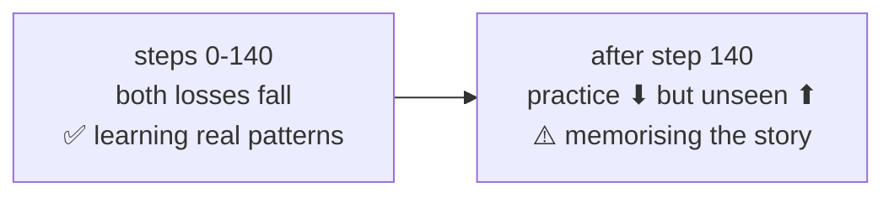

> 🧑‍🎓 A student who memorises last year's exam: perfect on those exact questions, lost on new ones.

The book shows exactly this. With only ~5,000 tokens of text, a model can memorise it. Real LLMs train on **billions** of tokens, far too many to memorise, so they have to learn general patterns.

### Our settings vs the book's

| | Book (GPT-2 small) | TinyGPT |
|---|---|---|
| model size | 163M numbers | 13.7M numbers |
| context length | 256 | 64 |
| learning rate | 0.0004 | 0.001 (small models can take bigger steps) |
| epochs | 10 | 25 |
| weight decay | 0.1 | 0.1 |
| final losses | train ≈ 0.4, validation ≈ 6.5 | train ≈ 0.8, validation ≈ 6.6 |

---

## 💾 Saving and loading (book 5.4)

Training takes time, so we save the learned numbers to a file and load them later.

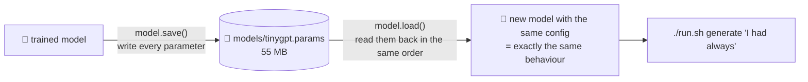

The file only stores **numbers**, not the design. So the model you load into must have the **same `GPTConfig`**, or the numbers won't fit.

---

## 🔗 How training connects to everything

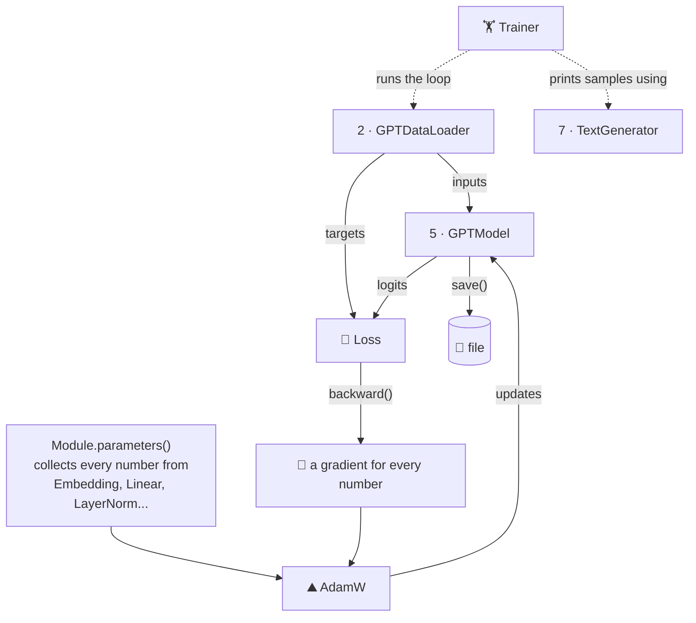

- Training touches **every** part of the model: each `Embedding`, `Linear` and `LayerNorm` hands its numbers to the optimizer through `Module.parameters()`.
- **Dropout** is on during training (`setTraining(true)`) and off when measuring or writing (`setTraining(false)`).

---

## ▶️ Try it

```bash
./run.sh 10       # the loss of an untrained model
./run.sh train    # train, save, then write
```

**Experiments** (change the constants at the top of `TinyGPT.java`):
1. `EPOCHS = 10`: less memorising. Is the writing worse?
2. `LEARNING_RATE = 1e-2f` (10× bigger): what happens to the loss?
3. `LEARNING_RATE = 1e-4f` (10× smaller): how far does the loss get in 25 epochs?
4. An even smaller model: `new GPTConfig(50257, 64, 64, 2, 2, 0.1f, false)`. Does it still learn?

## 🧠 Remember

- **Loss** = how wrong (−ln of the probability given to the right answer, averaged). Random ≈ 10.8, perfect = 0.
- **Backward** gives every number a **gradient**: which way to move to lower the loss.
- **AdamW** moves every number a small step downhill, with momentum and smart step sizes.
- Loop: **batch → forward → loss → backward → step → wipe gradients**, many times.
- Watch the **validation loss**: if it rises while the training loss falls, the model is **memorising**.

## 📖 In the book

| Section | Topic | Our code |
|---|---|---|
| 5.1.1 | Generating text with the untrained model | `TinyGPT` "Before training" line |
| 5.1.2 | The 6-step loss, cross-entropy, perplexity | `Loss`, `./run.sh 10` |
| 5.1.3 | Train/validation split and losses | `TinyGPT.main`, `Trainer.averageLoss` |
| 5.2 | `train_model_simple`, AdamW, overfitting | `Trainer`, `AdamW`, `./run.sh train` |
| 5.4 | Saving and loading weights | `GPTModel.save()` / `load()` |
| Appendix A.4, A.7 | Autograd, the typical training loop | Tool 2, the training loop |
