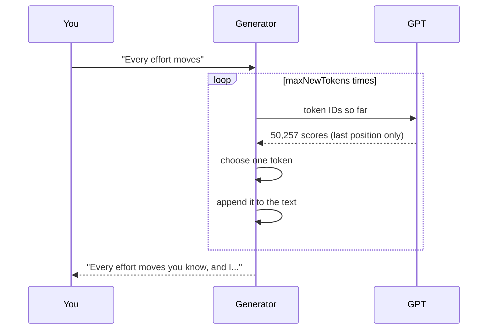
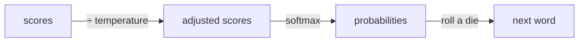
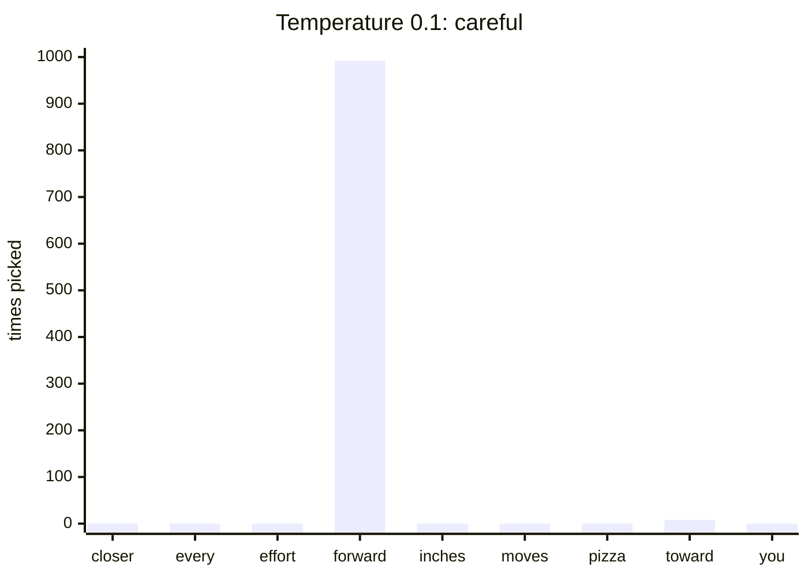
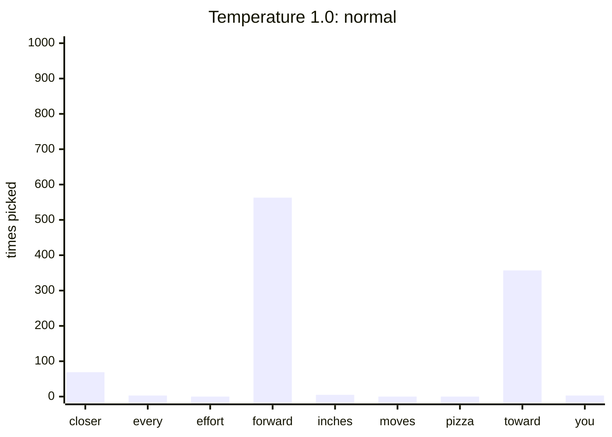
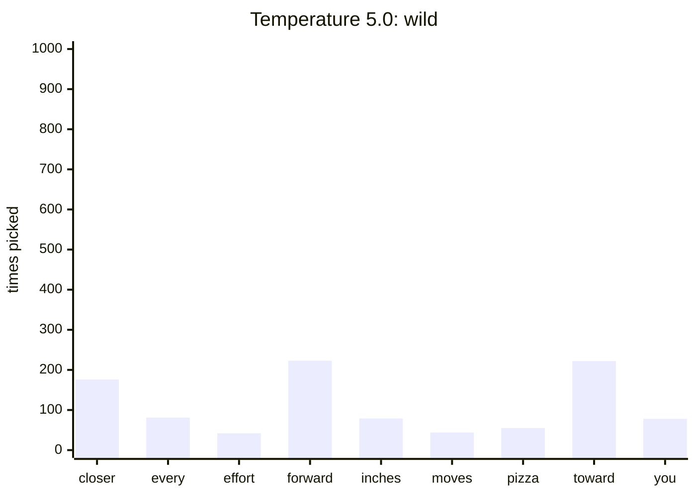
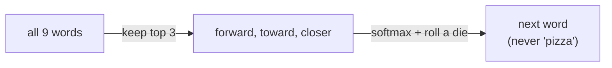

# 7. Writing text: choosing the next word

**Step 11** and `./run.sh generate` · Book chapter 4.7, 5.3 · Code: [`generation/TextGenerator.java`](../src/main/java/com/tinygpt/generation/TextGenerator.java)

← [Training](06-training.md) · [Back to README](../README.md)

---

## One token at a time

The model only ever predicts **one** next token. To write a sentence, we run it in a loop:



If the text gets longer than `contextLength` (64 tokens for TinyGPT), we only feed in the **most recent** 64. The model can't read more than that.

---

## How to choose? Three strategies

Imagine the model just read *"every effort moves you"* and gives these scores:

| word | closer | every | effort | **forward** | inches | moves | pizza | toward | you |
|---|---:|---:|---:|---:|---:|---:|---:|---:|---:|
| score | 4.51 | 0.89 | −1.90 | **6.75** | 1.63 | −1.62 | −1.89 | 6.28 | 1.79 |

### 1. Greedy: always take the top one

Always `"forward"`. Safe, but the text often gets stuck repeating itself.

### 2. Temperature: how adventurous?

Turn the scores into probabilities (softmax), then pick at random according to those probabilities.
**Temperature** divides the scores first:



What happens if we pick 1,000 times (real output of `./run.sh 11`):







> Temperature is like how many cups of coffee the writer had. Low: careful and predictable. High: creative, but sometimes says "pizza".

### 3. Top-k: only consider the best k words

Before picking, throw away everything except the **k** highest scores (set the rest to −∞, so they get 0% chance).



Top-k + temperature together give text that is **varied but still sensible**. `./run.sh train` shows both:

```
Greedy:                       Every effort moves you know; and I had the craft was vindicated by little Claude Nutley...
Temperature 1.0, top-k 25:    Every effort moves you knowagged him down." I was taken with the factrec me in a self-conf...
```

---

## In the code

Choosing the next token is written in **plain Java** (no tensors), so it's easy to read:

| Method | What it does |
|---|---|
| `generate(prompt, maxNewTokens, temperature, topK)` | the loop |
| `nextTokenScores(ids)` | run the model, keep the last position |
| `argMax(scores)` | greedy |
| `keepTopK(scores, k)` | top-k |
| `softmax(scores, temperature)` | scores → probabilities |
| `sample(...)` | roll the die |

## Try it

```bash
./run.sh 11
./run.sh train                          # once
./run.sh generate "I had always"
./run.sh generate "She said"
```

**Experiment:** in `TinyGPT.showSamples`, try temperature `0.5` and `2.0`, and top-k `1`, `5` and `0` (off).
