# 7. Writing text: choosing the next word

**Book:** Chapter 4.7, 5.3 · **Code:** [`generation/TextGenerator.java`](../src/main/java/com/tinygpt/generation/TextGenerator.java) · **Run:** `./run.sh 11`, `./run.sh generate "..."` · **Class pictures:** [TextGenerator](classes/7-generation.md)

← [6. Training](06-training.md) · Next: [8. How everything connects →](08-how-everything-connects.md)

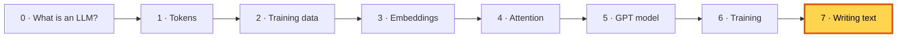

---

## 🤔 The problem

The model only ever gives **scores for the next token**. It never writes a whole sentence by itself.
So two questions:
1. How do we get **many** words out of it?
2. Given 50,257 scores, **which** token do we pick?

## 💡 Part 1 · One token at a time (book 4.7)

Ask for the next token, **add it to the text**, and ask again. Repeat as many times as you like.

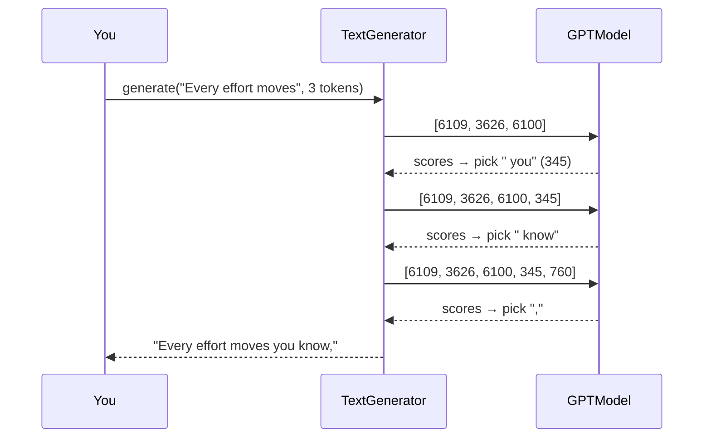

### Only the last position matters here

The model returns scores for **every** position (useful in training, where every position is a quiz). When writing, we only need the scores after the **last** token:

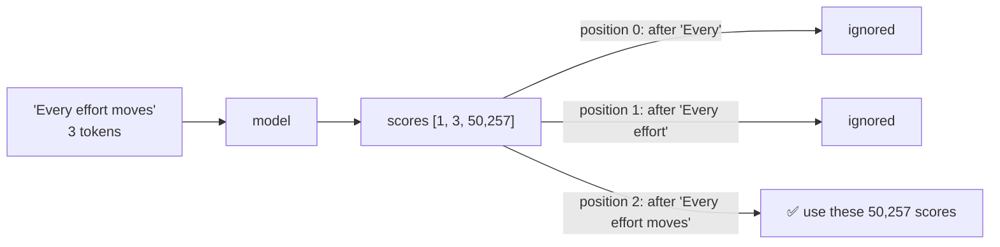

### The model can only read so much

TinyGPT has 64 position rows, so it can read at most **64 tokens**. If the text gets longer, we feed in only the **most recent 64**:

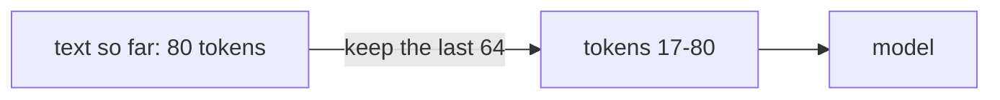

> 📜 Like reading through a window that only shows the last few lines of the page.

---

## 💡 Part 2 · Choosing the next token (book 5.3)

The book's example: after *"every effort moves you"*, a tiny 9-word vocabulary gets these scores:

| closer | every | effort | **forward** | inches | moves | pizza | toward | you |
|---:|---:|---:|---:|---:|---:|---:|---:|---:|
| 4.51 | 0.89 | −1.90 | **6.75** | 1.63 | −1.62 | −1.89 | 6.28 | 1.79 |

### Strategy 1 · Greedy: always the top score

Always **"forward"**.

| 👍 | 👎 |
|---|---|
| simple, predictable | boring; often gets stuck repeating the same words |

Our training samples use greedy, which is why early ones look like `, the, the, the`.

### Strategy 2 · Sampling with temperature

**Roll a weighted die**: turn the scores into percentages (softmax) and pick randomly, so likelier tokens are picked more often.
**Temperature** controls how adventurous the die is. It divides the scores before softmax:

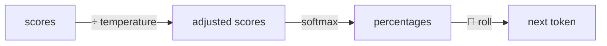

A tiny example with two tokens, scores `2` and `1`:

| Temperature | Scores become | Gap | Chances | Feels like |
|---:|---|---:|---|---|
| 0.5 | `4`, `2` | 2 (bigger) | 88% / 12% | careful |
| 1 | `2`, `1` | 1 | 73% / 27% | normal |
| 2 | `1`, `0.5` | 0.5 (smaller) | 62% / 38% | adventurous |

**Small temperature → bigger gaps → the favourite almost always wins.**
**Big temperature → smaller gaps → underdogs win more often.**

Picking 1,000 times with the book's scores (real output of `./run.sh 11`):

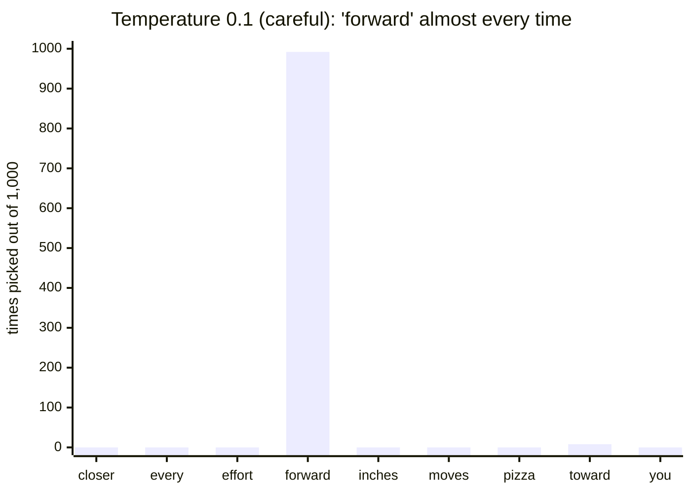

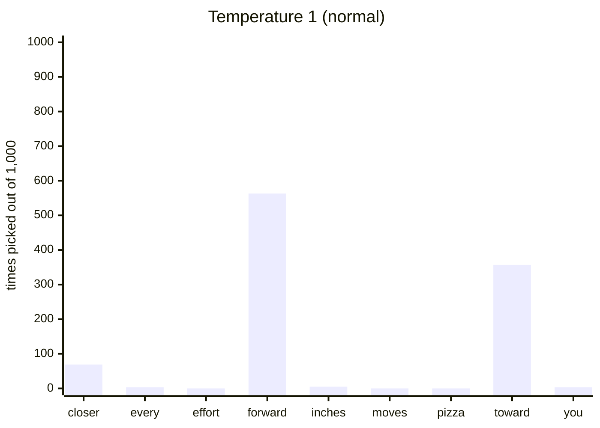

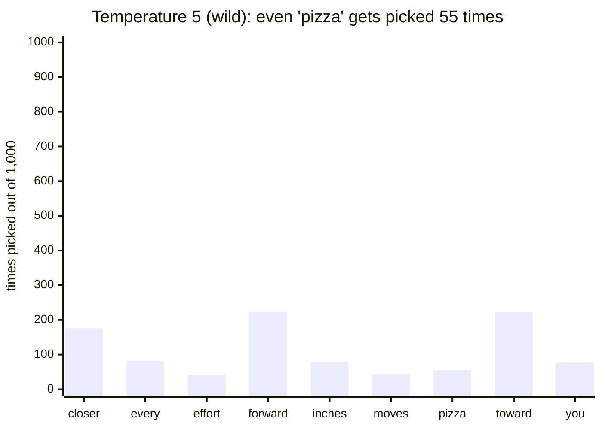

The book's run at temperature 1 got forward 582, toward 343, closer 73: almost the same as ours (forward 563, toward 357, closer 69). Different random dice, same pattern.

> ☕ Temperature is like how many cups of coffee the writer has had. Low: careful and predictable. High: creative, but might write "every effort moves you pizza".

### Strategy 3 · Top-k: only the best k may be picked

Before rolling the die, **throw away everything except the k highest scores** (set the rest to −∞, which becomes 0%).

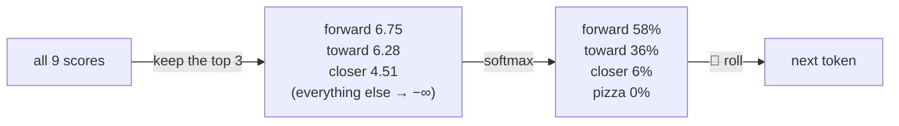

With top-k = 3 (from `./run.sh 11`): forward 570, toward 359, closer 71, and **never** "pizza".

### Combining them

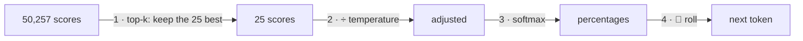

**Top-k removes silly choices; temperature controls variety among the sensible ones.** That's what `./run.sh train` uses for its second sample:

```
Greedy:                    Every effort moves you know; and I had the craft was vindicated by little Claude Nutley...
Temperature 1, top-k 25:   Every effort moves you knowagged him down." I was taken with the factrec me in a self-conf...
```

---

## 🏭 Watch the data move through `TextGenerator.generate()`

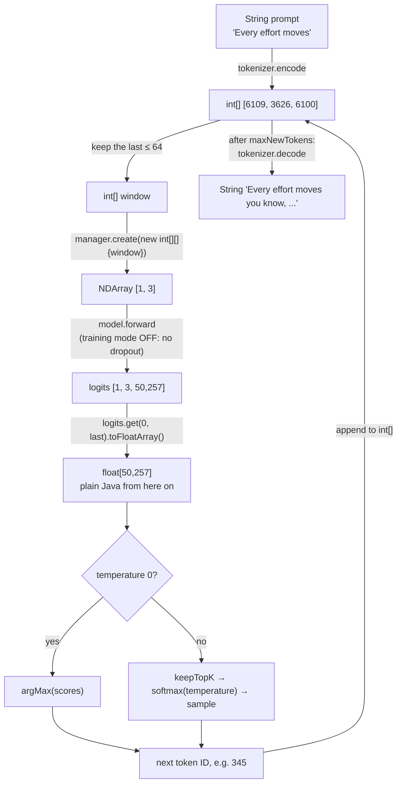

Choosing the token is written in **plain Java loops** (no tensors), so it's the easiest class to read:

| Method | What it does |
|---|---|
| `generate(prompt, maxNewTokens, temperature, topK)` | the loop above |
| `nextTokenScores(ids)` | run the model, return the last position's 50,257 scores |
| `argMax(scores)` | index of the biggest score (greedy) |
| `keepTopK(scores, k)` | everything except the top k → −∞ |
| `softmax(scores, temperature)` | scores → percentages that add up to 1 |
| `sample(...)` | roll the weighted die |

---

## 🔗 How writing connects to everything else

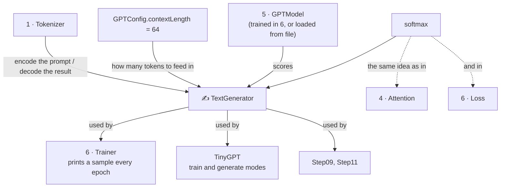

- **Writing uses no training tools at all**: no loss, no gradients, no optimizer, and dropout is switched off.
- **The same trained numbers** can be used for writing again and again; that's why we save them to a file.

---

## ▶️ Try it

```bash
./run.sh 11                              # the book's 9-word example
./run.sh train                           # train once (saves the model)
./run.sh generate "I had always"         # write with the saved model
./run.sh generate "She said"
```

**Experiments** (in `TinyGPT.showSamples`):
1. Temperature `0.5` vs `2.0`, with top-k 25. Which reads better?
2. Top-k `1`. What is that the same as? (Greedy!)
3. Top-k `0` (off) with temperature `1.5`. How strange does it get?

## 🧠 Remember

- The model writes **one token at a time**, feeding each new token back in.
- Only the **last position's** scores are used, and only the last `contextLength` tokens are fed in.
- **Greedy** = always the top token. **Temperature** = how adventurous. **Top-k** = only the k best are allowed.
- Writing needs only the **trained numbers**: no loss, no gradients, no dropout.

## 📖 In the book

| Section | Topic | Our code |
|---|---|---|
| 4.7 | `generate_text_simple`: greedy, cropping the context | `generateGreedy`, `nextTokenScores` |
| 5.1.1 | Text ↔ token ID helpers | `Tokenizer.encode` / `decode` |
| 5.3.1 | Temperature scaling, 1,000 samples | `softmax(scores, temperature)`, `./run.sh 11` |
| 5.3.2 | Top-k sampling | `keepTopK` |
| 5.3.3 | The combined `generate` function | `generate(prompt, n, temperature, topK)` |
