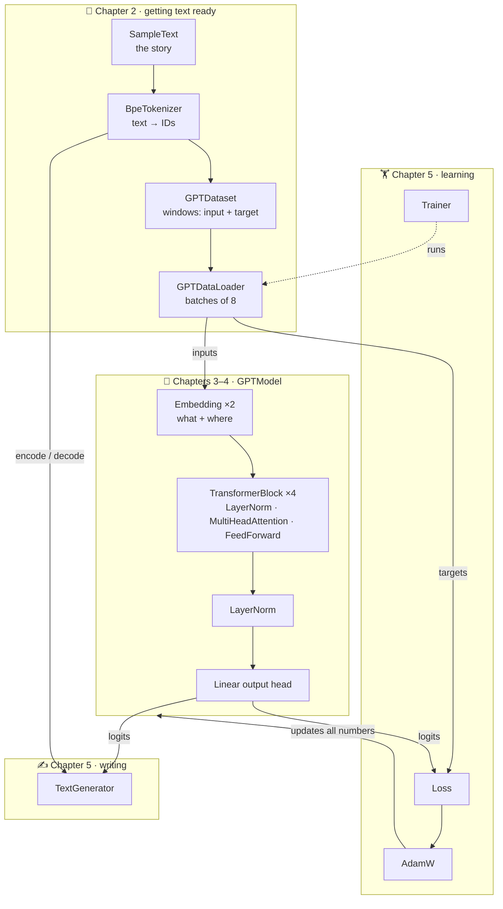
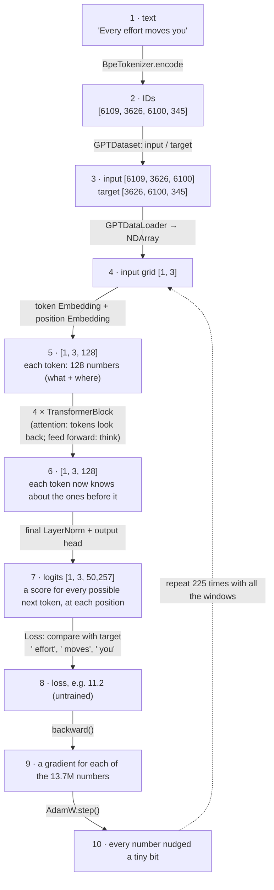
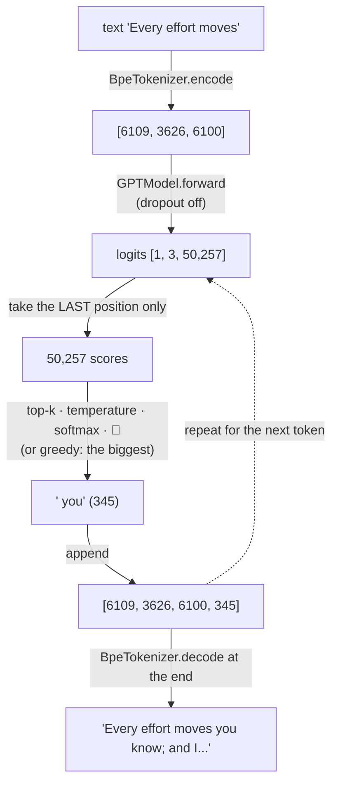
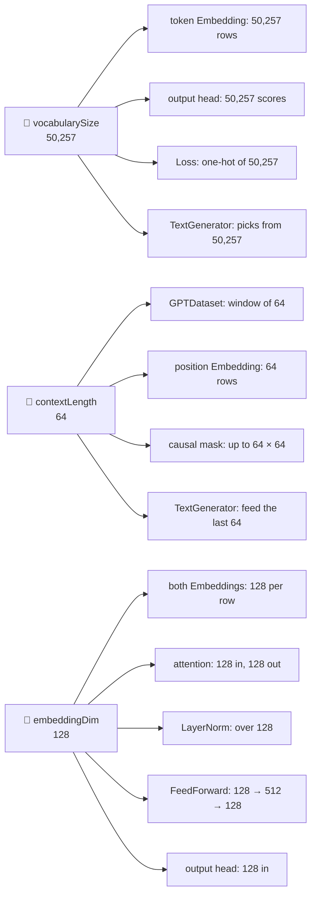
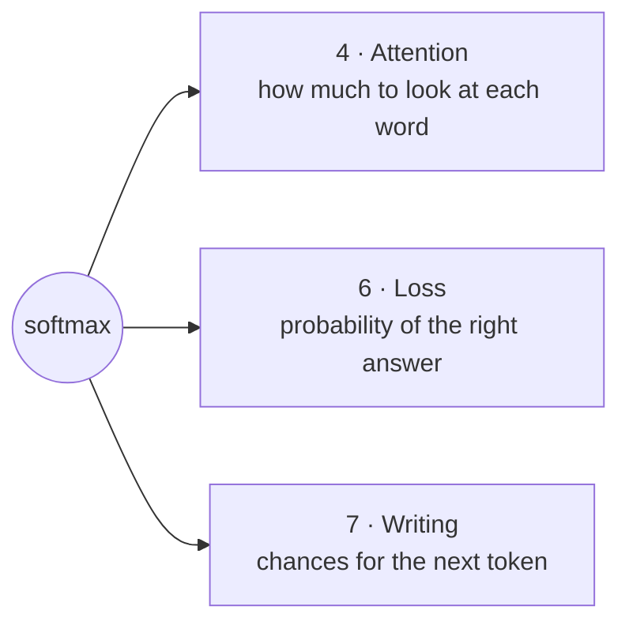
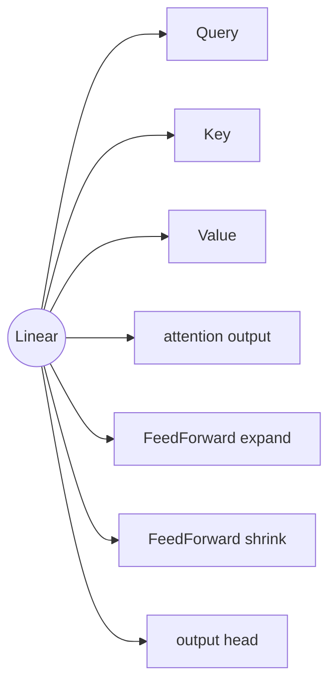
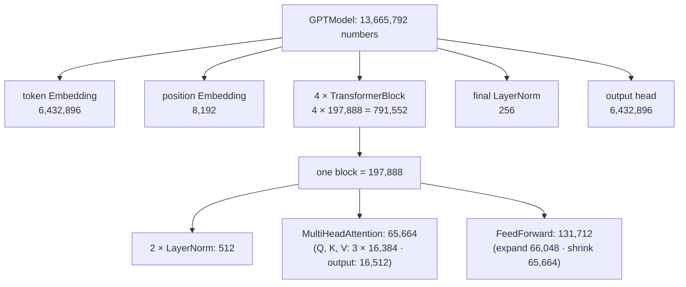
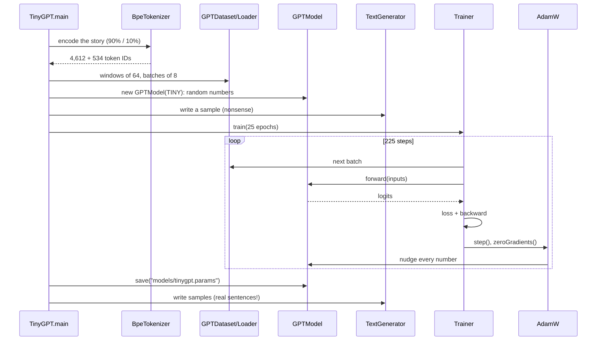

# 8. How everything connects

**Book:** chapters 2–5 together · **Code:** everything · **Run:** `./run.sh train`, then `./run.sh generate "Every effort moves"`

← [7. Writing text](07-generating-text.md) · Next: [9. Chat with GPT-2 →](09-chat-with-gpt2.md)

The other docs zoom in on one part each. This one **zooms out**: we follow a single sentence through the whole machine, and see how the parts depend on each other.

---

## 🧭 The whole machine on one page

---

## 🚂 Journey 1 · One sentence during **training**

Let's follow the window `"Every effort moves you"` through one training step (sizes from TinyGPT).

What each position is quizzed on in this one window (the causal mask keeps it fair):

| Position | Can see | Must guess |
|---:|---|---|
| 0 | "Every" | " effort" |
| 1 | "Every effort" | " moves" |
| 2 | "Every effort moves" | " you" |

---

## 🚂 Journey 2 · One sentence during **writing**

Now the trained model continues `"Every effort moves"`:

### Training vs writing, side by side

| | Training | Writing |
|---|---|---|
| Input | windows from the story | your prompt |
| Positions used | **all** (every position is a quiz) | **only the last** |
| Dropout | on | off |
| Loss, gradients, AdamW | ✅ used | ❌ not used |
| Numbers change? | yes, every step | no, read only |
| Output | a lower loss | new text |

---

## 🔗 The settings that tie everything together

Three numbers from `GPTConfig` and the tokenizer decide the size of many parts at once:

Change one of these, and every part connected to it changes size automatically, because they all read it from the same `GPTConfig`.

---

## 🔁 Ideas that appear more than once

The same few ideas are reused all over the model. Once you understand them, you understand most of the code.

### Softmax: "scores → percentages"

### Linear: "multiply by learned weights and add up"

Six per block × 4 blocks + the output head = **25 `Linear` layers** in TinyGPT.

### Embedding: "look up a row"

Used **twice**: for the token (*what*) and for the position (*where*). The output head does the opposite job (vector → a score per token).

### Add (➕): mixing information without losing any

| Where | What is added |
|---|---|
| Embeddings | token row + position row |
| Causal mask | scores + (0 or −∞) |
| Shortcuts | x + attention(x), x + feedForward(x) |
| Linear | the bias |

### Dropout: random switching-off during practice

Used **9 times**: once after the embeddings, and twice per block (on the attention weights, and on each half's output). Always switched off when writing.

### LayerNorm: steady volume

Used **9 times**: twice per block (before attention, before feed forward) and once at the very end.

---

## 🧮 Who owns which learnable numbers

`Module.parameters()` walks this tree and hands **all** of them to `AdamW`, so training improves every single one.

---

## ⏱️ What happens when you run `./run.sh train`

And `./run.sh generate "..."` only does: **new model → load the file → TextGenerator**. No training needed.

---

## 🧠 The whole project in 8 sentences

1. **Tokens**: text is cut into pieces, and each piece gets a number.
2. **Training data**: the story becomes quizzes, where the answer is always the next token.
3. **Embeddings**: each number becomes a list of numbers saying *what* the token is and *where* it sits.
4. **Attention**: each token looks back at earlier tokens and mixes in what's relevant, without peeking ahead.
5. **The GPT model**: blocks of attention + thinking are stacked, with norms and shortcuts, ending in a score for every possible next token.
6. **Training**: the loss says how wrong the guesses were, gradients say how to fix each number, and AdamW makes the fix, thousands of times.
7. **Writing**: pick a next token from the scores (greedy, temperature, top-k), add it, and repeat.
8. ChatGPT is the **same idea**, just with far more numbers, far more text, and extra fine-tuning. [9. Chat with GPT-2](09-chat-with-gpt2.md) does a small version of that fine-tuning (book chapter 7).

## 📖 Doc index

| # | Doc | Book |
|---:|---|---|
| 0 | [What is an LLM?](00-what-is-an-llm.md) | 1 |
| 1 | [Tokens](01-tokenization.md) | 2.2–2.5 |
| 2 | [Training data](02-training-data.md) | 2.6 |
| 3 | [Embeddings](03-embeddings.md) | 2.1, 2.7–2.8 |
| 4 | [Attention](04-attention.md) | 3 |
| 5 | [The GPT model](05-gpt-model.md) | 4 |
| 6 | [Training](06-training.md) | 5.1–5.2, 5.4 |
| 7 | [Writing text](07-generating-text.md) | 4.7, 5.3 |
| 8 | How everything connects (this page) | 2–5 |
| 9 | [Chat with GPT-2](09-chat-with-gpt2.md) | 5.5, 7 |
| — | [Every class, explained](classes/README.md) | — |
| — | [Glossary](glossary.md) | — |
