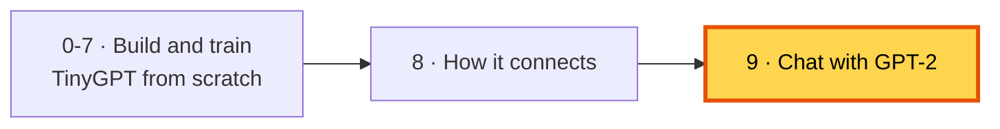
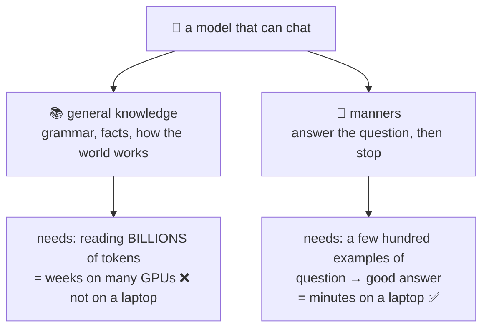
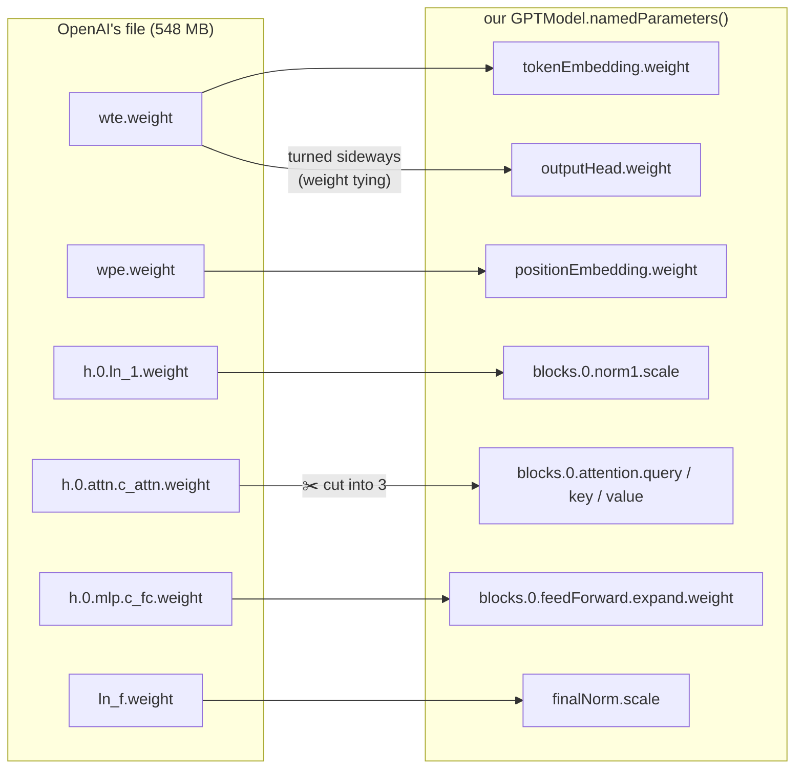
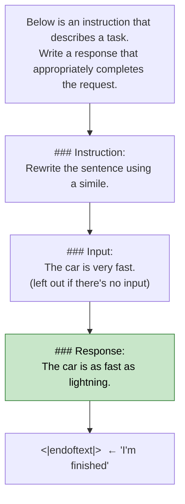
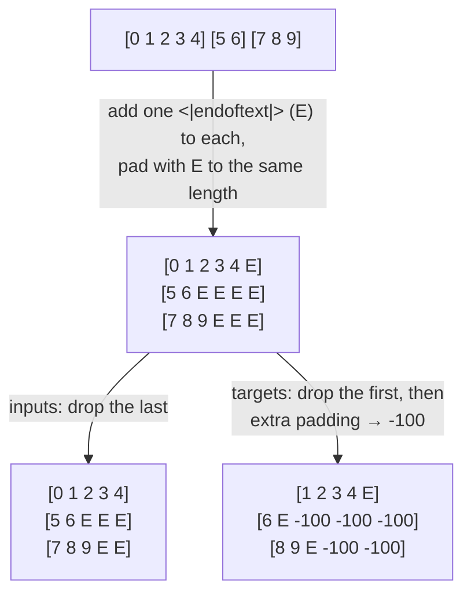
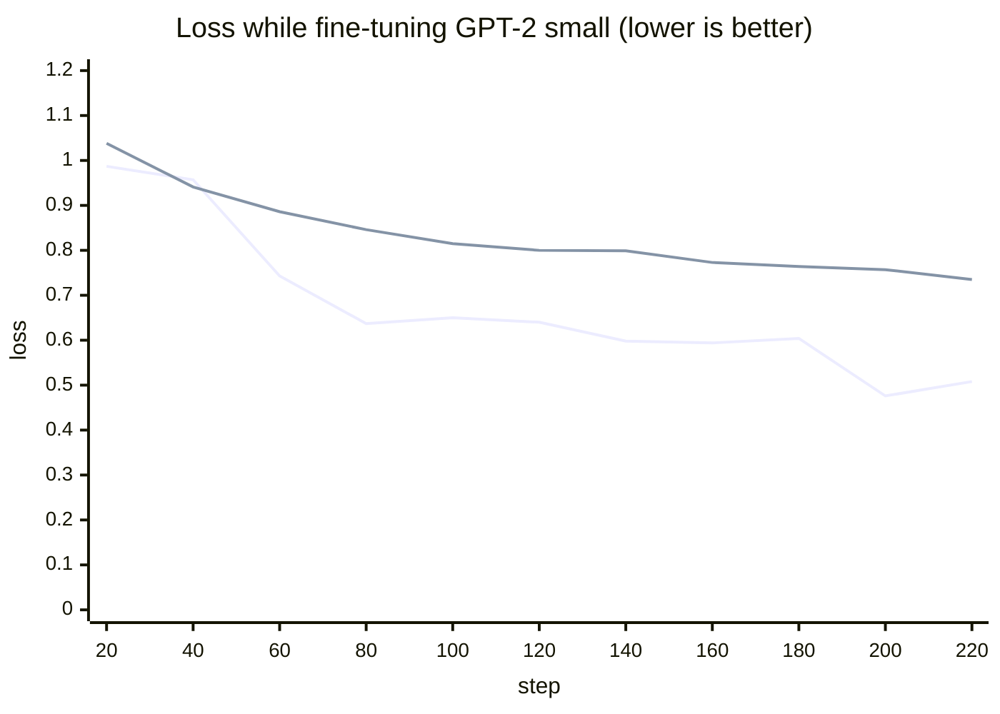
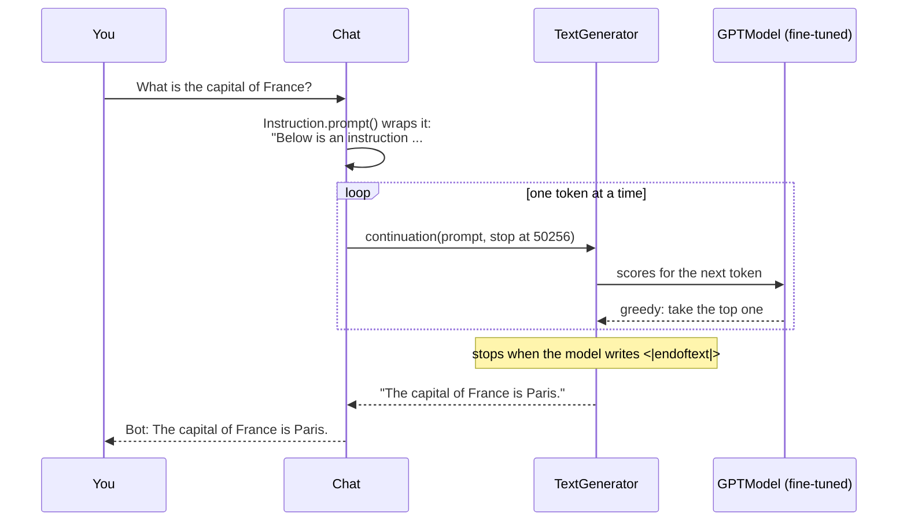
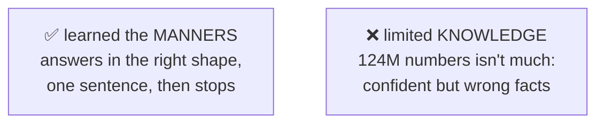
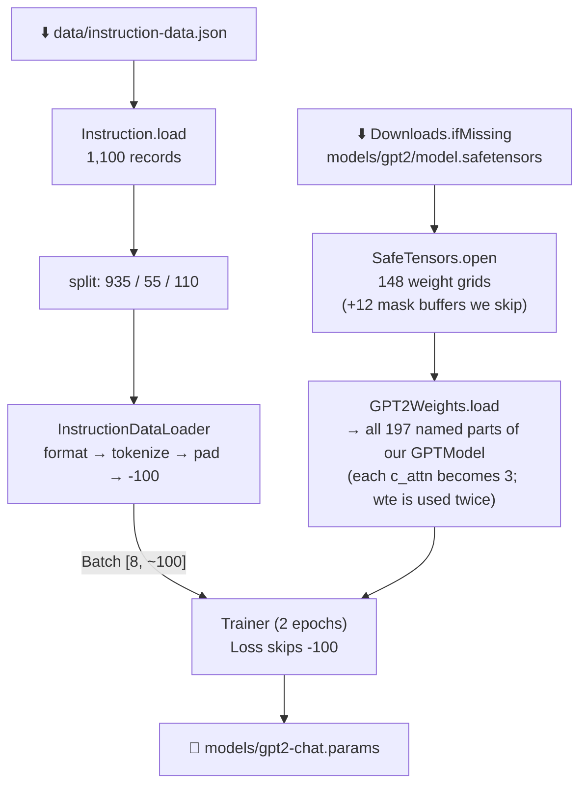
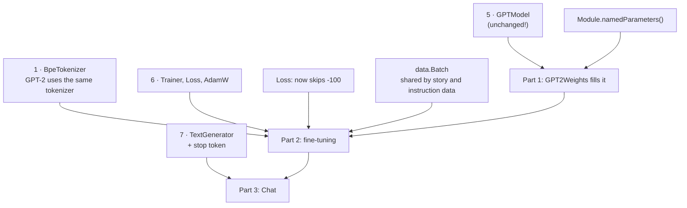

# 9. Chat: borrow GPT-2's brain, then teach it to follow instructions

**Book:** Chapter 5.5 and Chapter 7 · **Code:** [`pretrained/`](../src/main/java/com/tinygpt/pretrained), [`instruct/`](../src/main/java/com/tinygpt/instruct), [`FineTune.java`](../src/main/java/com/tinygpt/FineTune.java), [`Chat.java`](../src/main/java/com/tinygpt/Chat.java) · **Run:** `./run.sh 12`, `./run.sh finetune`, `./run.sh chat` · **Class pictures:** [chat classes](classes/9-chat.md)

← [8. How everything connects](08-how-everything-connects.md) · [README](../README.md) · Next: [10. Talk →](10-talk-with-dailydialog.md)



---

## 🤔 The problem: our model is too young to chat

TinyGPT read **one short story** (5,145 tokens). To chat, a model needs two things it doesn't have:



## 💡 The idea: borrow the knowledge, teach the manners

> 🎓 Hire someone who has already read a whole library (OpenAI's GPT-2, trained on 8 million web pages),
> then give them a short course on **how to answer questions** (the book's 1,100 instruction examples).

This is exactly the book's plan (stage 3 in [0. What is an LLM?](00-what-is-an-llm.md)):


---

## 🔍 Part 1 · Loading OpenAI's GPT-2 into our model (book 5.5)

### Why does it fit?

We built our `GPTModel` with **exactly GPT-2's design**: same embeddings, same attention, same LayerNorm, same GELU, same blocks.
So OpenAI's trained numbers fit straight in. We only have to match up the **names**:



To make this matching possible, every learnable number in our model now has a **name** (`Module.namedParameters()`, like PyTorch's `named_parameters()`).

### Two small differences from the book's model

| | Book's GPT (chapter 4) | OpenAI's GPT-2 |
|---|---|---|
| Query/Key/Value bias | no (`qkvBias = false`) | **yes** |
| Output head | its own table | **shares** the token table (weight tying) |

So `GPT2Size` uses `qkvBias = true`, and we copy the token table into the output head.

### ✅ The proof that our Java model is really GPT-2

Hugging Face's guide shows what GPT-2 writes for one prompt when it always picks the top word. `./run.sh 12` gives **exactly the same words**:

```
I enjoy walking with my cute dog, but I'm not sure if I'll ever be able to walk with my dog. I'm not sure if I'll ever be able to walk
```

If even one layer did its maths differently, these words would differ. Everything you built in chapters 2–4 matches GPT-2 exactly.

### But it only continues text

GPT-2 writes good English, but it doesn't **answer**. Ask it something in the chat format, and it copies the pattern forever (real output, before fine-tuning):

```
Asked:   Convert the active sentence to passive: 'The chef cooks the meal every day.'
Answer:  Write a response that appropriately completes the request.  ### Response:  Write a response that
         appropriately completes the request.  ### Response:  Write a response that ...
```

---

## 🔍 Part 2 · Instruction fine-tuning (book chapter 7)

### The practice data: 1,100 examples

Each example is a request, optional extra input, and a good answer:

| instruction | input | output |
|---|---|---|
| Evaluate the following phrase by transforming it into the spelling given. | freind --> friend | The spelling of the given phrase "freind" is incorrect, the correct spelling is "friend". |
| Rewrite the sentence using a simile. | The car is very fast. | The car is as fast as lightning. |
| Name the author of 'Pride and Prejudice'. | | Jane Austen. |

Split like the book: **935** to practise on, **55** to check progress, **110** for a final test it never sees during practice.

### Writing each example in a fixed format (book 7.2)

The model needs to see **where the request ends and the answer begins**. Every example is written in the "Alpaca" format:



When chatting later, we send everything **up to** `### Response:`, and the model fills in the green part.

### Batches of different lengths: padding (book 7.3)

Story windows were all 64 tokens long. Instructions have **different lengths**, so short ones are padded. Using the book's own example:



- The **first E** stays in the targets, so the model learns to say **"I'm finished"**. That's how the chatbot knows when to stop.
- The **extra E's** become **-100**, and `Loss` skips them. Nobody gets marked on filler.

(Our test `InstructionTest.collateMatchesTheBooksExample` checks we get exactly the book's numbers.)

### Practising: the same Trainer as before

Fine-tuning uses **the same `Trainer`, `Loss` and `AdamW`** as TinyGPT. Only the data and the settings change:

| | TinyGPT (from scratch) | GPT-2 fine-tuning |
|---|---|---|
| starting numbers | random | OpenAI's GPT-2 |
| data | 1 story, windows of 64 | 935 instructions, padded |
| learning rate | 0.001 | **0.00005** (20× smaller) |
| epochs | 25 | 2 |
| dropout | 0.1 | 0 |
| time on an M4 Pro | 20 s | **6.1 minutes** |

**Why a tiny learning rate?** GPT-2 already knows a lot. Big steps would make it **forget** what it learned from 8 million web pages. We just want to nudge it towards answering.

### What happened (real numbers from `./run.sh finetune`)



*Lower line: practice loss. Upper line: loss on the 55 check examples.* Both go down together, so it's learning, not memorising.
The losses start low (about 1, compared with 11 for TinyGPT) because GPT-2 already knows English.

---

## 🔍 Part 3 · Chatting



### Real conversation with GPT-2 small (124M), after 6 minutes of fine-tuning

```
You: What is the opposite of hot?
Bot: The opposite of hot is cold.                                    ✅

You: Give me a synonym for happy.
Bot: A synonym for happy is "joyful."                                ✅

You: What is the capital of France?
Bot: The capital of France is Paris.                                 ✅

You: Rewrite this sentence in passive voice || The cat chased the mouse.
Bot: The mouse chased the cat.                                       ❌ (swapped who did what)

You: Translate to French || Good morning
Bot: The French translation of 'good morning' is 'qu'on-vous?        ❌

You: Write a short sentence about the sea.
Bot: The sea is a sea of clouds.                                     🤔
```

And on the final test questions it had **never seen**:

| Question | Correct | Our model |
|---|---|---|
| Rewrite the sentence using a simile. *(The car is very fast.)* | The car is as fast as lightning. | The car is as fast as a horse. ✅ |
| What type of cloud is typically associated with thunderstorms? | cumulonimbus | "...is a cirrus." ❌ |
| Name the author of 'Pride and Prejudice'. | Jane Austen. | "...is Robert Frost." ❌ |

### What this tells us



It **sounds** sure even when it's wrong. Real chatbots have the same problem (called *hallucination*), just less often.
The book uses the bigger **GPT-2 medium (355M)** for this chapter for a reason, and you can too:

```bash
./run.sh finetune medium     # downloads 1.5 GB; roughly 3× slower (estimate)
./run.sh chat                # picks medium automatically once it exists
```

| | GPT-2 small | GPT-2 medium |
|---|---:|---:|
| numbers | 124M | 355M |
| layers × width | 12 × 768 | 24 × 1024 |
| download | 548 MB | 1.5 GB |
| saved chat model | 652 MB | about 1.6 GB |
| fine-tuning time here | 6.1 min (measured) | roughly 3× longer (estimate) |

### What it can't do (yet)

| Limitation | Why | How real chatbots handle it |
|---|---|---|
| Forgets the previous message | each message is a fresh prompt | they send the whole conversation every time |
| Wrong facts | small model, little knowledge | billions of numbers, far more training text |
| Repeats itself sometimes | greedy picking | temperature + top-k, and better training |
| Slow-ish answers | no "KV cache": it re-reads the whole prompt for every new token | they cache earlier work |

---

## 🏭 Watch the data move

### `./run.sh finetune`



### `./run.sh chat`


---

## 🔗 How this connects to everything you built



**Nothing in the model had to change.** The same `GPTModel` class runs TinyGPT (13.7M numbers), GPT-2 small (124M) and GPT-2 medium (355M). Only the `GPTConfig` and the numbers inside are different.

---

## ▶️ Try it

```bash
./run.sh 12              # load GPT-2 and let it continue text (downloads 548 MB once)
./run.sh finetune        # teach it to follow instructions (~6 min)
./run.sh chat            # talk to it; type 'exit' to stop
```

**Experiments**
1. Ask it the same question in two different ways. Does the answer change?
2. Try `Explain || photosynthesis` vs `Explain photosynthesis`. Which works better?
3. Fine-tune `medium` and ask both models the test questions above. How many does each get right?

## 🧠 Remember

- Chatting needs **knowledge** (from huge pretraining) **and manners** (from instruction fine-tuning).
- We **borrow** the knowledge by loading OpenAI's GPT-2 numbers into **our own** model; it matches GPT-2 word for word.
- Fine-tuning = the same training loop, a **tiny learning rate**, and instruction examples in a **fixed format**.
- Padding is marked **-100** so it isn't graded; the first `<|endoftext|>` teaches the model to **stop**.
- A small model learns the manners quickly, but still gets **facts wrong**. Bigger models know more.

## 📖 In the book

| Section | Topic | Our code |
|---|---|---|
| 5.5 | Loading OpenAI's GPT-2 weights | `SafeTensors`, `GPT2Weights`, `Step12_LoadGPT2` |
| 7.1–7.2 | Instruction data, Alpaca prompt format, 85/10/5 split | `Instruction`, `FineTune` |
| 7.3–7.4 | Padding, -100 targets, data loaders | `InstructionDataLoader`, `Loss.IGNORE` |
| 7.5 | Loading GPT-2 (the book uses medium, 355M) | `GPT2Size` |
| 7.6 | Fine-tuning: AdamW 0.00005, 2 epochs | `FineTune` + `Trainer` |
| 7.7 | Extracting responses, stopping at `<\|endoftext\|>` | `FineTune.answer`, `TextGenerator.continuation`, `Chat` |
| 7.8 | Scoring answers with a bigger model (Ollama) | not included |
