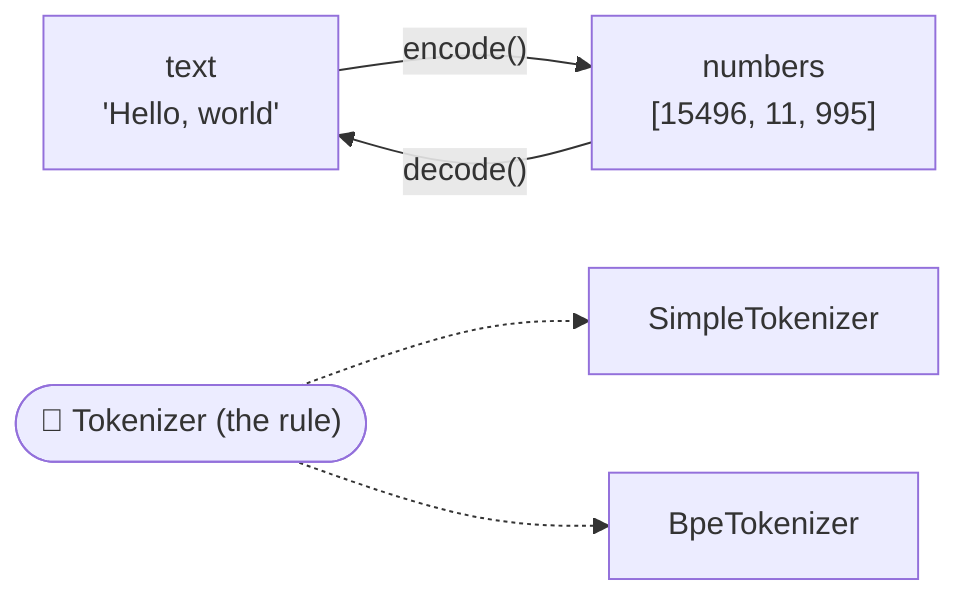
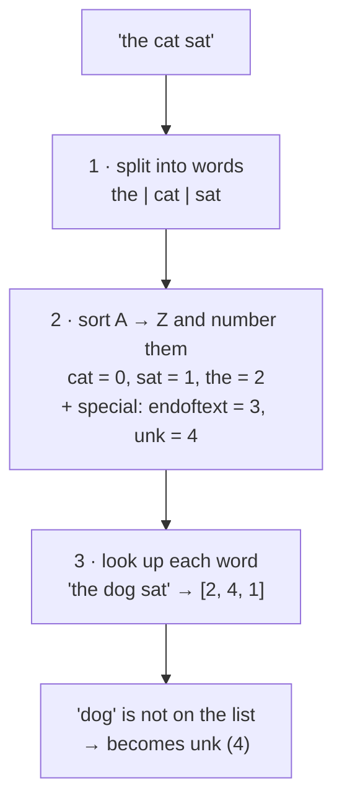
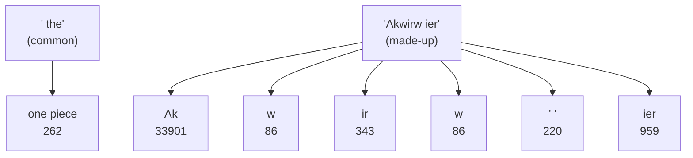

# Package `tokenizer`: turning words into numbers

← [All classes](README.md) · Next: [data →](2-data.md)

Computers can only do maths with numbers. These classes swap words for numbers, and back again.

---

## Tokenizer

🗣️ **In one sentence:** the *rule* that every tokenizer must follow: it must be able to turn text into numbers (`encode`) and numbers back into text (`decode`).

🌍 **Real-life picture:** a phone charger socket. Different chargers (tokenizers) can be plugged in, as long as they fit the same socket shape.

🖼️ **Diagram**

🔢 **Tiny example:** anything that uses a `Tokenizer` can swap one kind for the other without changing any code.
The `TextGenerator` doesn't care which tokenizer it gets. It only calls `encode` and `decode`.

🔗 **In the code:** [`Tokenizer.java`](../../src/main/java/com/tinygpt/tokenizer/Tokenizer.java) · it's an `interface` with 3 methods: `encode`, `decode`, `vocabularySize`.

---

## SimpleTokenizer

🗣️ **In one sentence:** our home-made tokenizer: it gives **every word one number**, using a word list made from the story.

🌍 **Real-life picture:** a class register. Every student has a roll number. If a visitor walks in who isn't on the list, they get the label "unknown".

🖼️ **Diagram**

🔢 **Tiny example** (learning from the text `"the cat sat"`):

| Word | Number |
|---|---:|
| cat | 0 |
| sat | 1 |
| the | 2 |
| `<\|endoftext\|>` | 3 |
| `<\|unk\|>` | 4 |

- `encode("the cat sat")` → `[2, 0, 1]`
- `encode("the dog sat")` → `[2, 4, 1]` ("dog" was never seen, so it becomes `<|unk|>`)
- `decode([2, 4, 1])` → `"the <|unk|> sat"`

**Weakness:** any new word is lost. `BpeTokenizer` fixes this.

🔗 **In the code:** [`SimpleTokenizer.java`](../../src/main/java/com/tinygpt/tokenizer/SimpleTokenizer.java) · `split()`, `buildVocabulary()`, `encode()`, `decode()` · Run it: `./run.sh 1`

---

## BpeTokenizer

🗣️ **In one sentence:** GPT-2's real tokenizer: common words get one number, and rare words are **built from smaller pieces**, so nothing is ever "unknown".

🌍 **Real-life picture:** Lego. Common shapes come as one ready-made brick. Anything unusual can still be built from small bricks.

🖼️ **Diagram**

🔢 **Tiny example**

| Text | Numbers |
|---|---|
| `Hello, world` | `[15496, 11, 995]` → "Hello" + "," + " world" |
| `Akwirw ier` | `[33901, 86, 343, 86, 220, 959]` (6 small pieces) |
| `<\|endoftext\|>` | `[50256]` (the special "end of document" number) |

It knows **50,257** pieces in total. Notice that `" world"` *includes the space*: in GPT-2, the space belongs to the word after it.

🔗 **In the code:** [`BpeTokenizer.java`](../../src/main/java/com/tinygpt/tokenizer/BpeTokenizer.java) · uses the JTokkit library, which holds GPT-2's list of pieces · Run it: `./run.sh 2`
