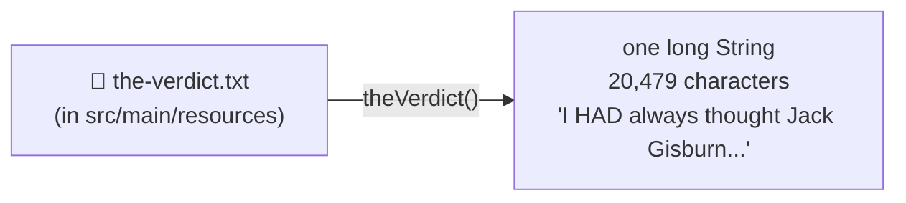
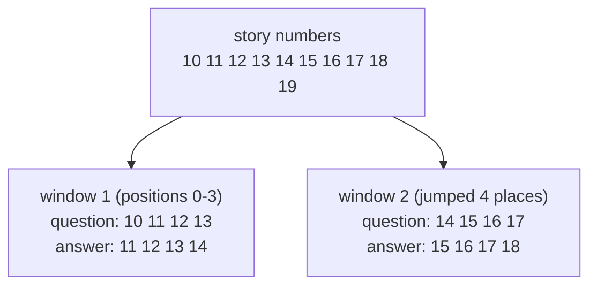
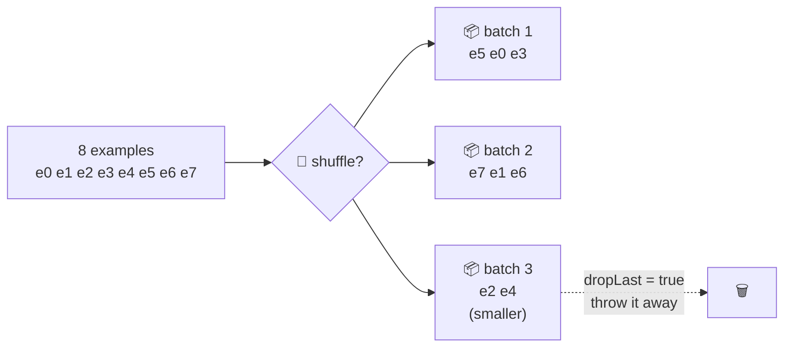

# Package `data`: making practice questions

← [tokenizer](1-tokenizer.md) · [All classes](README.md) · Next: [nn →](3-nn.md)

The model learns by practising one kind of question again and again: **"what word comes next?"**
These classes turn a story into thousands of those questions.

---

## SampleText

🗣️ **In one sentence:** loads the story *The Verdict* (by Edith Wharton, 1908) from the project's resources folder as one long piece of text.

🌍 **Real-life picture:** taking the textbook off the shelf before you start studying.

🖼️ **Diagram**

🔢 **Tiny example:** `SampleText.theVerdict().length()` → `20479`. After `BpeTokenizer` that's **5,145** token numbers.

🔗 **In the code:** [`SampleText.java`](../../src/main/java/com/tinygpt/data/SampleText.java) · used by `TinyGPT` and the step programs.

---

## GPTDataset

🗣️ **In one sentence:** slides a "window" along the story's numbers and makes **question/answer pairs**, where the answer is the question shifted one word to the right.

🌍 **Real-life picture:** a fill-in-the-next-word worksheet made from a book. You cover the book with a card that has a small window cut out, and slide it along.

🖼️ **Diagram**

🔢 **Tiny example:** story numbers `[10, 11, 12, 13, 14, 15, 16, 17, 18, 19]`, window size `4`, jump (stride) `4`:

| Example | Question (input) | Answer (target) |
|---:|---|---|
| 0 | `10 11 12 13` | `11 12 13 14` |
| 1 | `14 15 16 17` | `15 16 17 18` |

One example is really **4 questions at once**:

| Seen so far | Should guess |
|---|---|
| 10 | 11 |
| 10 11 | 12 |
| 10 11 12 | 13 |
| 10 11 12 13 | 14 |

With jump `1` instead of `4`, the windows overlap, and you get 6 examples instead of 2.

🔗 **In the code:** [`GPTDataset.java`](../../src/main/java/com/tinygpt/data/GPTDataset.java) · `input(i)`, `target(i)`, `size()` · Run it: `./run.sh 3`

---

## GPTDataLoader

🗣️ **In one sentence:** packs the examples into **batches** (boxes of several examples), optionally shuffled, so the model can practise on many at once.

`Batch` is the small record inside it that holds one box: `inputs` and `targets`.

🌍 **Real-life picture:** a teacher handing out flashcards in bundles of 8. Before each round the deck is shuffled, so students don't just learn the order.

🖼️ **Diagram**

🔢 **Tiny example:** 8 examples, batch size 3:
- `dropLast = false` → 3 batches (3 + 3 + 2)
- `dropLast = true` → 2 batches (3 + 3); the uneven leftover is skipped

In real training: 72 examples ÷ 8 per batch = **9 batches per round** (one round = one *epoch*).

A batch is a grid with shape `[8, 64]`: 8 examples, each 64 token numbers long.

🔗 **In the code:** [`GPTDataLoader.java`](../../src/main/java/com/tinygpt/data/GPTDataLoader.java) · use it in a `for` loop: `for (Batch batch : loader) { ... }` · used by `Trainer`.
