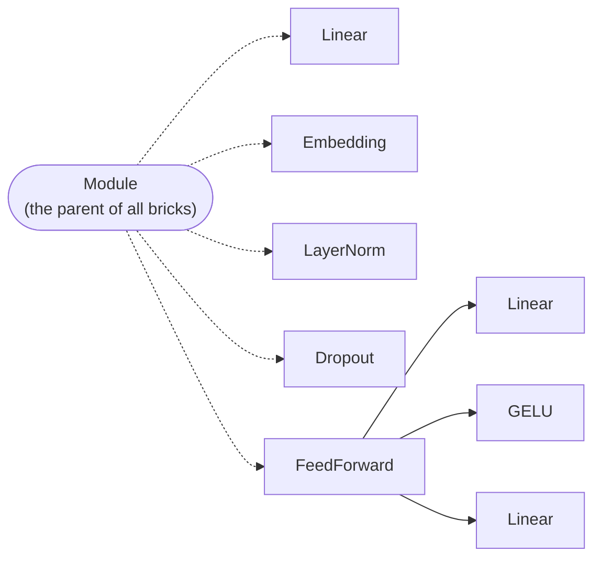
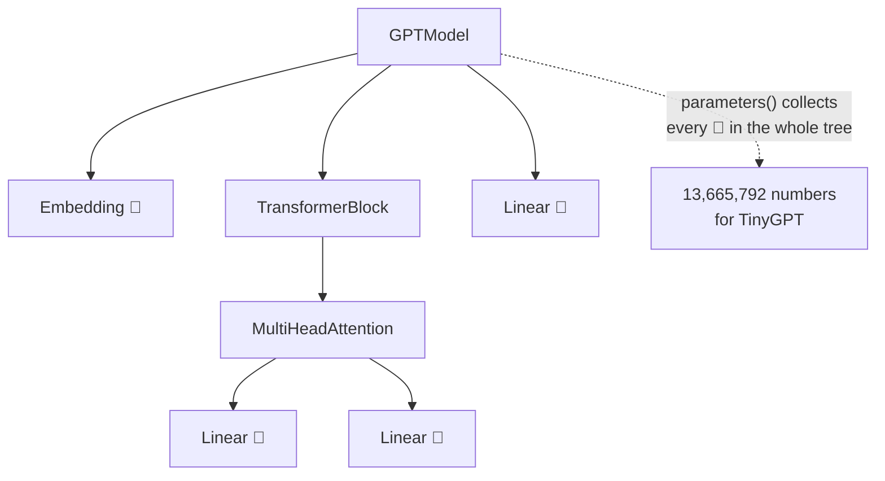
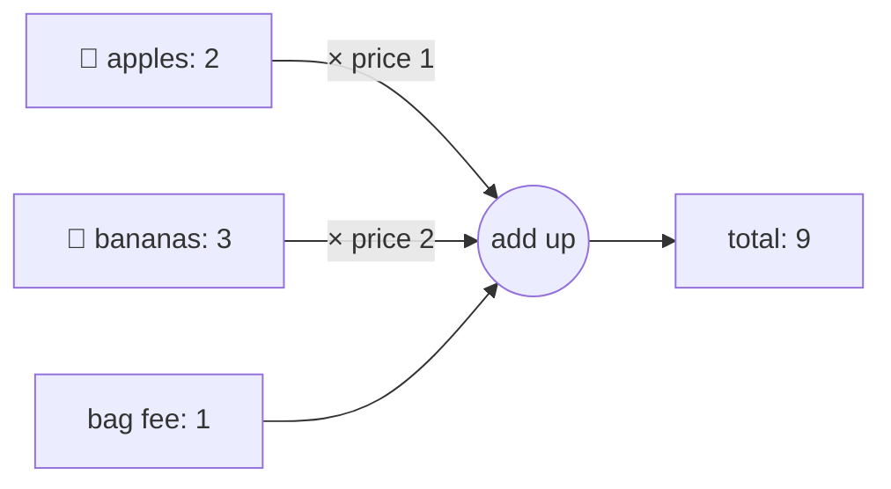
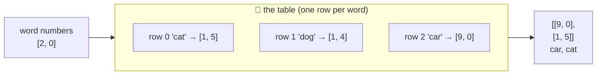
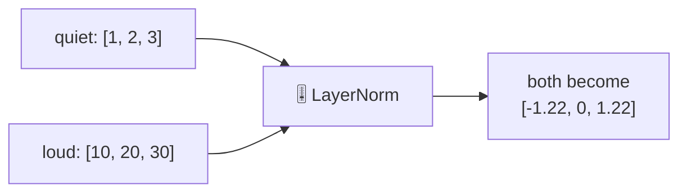
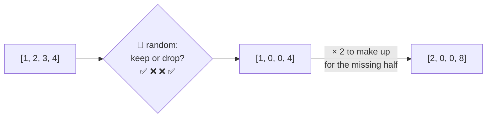
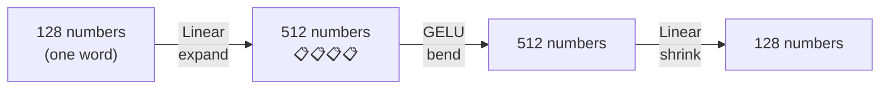

# Package `nn`: the Lego bricks

← [data](2-data.md) · [All classes](README.md) · Next: [attention →](4-attention.md)

"nn" stands for **neural network**. These are the small building blocks that bigger parts are made from,
the same way a Lego castle is made of plain bricks.



---

## Module

🔬 **Line by line with real numbers:** [walkthrough](../walkthroughs/step06-self-attention.md)

🗣️ **In one sentence:** the parent class of every layer: it keeps a list of the layer's **learnable numbers** (parameters) and of the **smaller layers inside it**.

🌍 **Real-life picture:** Russian nesting dolls. Each doll can contain smaller dolls. If you ask the biggest doll "how many dolls are there?", it counts every doll inside it.

🖼️ **Diagram**



🔢 **Tiny example:** a `Linear` with 2 inputs and 3 outputs has `2 × 3 = 6` weights and `3` bias numbers.
So its `parameterCount()` is **9**. A module holding two of them counts **18**.

It also has an on/off switch, `setTraining(true/false)`, which it passes down to every module inside. Dropout only works when this is on.

🔗 **In the code:** [`Module.java`](../../src/main/java/com/tinygpt/nn/Module.java) · `parameter()` registers a number grid, `child()` registers an inner module · same idea as PyTorch's `nn.Module`.

---

## Linear

🔬 **Line by line with real numbers:** [walkthrough](../walkthroughs/step06-self-attention.md)

🗣️ **In one sentence:** makes new numbers by **multiplying each input by a weight, adding them up, and adding an extra "bias"**. The weights are what the model learns.

🌍 **Real-life picture:** a shopping bill. Quantity × price for each item, add them up, then add a fixed bag fee.

🖼️ **Diagram**



🔢 **Tiny example:** inputs `[2, 3]`

| Output | Weights | Bias | Sum |
|---|---|---|---|
| output 1 | `1, 2` | `1` | `2×1 + 3×2 + 1 = 9` |
| output 2 | `0.5, 0` | `0` | `2×0.5 + 3×0 + 0 = 1` |

So `[2, 3]` → `[9, 1]`. The model starts with random "prices", and training slowly finds useful ones.
Many outputs = many different bills from the same shopping basket.

🔗 **In the code:** [`Linear.java`](../../src/main/java/com/tinygpt/nn/Linear.java) · `forward(x) = x × weight + bias` · used inside attention, feed forward, and the final output layer.

---

## Embedding

🔬 **Line by line with real numbers:** [walkthrough](../walkthroughs/step04-embeddings.md)

🗣️ **In one sentence:** a **lookup table** that turns a word's number into a list of numbers describing that word.

🌍 **Real-life picture:** a library card catalogue. You give it a card number, and it hands you that card. The card describes the thing.

🖼️ **Diagram**



🔢 **Tiny example:** imagine the two numbers mean *"how much of a machine"* and *"how alive"*:

| Word | Row | Meaning |
|---|---|---|
| cat | `[1, 5]` | not a machine, very alive |
| dog | `[1, 4]` | not a machine, very alive (close to cat!) |
| car | `[9, 0]` | very much a machine, not alive |

Looking up `[2, 0]` gives back rows 2 and 0: `[[9, 0], [1, 5]]`.

In the real model nobody writes these numbers by hand. They start **random**, and training moves similar words closer together.
TinyGPT uses 128 numbers per word; GPT-2 uses 768.

GPT uses **two** tables: one for *which word* it is, and one for *which position* it's in (1st, 2nd, 3rd...). The two rows are added together.

🔗 **In the code:** [`Embedding.java`](../../src/main/java/com/tinygpt/nn/Embedding.java) · `forward(ids)` is one line: pick those rows · Run it: `./run.sh 4`

---

## LayerNorm

🔬 **Line by line with real numbers:** [walkthrough](../walkthroughs/step09-gpt-model.md)

🗣️ **In one sentence:** rescales a list of numbers so they are **centred around 0 and not too spread out**, whatever size they started at.

🌍 **Real-life picture:** a sound engineer's volume knob. Whether a singer whispers or shouts, the knob brings them to the same comfortable level, and the *tune* stays the same.

🖼️ **Diagram**



🔢 **Tiny example** with `[10, 20, 30]`:

1. **Find the middle (average):** `(10 + 20 + 30) ÷ 3 = 20`
2. **Subtract it:** `[-10, 0, 10]`. Now the middle is 0.
3. **Measure the spread:** square each (`100, 0, 100`), average them (`66.7`), square root (`8.16`)
4. **Divide by the spread:** `[-10, 0, 10] ÷ 8.16 = [-1.22, 0, 1.22]`

`[1, 2, 3]` gives exactly the same answer: the *pattern* (low, middle, high) is kept, and the size is fixed.
After that, two learnable numbers (`scale` and `shift`) let the model turn the volume up or down if that helps.

🔗 **In the code:** [`LayerNorm.java`](../../src/main/java/com/tinygpt/nn/LayerNorm.java) · used twice in every `TransformerBlock`, and once at the end of `GPTModel`.

---

## GELU

🔬 **Line by line with real numbers:** [walkthrough](../walkthroughs/step09-gpt-model.md)

🗣️ **In one sentence:** a **gate** for numbers: positive numbers pass through almost unchanged, and negative numbers are squeezed to (almost) zero.

🌍 **Real-life picture:** a one-way door that swings smoothly. People walking forward pass easily; people walking backward are mostly stopped.

🖼️ **Diagram**

```mermaid
xychart-beta
    title "GELU: what goes in → what comes out"
    x-axis "in" ["-3", "-2", "-1", "0", "1", "2", "3"]
    y-axis "out" -0.5 --> 3
    line [-0.004, -0.045, -0.159, 0, 0.841, 1.955, 2.996]
```

🔢 **Tiny example**

| In | Out | What happened |
|---:|---:|---|
| 3 | 2.996 | passed through |
| 1 | 0.841 | mostly passed |
| 0 | 0 | — |
| -1 | -0.159 | mostly blocked |
| -3 | -0.004 | blocked |

**Why we need it:** without a bend like this, stacking 100 layers would be no smarter than one layer.
The bends are what let the model learn complicated patterns.

🔗 **In the code:** [`GELU.java`](../../src/main/java/com/tinygpt/nn/GELU.java) · `GELU.apply(x)` · used inside `FeedForward`.

---

## Dropout

🔬 **Line by line with real numbers:** [walkthrough](../walkthroughs/step07-causal-attention.md)

🗣️ **In one sentence:** while practising, it **randomly switches off** some numbers (sets them to 0), and makes the rest a bit bigger to make up for it.

🌍 **Real-life picture:** football practice where random players are told to sit out each time. Everyone has to learn to play well, instead of always passing to the one star player.

🖼️ **Diagram**



🔢 **Tiny example:** rate `0.5` means each number has a 50% chance of being dropped.
`[1, 2, 3, 4]` might become `[2, 0, 0, 8]`. Next time, a different random set is dropped.

**When writing text (not practising), dropout does nothing**, so the model uses everything it has learned.

🔗 **In the code:** [`Dropout.java`](../../src/main/java/com/tinygpt/nn/Dropout.java) · checks `isTraining()` first · used in attention, transformer blocks, and after the embeddings.

---

## FeedForward

🔬 **Line by line with real numbers:** [walkthrough](../walkthroughs/step09-gpt-model.md)

🗣️ **In one sentence:** gives each word some private "thinking time": it **expands** the word's numbers to 4× as many, bends them with GELU, then **shrinks** them back.

🌍 **Real-life picture:** spreading your notes across a big table to think, then writing a short summary back on your small notepad.

🖼️ **Diagram**



🔢 **Tiny example:** with 2 numbers per word, FeedForward goes `2 → 8 → 2`.
The bigger middle gives it room to notice more patterns before summarising.
Every word goes through the **same** FeedForward, but on its own: words don't talk to each other here (that's what attention is for).

🔗 **In the code:** [`FeedForward.java`](../../src/main/java/com/tinygpt/nn/FeedForward.java) · `Linear → GELU → Linear` · used in every `TransformerBlock`.
