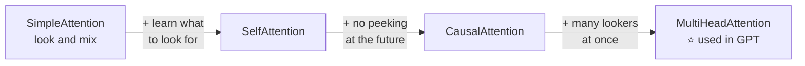
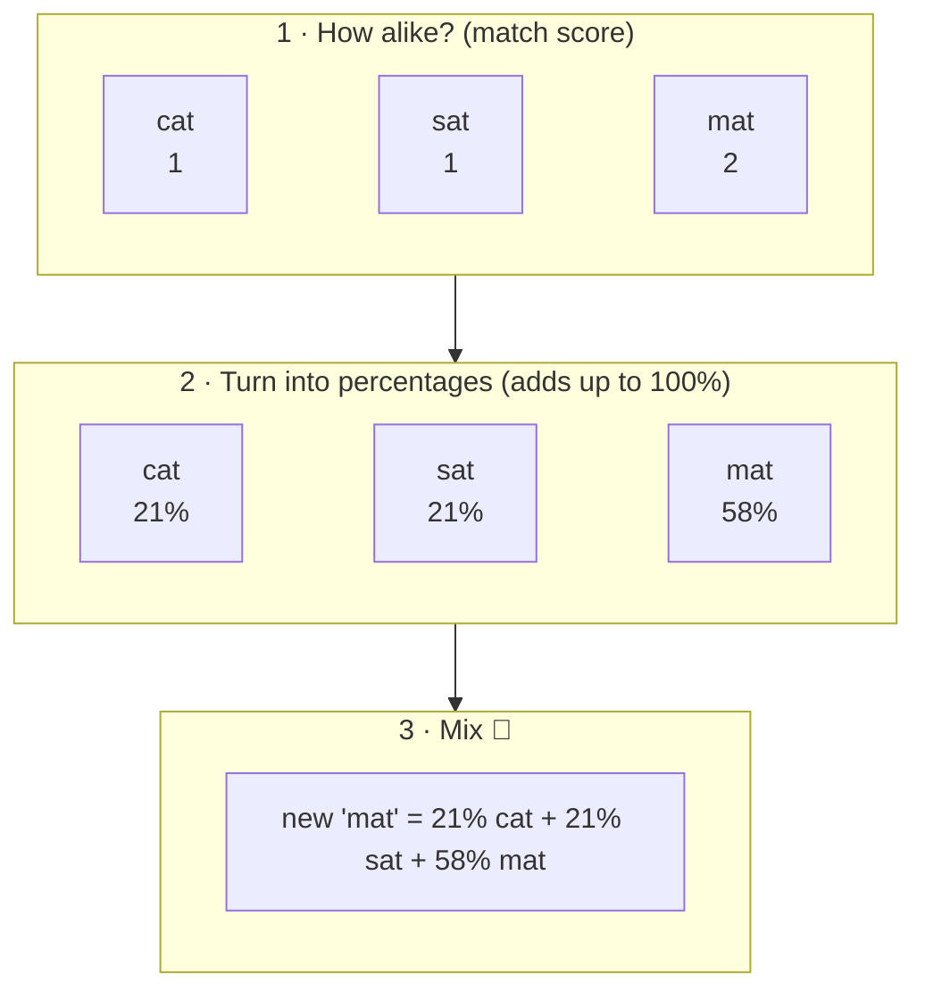
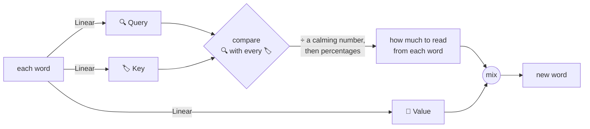
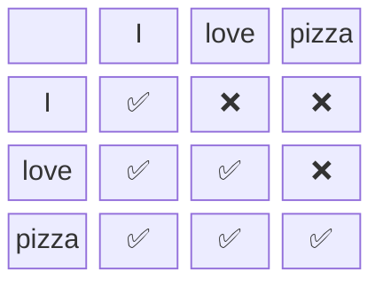
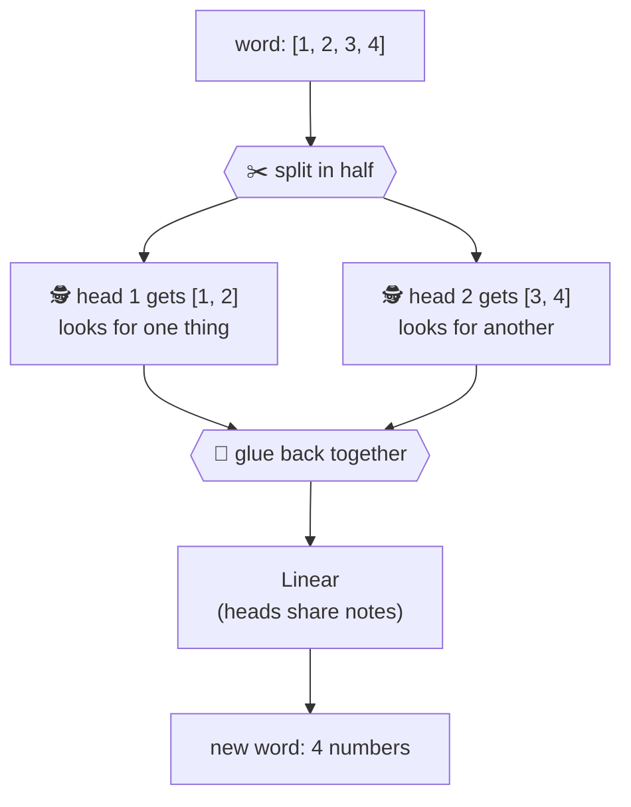

# Package `attention`: words looking at other words

← [nn](3-nn.md) · [All classes](README.md) · Next: [model →](5-model.md)

To understand a word, you look at the words around it. "Bank" means something different in
*"the river bank"* and *"money in the bank"*. Attention lets every word look at the others.

The four classes build up the idea one piece at a time:

---

## SimpleAttention

🗣️ **In one sentence:** each word checks **how similar** it is to every word, turns that into percentages, and becomes a **mix** of all the words.

🌍 **Real-life picture:** making a smoothie. Each fruit you add is a word. The more a word matters, the more of it goes into the cup.

🖼️ **Diagram** (focusing on the word "mat")

🔢 **Tiny example:** three words, two numbers each:

| Word | Numbers |
|---|---|
| cat | `[1, 0]` |
| sat | `[0, 1]` |
| mat | `[1, 1]` |

**Step 1 – match score** (multiply the matching numbers, then add):
- mat with cat: `1×1 + 1×0 = 1`
- mat with sat: `1×0 + 1×1 = 1`
- mat with mat: `1×1 + 1×1 = 2`

**Step 2 – percentages** (*softmax*): bigger scores get a bigger slice of the pizza, and the slices always add up to 100%.
Scores `1, 1, 2` → `21%, 21%, 58%`.

**Step 3 – mix:** `0.21 × [1,0] + 0.21 × [0,1] + 0.58 × [1,1] = [0.79, 0.79]`

So "mat" now carries a little bit of "cat" and "sat" inside it.

🔗 **In the code:** [`SimpleAttention.java`](../../src/main/java/com/tinygpt/attention/SimpleAttention.java) · `scores()`, `weights()`, `contextVectors()` · Run it: `./run.sh 5`

---

## SelfAttention

🗣️ **In one sentence:** like SimpleAttention, but each word first makes three **learned** versions of itself: a **Query** (what am I looking for?), a **Key** (what do I have?) and a **Value** (what do I give?).

🌍 **Real-life picture:** a library.
- **Query** 🔍 = the question you bring: *"books about cats"*
- **Key** 🏷️ = the label on each book's spine
- **Value** 📖 = what's inside the book

You compare your question with every label, then read mostly from the books whose labels match.

🖼️ **Diagram**

🔢 **Tiny example:** the word "it" is looking at "cat" and "mat":

| | Query of "it" | Key | Value |
|---|---|---|---|
| | `[1, 0]` | | |
| cat | | `[1, 0]` | `[5, 0]` |
| mat | | `[0, 1]` | `[0, 5]` |

1. **Compare:** with cat `1×1 + 0×0 = 1`; with mat `1×0 + 0×1 = 0`
2. **Calm down** (divide by √2 ≈ 1.41, because each list has 2 numbers): `0.71` and `0`
3. **Percentages:** cat `67%`, mat `33%`
4. **Mix the Values:** `0.67 × [5,0] + 0.33 × [0,5] = [3.35, 1.65]`

"it" took mostly from "cat". The Query/Key/Value weights are **learned**, so the model decides for itself what should match.

🔗 **In the code:** [`SelfAttention.java`](../../src/main/java/com/tinygpt/attention/SelfAttention.java) · `forward()`, `attend()` · Run it: `./run.sh 6`

---

## CausalAttention

🗣️ **In one sentence:** self-attention where each word may only look at **itself and the words before it**, never the words after it.

🌍 **Real-life picture:** a test where you must cover the answers below with a sheet of paper. If you could peek, you'd learn nothing.

🖼️ **Diagram** (✅ = may look, ❌ = hidden)

🔢 **Tiny example:** the word "love" has match scores `I: 2, love: 1, pizza: 3`.

- Without a mask: "pizza" would get the most attention, but "pizza" is the answer we want to guess. That's cheating!
- With the mask: the "pizza" score becomes **minus infinity** (smaller than any number), which turns into **0%**.
- Scores `2, 1, −∞` → percentages `73%, 27%, 0%` ✅

It also uses `Dropout` on the percentages while practising.

🔗 **In the code:** [`CausalAttention.java`](../../src/main/java/com/tinygpt/attention/CausalAttention.java) · `causalMask()` builds the ✅/❌ grid · Run it: `./run.sh 7`

---

## MultiHeadAttention

🗣️ **In one sentence:** runs **several causal attentions side by side** ("heads"), each free to look for something different, then joins their findings.

🌍 **Real-life picture:** a team of detectives searching the same room. One looks for fingerprints, one for footprints, one for notes. Together they understand much more.

🖼️ **Diagram**

🔢 **Tiny example:** a word has 4 numbers and there are 2 heads, so each head gets 2 numbers.
Each head does its own causal attention. The results are glued back into 4 numbers, and a final `Linear` mixes the heads' findings.

| | TinyGPT | GPT-2 |
|---|---:|---:|
| Numbers per word | 128 | 768 |
| Heads | 4 | 12 |
| Numbers per head | 32 | 64 |

We don't choose what each head looks for. That is learned during training.

🔗 **In the code:** [`MultiHeadAttention.java`](../../src/main/java/com/tinygpt/attention/MultiHeadAttention.java) · `splitHeads()` does the ✂️ · used in every `TransformerBlock` · Run it: `./run.sh 8`
