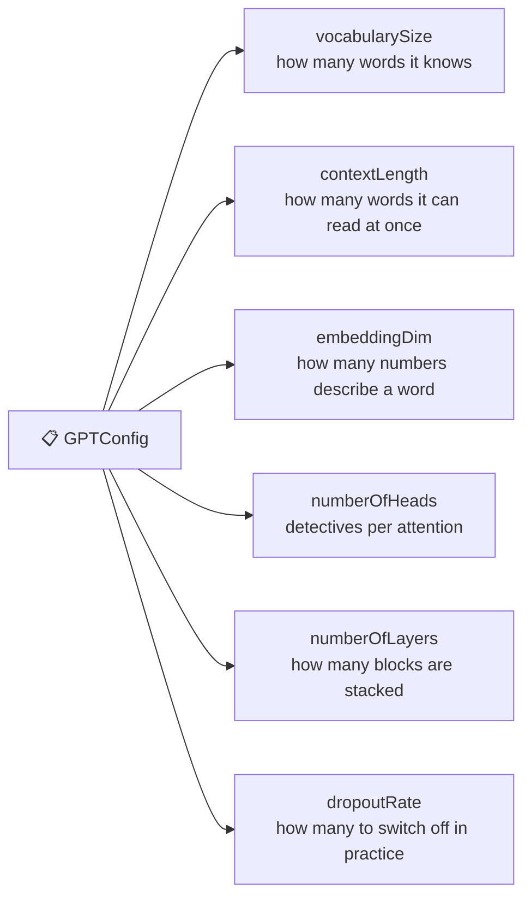
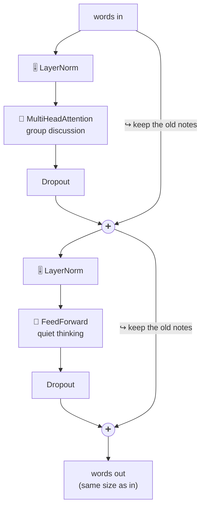
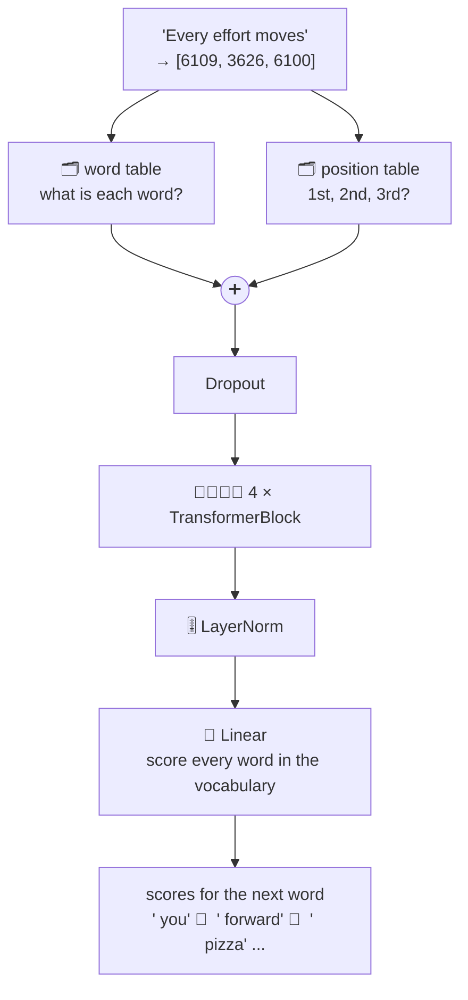

# Package `model`: the whole brain

← [attention](4-attention.md) · [All classes](README.md) · Next: [training →](6-training.md)

---

## GPTConfig

🔬 **Line by line with real numbers:** [walkthrough](../walkthroughs/step09-gpt-model.md)

🗣️ **In one sentence:** a **settings card** that says how big the model is: how many words it knows, how much it can read at once, how many layers, and so on.

🌍 **Real-life picture:** the settings screen of a video game: map size, number of players, difficulty.

🖼️ **Diagram**



🔢 **Tiny example:** the two ready-made cards:

| Setting | `TINY` (ours) | `GPT2_SMALL` (the book's) |
|---|---:|---:|
| vocabularySize | 50,257 | 50,257 |
| contextLength | 64 | 1,024 |
| embeddingDim | 128 | 768 |
| numberOfHeads | 4 | 12 |
| numberOfLayers | 4 | 12 |
| dropoutRate | 0.1 (10%) | 0.1 (10%) |
| **Total learnable numbers** | **13.7 million** | **163 million** |

Want a different size? Make your own card: `new GPTConfig(50257, 64, 64, 2, 2, 0.1f, false)`.

🔗 **In the code:** [`GPTConfig.java`](../../src/main/java/com/tinygpt/model/GPTConfig.java) · a Java `record`: just data, no behaviour.

---

## TransformerBlock

🔬 **Line by line with real numbers:** [walkthrough](../walkthroughs/step09-gpt-model.md)

🗣️ **In one sentence:** one "floor" of the model, where words first **listen to each other** (attention) and then each **thinks alone** (feed forward), always keeping a copy of what they had before.

🌍 **Real-life picture:** a classroom lesson. First a group discussion, then quiet thinking time. And you never throw your old notes away: you just add the new ideas to them.

🖼️ **Diagram**



🔢 **Tiny example** of the ↪️ shortcut ("keep the old notes"):

```
a word before:            [1.0,  2.0]
attention suggests:     + [0.1, -0.2]     (a small correction)
the word after:         = [1.1,  1.8]
```

Because we **add** the change instead of replacing the word, nothing important is lost, even after many floors.
This is why deep models (many floors) can still learn.

TinyGPT stacks **4** of these floors; GPT-2 stacks **12**.

🔗 **In the code:** [`TransformerBlock.java`](../../src/main/java/com/tinygpt/model/TransformerBlock.java) · the whole `forward()` is two lines, one per half.

---

## GPTModel

🔬 **Line by line with real numbers:** [walkthrough](../walkthroughs/step09-gpt-model.md)

🗣️ **In one sentence:** the complete brain: word numbers go in, and for every position out comes a **score for each of the 50,257 possible next words**.

🌍 **Real-life picture:** a factory line. Raw material (word numbers) goes in one end, passes through several workstations, and a finished product (next-word scores) comes out of the other end.

🖼️ **Diagram**



🔢 **Tiny example:** reading the sizes in plain words:

| Stage | Shape | In plain words |
|---|---|---|
| In | `[1, 3]` | 1 sentence, 3 words |
| After the tables | `[1, 3, 128]` | each word is now 128 numbers |
| After the blocks | `[1, 3, 128]` | same size, but the words now "know" about each other |
| Out | `[1, 3, 50257]` | for each word: a score for every possible next word |

To guess what comes after "moves", look at the **last** row and pick the highest score.

It can also **save** all its learned numbers to a file (`models/tinygpt.params`) and **load** them later, so you only have to train once.

🔗 **In the code:** [`GPTModel.java`](../../src/main/java/com/tinygpt/model/GPTModel.java) · `forward()`, `save()`, `load()` · Run it: `./run.sh 9`
