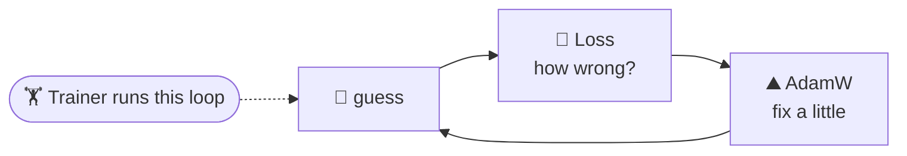
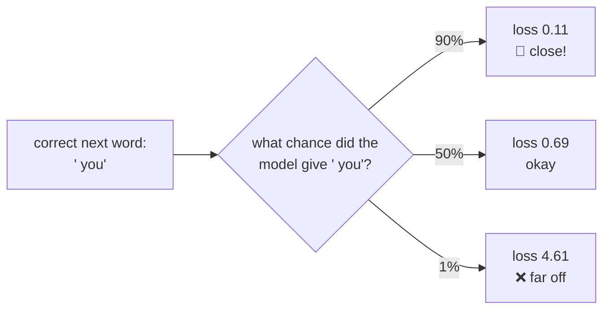
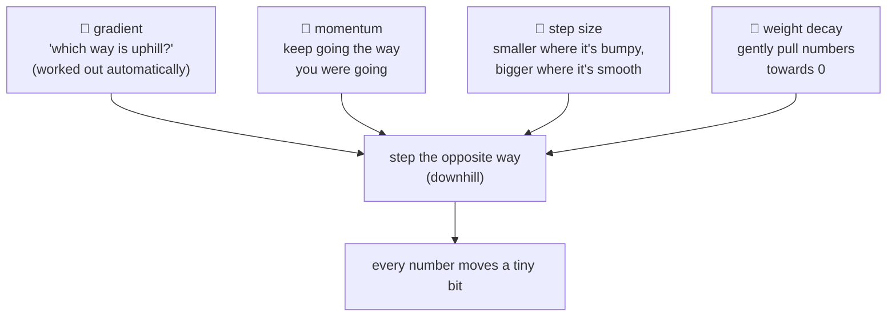
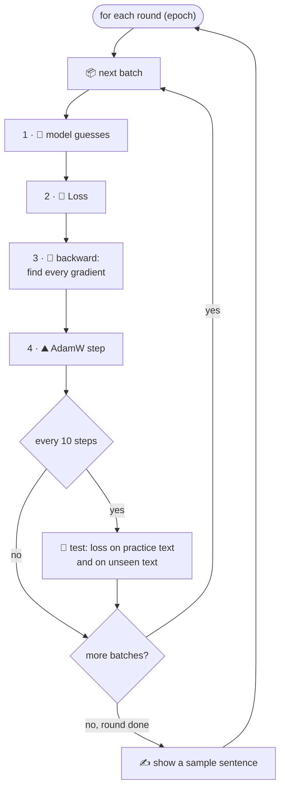

# Package `training`: practice makes perfect

← [model](5-model.md) · [All classes](README.md) · Next: [generation →](7-generation.md)

A new model knows nothing; all its numbers are random. Training is practice:
**guess → check how wrong → fix a little → repeat**.



---

## Loss

🔬 **Line by line with real numbers:** [walkthrough](../walkthroughs/step10-loss.md)

🗣️ **In one sentence:** gives **one number for how wrong** the model's guesses were: 0 means perfect, and bigger means worse.

🌍 **Real-life picture:** darts. The loss is how far your dart landed from the bullseye.

🖼️ **Diagram**



🔢 **Tiny example**

| Chance given to the right word | Loss |
|---:|---:|
| 100% | 0 |
| 90% | 0.11 |
| 50% | 0.69 |
| 10% | 2.30 |
| 1% | 4.61 |

The rule: **the more confident the model was in the right answer, the smaller the loss.**
For a batch we take the average: two guesses with loss `0.69` and `2.30` → `(0.69 + 2.30) ÷ 2 = 1.50`.

A brand-new model scores about **11**, because it's guessing blindly among 50,257 words.

*How it picks out the right answer:* it multiplies by a list that is all 0s except a 1 at the correct word.
If the right word is #2 out of 5: `[0, 0, 1, 0, 0]`. That's called **one-hot**.

🔗 **In the code:** [`Loss.java`](../../src/main/java/com/tinygpt/training/Loss.java) · `crossEntropy(logits, targets)` · Run it: `./run.sh 10`

---

## AdamW

🔬 **Line by line with real numbers:** [walkthrough](../walkthroughs/step-tinygpt-training.md)

🗣️ **In one sentence:** after each guess, it **nudges every one of the model's numbers a tiny bit** in the direction that makes the loss smaller.

🌍 **Real-life picture:** walking down a hill in thick fog to reach the bottom (the lowest loss). You can't see the bottom, only feel which way the ground slopes under your feet. So you take small steps downhill, like a ball rolling with momentum.

🖼️ **Diagram**



🔢 **Tiny example** (the simple version, without the extras):

```
a number in the model:          5
its gradient (uphill this way): +2
learning rate (step size):      0.1

new number = 5 − 0.1 × 2 = 4.8      ← stepped downhill
```

AdamW does this for **all 13.7 million numbers** at once, every step, with momentum and smart step sizes added.

**Safety check:** before moving anything, it checks that every gradient is a real number.
If something went wrong and a gradient is "NaN" (not a number), it **skips that step** instead of breaking the whole model.

🔗 **In the code:** [`AdamW.java`](../../src/main/java/com/tinygpt/training/AdamW.java) · `step()` moves the numbers, `zeroGradients()` wipes the old gradients clean.

---

## Trainer

🔬 **Line by line with real numbers:** [walkthrough](../walkthroughs/step-tinygpt-training.md)

🗣️ **In one sentence:** the **practice coach**: it hands the model batch after batch, and after each one runs *guess → loss → find gradients → AdamW step*. Now and then it tests the model on text it has never practised on.

🌍 **Real-life picture:** a sports coach running drills, and checking every so often how the team does in a friendly match against new opponents.

🖼️ **Diagram**



🔢 **Tiny example:** counting the work in `./run.sh train`:

```
72 examples ÷ 8 per batch   = 9 steps per round
9 steps × 25 rounds         = 225 steps in total
time on a laptop            ≈ 20 seconds
```

**Watch out for memorising.** If the score on *practice* text keeps getting better but the score on *unseen* text gets worse,
the model is memorising the answers instead of learning. Like a student who memorised last year's test.

🔗 **In the code:** [`Trainer.java`](../../src/main/java/com/tinygpt/training/Trainer.java) · `train()`, `trainStep()`, `averageLoss()` · Run it: `./run.sh train`
