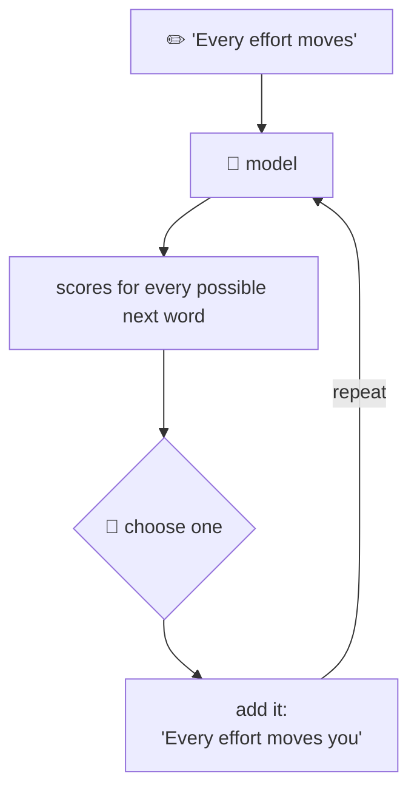
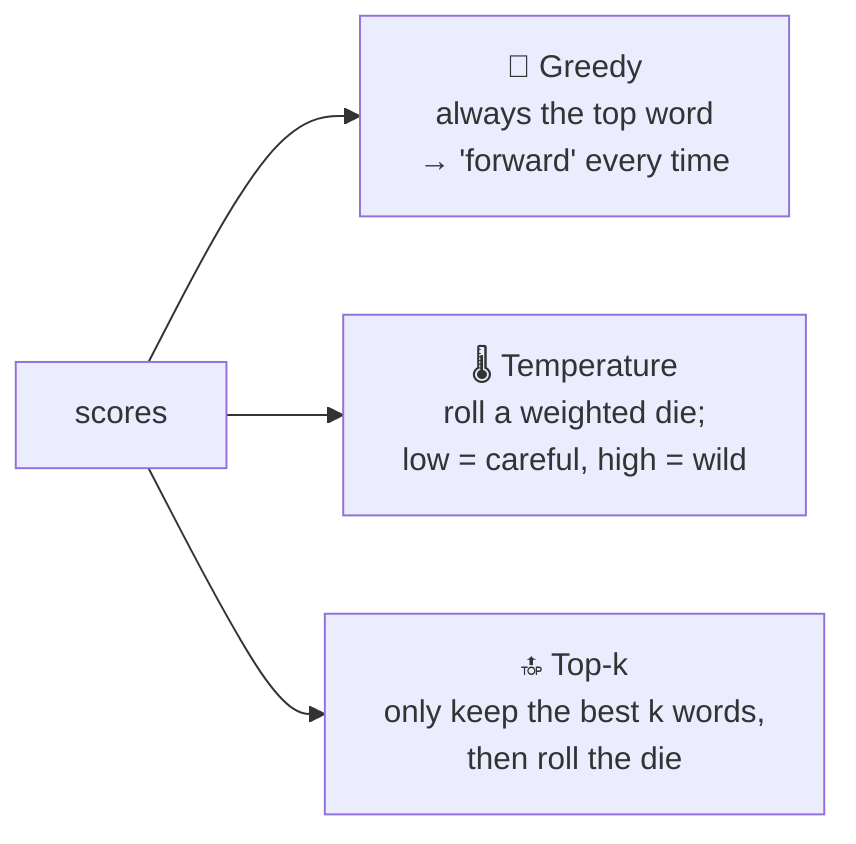

# Package `generation`: writing new text

← [training](6-training.md) · [All classes](README.md) · Next: [main and examples →](8-main-and-examples.md)

---

## TextGenerator

🗣️ **In one sentence:** makes the model **write**: it asks for the next word, adds it to the text, and repeats.

🌍 **Real-life picture:** a game of "one word each" story-telling, where the model always adds the next word.

🖼️ **Diagram**

### Three ways to choose the next word

Say the model's scores are: **forward 6.75**, **toward 6.28**, closer 4.51, ..., pizza −1.89.

🔢 **Tiny example: temperature.** Two words with scores `2` and `1`:

| Temperature | Scores become | Chances | Feels like |
|---:|---|---|---|
| 0.5 (cool) | `4` and `2` (gap grows) | 88% / 12% | careful, predictable |
| 1 (normal) | `2` and `1` | 73% / 27% | normal |
| 2 (hot) | `1` and `0.5` (gap shrinks) | 62% / 38% | creative, surprising |

Dividing by a **small** temperature stretches the gap between scores, so the winner wins more often.
Dividing by a **big** temperature squashes the gap, so underdogs win more often.

🔢 **Tiny example: top-k.** With `k = 3`, only *forward*, *toward* and *closer* can ever be picked.
"pizza" is thrown out before the die is rolled.

**Context window:** TinyGPT can only read 64 words at once. When the text gets longer, the generator feeds in only the **last 64**.

🔗 **In the code:** [`TextGenerator.java`](../../src/main/java/com/tinygpt/generation/TextGenerator.java)

| Method | Job |
|---|---|
| `generate(prompt, howMany, temperature, topK)` | the writing loop |
| `generateGreedy(prompt, howMany)` | the loop, always picking the top word |
| `argMax(scores)` | find the top word |
| `keepTopK(scores, k)` | throw away all but the best k |
| `softmax(scores, temperature)` | turn scores into chances that add up to 100% |

This class is written in plain Java (just loops over arrays), so it's a good one to read first. Run it: `./run.sh 11`, then `./run.sh generate "I had always"`.
