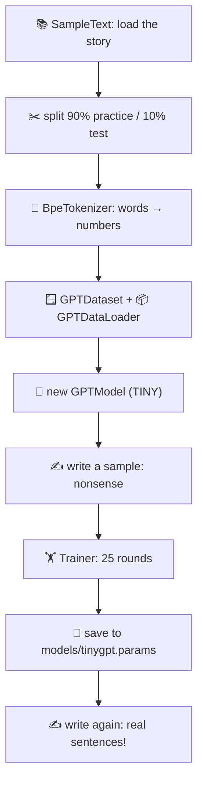
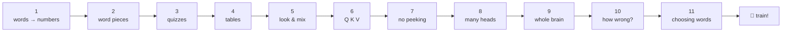

# The main program and the step programs

← [generation](7-generation.md) · [All classes](README.md)

---

## TinyGPT

🗣️ **In one sentence:** the main program that runs the whole journey: read the story, build the model, train it, save it, and let it write.

🌍 **Real-life picture:** the recipe card that uses all the ingredients (classes) in the right order.

🖼️ **Diagram**



🔢 **Tiny example:** what you'll see when you run it

```
Before training: Every effort moves you Hero farmland tenth harness ATL subsidized Contracts fixes
Epoch  2  step   10  ...  train loss 9.316  validation loss 9.487
...
Epoch 25  step  220  ...  train loss 0.773  validation loss 6.620
Greedy: Every effort moves you know; and I had the craft was vindicated by little Claude Nutley...
```

Two ways to run it:
- `./run.sh train`: train from scratch, then write
- `./run.sh generate "your words"`: load the saved model and continue your words

🔗 **In the code:** [`TinyGPT.java`](../../src/main/java/com/tinygpt/TinyGPT.java) · the settings (`EPOCHS`, `LEARNING_RATE`, ...) are at the top. Try changing them!

---

## The step programs

Each `StepNN_...` class is a tiny program that shows **one idea**, prints what happens, and uses the classes above.



| Program | Shows | Uses these classes | Run |
|---|---|---|---|
| `Step01_SimpleTokenizer` | splitting text, word list, unknown words | `SimpleTokenizer`, `SampleText` | `./run.sh 1` |
| `Step02_BytePairEncoding` | GPT-2's word pieces | `BpeTokenizer` | `./run.sh 2` |
| `Step03_SlidingWindow` | question/answer pairs, batches | `GPTDataset`, `GPTDataLoader` | `./run.sh 3` |
| `Step04_Embeddings` | lookup tables for words and positions | `Embedding` | `./run.sh 4` |
| `Step05_SimpleAttention` | match scores, percentages, mixing | `SimpleAttention` | `./run.sh 5` |
| `Step06_SelfAttention` | Query, Key, Value (same numbers as the book) | `SelfAttention` | `./run.sh 6` |
| `Step07_CausalAttention` | the ✅/❌ mask, dropout | `CausalAttention`, `Dropout` | `./run.sh 7` |
| `Step08_MultiHeadAttention` | several heads at once | `MultiHeadAttention` | `./run.sh 8` |
| `Step09_GPTModel` | the full GPT-2 brain (163 million numbers) | `GPTModel`, `GPTConfig`, `TextGenerator` | `./run.sh 9` |
| `Step10_Loss` | how wrong a new model is | `Loss`, `GPTModel` | `./run.sh 10` |
| `Step11_Sampling` | greedy, temperature, top-k | `TextGenerator` | `./run.sh 11` |

🔗 **In the code:** [`examples/`](../../src/main/java/com/tinygpt/examples)
