# Packages `pretrained`, `instruct` and `dialog`: borrowing GPT-2's brain and teaching it to chat

← [main and examples](8-main-and-examples.md) · [All classes](README.md) · Concept guides: [9. Chat with GPT-2](../09-chat-with-gpt2.md), [10. Talk](../10-talk-with-dailydialog.md)

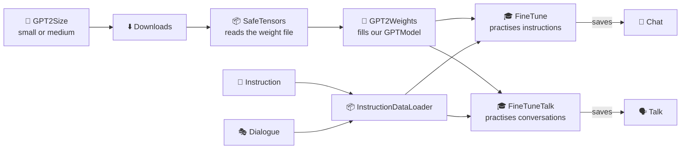

---

## Downloads

🔬 **Line by line with real numbers:** [walkthrough](../walkthroughs/step12-load-gpt2.md)

🗣️ **In one sentence:** downloads a file the first time it's needed, and reuses the saved copy after that.

🌍 **Real-life picture:** buying a book once and keeping it on your shelf, instead of going back to the shop every time you want to read it.

🖼️ **Diagram**

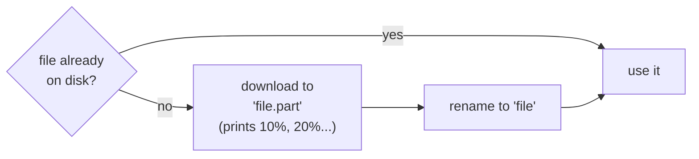

🔢 **Tiny example:** GPT-2's weights are **548 MB** (`models/gpt2/model.safetensors`), and the book's instructions are **200 KB** (`data/instruction-data.json`).
Downloading to `.part` first means a download that was interrupted halfway is never mistaken for a finished one.

🔗 **In the code:** [`Downloads.java`](../../src/main/java/com/tinygpt/pretrained/Downloads.java) · `ifMissing(url, file)` · used by `FineTune` and `Step12_LoadGPT2`.

---

## SafeTensors

🔬 **Line by line with real numbers:** [walkthrough](../walkthroughs/step12-load-gpt2.md)

🗣️ **In one sentence:** reads a `.safetensors` file, the format Hugging Face uses to share a model's learned numbers.

🌍 **Real-life picture:** a book with a **table of contents** at the front: "Chapter *wte.weight* is on pages 287,209,472 to 441,598,976". You look up the name, then jump straight to those pages.

🖼️ **Diagram**

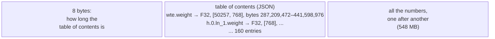

🔢 **Tiny example** (from the tests): a file whose table of contents says
`"a": shape [2, 2], bytes 0–16` and `"b": shape [2], bytes 16–24`, followed by the numbers `1 2 3 4 5 6`.
`get("a")` → `[1, 2, 3, 4]` (4 numbers × 4 bytes = 16 bytes) and `get("b")` → `[5, 6]`.

🔗 **In the code:** [`SafeTensors.java`](../../src/main/java/com/tinygpt/pretrained/SafeTensors.java) · `open(file)`, `names()`, `get(name)`.

---

## GPT2Weights

🔬 **Line by line with real numbers:** [walkthrough](../walkthroughs/step12-load-gpt2.md)

🗣️ **In one sentence:** copies OpenAI's trained GPT-2 numbers into **our own** `GPTModel`, matching each of OpenAI's part names to ours.

🌍 **Real-life picture:** moving into a house that's already furnished. The rooms (our model's parts) are the same shape as in the old house, so every piece of furniture fits; you just need to know which room each box goes in.

🖼️ **Diagram**

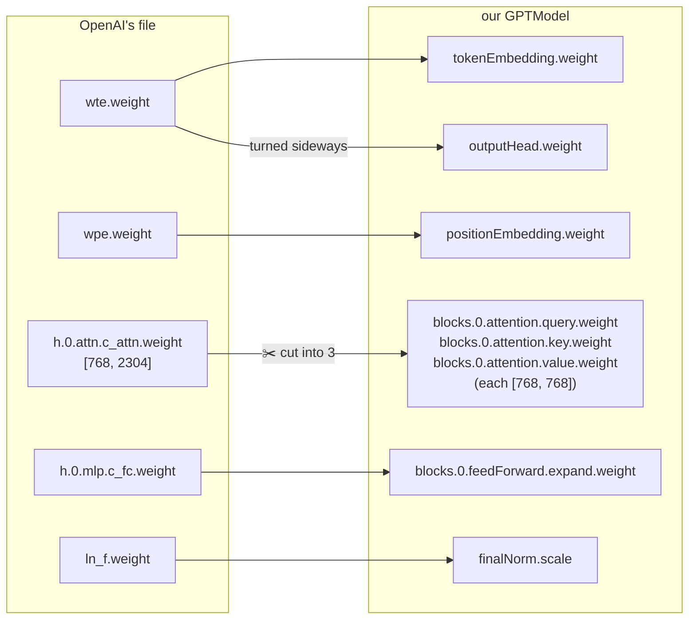

🔢 **Tiny example: cutting Query/Key/Value apart.** OpenAI stores all three side by side in one wide grid. With 2 rows and 6 columns, cut into 3:

```
[ 1  2 | 3  4 | 5  6 ]        query = [1 2]   key = [3  4]   value = [5  6]
[ 7  8 | 9 10 |11 12 ]                [7 8]         [9 10]         [11 12]
```

GPT-2 small has 12 blocks, so this happens 12 times. Then a check makes sure **every** part of our model got numbers. If anything is missing, it stops with an error.

The settings must match GPT-2 exactly, so they come from [`GPT2Size`](#gpt2size) (Q/K/V **with** bias, as OpenAI used, and dropout 0).

✅ **Proof it works:** with these numbers, our Java model continues *"I enjoy walking with my cute dog"* exactly like the real GPT-2:
*", but I'm not sure if I'll ever be able to walk with my dog."*

🔗 **In the code:** [`GPT2Weights.java`](../../src/main/java/com/tinygpt/pretrained/GPT2Weights.java) · `load(model, file)` · relies on `Module.namedParameters()` · Run it: `./run.sh 12`

---

## GPT2Size

🔬 **Line by line with real numbers:** [walkthrough](../walkthroughs/step12-load-gpt2.md)

🗣️ **In one sentence:** the two GPT-2 sizes you can download (small and medium), each with its settings card, download address and file names.

🌍 **Real-life picture:** a menu with a small and a large size. Same recipe, different amounts.

🖼️ **Diagram**

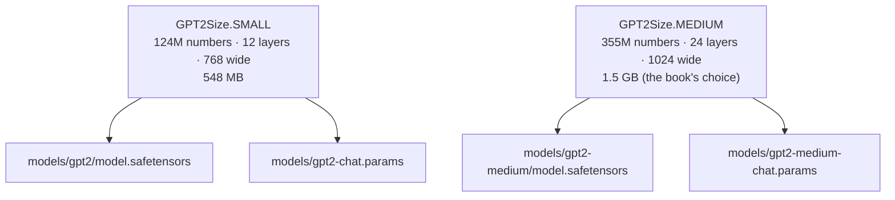

🔢 **Tiny example:** `./run.sh finetune medium` → `GPT2Size.fromArgs(["medium"])` → `MEDIUM`. Anything else gives `SMALL`.

🔗 **In the code:** [`GPT2Size.java`](../../src/main/java/com/tinygpt/pretrained/GPT2Size.java) · `config()`, `url()`, `weightsFile()`, `chatModelFile()`.

---

## Instruction

🔬 **Line by line with real numbers:** [walkthrough](../walkthroughs/finetune-and-chat.md)

🗣️ **In one sentence:** one practice example (*a request, optional extra input, and a good answer*), and how to write it out so the model can tell the request and the answer apart.

🌍 **Real-life picture:** a worksheet with labelled boxes: **Question**, **Extra info**, **Your answer**. The labels tell you where to write.

🖼️ **Diagram**

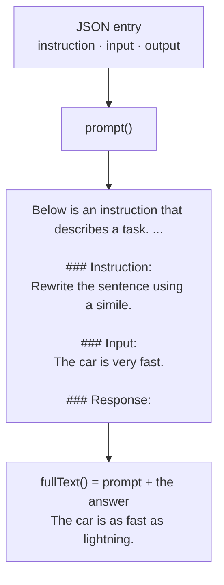

🔢 **Tiny example:** if `input` is empty (e.g. *"Name a color."*), the `### Input:` section is left out completely.
When chatting, we send only `prompt()`, which ends at `### Response:`, and the model writes what comes next: the answer.

🔗 **In the code:** [`Instruction.java`](../../src/main/java/com/tinygpt/instruct/Instruction.java) · a Java `record` · `prompt()`, `fullText()`, `load(json)`.

---

## InstructionDataLoader

🔬 **Line by line with real numbers:** [walkthrough](../walkthroughs/finetune-and-chat.md)

🗣️ **In one sentence:** packs instruction examples (which all have **different lengths**) into batches, padding the short ones and marking the padding as "don't grade".

🌍 **Real-life picture:** packing different-length pencils into a box. Short ones get a cap on the end so they all line up, and the teacher knows the caps aren't part of the pencils.

🖼️ **Diagram** (the book's own example)

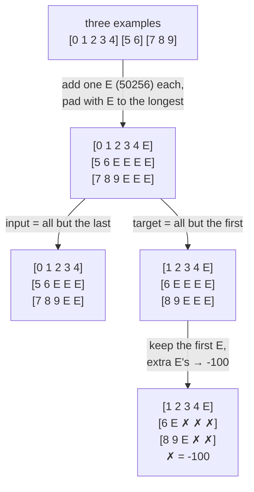

🔢 **Why keep the first E?** It teaches the model to **say "I'm finished"** after an answer, which is how the chatbot knows when to stop.
**Why -100 for the rest?** They're just filler. `Loss` skips every position whose target is -100, so the model isn't graded on filler.

🔗 **In the code:** [`InstructionDataLoader.java`](../../src/main/java/com/tinygpt/instruct/InstructionDataLoader.java) · `collate()` · gives the same `Batch` as `GPTDataLoader`, so the same `Trainer` works for both.

---

## FineTune

🔬 **Line by line with real numbers:** [walkthrough](../walkthroughs/finetune-and-chat.md)

🗣️ **In one sentence:** the program that loads GPT-2, practises on 935 instruction examples for 2 rounds, and saves the result for chatting.

🌍 **Real-life picture:** a well-read person (GPT-2: read millions of web pages) who gets a short training course in **how to answer questions politely and to the point**.

🖼️ **Diagram**

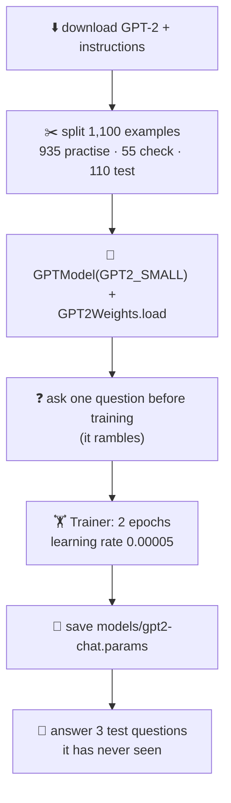

🔢 **Tiny example: counting the work.** 935 examples ÷ 8 per batch = 116 steps per round × 2 rounds = **232 steps**. On an M4 Pro, GPT-2 small took **6.1 minutes**.
The learning rate is **20 times smaller** than TinyGPT's (0.00005 vs 0.001): GPT-2 already knows a lot, and big steps would make it forget.

🔗 **In the code:** [`FineTune.java`](../../src/main/java/com/tinygpt/FineTune.java) · `answer()` asks a question and stops at `<|endoftext|>` · Run it: `./run.sh finetune`

---

## Chat

🔬 **Line by line with real numbers:** [walkthrough](../walkthroughs/finetune-and-chat.md)

🗣️ **In one sentence:** a terminal chat loop: it wraps what you type in the instruction format, lets the fine-tuned model answer, and repeats.

🌍 **Real-life picture:** a walkie-talkie. You say something, it answers, you say something else. But it **forgets** each message right after answering it.

🖼️ **Diagram**

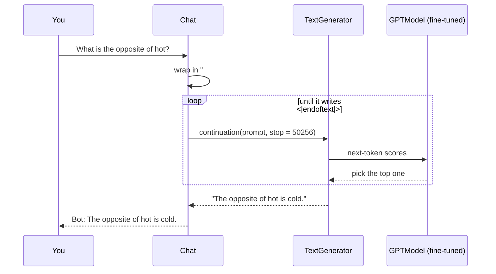

🔢 **Tiny example** (real answers from GPT-2 small after fine-tuning):

```
You: What is the capital of France?
Bot: The capital of France is Paris.
You: Give me a synonym for happy.
Bot: A synonym for happy is "joyful."
```

Type `Translate to French || Good morning`, and everything after `||` becomes the `### Input:` section.
It picks GPT-2 medium automatically if you've fine-tuned it; `./run.sh chat small` forces small.

🔗 **In the code:** [`Chat.java`](../../src/main/java/com/tinygpt/Chat.java) · Run it: `./run.sh chat` (after `./run.sh finetune`)

---

## Dialogue

🔬 **Line by line with real numbers:** [walkthrough](../walkthroughs/finetune-talk-and-talk.md)

🗣️ **In one sentence:** one everyday conversation from DailyDialog, written out as a **play script** (`A: ...` / `B: ...`, one line per turn).

🌍 **Real-life picture:** the script of a short school play: who says what, in order.

🖼️ **Diagram**

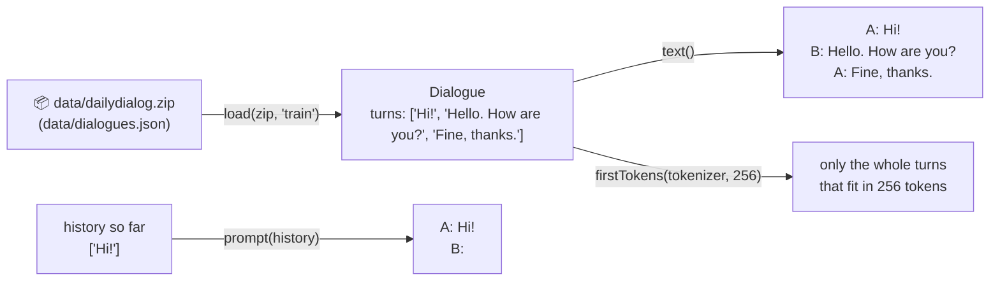

🔢 **Tiny example:**
- `new Dialogue(List.of("Hi!", "Hello. How are you?")).text()` → `"A: Hi!\nB: Hello. How are you?\n"`
- `Dialogue.prompt(List.of("Hi!"))` → `"A: Hi!\nB:"`. The model finishes B's line.
- `Dialogue.NEW_LINE_ID` = **198**, GPT-2's token for `\n`. When the model writes it, its turn is over.

🔗 **In the code:** [`Dialogue.java`](../../src/main/java/com/tinygpt/dialog/Dialogue.java) · tested in `DialogueTest`

---

## FineTuneTalk

🔬 **Line by line with real numbers:** [walkthrough](../walkthroughs/finetune-talk-and-talk.md)

🗣️ **In one sentence:** the program that loads GPT-2, practises on 11,118 DailyDialog conversations for 1 round, and saves the result for talking.

🌍 **Real-life picture:** the same well-read person as in [FineTune](#finetune), but this time they watch thousands of short plays about everyday life to learn **how people chat**.

🖼️ **Diagram**

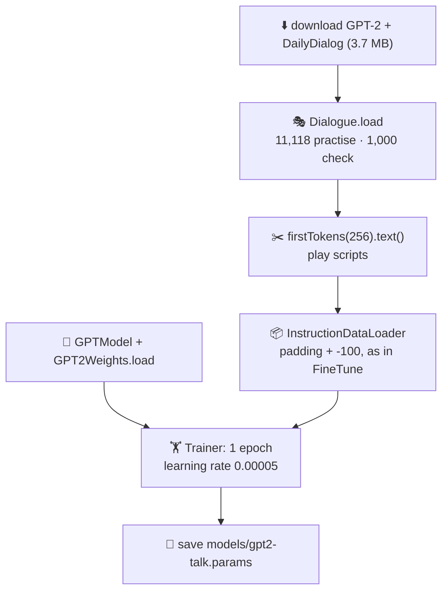

🔢 **Tiny example: counting the work.** 11,118 conversations ÷ 8 per batch = **1,389 steps** (one round). On an M4 Pro, GPT-2 small took **71.6 minutes** (validation loss 2.39 → 2.22).

`reply(generator, history)` asks for the next line: `continuation(Dialogue.prompt(history), 60, 0.7, 40, stop = 198)`.

🔗 **In the code:** [`FineTuneTalk.java`](../../src/main/java/com/tinygpt/FineTuneTalk.java) · Run it: `./run.sh finetune-talk` (or `./run.sh finetune-talk medium`)

---

## Talk

🔬 **Line by line with real numbers:** [walkthrough](../walkthroughs/finetune-talk-and-talk.md)

🗣️ **In one sentence:** a terminal conversation that **remembers**: it sends the whole conversation so far each time, and the model writes B's next line.

🌍 **Real-life picture:** unlike [Chat](#chat)'s walkie-talkie, this is a phone call: the other person remembers what you said a minute ago.

🖼️ **Diagram**

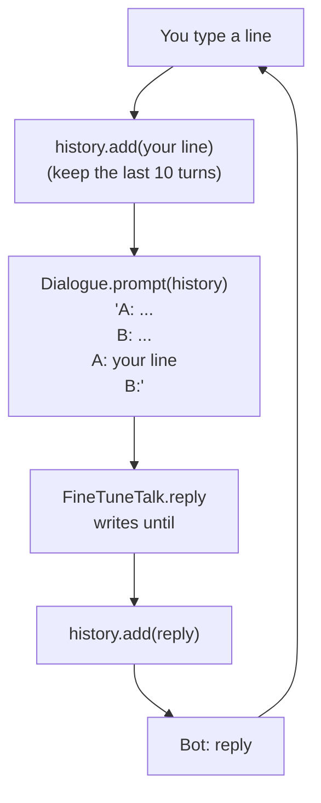

🔢 **Tiny example:** after two turns the history is `["Hi! How are you?", "I'm fine, thanks. And you?"]`, so the next prompt starts with `A: Hi! How are you?\nB: I'm fine, thanks. And you?\nA: ...`.
Type `new` to clear the history, `exit` to quit.

🔗 **In the code:** [`Talk.java`](../../src/main/java/com/tinygpt/Talk.java) · Run it: `./run.sh talk` (after `./run.sh finetune-talk`)
