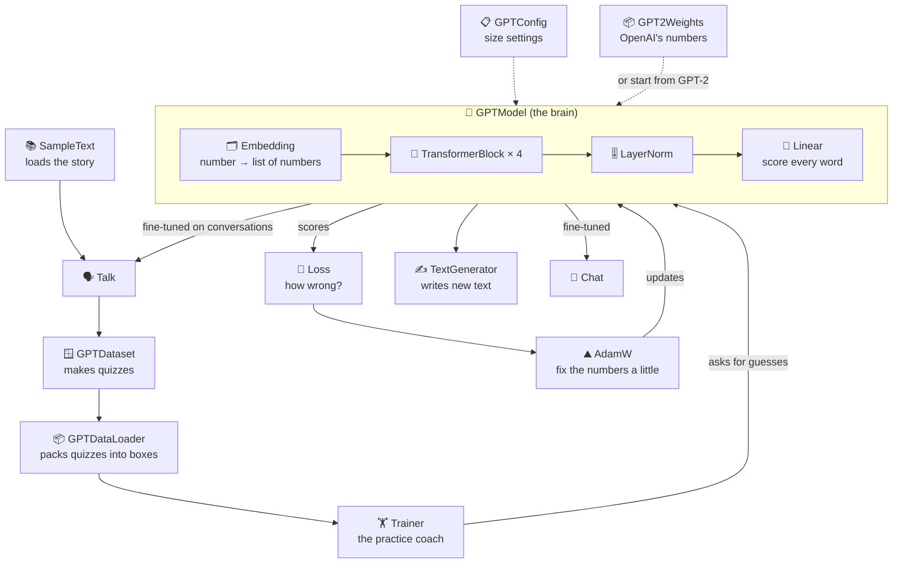
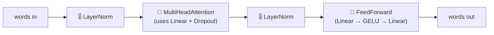
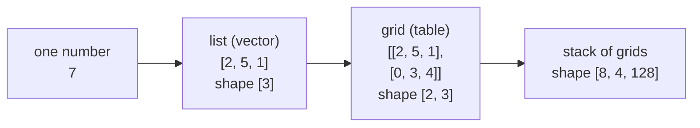

# Every class, explained with pictures

This guide explains **every class in TinyGPT**, one at a time. No maths background needed.

Each class gets the same five things:

| | |
|---|---|
| 🗣️ **In one sentence** | what the class does |
| 🌍 **Real-life picture** | the same idea from everyday life |
| 🖼️ **Diagram** | what goes in, what happens, what comes out |
| 🔢 **Tiny example** | small, friendly numbers you can check yourself |
| 🔗 **In the code** | where to find it, and who uses it |

← [Back to the main README](../../README.md) · Prefer to learn concept by concept? Start with [0. What is an LLM?](../00-what-is-an-llm.md)

---

## The map: how all the classes work together

Follow the arrows from the top. The text goes in at the top, and new text comes out at the bottom.

And here is what is **inside** one `TransformerBlock`:

---

## All classes

| Package | Class | In one sentence | Guide |
|---|---|---|---|
| tokenizer | `Tokenizer` | The rule every tokenizer must follow: text → numbers → text. | [tokenizer](1-tokenizer.md#tokenizer) |
| | `SimpleTokenizer` | Our home-made tokenizer: one number per word. | [tokenizer](1-tokenizer.md#simpletokenizer) |
| | `BpeTokenizer` | GPT-2's real tokenizer: breaks words into pieces. | [tokenizer](1-tokenizer.md#bpetokenizer) |
| data | `SampleText` | Loads the story we learn from. | [data](2-data.md#sampletext) |
| | `GPTDataset` | Turns the story into "guess the next word" quizzes. | [data](2-data.md#gptdataset) |
| | `GPTDataLoader` (+ `Batch`) | Packs the quizzes into boxes of 8. | [data](2-data.md#gptdataloader) |
| nn | `Module` | The parent of every layer; keeps track of its learnable numbers. | [nn](3-nn.md#module) |
| | `Linear` | Mixes numbers using "weights", like adding up a shopping bill. | [nn](3-nn.md#linear) |
| | `Embedding` | A lookup table: word number → list of numbers. | [nn](3-nn.md#embedding) |
| | `LayerNorm` | Keeps numbers at a steady size. | [nn](3-nn.md#layernorm) |
| | `GELU` | A gate: lets positive numbers through, mostly blocks negative ones. | [nn](3-nn.md#gelu) |
| | `Dropout` | Randomly switches some numbers off while practising. | [nn](3-nn.md#dropout) |
| | `FeedForward` | Each word's private "thinking time". | [nn](3-nn.md#feedforward) |
| attention | `SimpleAttention` | Words look at each other and mix together. | [attention](4-attention.md#simpleattention) |
| | `SelfAttention` | Same, but the model learns what to look for (Query, Key, Value). | [attention](4-attention.md#selfattention) |
| | `CausalAttention` | Same, but no peeking at future words. | [attention](4-attention.md#causalattention) |
| | `MultiHeadAttention` | Several attentions at once, each looking for something different. | [attention](4-attention.md#multiheadattention) |
| model | `GPTConfig` | The settings card: how big the model is. | [model](5-model.md#gptconfig) |
| | `TransformerBlock` | One "thinking floor" of the model: listen, then think. | [model](5-model.md#transformerblock) |
| | `GPTModel` | The whole brain: word numbers in, next-word scores out. | [model](5-model.md#gptmodel) |
| training | `Loss` | One number that says how wrong the model was. | [training](6-training.md#loss) |
| | `AdamW` | Nudges every number to make the model a little less wrong. | [training](6-training.md#adamw) |
| | `Trainer` | The practice coach: repeats guess → check → fix. | [training](6-training.md#trainer) |
| generation | `TextGenerator` | Writes text one word at a time. | [generation](7-generation.md#textgenerator) |
| data | `Batch` | One box of inputs and targets, shared by both kinds of training data. | [data](2-data.md#batch) |
| pretrained | `GPT2Size` | Small or medium GPT-2: settings, download address, file names. | [chat](9-chat.md#gpt2size) |
| | `Downloads` | Downloads a file once and keeps it. | [chat](9-chat.md#downloads) |
| | `SafeTensors` | Reads Hugging Face's weight file format. | [chat](9-chat.md#safetensors) |
| | `GPT2Weights` | Puts OpenAI's GPT-2 numbers into our model. | [chat](9-chat.md#gpt2weights) |
| instruct | `Instruction` | One "request → good answer" example, in the chat format. | [chat](9-chat.md#instruction) |
| | `InstructionDataLoader` | Pads different-length examples into batches. | [chat](9-chat.md#instructiondataloader) |
| dialog | `Dialogue` | One everyday conversation, written as an `A:` / `B:` script. | [chat](9-chat.md#dialogue) |
| (root) | `TinyGPT` | The main program: train, save, write. | [main and examples](8-main-and-examples.md#tinygpt) |
| | `FineTune` | Teaches GPT-2 to follow instructions. | [chat](9-chat.md#finetune) |
| | `Chat` | Talk to the fine-tuned GPT-2 in the terminal. | [chat](9-chat.md#chat) |
| | `FineTuneTalk` | Teaches GPT-2 everyday conversation (DailyDialog). | [chat](9-chat.md#finetunetalk) |
| | `Talk` | A conversation that remembers what was said. | [chat](9-chat.md#talk) |
| examples | `Step01` … `Step12` | Small runnable demos, one per idea. | [main and examples](8-main-and-examples.md#the-step-programs) |

---

## Three words you'll see everywhere

**Number list (vector)**: just a list of numbers, like `[2, 5, 1]`. Think of a player card in a game: *speed 2, strength 5, magic 1*.

**Grid (tensor / NDArray)**: numbers laid out in rows and columns, like a spreadsheet. It can have more layers too, like a stack of spreadsheets.

**Shape**: how big the grid is. `[8, 4]` means 8 rows and 4 columns, so 32 numbers in total.

