# Line-by-line walkthroughs

← [README](../../README.md) · [All classes](../classes/README.md)

The [concept guides](../00-what-is-an-llm.md) explain the **ideas**. The [class pages](../classes/README.md) give each class a one-page picture.
The walkthroughs go one step further: they take each program and explain it **line by line**, including **every class it uses**. Each line gets:

- 🟨 the code, with the line being explained marked `◀`
- 🗣️ what it does, in plain words (and often a 🌍 real-life comparison)
- 🖼️ a diagram
- 🔢 the **real numbers** the code produces, small enough to check with a calculator

Read them in order: each one builds on the last.

```mermaid
flowchart LR
    S1["1 · words → numbers"] --> S2["2 · word pieces"] --> S3["3 · quizzes & batches"] --> S4["4 · embeddings"]
    S4 --> S5["5 · simple attention"] --> S6["6 · Q, K, V"] --> S7["7 · no peeking"] --> S8["8 · many heads"]
    S8 --> S9["9 · the whole GPT"] --> S10["10 · loss"] --> S11["11 · choosing words"] --> T["🏁 training"]
    T --> S12["12 · load GPT-2"] --> F["🎓 FineTune + 💬 Chat"] --> K["🎭 FineTuneTalk + 🗣️ Talk"]
```

| # | Walkthrough | Program | Classes explained inside | Run |
|---|---|---|---|---|
| 1 | [Words → numbers](step01-simple-tokenizer.md) | `Step01_SimpleTokenizer` | `SampleText`, `Tokenizer`, `SimpleTokenizer` | `./run.sh 1` |
| 2 | [Word pieces (BPE)](step02-byte-pair-encoding.md) | `Step02_BytePairEncoding` | `BpeTokenizer` | `./run.sh 2` |
| 3 | [Quizzes and batches](step03-sliding-window.md) | `Step03_SlidingWindow` | `GPTDataset`, `GPTDataLoader`, `Batch` | `./run.sh 3` |
| 4 | [Embeddings](step04-embeddings.md) | `Step04_Embeddings` | `Embedding` | `./run.sh 4` |
| 5 | [Simple attention](step05-simple-attention.md) | `Step05_SimpleAttention` | `SimpleAttention` | `./run.sh 5` |
| 6 | [Self-attention: Q, K, V](step06-self-attention.md) | `Step06_SelfAttention` | `SelfAttention`, `Linear`, `Module` | `./run.sh 6` |
| 7 | [Causal attention + dropout](step07-causal-attention.md) | `Step07_CausalAttention` | `CausalAttention`, `Dropout` | `./run.sh 7` |
| 8 | [Multi-head attention](step08-multi-head-attention.md) | `Step08_MultiHeadAttention` | `MultiHeadAttention` | `./run.sh 8` |
| 9 | [The whole GPT model](step09-gpt-model.md) | `Step09_GPTModel` | `GPTConfig`, `GPTModel`, `TransformerBlock`, `LayerNorm`, `FeedForward`, `GELU` | `./run.sh 9` |
| 10 | [Loss](step10-loss.md) | `Step10_Loss` | `Loss` | `./run.sh 10` |
| 11 | [Choosing the next word](step11-sampling.md) | `Step11_Sampling` | `TextGenerator` | `./run.sh 11` |
| 🏁 | [Training TinyGPT](step-tinygpt-training.md) | `TinyGPT` | `Trainer`, `AdamW` | `./run.sh train` |
| 12 | [Loading GPT-2](step12-load-gpt2.md) | `Step12_LoadGPT2` | `GPT2Size`, `Downloads`, `SafeTensors`, `GPT2Weights` | `./run.sh 12` |
| 🎓💬 | [Instruction fine-tuning and chat](finetune-and-chat.md) | `FineTune`, `Chat` | `Instruction`, `InstructionDataLoader` | `./run.sh finetune`, `./run.sh chat` |
| 🎭🗣️ | [Conversation fine-tuning and talk](finetune-talk-and-talk.md) | `FineTuneTalk`, `Talk` | `Dialogue` | `./run.sh finetune-talk`, `./run.sh talk` |

Every class in the project is explained in one of these.
