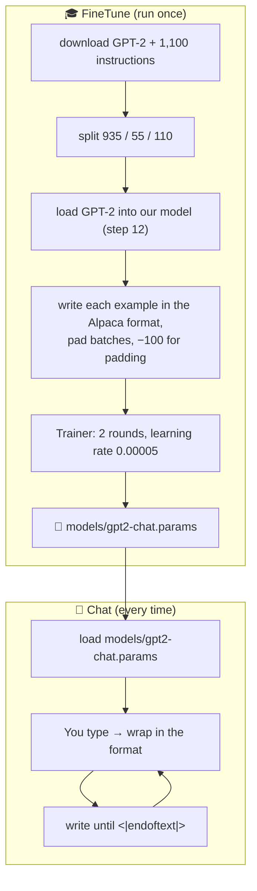
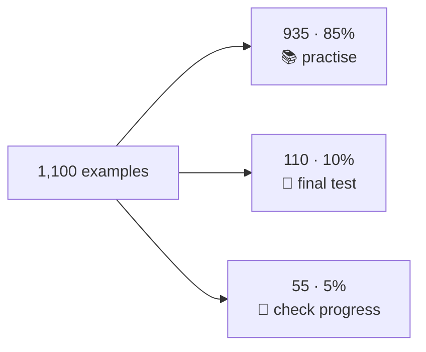
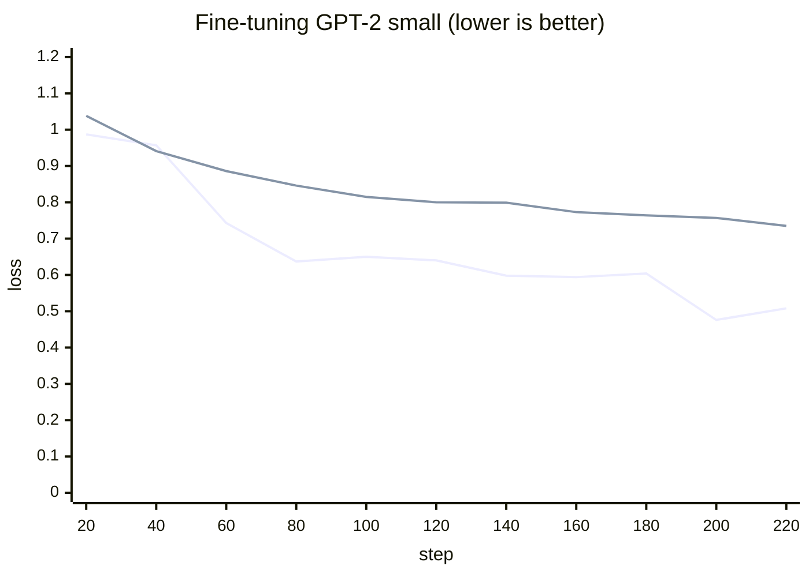
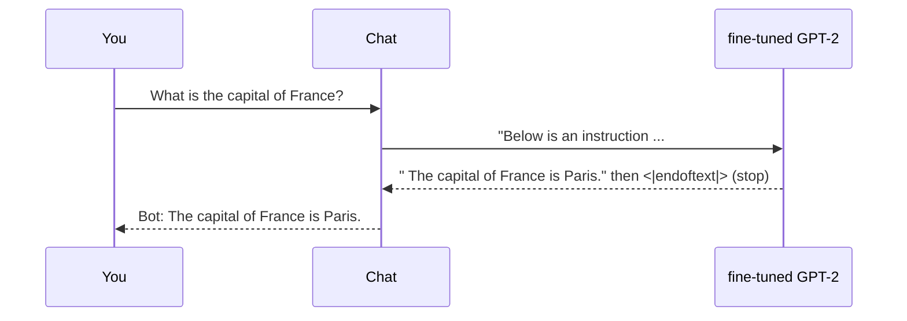
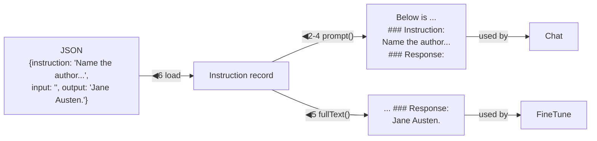
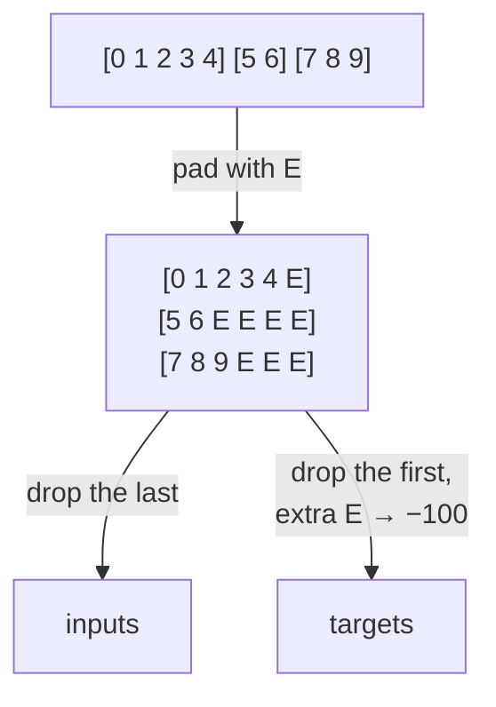

# Line by line: `FineTune` and `Chat`

**Run it:** `./run.sh finetune` (about 6 minutes), then `./run.sh chat` · **Code:** [`FineTune.java`](../../src/main/java/com/tinygpt/FineTune.java), [`Chat.java`](../../src/main/java/com/tinygpt/Chat.java), and the classes they use: [`Instruction`](../../src/main/java/com/tinygpt/instruct/Instruction.java), [`InstructionDataLoader`](../../src/main/java/com/tinygpt/instruct/InstructionDataLoader.java) · **Idea first:** [9. Chat with GPT-2](../09-chat-with-gpt2.md) · **Book:** chapter 7

← [Step 12](step12-load-gpt2.md) · [All walkthroughs](README.md) · Next: [FineTuneTalk and Talk →](finetune-talk-and-talk.md)

The numbers on this page are **real**, from `./run.sh finetune` on an M4 Pro (GPT-2 small, 6.1 minutes).

---

## 🗺️ Both programs on one page



**Why?** After step 12, GPT-2 writes good English, but only **continues** text. Ask it a question and it may write another question. Fine-tuning shows it ~1,000 examples of "request → good answer", so it learns to **answer, then stop**.

---

# Part A · `FineTune.java`

## Lines 38-44 · the settings (the book's, chapter 7.6)

```java
    public static final Path DATA_FILE = Path.of("data", "instruction-data.json");   // ◀ the book's 1,100 examples

    private static final int EPOCHS = 2;                   // ◀ only 2 rounds: GPT-2 already knows English
    private static final int BATCH_SIZE = 8;
    private static final float LEARNING_RATE = 5e-5f;      // ◀ 0.00005: 20× smaller than TinyGPT's
    private static final float WEIGHT_DECAY = 0.1f;
```

🗣️ **Why such a small learning rate?** GPT-2 learned from 8 million web pages. Big steps would make it **forget** that. We only want to nudge it towards answering.

## Lines 47-51 · size and downloads

```java
        Engine.getInstance().setRandomSeed(123);
        GPT2Size size = GPT2Size.fromArgs(args);                              // ◀ "medium" → MEDIUM, else SMALL
        System.out.println("Fine-tuning GPT-2 " + size + "\n");
        Downloads.ifMissing(size.url(), size.weightsFile());                  // ◀ GPT-2 (548 MB, once)
        Downloads.ifMissing(Downloads.INSTRUCTION_DATA_URL, DATA_FILE);       // ◀ the instructions (200 KB, once)
```

([`GPT2Size` and `Downloads` explained in step 12](step12-load-gpt2.md#gpt2size--small-or-medium).)

---

## Lines 54-64 · the data, split 85 / 10 / 5

```java
        List<Instruction> all = Instruction.load(DATA_FILE);                                      // ◀ 1 · 1,100 examples
        int trainCount = (int) (all.size() * 0.85);                                               // ◀ 2 · 935
        int testCount = (int) (all.size() * 0.10);                                                // ◀ 2 · 110
        List<Instruction> train = all.subList(0, trainCount);                                     // ◀ 3 · 0-934
        List<Instruction> test = all.subList(trainCount, trainCount + testCount);                 // ◀ 3 · 935-1044
        List<Instruction> validation = all.subList(trainCount + testCount, all.size());           // ◀ 3 · 1045-1099: the 55 left
        System.out.println(train.get(0).fullText());                                              // ◀ 4 · show one
```



One example (◀4), as the model sees it:

```
Below is an instruction that describes a task. Write a response that appropriately completes the request.

### Instruction:
Evaluate the following phrase by transforming it into the spelling given.

### Input:
freind --> friend

### Response:
The spelling of the given phrase "freind" is incorrect, the correct spelling is "friend".
```

---

## Lines 66-76 · load GPT-2, ask a question before practice

```java
        BpeTokenizer tokenizer = new BpeTokenizer();
        try (NDManager manager = NDManager.newBaseManager()) {
            GPTModel model = new GPTModel(manager, size.config());              // ◀ our model, GPT-2's shape
            GPT2Weights.load(model, size.weightsFile());                         // ◀ step 12
            TextGenerator generator = new TextGenerator(model, tokenizer, manager, 123);

            Instruction check = validation.getFirst();                           // ◀ one question to watch
            System.out.println("  it answers: " + answer(generator, check));     // ◀ before: it rambles
```

## Lines 79-81 · the loaders

```java
            int maxLength = model.config().contextLength();                     // ◀ 1,024: never cut anything shorter
            InstructionDataLoader trainLoader = new InstructionDataLoader(texts(train), tokenizer, BATCH_SIZE, true, true, maxLength);
            InstructionDataLoader validationLoader = new InstructionDataLoader(texts(validation), tokenizer, BATCH_SIZE, false, false, maxLength);
```

`texts(...)` turns each `Instruction` into its full Alpaca text. The loader pads them into batches ([Part C](#instructiondataloader--batches-of-different-lengths)).

## Lines 83-88 · practise: the same Trainer as TinyGPT

```java
            Trainer trainer = new Trainer(model, manager, LEARNING_RATE, WEIGHT_DECAY);
            trainer.train(trainLoader, validationLoader, EPOCHS, 20,                     // ◀ print losses every 20 steps
                    () -> System.out.println("   asked: " + check.instruction() + " " + check.input()
                            + "\n   answer: " + answer(generator, check)));            // ◀ after each round: ask again
```

🗣️ Exactly [TinyGPT's training loop](step-tinygpt-training.md#trainer--the-practice-coach): forward → loss → backward → AdamW → zero. Only the data and settings are different.

🔢 935 ÷ 8 = 116 steps per round × 2 = **232 steps**, 6.1 minutes.



The losses start at about **1** (TinyGPT started at 11) because GPT-2 already knows English. Both lines go down together: learning, not memorising.

## Lines 91-101 · save, then test on unseen questions

```java
            model.save(size.chatModelFile());                         // ◀ models/gpt2-chat.params (652 MB)
            for (Instruction example : test.subList(0, 3)) {          // ◀ 3 questions it never practised on
                System.out.println("  correct answer: " + example.output());
                System.out.println("  model answer:   " + answer(generator, example));
            }
```

| question | correct | GPT-2 small said |
|---|---|---|
| Rewrite using a simile *(The car is very fast.)* | as fast as lightning | as fast as a horse ✅ |
| Cloud type for thunderstorms? | cumulonimbus | cirrus ❌ |
| Author of 'Pride and Prejudice'? | Jane Austen | Robert Frost ❌ |

It learned the **manners** (answer, then stop), but a 124M model knows few **facts**.

## Lines 105-112 · `answer` and `texts`

```java
    public static String answer(TextGenerator generator, Instruction instruction) {
        return generator.continuation(instruction.prompt(),         // ◀ 1 · the text up to "### Response:\n"
                        120,                                        // ◀ 2 · at most 120 tokens
                        0f, 0,                                      // ◀ 3 · greedy (temperature 0)
                        BpeTokenizer.END_OF_TEXT_ID)                // ◀ 4 · stop at <|endoftext|> = "I'm finished"
                .strip().replace("\n", " ");                        // ◀ 5 · tidy: no extra spaces or line breaks
    }

    private static List<String> texts(List<Instruction> instructions) {
        return instructions.stream().map(Instruction::fullText).toList();   // ◀ each Instruction → its full text
    }
```

([`continuation` explained in step 11](step11-sampling.md#continuation--the-writing-loop).)

---

# Part B · `Chat.java`

## Lines 41-48 · which model?

```java
        GPT2Size size = args.length > 0 ? GPT2Size.fromArgs(args)                               // ◀ 1 · you chose one
                : Files.exists(GPT2Size.MEDIUM.chatModelFile()) ? GPT2Size.MEDIUM : GPT2Size.SMALL;   // ◀ 2 · else the biggest you've trained
        if (!Files.exists(size.chatModelFile())) {                                              // ◀ 3 · not fine-tuned yet?
            System.out.println("No fine-tuned GPT-2 " + size + " yet. Run this once first:  ./run.sh finetune" ...);
            return;
        }
```

## Lines 49-52 · load the fine-tuned model

```java
        try (NDManager manager = NDManager.newBaseManager()) {
            GPTModel model = new GPTModel(manager, size.config());
            model.load(size.chatModelFile());                                        // ◀ the 652 MB we saved
            TextGenerator generator = new TextGenerator(model, new BpeTokenizer(), manager, 123);
```

## Lines 61-76 · the chat loop

```java
            BufferedReader in = new BufferedReader(new InputStreamReader(System.in));   // ◀ 1 · read what you type
            while (true) {
                System.out.print("You: ");
                System.out.flush();                                                      // ◀ 2 · show "You: " now
                String line = in.readLine();                                             // ◀ 3 · wait for Enter
                if (line == null || line.equalsIgnoreCase("exit") || line.equalsIgnoreCase("quit")) {
                    break;                                                               // ◀ 4 · stop
                }
                if (line.isBlank()) {
                    continue;                                                            // ◀ 5 · empty line: ask again
                }
                String[] parts = line.split("\\|\\|", 2);                                // ◀ 6 · split at ||
                Instruction request = new Instruction(parts[0].strip(), parts.length > 1 ? parts[1].strip() : "", "");   // ◀ 7
                System.out.println("Bot: " + FineTune.answer(generator, request));       // ◀ 8
            }
```

| ◀ | what it does |
|---|---|
| 2 | `print` (not `println`) leaves the cursor after "You: ". `flush` makes sure it shows before we wait. |
| 3 | Wait until you press Enter. `null` means the input was closed (Ctrl+D). |
| 6 | `"Translate to French \|\| Good morning"` → `["Translate to French ", " Good morning"]`. `\\|` because `\|` has a special meaning in patterns; `2` = cut at most once. |
| 7 | Instruction = before `\|\|`, input = after it (or empty), output = empty: that's what the model will write. |
| 8 | Wrap, write until `<\|endoftext\|>`, print. |



**Each message is answered on its own.** Chat doesn't remember earlier messages; [Talk](finetune-talk-and-talk.md) does.

---

# Part C · the classes they use

## `Instruction` · one example, in the Alpaca format

```java
public record Instruction(String instruction, String input, String output) {      // ◀ 1

    private static final String INTRO =
            "Below is an instruction that describes a task. Write a response that appropriately completes the request.";

    public String prompt() {
        String text = INTRO + "\n\n### Instruction:\n" + instruction;              // ◀ 2
        if (input != null && !input.isBlank()) {
            text += "\n\n### Input:\n" + input;                                    // ◀ 3 · only if there is one
        }
        return text + "\n\n### Response:\n";                                       // ◀ 4 · the model continues from here
    }

    public String fullText() {
        return prompt() + output;                                                  // ◀ 5 · with the answer: for practice
    }

    public static List<Instruction> load(Path jsonFile) throws IOException {
        return new Gson().fromJson(Files.readString(jsonFile), new TypeToken<List<Instruction>>() {}.getType());   // ◀ 6
    }
}
```

| ◀ | what it does |
|---|---|
| 1 | A record holding the three fields of one JSON example. |
| 2-4 | Build the fixed layout. The `###` headings show the model **where the request ends and the answer begins**. |
| 5 | Practice text = prompt + the right answer. |
| 6 | **Gson** reads the JSON file. The record's field names match the JSON keys (`instruction`, `input`, `output`), so each `{...}` becomes an `Instruction` automatically. `TypeToken` tells Gson "a **list** of Instructions". |



---

## `InstructionDataLoader` · batches of different lengths

Story windows were all exactly 64 tokens. Instructions are **all different lengths**, but a batch must be a rectangle. So short ones are **padded**.

### The constructor

```java
    public InstructionDataLoader(List<String> texts, Tokenizer tokenizer, int batchSize, boolean shuffle,
                                 boolean dropLast, int maxLength) {
        for (String text : texts) {
            examples.add(tokenizer.encode(text));    // ◀ tokenize every example once, up front
        }
        ...
    }
```

The iterator is the same as [`GPTDataLoader`'s](step03-sliding-window.md#iterator--decide-the-order) (order, shuffle, hand out 8 at a time), except each bundle goes through `collate`.

### `collate` · pad into a rectangle

```java
    static Batch collate(List<int[]> examples, int maxLength) {
        int end = BpeTokenizer.END_OF_TEXT_ID;                                  // 50256 (written E below)
        int longest = 0;
        for (int[] example : examples) {
            longest = Math.max(longest, example.length + 1);                    // ◀ 1 · longest + room for one E
        }
        int width = Math.min(longest - 1, maxLength);                           // ◀ 2 · inputs are 1 shorter

        for (int row = 0; row < examples.size(); row++) {
            int[] padded = new int[longest];
            Arrays.fill(padded, end);                                           // ◀ 3 · fill with E
            System.arraycopy(examples.get(row), 0, padded, 0, examples.get(row).length);   // ◀ 4 · real tokens on top

            int firstEnd = examples.get(row).length;                            // ◀ 5 · where the real "I'm finished" is
            for (int col = 0; col < width; col++) {
                inputs[row][col] = padded[col];                                 // ◀ 6 · input = all but the last
                int target = padded[col + 1];                                   // ◀ 7 · target = shifted by one
                boolean isExtraPadding = col + 1 > firstEnd;
                targets[row][col] = isExtraPadding ? Loss.IGNORE : target;      // ◀ 8 · extra E → −100
            }
        }
        return new Batch(inputs, targets);
    }
```

🔢 **The book's own example** (checked by `InstructionTest`): three examples `[0 1 2 3 4]`, `[5 6]`, `[7 8 9]`.

| ◀ | example `[5 6]` |
|---|---|
| 1 | longest = 5 + 1 = **6** (from `[0 1 2 3 4]`) |
| 3-4 | padded = `[5 6 E E E E]` |
| 5 | firstEnd = 2 (the E at position 2 is the real "I'm finished") |
| 6 | input = `[5 6 E E E]` |
| 7 | shifted = `[6 E E E E]` |
| 8 | target = `[6 E −100 −100 −100]`: the first E is **kept**, the rest are **ignored** |

All three:

```
inputs                    targets
[0  1  2  3  4]           [1  2  3  4  E]
[5  6  E  E  E]           [6  E  −100 −100 −100]
[7  8  9  E  E]           [8  9  E  −100 −100]
```



**Why keep the first E?** That's how the model learns to say **"I'm finished"** after an answer. `Chat` stops when it sees it.
**Why −100 for the rest?** They're just filler. [`Loss`](step10-loss.md#part-b--losscrossentropy-line-by-line) skips −100, so nobody is marked on padding.

---

## 🧠 What this step teaches

- **Fine-tuning** = the same training loop, starting from GPT-2's numbers, with a **tiny learning rate** and a **few rounds**.
- Every example uses a **fixed format** so the model knows where the answer goes.
- Different lengths are **padded**; padding is marked **−100** so it isn't graded; one `<|endoftext|>` teaches it to **stop**.
- Chat = wrap your message in the same format, write until `<|endoftext|>`.

## 🧪 Try it yourself

1. `./run.sh chat` and ask "Explain || photosynthesis" vs "Explain photosynthesis".
2. `FineTune.java`, line 41: `EPOCHS = 1`. Faster, but are the answers worse?
3. `./run.sh finetune medium`: the book's choice. Ask both models the 3 test questions above.
