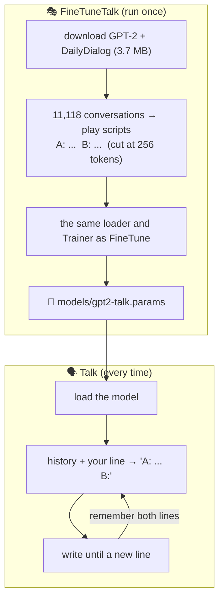
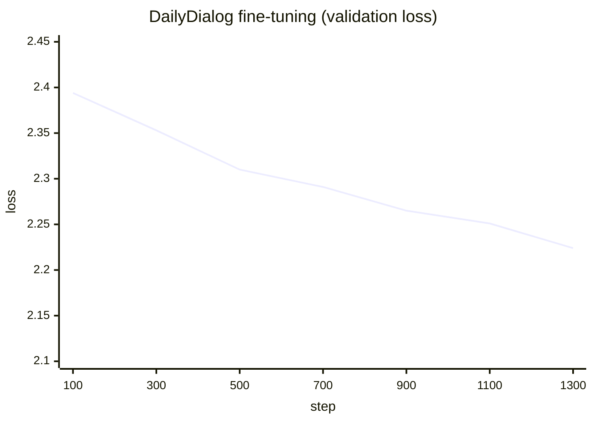
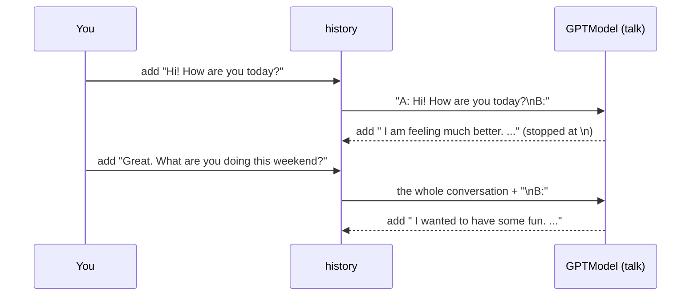

# Line by line: `FineTuneTalk` and `Talk`

**Run it:** `./run.sh finetune-talk` (about 70 minutes), then `./run.sh talk` · **Code:** [`FineTuneTalk.java`](../../src/main/java/com/tinygpt/FineTuneTalk.java), [`Talk.java`](../../src/main/java/com/tinygpt/Talk.java), and the class they use: [`Dialogue`](../../src/main/java/com/tinygpt/dialog/Dialogue.java) · **Idea first:** [10. Talk](../10-talk-with-dailydialog.md)

← [FineTune and Chat](finetune-and-chat.md) · [All walkthroughs](README.md)

The numbers on this page are **real**, from `./run.sh finetune-talk` on an M4 Pro (GPT-2 small, 71.6 minutes).

---

## 🗺️ Both programs on one page



**Same recipe as [FineTune](finetune-and-chat.md), different data.** Instructions taught it to answer quiz questions. Everyday conversations teach it to **take turns** like a person.

---

# Part A · `FineTuneTalk.java`

## Lines 38-44 · the settings

```java
    public static final Path DATA_FILE = Path.of("data", "dailydialog.zip");

    private static final int EPOCHS = 1;               // ◀ 11,118 examples: one round is plenty
    private static final int BATCH_SIZE = 8;
    private static final int MAX_TOKENS = 256;         // ◀ cut longer conversations (saves time and memory)
    private static final float LEARNING_RATE = 5e-5f;  // ◀ the same small nudges as FineTune
    private static final float WEIGHT_DECAY = 0.1f;
```

## Lines 46-58 · download and prepare the data

```java
        GPT2Size size = GPT2Size.fromArgs(args);
        Downloads.ifMissing(size.url(), size.weightsFile());                    // ◀ GPT-2
        Downloads.ifMissing(Downloads.DAILY_DIALOG_URL, DATA_FILE);             // ◀ DailyDialog (CC BY-NC-SA 4.0)

        BpeTokenizer tokenizer = new BpeTokenizer();
        List<String> train = texts(Dialogue.load(DATA_FILE, "train"), tokenizer);           // ◀ 11,118 scripts
        List<String> validation = texts(Dialogue.load(DATA_FILE, "validation"), tokenizer); // ◀ 1,000 scripts
        System.out.println(train.getFirst());                                               // ◀ show one
```

```
Conversations: 11,118 to practise on, 1,000 to check progress

A: Say, Jim, how about going for a few beers after dinner?
B: You know that is tempting but is really not good for our fitness.
A: What do you mean? It will help us to relax.
...
B: All right.
```

```java
    private static List<String> texts(List<Dialogue> dialogues, BpeTokenizer tokenizer) {
        return dialogues.stream().map(d -> d.firstTokens(tokenizer, MAX_TOKENS).text()).toList();   // ◀ cut, then write as a script
    }
```

## Lines 60-80 · load GPT-2, practise, save

```java
        List<String> check = List.of("Hi! How are you today?");                     // ◀ one line to watch
        ...
            GPT2Weights.load(model, size.weightsFile());                             // ◀ step 12
            System.out.println("Before practice, ... it replies: " + reply(generator, check));

            InstructionDataLoader trainLoader = new InstructionDataLoader(train, tokenizer, BATCH_SIZE, true, true, maxLength);   // ◀ same padding as FineTune
            ...
            trainer.train(trainLoader, validationLoader, EPOCHS, 100, ...);          // ◀ losses every 100 steps
            model.save(size.talkModelFile());                                        // ◀ models/gpt2-talk.params
```

🗣️ The loader and trainer are **exactly** the ones from [FineTune](finetune-and-chat.md). The padding adds one `<|endoftext|>` after each whole conversation, so the model also learns where a conversation ends.

Real before/after, to "Hi! How are you today?":

| | reply |
|---|---|
| before | *My wife and I have just finished a beautiful evening at the spa, and I know we're going to be going to the beach...* (just keeps writing) |
| after | *Good. I got the job interview.* (one line, then stops) |



🔢 11,118 ÷ 8 = **1,389 steps**, 71.6 minutes. The loss stays around 2, much higher than instruction fine-tuning's 0.7, because a chat has **many good next lines** while an instruction usually has one right answer.

## Lines 94-96 · `reply`

```java
    public static String reply(TextGenerator generator, List<String> history) {
        return generator.continuation(Dialogue.prompt(history),   // ◀ 1 · "A: ...\nB: ...\nA: your line\nB:"
                60,                                               // ◀ 2 · at most 60 tokens
                0.7f, 40,                                         // ◀ 3 · a little randomness
                Dialogue.NEW_LINE_ID);                            // ◀ 4 · stop at the end of the line
    }
```

| ◀ | why |
|---|---|
| 3 | Greedy picking repeats the same safe reply ("I don't know.") again and again. Temperature 0.7 + top-40 gives variety without nonsense ([step 11](step11-sampling.md)). |
| 4 | Token **198** = `\n`. In practice, every line ended with one, so the model writes `\n` when its turn is over. |

---

# Part B · `Talk.java`

## Lines 40-46 · which model?

The same logic as [Chat](finetune-and-chat.md#lines-41-48--which-model), using `talkModelFile()`.

## Lines 48-52 · load it

```java
        System.out.println("Loading " + size.talkModelFile() + " ...");                     // ◀ so you know it's working
        GPTModel model = new GPTModel(manager, size.config());
        model.load(size.talkModelFile());
        TextGenerator generator = new TextGenerator(model, new BpeTokenizer(), manager, System.nanoTime());   // ◀ a new seed each run
```

`System.nanoTime()` as the seed means the random choices differ every time you run it, so conversations don't repeat.

## Lines 60-86 · the conversation loop, with memory

```java
            List<String> history = new ArrayList<>();                                 // ◀ 1 · everything said so far
            while (true) {
                System.out.print("You: ");
                ...
                if (line.equalsIgnoreCase("new")) {
                    history.clear();                                                  // ◀ 2 · forget, start fresh
                    continue;
                }
                history.add(line.strip());                                            // ◀ 3 · remember your line
                while (history.size() > REMEMBERED_TURNS) {
                    history.subList(0, 2).clear();                                    // ◀ 4 · drop the oldest pair
                }
                String reply = FineTuneTalk.reply(generator, history).strip();        // ◀ 5 · B's next line
                history.add(reply);                                                   // ◀ 6 · remember it too
                System.out.println("Bot: " + reply);
            }
```

| ◀ | what it does |
|---|---|
| 1 | A list of every line, yours and the bot's, in order. |
| 3 + 6 | Both sides are remembered, so the next prompt contains the **whole conversation**. |
| 4 | Keep at most 10 lines (`REMEMBERED_TURNS`). Dropping **two** at a time keeps your lines at even positions (A) and the bot's at odd ones (B). |

🔢 After two of your messages, the prompt for line ◀5 is:

```
A: Hi! How are you today?
B: I am feeling much better. I'm doing well, but I've been up a long time.
A: Great. What are you doing this weekend?
B:
```



🌍 **Chat** is a walkie-talkie: each message on its own. **Talk** is a phone call: the other person remembers what you just said.

A real conversation:

```
You: Hi! How are you today?
Bot: I am feeling much better. I'm doing well, but I've been up a long time.
You: Great. What are you doing this weekend?
Bot: I wanted to have some fun. I wanted to play the guitar and play classical music.
You: I have a dog called Max.
Bot: Oh, hi! I love dogs.
You: What is my dog called?
Bot: He is a big dog.          ← "Max" was in the prompt, but a 124M model doesn't use it
```

---

# Part C · `Dialogue` line by line

```java
public record Dialogue(List<String> turns) {                     // ◀ one conversation: a list of lines

    public static final int NEW_LINE_ID = 198;                   // ◀ GPT-2's token for "\n"

    public static String speaker(int turn) {
        return turn % 2 == 0 ? "A" : "B";                        // ◀ 1 · 0 → A, 1 → B, 2 → A, ...
    }

    public String text() {
        return script(turns);                                    // ◀ 2 · the whole conversation
    }

    public Dialogue firstTokens(Tokenizer tokenizer, int maxTokens) {
        int keep = 1;
        while (keep < turns.size() && tokenizer.encode(script(turns.subList(0, keep + 1))).length <= maxTokens) {
            keep++;                                              // ◀ 3 · add whole turns while they fit
        }
        return new Dialogue(turns.subList(0, keep));
    }

    public static String prompt(List<String> history) {
        return script(history) + speaker(history.size()) + ":";  // ◀ 4 · conversation so far + "B:"
    }

    private static String script(List<String> turns) {
        StringBuilder text = new StringBuilder();
        for (int i = 0; i < turns.size(); i++) {
            text.append(speaker(i)).append(": ").append(turns.get(i)).append('\n');   // ◀ 5 · "A: Hi!\n"
        }
        return text.toString();
    }
```

| ◀ | tiny example with `["Hi!", "Hello. How are you?", "Fine, thanks."]` |
|---|---|
| 1 | `%` = remainder: 0 % 2 = 0 → A; 1 % 2 = 1 → B |
| 2 & 5 | `"A: Hi!\nB: Hello. How are you?\nA: Fine, thanks.\n"` |
| 3 | with `maxTokens` = the size of the first 2 lines → keeps `["Hi!", "Hello. How are you?"]`. Always at least 1 turn. |
| 4 | `prompt(["Hi!"])` → `"A: Hi!\nB:"`: the model finishes B's line |

### `load` · reading ConvLab's zip

```java
    public static List<Dialogue> load(Path zip, String split) throws IOException {
        try (ZipFile file = new ZipFile(zip.toFile());                                     // ◀ 1 · open the zip
             var reader = new InputStreamReader(file.getInputStream(file.getEntry("data/dialogues.json")), StandardCharsets.UTF_8)) {   // ◀ 2
            for (JsonElement element : JsonParser.parseReader(reader).getAsJsonArray()) {  // ◀ 3 · every conversation
                JsonObject dialogue = element.getAsJsonObject();
                if (!dialogue.get("data_split").getAsString().equals(split)) {
                    continue;                                                              // ◀ 4 · wrong part? skip
                }
                List<String> turns = new ArrayList<>();
                for (JsonElement turn : dialogue.getAsJsonArray("turns")) {
                    turns.add(turn.getAsJsonObject().get("utterance").getAsString()
                            .replace("\n", " ").strip());                                 // ◀ 5 · one line per turn
                }
                dialogues.add(new Dialogue(turns));
            }
        }
        return dialogues;
    }
```

| ◀ | why |
|---|---|
| 1-2 | Read `data/dialogues.json` straight from inside the zip, without unpacking it to disk. |
| 4 | All 13,118 conversations are in one file, each marked `"train"`, `"validation"` or `"test"`. |
| 5 | A new line means "end of turn", so a turn must never contain one. |

The JSON for one turn looks like `{"speaker": "user", "utterance": "Say, Jim, how about going for a few beers after dinner?", ...}`. We only need `utterance`.

---

## 🧠 What this step teaches

- **The data decides what the model becomes.** Same model and recipe: instructions → a quiz-answerer; conversations → a chatter.
- A conversation is written as a **script** (`A:` / `B:`), and a **new line** means "my turn is over".
- **Memory** = send the whole conversation so far every time.

## 🧪 Try it yourself

1. `FineTuneTalk.java`, line 42: `MAX_TOKENS = 128`. Much faster. Are the replies worse?
2. `Talk.java`, line 37: `REMEMBERED_TURNS = 2`. Now it only sees your last line and its own.
3. `FineTuneTalk.reply`: change 0.7 to 0 (greedy). Does it keep saying the same thing?
