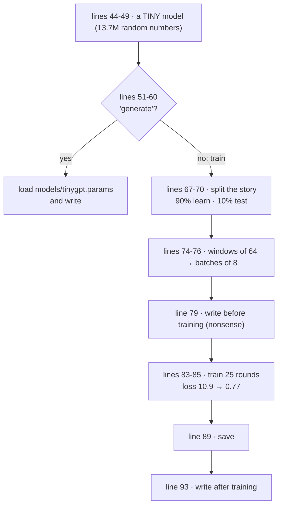
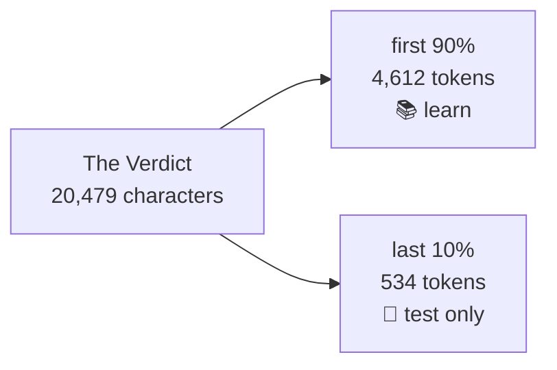
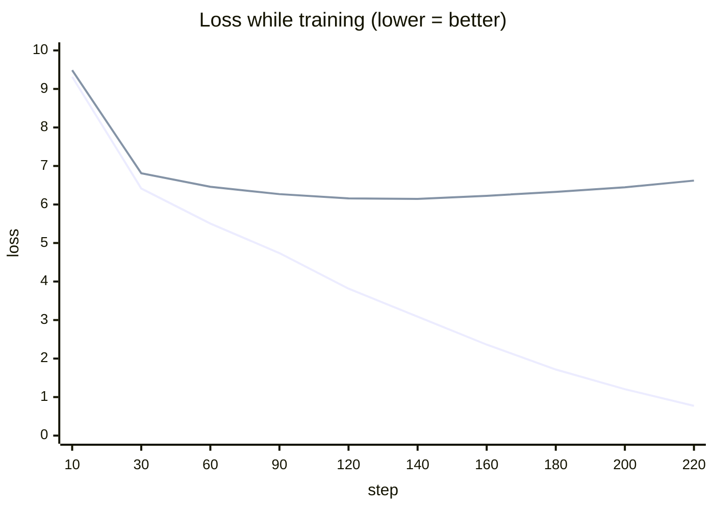
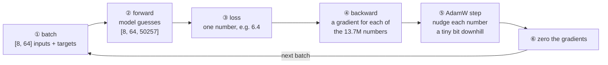
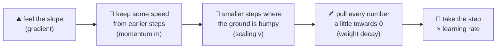

# Line by line: `TinyGPT` (training)

**Run it:** `./run.sh train` (about 20 seconds), then `./run.sh generate "Your words"` · **Code:** [`TinyGPT.java`](../../src/main/java/com/tinygpt/TinyGPT.java), and the classes it uses: [`Trainer`](../../src/main/java/com/tinygpt/training/Trainer.java), [`AdamW`](../../src/main/java/com/tinygpt/training/AdamW.java) · **Idea first:** [6. Training](../06-training.md) · **Book:** 5.2, 5.4

← [Step 11](step11-sampling.md) · [All walkthroughs](README.md) · Next: [Step 12 →](step12-load-gpt2.md)

Every output on this page is **real**: it's what `./run.sh train` prints on an M4 Pro with seed 123.

---

## 🗺️ The whole program on one page



**This is where everything comes together**: steps 1-11 build the parts; this program makes them **learn**.

---

# Part A · `TinyGPT.java`

## Lines 31-39 · the settings

```java
    private static final Path MODEL_FILE = Path.of("models", "tinygpt.params");   // ◀ where to save
    private static final String PROMPT = "My name is";                             // ◀ what to write after

    private static final int EPOCHS = 25;              // ◀ go through the story 25 times
    private static final int BATCH_SIZE = 8;           // ◀ 8 examples per step
    private static final float LEARNING_RATE = 1e-3f;  // ◀ 0.001: how big each nudge is
    private static final float WEIGHT_DECAY = 0.1f;    // ◀ gently pull weights towards 0
    private static final float TRAIN_SHARE = 0.9f;     // ◀ 90% to learn from, 10% to test on
```

🗣️ All the knobs in one place, so they're easy to experiment with. `1e-3` is a short way to write 0.001.

---

## Lines 42-49 · the model and the writer

```java
        Engine.getInstance().setRandomSeed(123);                                    // ◀ same results every run
        GPTConfig config = GPTConfig.TINY;                                          // ◀ 4 blocks, 4 heads, 128 numbers, 64 tokens
        BpeTokenizer tokenizer = new BpeTokenizer();
        try (NDManager manager = NDManager.newBaseManager()) {
            GPTModel model = new GPTModel(manager, config);                         // ◀ step 9, small size
            TextGenerator generator = new TextGenerator(model, tokenizer, manager, 123);   // ◀ step 11
```

```
Model: 4 layers, 4 heads, 128 dims, context 64 tokens -> 13,665,792 parameters
```

---

## Lines 51-60 · `generate` mode: no training

```java
            if (args.length > 0 && args[0].equals("generate")) {                // ◀ 1 · ./run.sh generate "..."
                String prompt = args.length > 1 ? args[1] : PROMPT;              // ◀ 2 · your words, or "My name is"
                if (!Files.exists(MODEL_FILE)) {                                 // ◀ 3 · trained yet?
                    System.out.println("No saved model yet. Run without arguments first to train one.");
                    return;
                }
                model.load(MODEL_FILE);                                          // ◀ 4 · put the learned numbers back
                showSamples(generator, prompt);                                  // ◀ 5 · write
                return;
            }
```

🗣️ `./run.sh generate "I had always"` skips training and loads the numbers saved last time ([`load` explained in step 9](step09-gpt-model.md#save-and-load--keep-the-learned-numbers)).

---

## Lines 67-70 · split the story

```java
            String text = SampleText.theVerdict();                                 // ◀ 20,479 characters
            int split = (int) (text.length() * TRAIN_SHARE);                       // ◀ 18,431: where 90% ends
            int[] trainTokens = tokenizer.encode(text.substring(0, split));        // ◀ the first 90%
            int[] validationTokens = tokenizer.encode(text.substring(split));      // ◀ the last 10%
```

```
Training tokens: 4612, validation tokens: 534
```

🗣️ The model **learns** from the first 90%. The last 10% is kept **hidden** and only used to test it.

🌍 A teacher keeps some exam questions back. If a pupil only memorised the practice sheet, they'll fail the hidden questions.



---

## Lines 74-76 · windows and batches

```java
            int window = config.contextLength();                                     // ◀ 64 tokens
            GPTDataLoader trainLoader = new GPTDataLoader(new GPTDataset(trainTokens, window, window), BATCH_SIZE, true, true);          // ◀ shuffled
            GPTDataLoader validationLoader = new GPTDataLoader(new GPTDataset(validationTokens, window, window), BATCH_SIZE, false, false);
```

🔢 [Step 3](step03-sliding-window.md)'s sliding window, at full size: windows of 64 tokens, jumping 64 each time. 4,612 tokens → **72** examples → 72 ÷ 8 = **9 steps per round**. 25 rounds = **225 steps**.

---

## Line 79 · before training

```java
            System.out.println("Before training: " + generator.generateGreedy(PROMPT, 10));   // ◀
```

```
Before training: My name isroleumTar submerged Kass Nile junction Nar222etch Mercury
```

Random numbers → random words.

---

## Lines 83-86 · train

```java
            Trainer trainer = new Trainer(model, manager, LEARNING_RATE, WEIGHT_DECAY);       // ◀ 1
            long start = System.currentTimeMillis();                                         // ◀ 2 · start the clock
            trainer.train(trainLoader, validationLoader, EPOCHS, 10, generator, PROMPT);      // ◀ 3
            System.out.printf("%nTraining took %.1f seconds%n", (System.currentTimeMillis() - start) / 1000.0);
```

| ◀ | what it does |
|---|---|
| 1 | A trainer for this model, with AdamW inside ([Part B](#trainer--the-practice-coach)). |
| 3 | 25 rounds; print the losses every **10** steps, and write a sample after each round. |

Real output (shortened):

```
   sample: My name is,,,,,,,,,,,,,,,,,,,,,,,,,                       ← learned: "," is common
Epoch  2  step   10  ...  |  train loss 9.316  validation loss 9.487
Epoch  4  step   30  ...  |  train loss 6.415  validation loss 6.812
   sample: My name is, the the, the, the the, the, the.             ← learned: "the" is common
Epoch 10  step   90  ...  |  train loss 4.737  validation loss 6.269
   sample: My name is, and he was to the the one of the, and a little, ...
Epoch 16  step  140  ...  |  train loss 3.089  validation loss 6.144  ← validation's best
   sample: My name is, and I had been the the Riv, and, and of the that, ...
Epoch 20  step  180  ...  |  train loss 1.716  validation loss 6.328
Epoch 25  step  220  ...  |  train loss 0.773  validation loss 6.620
   sample: My name is, as he had been no preliminary work of the exquisite Hermia Croft, ...

Training took 19.8 seconds
```



(The lower line is the training loss, the upper one is the validation loss.)

### 👀 What the numbers tell us

| what | meaning |
|---|---|
| **Training loss falls all the way** (9.3 → 0.77) | the model gets very good at the text it practises on |
| **Validation loss falls, then rises** after step 140 (6.14 → 6.62) | after that, it's **memorising** the story, not learning English. This is **overfitting**. |
| The last sample quotes the story ("the exquisite Hermia Croft") | memorised word for word |

That's expected: 4,612 tokens is **tiny**. GPT-2 learned from billions. The book shows the same picture (figure 5.12).

---

## Lines 89-93 · save, then write

```java
            model.save(MODEL_FILE);                    // ◀ write all 13.7M numbers to models/tinygpt.params
            showSamples(generator, PROMPT);            // ◀ write with the trained model
```

```
Greedy (always the top choice):
  My name is, as he had been no preliminary work of the exquisite Hermia Croft, with a kind of an exquisburn, he chucked painting ...
Temperature 1.0, top-k 25 (a bit creative):
  My name is-colour, as one were the end so--his of Jack's: "Yes to see it," she began, as his pictures. ...
```

Real English words in a story-like style: a big step up from "roleumTar submerged Kass". (`showSamples` calls the [two writing methods from step 11](step11-sampling.md#generategreedy-and-generate).)

---

# Part B · the classes it uses

## `Trainer` · the practice coach

### `train` · the loop

```java
    public void train(Iterable<Batch> trainLoader, Iterable<Batch> validationLoader, int epochs, int evalEvery,
                      Runnable afterEachEpoch) {
        int globalStep = 0;
        long tokensSeen = 0;

        for (int epoch = 1; epoch <= epochs; epoch++) {                              // ◀ 1 · 25 rounds
            model.setTraining(true);                                                 // ◀ 2 · dropout on
            for (Batch batch : trainLoader) {                                        // ◀ 3 · 9 batches per round
                trainStep(batch);                                                    // ◀ 4 · learn from one batch
                globalStep++;
                tokensSeen += (long) batch.inputs().length * batch.inputs()[0].length;   // ◀ 5 · 8 × 64 = 512 more

                if (globalStep % evalEvery == 0) {                                   // ◀ 6 · every 10th step
                    float trainLoss = averageLoss(trainLoader, 5);
                    float validationLoss = averageLoss(validationLoader, 5);
                    System.out.printf("Epoch %2d  step %4d  ...", ...);
                }
            }
            afterEachEpoch.run();                                                    // ◀ 7 · e.g. write a sample
        }
        if (skippedSteps > 0) {                                                      // ◀ 8
            System.out.printf("(Skipped %d of %d steps because a gradient came back as NaN.)%n", skippedSteps, globalStep);
        }
    }
```

| ◀ | what it does |
|---|---|
| 1 | One **epoch** = one pass over all the training data. |
| 3 | The loader gives a new shuffled order each round ([step 3](step03-sliding-window.md#iterator--decide-the-order)). |
| 5 | Count tokens, for the printout. |
| 6 | `%` = remainder: `step % 10 == 0` is true at steps 10, 20, 30, ... Measures the loss on (at most) 5 batches of each set. |
| 7 | `Runnable` = "a piece of code to run later". TinyGPT passes "write a sample"; FineTune passes "answer a test question". |
| 8 | The [known NaN issue](../../README.md#known-issue-an-occasional-skipped-step): reports how many steps were skipped. |

### `trainStep` · the 5 moves of learning

```java
    private void trainStep(Batch batch) {
        try (NDScope ignored = new NDScope()) {                                      // free temporary grids at the end
            NDArray inputs = manager.create(batch.inputs());                         // ◀ 1 · take a batch
            NDArray targets = manager.create(batch.targets());

            try (GradientCollector gradients = Engine.getInstance().newGradientCollector()) {   // ◀ start recording
                NDArray logits = model.forward(inputs);                              // ◀ 2 · forward: guess
                NDArray loss = Loss.crossEntropy(logits, targets);                   // ◀ 3 · loss: how wrong?
                gradients.backward(loss);                                            // ◀ 4 · backward: who's to blame?
            }
            if (!optimizer.step()) {                                                 // ◀ 5 · nudge every weight
                skippedSteps++;
            }
            optimizer.zeroGradients();                                               // ◀ 6 · clean slate
        }
    }
```



| move | in plain words |
|---|---|
| ② forward | Make guesses for every position. |
| ③ loss | Score them ([step 10](step10-loss.md)). |
| ④ backward | **Autograd**: the engine follows every calculation **backwards** from the loss and works out, for each of the 13.7 million numbers, "if this number went up a little, would the loss go up or down, and by how much?" That's the **gradient**. The `GradientCollector` records the calculations so it can do this. |
| ⑤ step | Move every number a tiny bit in the direction that makes the loss **smaller** (AdamW, below). |
| ⑥ zero | Gradients would otherwise **add up** across steps, so reset them to 0. |

🌍 Darts practice: throw (forward), measure how far off you were (loss), work out how to adjust your arm (backward), adjust a little (step), throw again.

### `averageLoss` · test without learning

```java
    public float averageLoss(Iterable<Batch> loader, int maxBatches) {
        boolean wasTraining = model.isTraining();
        model.setTraining(false);                                             // ◀ no dropout while testing
        float total = 0;
        int count = 0;
        for (Batch batch : loader) {
            if (count == maxBatches) {
                break;                                                        // ◀ 5 batches is enough for a good estimate
            }
            try (NDScope ignored = new NDScope()) {
                NDArray logits = model.forward(manager.create(batch.inputs()));
                total += Loss.crossEntropy(logits, manager.create(batch.targets())).getFloat();   // ◀ no backward, no step
            }
            count++;
        }
        model.setTraining(wasTraining);
        return count == 0 ? Float.NaN : total / count;                        // ◀ the average
    }
```

Only forward + loss: **measuring** doesn't change the model.

---

## `AdamW` · how to nudge each number

### The idea: walking down a foggy hill

The loss is like the **height** of a hill, and every setting of the 13.7 million numbers is a spot on it. We want to reach the **bottom**. In the fog, all we can feel is the **slope** under our feet: that's the gradient.



### The constructor

```java
    private static final float BETA1 = 0.9f;      // ◀ how much momentum to keep (90%)
    private static final float BETA2 = 0.999f;    // ◀ how slowly the bumpiness estimate changes
    private static final float EPSILON = 1e-8f;   // ◀ 0.00000001, avoids ÷ 0

    public AdamW(List<NDArray> parameters, float learningRate, float weightDecay) {
        this.parameters = parameters;            // ◀ every learnable grid in the model
        for (NDArray p : parameters) {
            momentum.add(p.zerosLike());         // ◀ m: one 0 per number, same shapes
            velocity.add(p.zerosLike());         // ◀ v: one 0 per number
        }
    }
```

AdamW keeps **two extra numbers for every weight**. That's why training needs about 3× the memory of the model.

### `step` · line by line

```java
    public boolean step() {
        if (!gradientsAreFinite()) {                                              // ◀ 1
            return false;
        }
        step++;
        float correction1 = 1f - (float) Math.pow(BETA1, step);                   // ◀ 2
        float correction2 = 1f - (float) Math.pow(BETA2, step);

        for (int i = 0; i < parameters.size(); i++) {
            NDArray weight = parameters.get(i);
            NDArray gradient = weight.getGradient();
            NDArray m = momentum.get(i);
            NDArray v = velocity.get(i);

            m.muli(BETA1).addi(gradient.mul(1f - BETA1));                         // ◀ 3
            v.muli(BETA2).addi(gradient.square().mul(1f - BETA2));                // ◀ 4

            NDArray mHat = m.div(correction1);                                    // ◀ 5
            NDArray vHat = v.div(correction2);
            NDArray update = mHat.div(vHat.sqrt().add(EPSILON))                   // ◀ 6
                    .add(weight.mul(weightDecay));                                // ◀ 7
            weight.subi(update.mul(learningRate));                                // ◀ 8
        }
        return true;
    }
```

| ◀ | formula | in plain words |
|---|---|---|
| 1 | | If any gradient is NaN ("not a number") or infinite, **skip** this step. One bad step would ruin every weight. |
| 2 | 1 − 0.9^step | m and v start at 0, so early on they're too small. These fix that (see ◀5). |
| 3 | m = 0.9·m + 0.1·gradient | **Momentum**: 90% of the old direction + 10% of the new slope. Smooths out zig-zags. |
| 4 | v = 0.999·v + 0.001·gradient² | **Bumpiness**: a slow average of how big the slopes have been. |
| 5 | m̂ = m ÷ correction | Undo the "started at 0" effect. |
| 6 | m̂ ÷ (√v̂ + ε) | The direction, **divided by the typical size** of the slope. Steep and bumpy → smaller step; gentle and steady → relatively bigger step. |
| 7 | + weightDecay · weight | **Weight decay**: also push the weight a little towards 0, so no number grows too big. |
| 8 | weight −= learningRate · update | Take the step. `−` because the gradient points **uphill**; we go **down**. |

`muli`, `addi`, `subi` (with an **i**) change the grid **in place** instead of making a new one, which saves memory.

🔢 **One weight, three steps, by hand.** weight = 0.5, learning rate 0.001, weight decay 0.1:

| step | gradient | m | v | m̂ | v̂ | update (◀6 + ◀7) | new weight |
|---:|---:|---:|---:|---:|---:|---:|---:|
| 1 | 0.2 | 0.02 | 0.00004 | 0.2 | 0.04 | 0.2 ÷ 0.2 + 0.05 = **1.05** | 0.5 − 0.00105 = **0.49895** |
| 2 | 0.2 | 0.038 | 0.00008 | 0.2 | 0.04 | 1.0499 | **0.49790** |
| 3 | −0.1 | 0.0242 | 0.00009 | 0.0893 | 0.03 | 0.5654 | **0.49734** |

👀 At step 1, m̂ ÷ √v̂ = 0.2 ÷ 0.2 = **1**, whatever size the gradient is. AdamW steps are about the size of the **learning rate**, so one setting works for every number in the model. At step 3 the slope flips sign, but momentum still remembers the earlier direction, so the step is only smaller, not reversed.

### `zeroGradients`

```java
    public void zeroGradients() {
        for (NDArray weight : parameters) {
            weight.getGradient().set(new NDIndex(":"), 0f);   // ◀ ":" = every position → 0
        }
    }
```

---

## 🧠 What this step teaches

- Training = **forward → loss → backward → step → zero**, repeated for every batch, for many rounds.
- **Autograd** works out a gradient (which way is downhill) for all 13.7 million numbers.
- **AdamW** steps downhill with momentum, adjusts the step size per number, and gently shrinks weights.
- Watch the **validation loss**: when it starts rising, the model is memorising (**overfitting**).

## 🧪 Try it yourself

1. Line 35: set `EPOCHS = 16` (where validation loss was lowest). Does the writing feel more or less like copying?
2. Line 37: try `LEARNING_RATE = 1e-2f` (10× bigger). Watch the loss jump about.
3. Line 39: `TRAIN_SHARE = 0.5f`. Less to learn from, more to test on.
