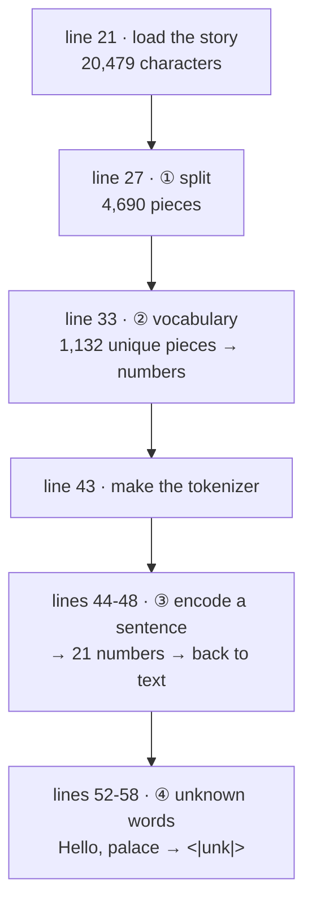
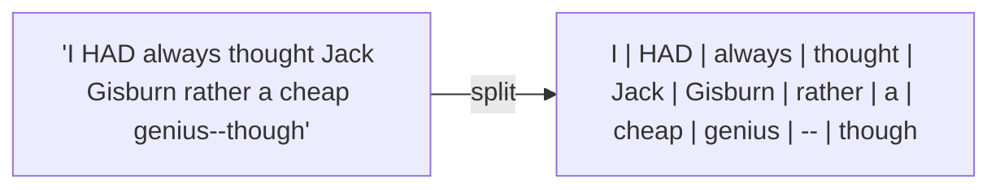
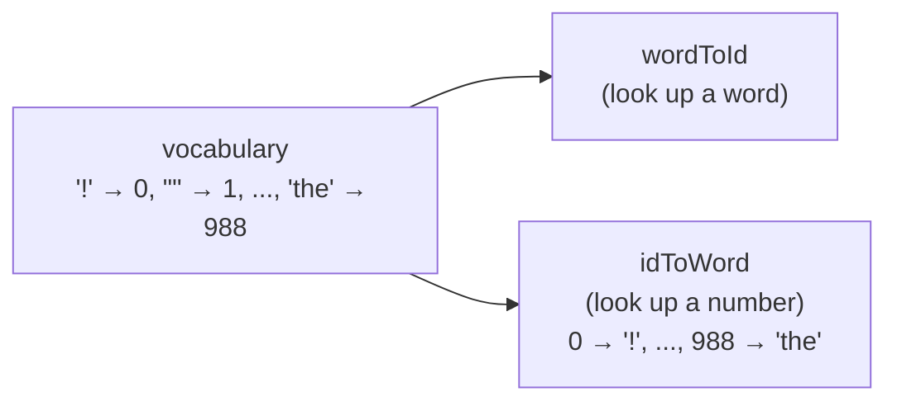
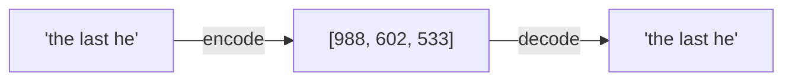
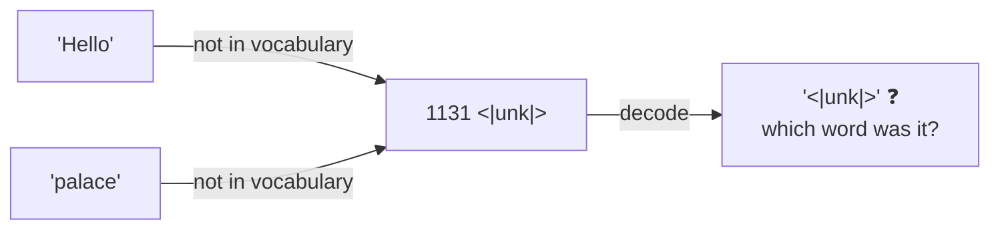
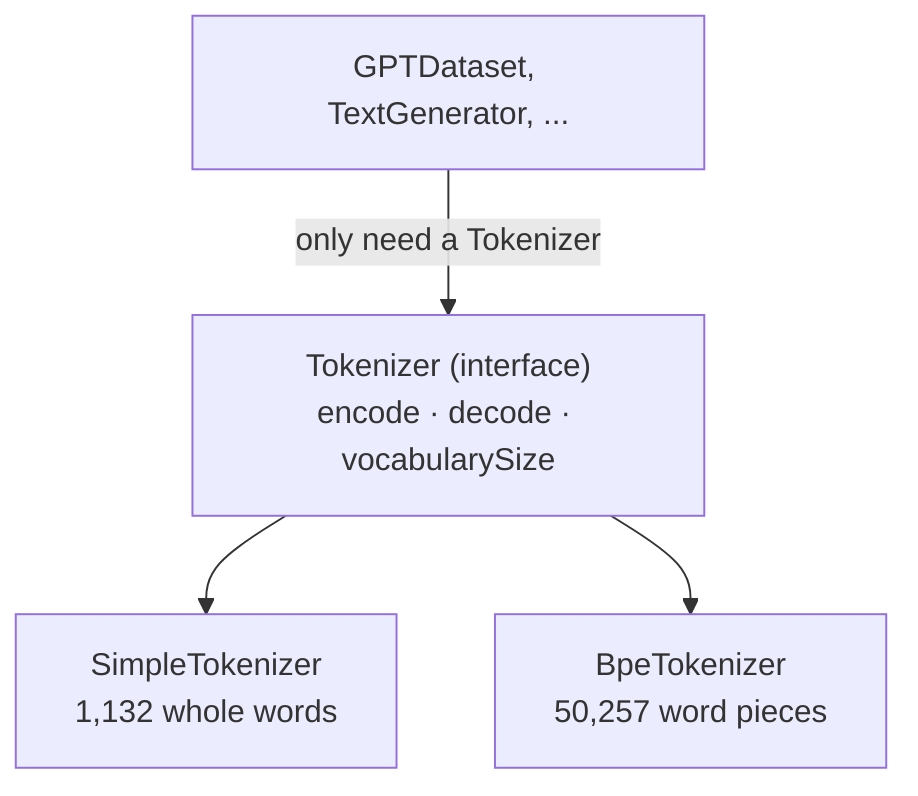
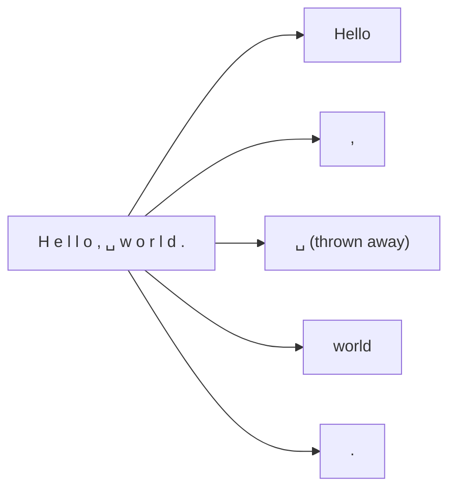
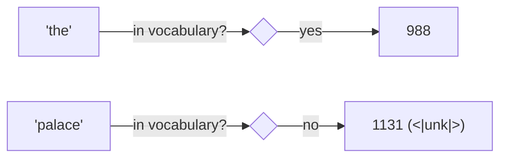

# Line by line: `Step01_SimpleTokenizer`

**Run it:** `./run.sh 1` · **Code:** [`Step01_SimpleTokenizer.java`](../../src/main/java/com/tinygpt/examples/Step01_SimpleTokenizer.java), and the classes it uses: [`SampleText`](../../src/main/java/com/tinygpt/data/SampleText.java), [`Tokenizer`](../../src/main/java/com/tinygpt/tokenizer/Tokenizer.java), [`SimpleTokenizer`](../../src/main/java/com/tinygpt/tokenizer/SimpleTokenizer.java) · **Idea first:** [1. Tokens](../01-tokenization.md) · **Book:** 2.2–2.4

← [All walkthroughs](README.md) · Next: [Step 2 →](step02-byte-pair-encoding.md)

Every output on this page is **real**: it's what `./run.sh 1` prints.

---

## 🗺️ The whole program on one page



**Why do this at all?** A computer can't do maths on the word "cat". It can do maths on the number 233. A **tokenizer** is the translator between the two.

---

# Part A · `Step01_SimpleTokenizer.java`

## Lines 3-8 · imports

```java
import com.tinygpt.data.SampleText;          // ◀ ours: loads the story
import com.tinygpt.tokenizer.SimpleTokenizer; // ◀ ours: the tokenizer (Part B)

import java.util.Arrays;                      // ◀ Java's: prints an int[] nicely
import java.util.List;                        // ◀ Java's: an ordered list
import java.util.Map;                         // ◀ Java's: a lookup table, word → number
```

---

## Line 21 · load the story

```java
        String story = SampleText.theVerdict();   // ◀
```

🗣️ Reads *The Verdict* (Edith Wharton, 1908) into one long `String`. This is the same story the book uses. See [Part B: SampleText](#sampletext--the-story-file).

## Lines 22-23 · show the start of it

```java
        System.out.println("The story has " + story.length() + " characters. It starts like this:");   // ◀
        System.out.println("  " + story.substring(0, 99) + "...");                                        // ◀
```

```
The story has 20479 characters. It starts like this:
  I HAD always thought Jack Gisburn rather a cheap genius--though a good fellow enough--so it was no ...
```

🗣️ `length()` counts characters (letters, spaces, punctuation). `substring(0, 99)` takes characters 0 to 98, the first 99.

---

## Line 27 · split into pieces

```java
        List<String> words = SimpleTokenizer.split(story);   // ◀
```

🗣️ Cuts the text into **words and punctuation marks**, and throws away the spaces.



Real output:

```
1) Split into 4690 pieces. The first 20:
   [I, HAD, always, thought, Jack, Gisburn, rather, a, cheap, genius, --, though, a, good, fellow, enough, --, so, it, was]
```

Notice `--` became its own piece, and `a` appears twice. How `split` does it: [Part B](#split--cut-text-into-pieces).

---

## Line 33 · give every unique piece a number

```java
        Map<String, Integer> vocabulary = SimpleTokenizer.buildVocabulary(story);   // ◀
```

🗣️ The **vocabulary** is a dictionary: every *different* piece gets one number. 4,690 pieces, but many repeat ("a", "the", "."), so only **1,130** are different. Plus 2 special tokens = **1,132**.

## Lines 34-39 · print the first 8 entries

```java
        System.out.println("2) Vocabulary size: " + vocabulary.size() + " ...");   // ◀ 1132
        vocabulary.entrySet().stream()                                            // ◀ every (word, number) pair
                .sorted(Map.Entry.comparingByValue())                             // ◀ sort by the number
                .limit(8)                                                         // ◀ keep the first 8
                .forEach(entry -> System.out.println("   " + entry.getValue() + " -> " + entry.getKey()));   // ◀ print "0 -> !"
```

```
   0 -> !
   1 -> "
   2 -> '
   3 -> (
   4 -> )
   5 -> ,
   6 -> --
   7 -> .
```

🗣️ Punctuation comes first because the vocabulary is in **alphabetical (computer) order**, and in that order symbols come before capital letters, which come before small letters.

🌍 Like the index at the back of a book: every word is listed once, in order, with its own number.

---

## Line 43 · make the tokenizer

```java
        SimpleTokenizer tokenizer = new SimpleTokenizer(vocabulary);   // ◀
```

🗣️ The tokenizer keeps the vocabulary **both ways round**: word → number (for encoding) and number → word (for decoding).



---

## Lines 44-48 · encode and decode a sentence

```java
        String sentence = "\"It's the last he painted, you know,\" Mrs. Gisburn said with pardonable pride.";   // ◀
        int[] ids = tokenizer.encode(sentence);                                                              // ◀
        System.out.println("   IDs:    " + Arrays.toString(ids));                                           // ◀
        System.out.println("   Decode: " + tokenizer.decode(ids));                                          // ◀
```

`\"` inside a Java string means a real `"` character.

Real output, piece by piece:

| piece | `"` | It | ' | s | the | last | he | painted | , | you | know | , | `"` | Mrs | . | Gisburn | said | with | pardonable | pride | . |
|---|---|---|---|---|---|---|---|---|---|---|---|---|---|---|---|---|---|---|---|---|---|
| **ID** | 1 | 56 | 2 | 850 | 988 | 602 | 533 | 746 | 5 | 1126 | 596 | 5 | 1 | 67 | 7 | 38 | 851 | 1108 | 754 | 793 | 7 |



```
   Decode: " It' s the last he painted, you know," Mrs. Gisburn said with pardonable pride.
```

👀 Look closely: decoding gives `" It' s`, not `"It's`. The tokenizer split `It's` into `It`, `'`, `s`, and when it glues pieces back together it can't know there was **no space** around the `'`. The book gets the same result. It's one reason real tokenizers (step 2) remember spaces.

---

## Lines 52-58 · words it has never seen

```java
        String withNewWords = "Hello, do you like tea?" + " " + SimpleTokenizer.END_OF_TEXT + " " + "In the sunlit terraces of the palace.";   // ◀
        int[] newIds = tokenizer.encode(withNewWords);   // ◀
```

🗣️ Two short texts, joined with the special `<|endoftext|>` token, which means "one document ends here, a new one starts".

| piece | Hello | , | do | you | like | tea | ? | `<\|endoftext\|>` | In | the | sunlit | terraces | of | the | palace | . |
|---|---|---|---|---|---|---|---|---|---|---|---|---|---|---|---|---|
| **ID** | **1131** | 5 | 355 | 1126 | 628 | 975 | 10 | **1130** | 55 | 988 | 956 | 984 | 722 | 988 | **1131** | 7 |

```
   Decode: <|unk|>, do you like tea? <|endoftext|> In the sunlit terraces of the <|unk|>.
```

🗣️ "Hello" and "palace" never appear in *The Verdict*, so they get **1131 = `<|unk|>`** ("unknown"). The meaning is **lost**: decoding can't bring the words back. Step 2 fixes this.



---

# Part B · the classes it uses

## `SampleText` · the story file

```java
    public static String theVerdict() {
        try (InputStream in = SampleText.class.getResourceAsStream("/the-verdict.txt")) {   // ◀ 1
            if (in == null) {                                                                // ◀ 2
                throw new IllegalStateException("the-verdict.txt not found in src/main/resources");
            }
            return new String(in.readAllBytes(), StandardCharsets.UTF_8);                    // ◀ 3
        } catch (IOException e) {
            throw new UncheckedIOException(e);                                               // ◀ 4
        }
    }
```

| ◀ | what it does |
|---|---|
| 1 | Opens `the-verdict.txt` from `src/main/resources`. Maven copies that folder next to the compiled code, so `getResourceAsStream` finds it however you run the program. `try ( ... )` closes the file afterwards. |
| 2 | If the file is missing, stop with a clear message instead of a confusing crash later. |
| 3 | Read every byte, and turn the bytes into text using **UTF-8** (the standard way of storing letters as bytes). |
| 4 | Reading a file can fail. Java makes us handle that, so we wrap it in an "unchecked" error that the caller doesn't have to catch. |

The constructor `private SampleText() {}` stops anyone from writing `new SampleText()`. It's just a holder for one method.

---

## `Tokenizer` · the promise every tokenizer keeps

```java
public interface Tokenizer {
    int[] encode(String text);        // ◀ text → numbers
    String decode(int[] tokenIds);    // ◀ numbers → text
    int vocabularySize();             // ◀ how many different tokens it knows
}
```

🗣️ An **interface** is a list of methods without code. It's a promise: "anything that calls itself a Tokenizer can do these 3 things".
`SimpleTokenizer` (this step) and `BpeTokenizer` (step 2) both keep the promise, so the rest of the project can use either one.



---

## `SimpleTokenizer` · line by line

### The constants

```java
    public static final String END_OF_TEXT = "<|endoftext|>";   // ◀ "a new document starts here"
    public static final String UNKNOWN = "<|unk|>";             // ◀ "a word I don't know"

    private static final Pattern SPLIT_PATTERN = Pattern.compile("([,.:;?_!\"()']|--|\\s)");      // ◀ where to cut
    private static final Pattern SPACE_BEFORE_PUNCTUATION = Pattern.compile("\\s+([,.:;?!\"()'])"); // ◀ for decode
```

🗣️ A `Pattern` is a **regular expression**: a tiny language for describing text. Reading `SPLIT_PATTERN` piece by piece:

| part | means |
|---|---|
| `[,.:;?_!\"()']` | any **one** of these characters: `, . : ; ? _ ! " ( ) '` |
| `\|` | or |
| `--` | a double dash |
| `\|` | or |
| `\\s` | any whitespace (space, tab, new line) |
| `( ... )` | remember what matched, so we can keep it |

---

### `split` · cut text into pieces

```java
    public static List<String> split(String text) {
        List<String> pieces = new ArrayList<>();
        Matcher matcher = SPLIT_PATTERN.matcher(text);                        // ◀ 1
        int start = 0;
        while (matcher.find()) {                                               // ◀ 2
            addIfNotBlank(pieces, text.substring(start, matcher.start()));    // ◀ 3
            addIfNotBlank(pieces, matcher.group());                           // ◀ 4
            start = matcher.end();                                            // ◀ 5
        }
        addIfNotBlank(pieces, text.substring(start));                         // ◀ 6
        return pieces;
    }
```

🔢 Follow it on `"Hello, world."`:

| loop | `find()` matches | ◀3 adds the text before it | ◀4 adds the match itself | `start` moves to |
|---|---|---|---|---|
| 1 | `,` at position 5 | `Hello` | `,` | 6 |
| 2 | ` ` (space) at 6 | *(nothing between 6 and 6)* | ~~` `~~ blank, skipped | 7 |
| 3 | `.` at 12 | `world` | `.` | 13 |
| after the loop ◀6 | | *(nothing left)* | | |

Result: `["Hello", ",", "world", "."]`



`addIfNotBlank` strips spaces from the ends of a piece and only keeps it if something is left. That's how the spaces disappear.

---

### `buildVocabulary` · number every unique piece

```java
    public static Map<String, Integer> buildVocabulary(String text) {
        List<String> uniqueWords = new ArrayList<>(new TreeSet<>(split(text)));   // ◀ 1
        uniqueWords.add(END_OF_TEXT);                                              // ◀ 2
        uniqueWords.add(UNKNOWN);                                                  // ◀ 2

        Map<String, Integer> vocabulary = new HashMap<>();
        for (int id = 0; id < uniqueWords.size(); id++) {                          // ◀ 3
            vocabulary.put(uniqueWords.get(id), id);
        }
        return vocabulary;
    }
```

| ◀ | what it does | tiny example: `"the cat the"` |
|---|---|---|
| 1 | A `TreeSet` keeps each item **once**, in **sorted** order. | `[cat, the]` |
| 2 | Add the 2 special tokens at the end. | `[cat, the, <\|endoftext\|>, <\|unk\|>]` |
| 3 | Number them 0, 1, 2, ... | `{cat: 0, the: 1, <\|endoftext\|>: 2, <\|unk\|>: 3}` |

On the real story the special tokens become **1130** and **1131**, which is why `<|unk|>` showed up as 1131 above.

---

### `encode` · words → numbers

```java
    public int[] encode(String text) {
        return split(text).stream()                                                   // ◀ 1
                .mapToInt(word -> wordToId.getOrDefault(word, wordToId.get(UNKNOWN))) // ◀ 2
                .toArray();                                                           // ◀ 3
    }
```

| ◀ | what it does |
|---|---|
| 1 | Split the text, then handle the pieces one by one (`stream`). |
| 2 | Look each piece up. `getOrDefault`: if it isn't there, use the number of `<|unk|>` instead. |
| 3 | Collect the numbers into an `int[]`. |



---

### `decode` · numbers → words

```java
    public String decode(int[] tokenIds) {
        List<String> words = new ArrayList<>();
        for (int id : tokenIds) {
            words.add(idToWord.get(id));                                                           // ◀ 1
        }
        return SPACE_BEFORE_PUNCTUATION.matcher(String.join(" ", words)).replaceAll("$1");        // ◀ 2
    }
```

🔢 With `[38, 851, 7]`:

| ◀ | result |
|---|---|
| 1 · look up each number | `["Gisburn", "said", "."]` |
| 2a · `String.join(" ", ...)` puts a space between every piece | `"Gisburn said ."` |
| 2b · `replaceAll("$1")` removes any space **before** punctuation (`$1` = "the punctuation mark that matched") | `"Gisburn said."` |

---

### `vocabularySize`

```java
    public int vocabularySize() {
        return wordToId.size();   // ◀ 1,132 for The Verdict
    }
```

---

## 🧠 What this step teaches

- Text → pieces → numbers (**encode**), and back (**decode**).
- The vocabulary is just a **sorted list of every unique piece**, numbered from 0.
- Words that aren't in the vocabulary become **`<|unk|>`**, and their meaning is lost. That's the big weakness. [Step 2](step02-byte-pair-encoding.md) fixes it.

## 🧪 Try it yourself

1. Line 44: encode your own sentence. Which of your words are unknown?
2. Line 52: put "Gisburn" in the text. It's known, because it's in the story.
3. In `SimpleTokenizer`, remove `--` from `SPLIT_PATTERN`. How does the first-20 list change?
