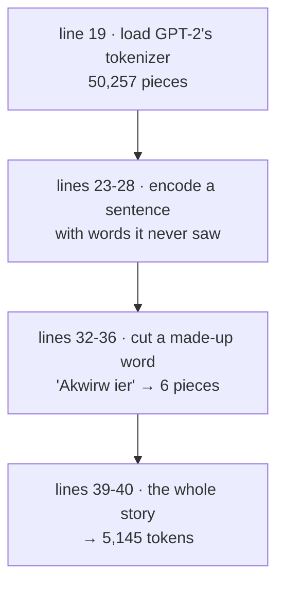
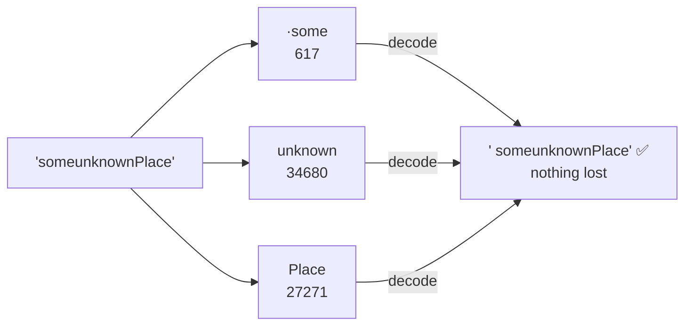
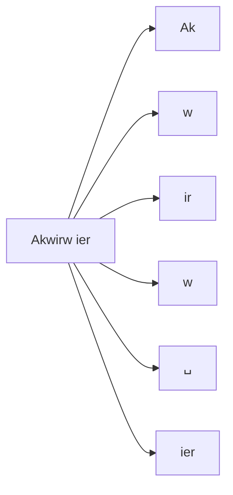
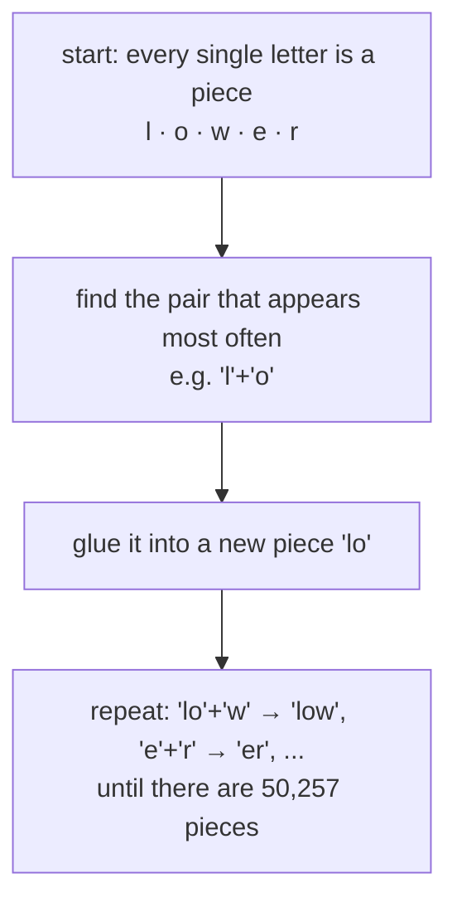
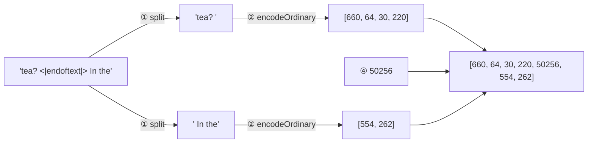

# Line by line: `Step02_BytePairEncoding`

**Run it:** `./run.sh 2` · **Code:** [`Step02_BytePairEncoding.java`](../../src/main/java/com/tinygpt/examples/Step02_BytePairEncoding.java) and [`BpeTokenizer.java`](../../src/main/java/com/tinygpt/tokenizer/BpeTokenizer.java) · **Idea first:** [1. Tokens](../01-tokenization.md) · **Book:** 2.5

← [Step 1](step01-simple-tokenizer.md) · [All walkthroughs](README.md) · Next: [Step 3 →](step03-sliding-window.md)

Every output on this page is **real**: it's what `./run.sh 2` prints.

---

## 🗺️ The whole program on one page



**The problem from step 1:** unknown words became `<|unk|>` and were lost. **The fix:** don't number whole words; number **pieces** of words. Any word, even a made-up one, can be built from pieces.

---

# Part A · `Step02_BytePairEncoding.java`

## Line 19 · load GPT-2's tokenizer

```java
        BpeTokenizer tokenizer = new BpeTokenizer();   // ◀
```

🗣️ Unlike step 1, we don't build a vocabulary from our story. We use the **exact** one OpenAI made for GPT-2 from millions of web pages. That matters later: in step 12 we load GPT-2's trained numbers, and they only make sense with GPT-2's own tokens.

## Line 20 · how many pieces it knows

```java
        System.out.println("GPT-2 knows " + tokenizer.vocabularySize() + " tokens.");   // ◀ 50257
```

| | Step 1 `SimpleTokenizer` | Step 2 `BpeTokenizer` |
|---|---:|---:|
| vocabulary | 1,132 whole words | **50,257** word pieces |
| made from | one short story | millions of web pages |
| unknown words | → `<\|unk\|>` (lost) | split into smaller pieces (never lost) |

---

## Lines 23-28 · encode a sentence with new words

```java
        String text = "Hello, do you like tea? <|endoftext|> In the sunlit terraces of someunknownPlace.";   // ◀
        int[] ids = tokenizer.encode(text);                       // ◀
        System.out.println("IDs:    " + Arrays.toString(ids));    // ◀
        System.out.println("Decode: " + tokenizer.decode(ids));   // ◀
```

Real pieces (a `·` shows a space that belongs to the piece):

| piece | Hello | , | ·do | ·you | ·like | ·tea | ? | · | `<\|endoftext\|>` | ·In | ·the | ·sun | lit | ·terr | aces | ·of | ·some | unknown | Place | . |
|---|---|---|---|---|---|---|---|---|---|---|---|---|---|---|---|---|---|---|---|---|
| **ID** | 15496 | 11 | 466 | 345 | 588 | 8887 | 30 | 220 | **50256** | 554 | 262 | 4252 | 18250 | 8812 | 2114 | 286 | 617 | 34680 | 27271 | 13 |

```
Decode: Hello, do you like tea? <|endoftext|> In the sunlit terraces of someunknownPlace.
```

👀 Three things to notice:

1. **"Hello" is known now** (15496). The step 1 tokenizer turned it into `<|unk|>`.
2. **"someunknownPlace" isn't a word at all**, yet it's built from 3 known pieces: `·some` + `unknown` + `Place`. "sunlit" and "terraces" are split too.
3. **The space is part of the piece**: `·the` (262) is a different token from `the` (1169). That's why decode gives back the text **exactly**, with no `It' s` problem like in step 1.



## Line 28 · the end-of-text token

```java
        System.out.println("No <|unk|> needed! Note <|endoftext|> became ID " + BpeTokenizer.END_OF_TEXT_ID + ".");   // ◀ 50256
```

🗣️ `<|endoftext|>` is the **last** ID, 50256. GPT-2 saw it between documents during training. Later, in [step 3's data](step03-sliding-window.md) and the [chat bot](../09-chat-with-gpt2.md), it means "this text is finished".

---

## Lines 32-36 · watch a made-up word being cut

```java
        String madeUp = "Akwirw ier";                                          // ◀ not a real word
        for (int id : tokenizer.encode(madeUp)) {                              // ◀ for each piece...
            System.out.printf("   %6d -> \"%s\"%n", id, tokenizer.decodeOne(id));   // ◀ ...print its ID and its text
        }
```

```
    33901 -> "Ak"
       86 -> "w"
      343 -> "ir"
       86 -> "w"
      220 -> " "
      959 -> "ier"
```

🗣️ `printf("%6d", id)` prints the number right-aligned in 6 spaces, so the column lines up. `%n` is a new line.



No piece is unknown, because in the worst case BPE can fall back to **single letters** (even single bytes). So nothing is ever lost.

### How did GPT-2 get its pieces? (the "pair merging" idea)

BPE stands for **Byte Pair Encoding**. Before GPT-2 was trained, OpenAI ran this on lots of text:



That's why common words are **one** piece (`·the`, `·you`, `·unbelievable`), while rare words are several (`unbelievable` without a space in front is 4 pieces: `un`·`bel`·`iev`·`able`).

🌍 LEGO: common shapes come as one ready-made block, and anything unusual can still be built from small bricks.

---

## Lines 39-40 · the whole story

```java
        int[] storyIds = tokenizer.encode(SampleText.theVerdict());                       // ◀
        System.out.println("The whole story becomes " + storyIds.length + " BPE tokens."); // ◀ 5145
```

| | step 1 | step 2 |
|---|---:|---:|
| pieces in *The Verdict* | 4,690 | **5,145** |

A few more pieces than step 1, because some words are split, and the spaces and line breaks are kept. These 5,145 numbers are what [step 3](step03-sliding-window.md) turns into training examples.

---

# Part B · `BpeTokenizer` line by line

## The constants and the encoding

```java
    public static final String END_OF_TEXT = "<|endoftext|>";
    public static final int END_OF_TEXT_ID = 50256;            // ◀ the last ID
    public static final int GPT2_VOCABULARY_SIZE = 50257;      // ◀ IDs 0 to 50256

    private final Encoding gpt2 = Encodings.newDefaultEncodingRegistry().getEncoding(EncodingType.R50K_BASE);   // ◀
```

🗣️ We don't write BPE ourselves. **jtokkit** is a Java copy of OpenAI's own tokenizer library (tiktoken). `R50K_BASE` is the name of **GPT-2's** piece list (r = "rank", 50K pieces).

---

## `encode` · text → numbers

```java
    public int[] encode(String text) {
        IntArrayList result = new IntArrayList();
        String[] documents = text.split(Pattern.quote(END_OF_TEXT), -1);    // ◀ 1
        for (int i = 0; i < documents.length; i++) {
            IntArrayList tokens = gpt2.encodeOrdinary(documents[i]);        // ◀ 2
            for (int j = 0; j < tokens.size(); j++) {
                result.add(tokens.get(j));                                  // ◀ 3
            }
            if (i < documents.length - 1) {
                result.add(END_OF_TEXT_ID);                                 // ◀ 4
            }
        }
        return result.toArray();
    }
```

🔢 Follow it on `"tea? <|endoftext|> In the"`:

| ◀ | what it does | result |
|---|---|---|
| 1 | Cut the text at every `<\|endoftext\|>`. `Pattern.quote` means "treat `\|` as a normal character". `-1` keeps empty parts at the ends. | `["tea? ", " In the"]` |
| 2 | Encode each part as ordinary text. | `[660, 64, 30, 220]` and `[554, 262]` |
| 3 | Add those IDs to the result. | |
| 4 | **Between** parts (not after the last), add 50256. | `[660, 64, 30, 220, `**`50256`**`, 554, 262]` |

**Why not let jtokkit handle `<|endoftext|>`?** `encodeOrdinary` would treat it as 13 normal characters (`<`, `|`, `end`, ...), not as the special token. So we cut it out and put 50256 in ourselves.



(Here `tea` has no space in front, so it's two pieces, `te` + `a` = 660, 64. Above, `·tea` with a space was the single piece 8887.)

---

## `decode` · numbers → text

```java
    public String decode(int[] tokenIds) {
        IntArrayList list = new IntArrayList(tokenIds.length);   // ◀ 1 · jtokkit wants its own list type
        for (int id : tokenIds) {
            list.add(id);                                        // ◀ 2 · copy the IDs in
        }
        return gpt2.decode(list);                                // ◀ 3 · look up each piece and glue them
    }
```

🔢 `[15496, 995]` → `"Hello"` + `" world"` → `"Hello world"`. Spaces are inside the pieces, so plain gluing is exactly right.

## `decodeOne` · one ID → its text

```java
    public String decodeOne(int tokenId) {
        return decode(new int[]{tokenId});   // ◀ 995 → " world"
    }
```

Used by lines 34-35 to show each piece separately.

## `vocabularySize`

```java
    public int vocabularySize() {
        return GPT2_VOCABULARY_SIZE;   // ◀ 50257
    }
```

The model needs this number: its last layer gives **one score for each of the 50,257 pieces** ([step 9](step09-gpt-model.md)).

---

## 🧠 What this step teaches

- BPE numbers **pieces of words**, so there are **no unknown words**.
- Common words are one piece, rare words are several, and the space belongs to the piece.
- `<|endoftext|>` = **50256**, the "document finished" token.
- We use GPT-2's own pieces so we can later load GPT-2's trained numbers.

## 🧪 Try it yourself

1. Line 32: try your own name. How many pieces is it?
2. Line 23: compare `"cat"`, `" cat"` and `"Cat"`. You'll get 3 different IDs: 9246, 3797, 21979.
3. Encode a sentence in another language. Many more pieces per word: GPT-2 learned mostly from English.
