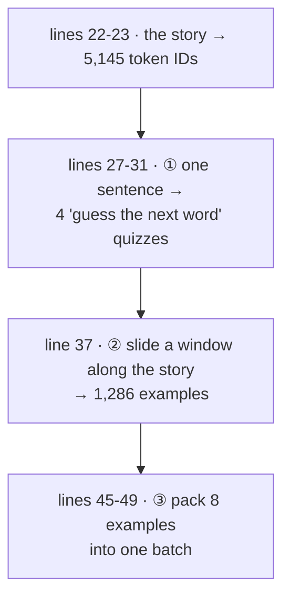
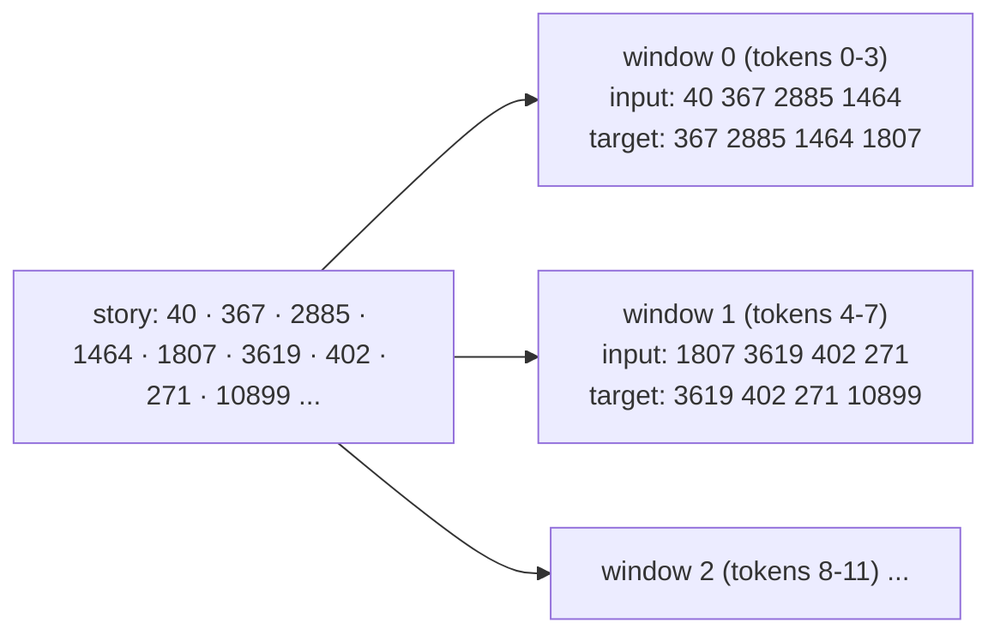
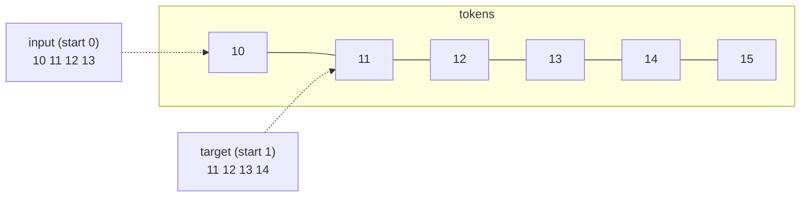
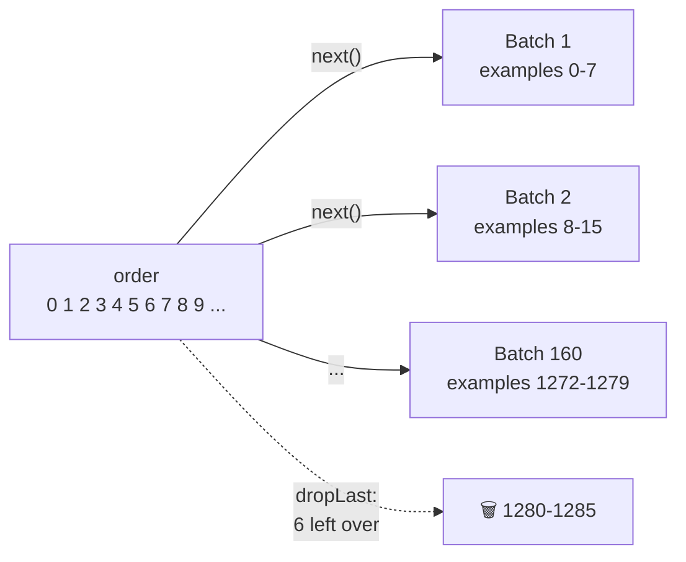

# Line by line: `Step03_SlidingWindow`

**Run it:** `./run.sh 3` · **Code:** [`Step03_SlidingWindow.java`](../../src/main/java/com/tinygpt/examples/Step03_SlidingWindow.java), and the classes it uses: [`GPTDataset`](../../src/main/java/com/tinygpt/data/GPTDataset.java), [`GPTDataLoader`](../../src/main/java/com/tinygpt/data/GPTDataLoader.java), [`Batch`](../../src/main/java/com/tinygpt/data/Batch.java) · **Idea first:** [2. Training data](../02-training-data.md) · **Book:** 2.6

← [Step 2](step02-byte-pair-encoding.md) · [All walkthroughs](README.md) · Next: [Step 4 →](step04-embeddings.md)

Every output on this page is **real**: it's what `./run.sh 3` prints.

---

## 🗺️ The whole program on one page



**Why?** A GPT learns one game: *read some words, guess the next one*. The story itself contains all the answers. We just have to cut it into quiz questions.

---

# Part A · `Step03_SlidingWindow.java`

## Lines 22-23 · the story as numbers

```java
        BpeTokenizer tokenizer = new BpeTokenizer();                 // ◀ GPT-2's tokenizer (step 2)
        int[] ids = tokenizer.encode(SampleText.theVerdict());      // ◀ 5,145 numbers
```

```
ids = [40, 367, 2885, 1464, 1807, 3619, 402, 271, 10899, 2138, 257, 7026, 15632, 438, ...]
        I   ·H   AD  ·always ·thought ·Jack ·G  is  burn  ·rather ·a ·cheap ·genius --
```

---

## Lines 27-31 · every beginning is a quiz

```java
        int[] sample = Arrays.copyOfRange(ids, 50, 55);                  // ◀ 1 · 5 tokens from the middle
        for (int i = 1; i < sample.length; i++) {                        // ◀ 2 · i = 1, 2, 3, 4
            int[] context = Arrays.copyOfRange(sample, 0, i);            // ◀ 3 · the first i tokens
            System.out.printf("   %-28s ----> %s%n",
                    "\"" + tokenizer.decode(context) + "\"",             // ◀ 4 · what the model has read
                    "\"" + tokenizer.decodeOne(sample[i]) + "\"");      // ◀ 5 · the answer: the next token
        }
```

| ◀ | what it does | with real numbers |
|---|---|---|
| 1 | Copy tokens 50 to 54 (`copyOfRange` stops **before** 55). | `[290, 4920, 2241, 287, 257]` |
| 2 | Loop 4 times. | |
| 3 | Take the first `i` tokens. | i=1: `[290]`, i=2: `[290, 4920]`, ... |
| 4-5 | Print "what was read" ----> "what comes next". `%-28s` pads the text to 28 characters, so the arrows line up. | see below |

```
   " and"                       ----> " established"
   " and established"           ----> " himself"
   " and established himself"   ----> " in"
   " and established himself in" ----> " a"
```

🗣️ **5 tokens give 4 quizzes.** The model must guess each next word using **only** the words before it.

---

## Lines 35-37 · slide a window along the whole story

```java
        int maxLength = 4;                                           // ◀ window size: 4 tokens
        int stride = 4;                                              // ◀ jump 4 tokens each time
        GPTDataset dataset = new GPTDataset(ids, maxLength, stride); // ◀ cut the story into examples
```

🗣️ Picture a card with a **window** 4 tokens wide. Lay it on the story, copy what you see, slide the card 4 tokens right, copy again, and so on to the end.



How the code does it: [Part B: GPTDataset](#gptdataset--the-sliding-window).

## Lines 38-41 · print the first example

```java
        System.out.println("2) Window of " + maxLength + " tokens, moving " + stride + " each time -> " + dataset.size() + " examples");
        System.out.println("   input  " + Arrays.toString(dataset.input(0)) + "  " + tokenizer.decode(dataset.input(0)).replace("\n", " "));
        System.out.println("   target " + Arrays.toString(dataset.target(0)) + "  " + tokenizer.decode(dataset.target(0)).replace("\n", " "));
```

```
2) Window of 4 tokens, moving 4 each time -> 1286 examples
   input  [40, 367, 2885, 1464]  I HAD always
   target [367, 2885, 1464, 1807]   HAD always thought
```

🗣️ `.replace("\n", " ")` swaps any line break for a space, so the output stays on one line.

**The target is the input moved one step to the right.** So one example is really **4 quizzes**:

| the model has read | it should guess |
|---|---|
| I | ·H |
| I ·H | AD |
| I ·H AD | ·always |
| I ·H AD ·always | ·thought |

("HAD" is two GPT-2 pieces, `·H` + `AD`, because capital-letter words are rarer.)

🔢 **Why 1,286 examples?** A window can start at 0, 4, 8, ... as long as there's still one token after it for the last answer: start + 4 < 5,145, so the last start is 5,140. That's 5,140 ÷ 4 + 1 = **1,286** windows.

---

## Lines 45-49 · pack 8 examples into a batch

```java
        GPTDataLoader loader = new GPTDataLoader(dataset, 8, false, true);   // ◀ 1
        Batch first = loader.iterator().next();                             // ◀ 2
        System.out.println("   inputs  = " + Arrays.deepToString(first.inputs()));    // ◀ 3
        System.out.println("   targets = " + Arrays.deepToString(first.targets()));   // ◀ 3
```

| ◀ | what it does |
|---|---|
| 1 | A loader that gives out **8** examples at a time, **not shuffled** (`false`), and skips a last batch that isn't full (`true`). |
| 2 | Ask for the first batch. (A `for (Batch b : loader)` loop would go through all of them.) |
| 3 | `deepToString` prints a grid (an array of arrays). |

```
inputs  = [[40, 367, 2885, 1464], [1807, 3619, 402, 271], [10899, 2138, 257, 7026], [15632, 438, 2016, 257],
           [922, 5891, 1576, 438], [568, 340, 373, 645], [1049, 5975, 284, 502], [284, 3285, 326, 11]]
targets = [[367, 2885, 1464, 1807], [3619, 402, 271, 10899], ...]
```

As a grid, it's **8 rows × 4 columns**:

| row | inputs | targets |
|---|---|---|
| 0 | 40 · 367 · 2885 · 1464 | 367 · 2885 · 1464 · **1807** |
| 1 | 1807 · 3619 · 402 · 271 | 3619 · 402 · 271 · **10899** |
| 2 | 10899 · 2138 · 257 · 7026 | 2138 · 257 · 7026 · **15632** |
| ... | ... | ... |
| 7 | 284 · 3285 · 326 · 11 | 3285 · 326 · 11 · **287** |

👀 Each row's input starts where the row above ended (stride 4 = no overlap, no gaps). And each target's last number is the next row's first input.

🌍 A teacher handing out flashcards in bundles of 8: questions on the front (inputs), answers on the back (targets).

---

# Part B · the classes it uses

## `GPTDataset` · the sliding window

```java
    public GPTDataset(int[] tokenIds, int maxLength, int stride) {
        for (int start = 0; start + maxLength < tokenIds.length; start += stride) {           // ◀ 1
            inputs.add(Arrays.copyOfRange(tokenIds, start, start + maxLength));               // ◀ 2
            targets.add(Arrays.copyOfRange(tokenIds, start + 1, start + maxLength + 1));      // ◀ 3
        }
    }
```

🔢 With tokens `[10, 11, 12, 13, 14, 15, 16, 17, 18, 19]`, `maxLength = 4`, `stride = 4`:

| start | ◀1 check `start + 4 < 10` | ◀2 input = positions start..start+3 | ◀3 target = positions start+1..start+4 |
|---:|---|---|---|
| 0 | 4 < 10 ✅ | `[10, 11, 12, 13]` | `[11, 12, 13, 14]` |
| 4 | 8 < 10 ✅ | `[14, 15, 16, 17]` | `[15, 16, 17, 18]` |
| 8 | 12 < 10 ❌ stop | | |

The check is `<`, not `<=`, because the target needs **one more** token after the window.



The other methods just hand back what was made:

```java
    public GPTDataset(String text, Tokenizer tokenizer, int maxLength, int stride) {
        this(tokenizer.encode(text), maxLength, stride);   // ◀ shortcut: tokenize first, then do the above
    }
    public int[] input(int index)  { return inputs.get(index); }    // ◀ example number `index`
    public int[] target(int index) { return targets.get(index); }   // ◀ its answers
    public int size()              { return inputs.size(); }        // ◀ how many examples (1,286)
```

**Stride smaller than the window** (e.g. stride 1) makes the windows overlap: more examples from the same text, but they're very alike.

---

## `GPTDataLoader` · bundles of examples

### The fields and constructors

```java
    public GPTDataLoader(GPTDataset dataset, int batchSize, boolean shuffle, boolean dropLast, long seed) {
        this.dataset = dataset;         // ◀ where the examples come from
        this.batchSize = batchSize;     // ◀ how many per bundle (8)
        this.shuffle = shuffle;         // ◀ mix the order each time?
        this.dropLast = dropLast;       // ◀ skip a last, smaller bundle?
        this.random = new Random(seed); // ◀ the shuffling dice, with a fixed seed so runs repeat
    }

    public GPTDataLoader(GPTDataset dataset, int batchSize, boolean shuffle, boolean dropLast) {
        this(dataset, batchSize, shuffle, dropLast, 123);   // ◀ same, with seed 123
    }
```

### `numberOfBatches`

```java
    public int numberOfBatches() {
        return dropLast ? dataset.size() / batchSize                     // ◀ only full bundles
                        : (dataset.size() + batchSize - 1) / batchSize;  // ◀ round up: count the partly full one too
    }
```

🔢 1,286 examples, batch size 8: `dropLast` → 1,286 ÷ 8 = **160** (whole-number division drops the 6 left over). Without it: (1,286 + 7) ÷ 8 = **161**.

### `iterator` · decide the order

```java
        List<Integer> order = new ArrayList<>();
        for (int i = 0; i < dataset.size(); i++) {
            order.add(i);                                // ◀ [0, 1, 2, ..., 1285]
        }
        if (shuffle) {
            Collections.shuffle(order, random);          // ◀ e.g. [804, 17, 1150, ...]
        }
```

🗣️ We shuffle the **example numbers**, not the examples themselves. Training then sees the story in a different order every round, so it can't just learn the order.

### `iterator` · hand out bundles

```java
            public boolean hasNext() {
                int remaining = order.size() - position;
                return dropLast ? remaining >= batchSize : remaining > 0;   // ◀ is there another bundle?
            }

            public Batch next() {
                int count = Math.min(batchSize, order.size() - position);   // ◀ 8, or fewer at the very end
                int[][] inputs = new int[count][];
                int[][] targets = new int[count][];
                for (int i = 0; i < count; i++) {
                    int index = order.get(position++);                       // ◀ the next example number
                    inputs[i] = dataset.input(index);                        // ◀ its input row
                    targets[i] = dataset.target(index);                      // ◀ its target row
                }
                return new Batch(inputs, targets);                           // ◀ one bundle
            }
```



`implements Iterable<Batch>` is what lets other code write `for (Batch batch : loader) { ... }`.

---

## `Batch` · one bundle

```java
public record Batch(int[][] inputs, int[][] targets) {}   // ◀
```

🗣️ A Java `record` is a tiny class that just **holds** values: here two grids of the same shape, `[8 rows][4 tokens]`. Java writes the getters (`inputs()`, `targets()`) for us.

Both the story loader (here) and the [chat-training loader](finetune-and-chat.md) make `Batch`es, so the same `Trainer` can learn from either.

---

## 🧠 What this step teaches

- Training data is free: **the next word is the answer**, so the target is the input shifted by one.
- A **sliding window** cuts a long story into many examples. **Stride** = how far it jumps.
- A **batch** stacks several examples into one grid, so the model can learn from them together.

## 🧪 Try it yourself

1. Line 36: set `stride = 1`. How many examples now? (Answer: 5,141.)
2. Line 35: set `maxLength = 8`. What do the batch rows look like?
3. Line 45: set shuffle to `true`. The first batch now holds 8 random parts of the story.
