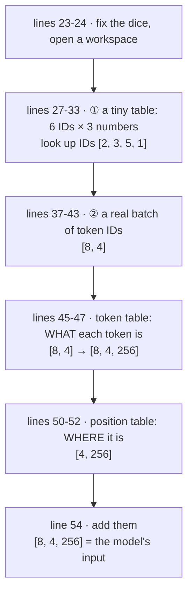
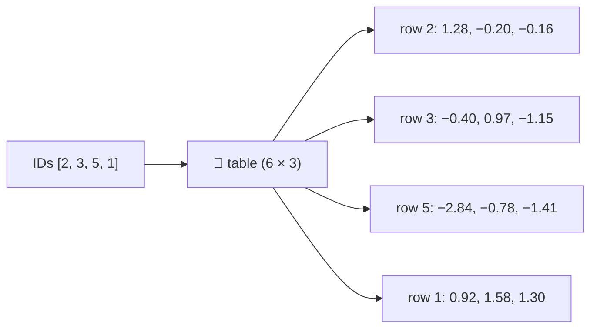
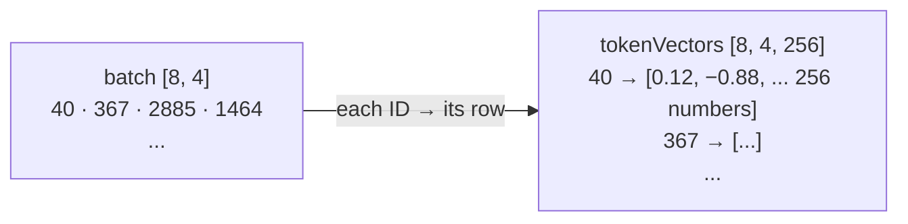
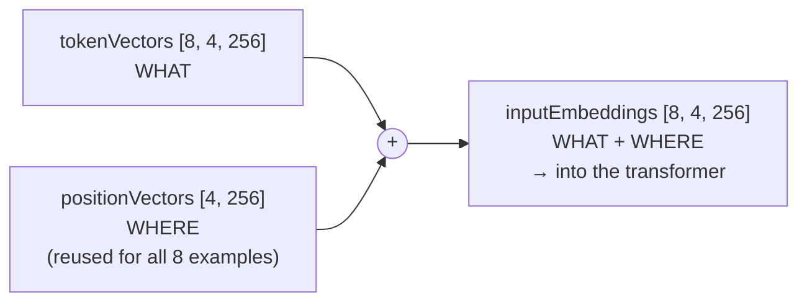
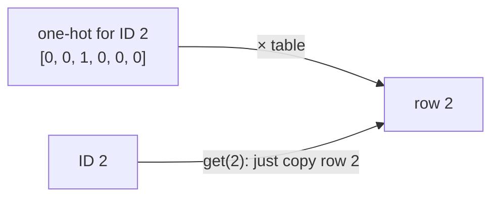

# Line by line: `Step04_Embeddings`

**Run it:** `./run.sh 4` · **Code:** [`Step04_Embeddings.java`](../../src/main/java/com/tinygpt/examples/Step04_Embeddings.java) and [`Embedding.java`](../../src/main/java/com/tinygpt/nn/Embedding.java) · **Idea first:** [3. Embeddings](../03-embeddings.md) · **Book:** 2.7–2.8

← [Step 3](step03-sliding-window.md) · [All walkthroughs](README.md) · Next: [Step 5 →](step05-simple-attention.md)

Every output on this page is **real**: it's what `./run.sh 4` prints.

---

## 🗺️ The whole program on one page



**Why?** A token ID like 2885 is just a label: 2885 isn't "bigger" or "closer" to anything. The model needs **a list of numbers it can learn**, so words used in similar ways can end up with similar lists.

---

# Part A · `Step04_Embeddings.java`

## Lines 23-24 · fix the dice, open a workspace

```java
        Engine.getInstance().setRandomSeed(123);                     // ◀ same "random" numbers every run
        try (NDManager manager = NDManager.newBaseManager()) {       // ◀ owns the grids, frees them at the end
```

Same as in every step ([explained in step 8](step08-multi-head-attention.md#line-21--fix-the-dice)). Seed 123 is also what the book uses, so the table below matches **the book's numbers exactly**.

---

## Lines 27-29 · a tiny lookup table

```java
            Embedding small = new Embedding(manager, 6, 3);   // ◀ 6 IDs, 3 numbers each
            System.out.println(small.weight());               // ◀ print the table
```

```
            number 0  number 1  number 2
   ID 0  [  0.3374,  -0.1778,  -0.169  ]
   ID 1  [  0.9178,   1.581 ,   1.301  ]
   ID 2  [  1.2753,  -0.201 ,  -0.1606 ]
   ID 3  [ -0.4015,   0.9666,  -1.1481 ]
   ID 4  [ -1.1589,   0.3255,  -0.6315 ]
   ID 5  [ -2.84  ,  -0.7849,  -1.4096 ]
```

🗣️ One **row** per possible ID, filled with random numbers. They mean nothing yet. During training, they get nudged until they're useful (see [step 6](../06-training.md)).

`hasGradient` in the printout means "training is allowed to change these numbers".

---

## Lines 31-33 · look some IDs up

```java
            NDArray ids = manager.create(new int[]{2, 3, 5, 1});   // ◀ 4 token IDs
            System.out.println(small.forward(ids));                // ◀ look them up
```

```
[[ 1.2753, -0.201 , -0.1606],   ← row 2
 [-0.4015,  0.9666, -1.1481],   ← row 3
 [-2.84  , -0.7849, -1.4096],   ← row 5
 [ 0.9178,  1.581 ,  1.301 ]]   ← row 1
```

🗣️ There's no maths at all: **ID 2 → copy row 2**. 4 IDs in, 4 rows out: shape `[4]` → `[4, 3]`.



🌍 A school register: say a pupil's number, and you get back their row of details.

---

## Lines 37-43 · a real batch of token IDs

```java
            int vocabularySize = 50257;   // ◀ GPT-2 knows 50,257 tokens (step 2)
            int outputDim = 256;          // ◀ each token becomes 256 numbers
            int contextLength = 4;        // ◀ 4 tokens per example
            int[] storyIds = new BpeTokenizer().encode(SampleText.theVerdict());                    // ◀ the story as IDs
            GPTDataLoader loader = new GPTDataLoader(new GPTDataset(storyIds, contextLength, contextLength), 8, false, true);   // ◀ step 3
            NDArray batch = manager.create(loader.iterator().next().inputs());                      // ◀ first batch as a grid
```

🗣️ This is exactly [step 3](step03-sliding-window.md)'s first batch, turned into an `NDArray` so we can do maths on it:

```
batch [8, 4] = [[40, 367, 2885, 1464],
                [1807, 3619, 402, 271],
                ...]
```

---

## Lines 45-47 · token embeddings: WHAT each token is

```java
            Embedding tokenEmbedding = new Embedding(manager, vocabularySize, outputDim);   // ◀ 50,257 rows × 256
            NDArray tokenVectors = tokenEmbedding.forward(batch);                          // ◀ look up all 32 IDs
```

```
   Token embeddings  (what):          (8, 4, 256)   (each token -> 256 numbers)
```

🗣️ The table is now **50,257 × 256 = 12,865,792** numbers. Each of the 8 × 4 = 32 IDs in the batch is swapped for its 256-number row. A new direction (256) is added to the end of the shape:



---

## Lines 50-52 · position embeddings: WHERE it is

```java
            Embedding positionEmbedding = new Embedding(manager, contextLength, outputDim);   // ◀ 4 rows × 256
            NDArray positionVectors = positionEmbedding.forward(manager.arange(contextLength)); // ◀ look up 0, 1, 2, 3
```

```
   Position embeddings (where):       (4, 256)      (one per position)
```

🗣️ A **second** table, with one row per **position** (1st, 2nd, 3rd, 4th) instead of one per word. `manager.arange(4)` makes `[0, 1, 2, 3]`, so we get all 4 rows.

**Why do we need it?** The next part of the model, attention ([step 5](step05-simple-attention.md)), mixes words together without noticing their order. Without positions:

> "**dog** bites **man**" and "**man** bites **dog**" would look the same.

---

## Line 54 · add them together

```java
            NDArray inputEmbeddings = tokenVectors.add(positionVectors);   // ◀ [8, 4, 256] + [4, 256]
```

```
   Token + position = model input:    (8, 4, 256)
```

🗣️ Each token's row gets **its position's row** added to it, number by number.

🔢 With just 2 numbers instead of 256 (made-up values, to keep it small):

| | token row | + position row | = model input |
|---|---|---|---|
| "dog" at position 0 | [0.5, 0.2] | + [0.1, 0.0] | = **[0.6, 0.2]** |
| "dog" at position 2 | [0.5, 0.2] | + [0.0, 0.3] | = **[0.5, 0.5]** |

Same word, different place → **different input**. Now the model can tell the two "dog"s apart.

**How can `[8, 4, 256]` + `[4, 256]` work, when the shapes differ?** The engine **repeats** the smaller grid for each of the 8 examples. This is called *broadcasting*: every example uses the same 4 position rows.



This is exactly what the first lines of `GPTModel.forward` do ([step 9](step09-gpt-model.md)).

---

# Part B · `Embedding` line by line

```java
public class Embedding extends Module {                    // ◀ 1

    private final NDArray weight;

    public Embedding(NDManager manager, int numberOfIds, int embeddingDim) {
        weight = parameter("weight",                                                     // ◀ 2
                manager.randomNormal(0f, 1f, new Shape(numberOfIds, embeddingDim), DataType.FLOAT32));   // ◀ 3
    }

    public NDArray forward(NDArray ids) {
        return weight.get(ids);                            // ◀ 4
    }

    public NDArray weight() {
        return weight;                                     // ◀ 5
    }
}
```

| ◀ | what it does |
|---|---|
| 1 | `extends Module`: an Embedding is a model part with learnable numbers ([Module explained in step 6](step06-self-attention.md#module--the-parent-of-every-model-part)). |
| 2 | `parameter("weight", ...)` registers the table as **learnable**, under the name `weight`. Training will change it, and saving will store it. |
| 3 | Fill a `[numberOfIds, embeddingDim]` grid with random numbers from a **normal distribution** with average 0 and spread 1. Most numbers land between −2 and 2. `FLOAT32` = ordinary decimal numbers. |
| 4 | `get(ids)` picks the rows. It works for any shape of IDs: `[4]` → `[4, 3]`, `[8, 4]` → `[8, 4, 256]`. |
| 5 | Lets examples print the whole table (line 29). |

### Why is this a "layer", if it's only a lookup?

Picking row 2 gives the same result as multiplying the table by a **one-hot** list `[0, 0, 1, 0, 0, 0]` (a 1 in place 2). So an Embedding is a [Linear layer](step06-self-attention.md#linear--multiply-by-a-learnable-grid) done the fast way: no multiplying by zeros.



---

## 🧠 What this step teaches

- An **embedding** turns each token ID into a **learnable list of numbers**, by looking up a row in a table.
- A second table adds **where** the token is. Token + position = the model's input.
- Shapes: `[8, 4]` IDs → `[8, 4, 256]` numbers.
- The tables start **random**; training makes them meaningful.

## 🧪 Try it yourself

1. Line 31: look up `[2, 2, 2]`. You get the same row three times.
2. Line 31: look up `[6]`. It fails: the table only has rows 0 to 5.
3. Line 23: change the seed. Different numbers, same shapes.
