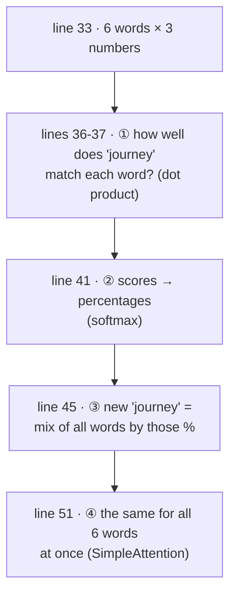
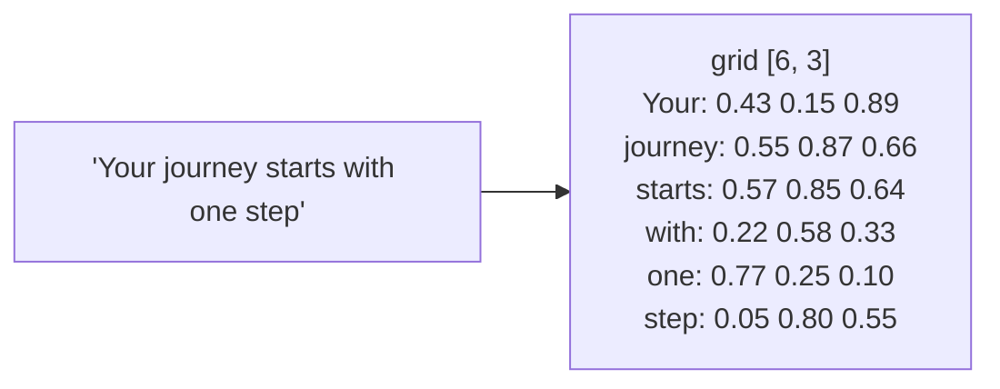
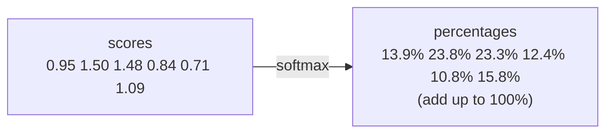
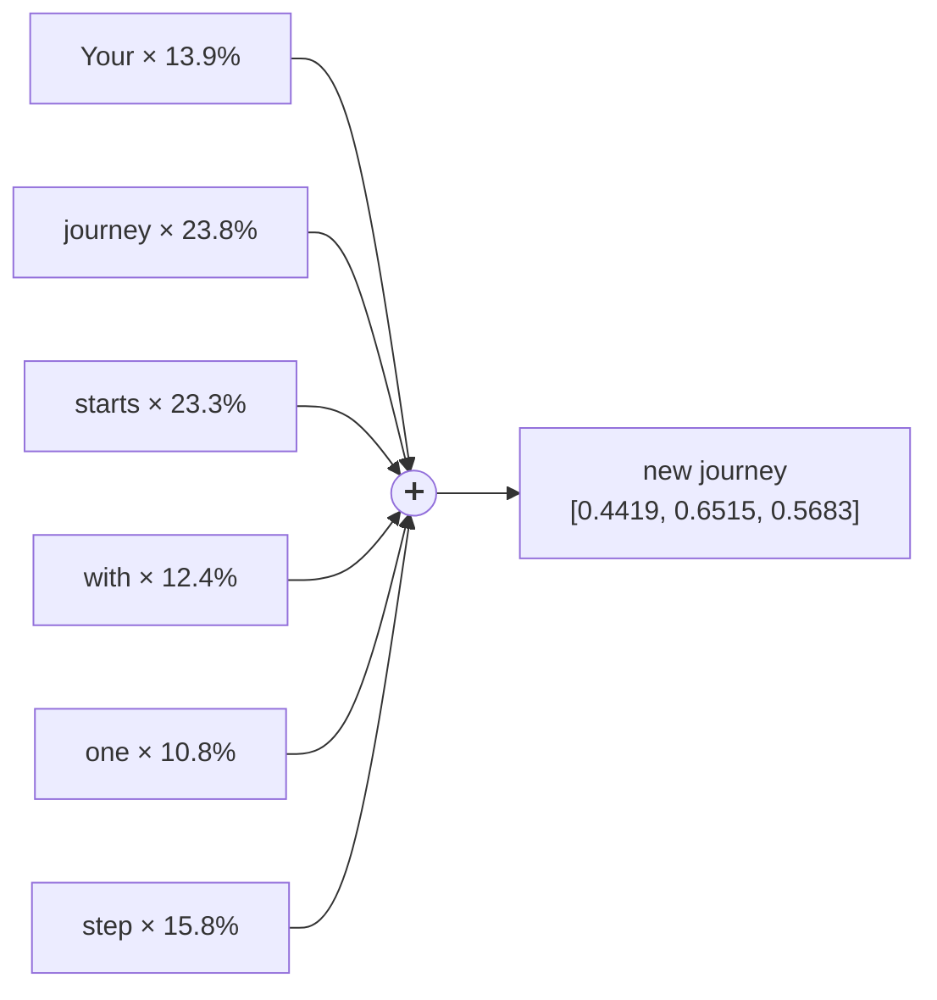
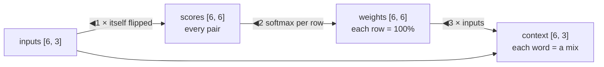

# Line by line: `Step05_SimpleAttention`

**Run it:** `./run.sh 5` · **Code:** [`Step05_SimpleAttention.java`](../../src/main/java/com/tinygpt/examples/Step05_SimpleAttention.java) and [`SimpleAttention.java`](../../src/main/java/com/tinygpt/attention/SimpleAttention.java) · **Idea first:** [4. Attention](../04-attention.md) · **Book:** 3.3

← [Step 4](step04-embeddings.md) · [All walkthroughs](README.md) · Next: [Step 6 →](step06-self-attention.md)

Every output on this page is **real**, and there's no randomness in this step, so you can check every number with a calculator.

---

## 🗺️ The whole program on one page



**Why?** In "Your journey starts with one step", the word *journey* means more when you know *starts* and *step* are nearby. **Attention** lets each word pull in a bit of the other words. This step does it with no learning at all, just "how similar are two words?".

---

# Part A · `Step05_SimpleAttention.java`

## Lines 17-29 · the sentence

```java
    static final String[] WORDS = {"Your", "journey", "starts", "with", "one", "step"};   // ◀ names, for printing

    static NDArray sentence(NDManager manager) {
        return manager.create(new float[][]{
                {0.43f, 0.15f, 0.89f}, // Your       ◀ row 0
                {0.55f, 0.87f, 0.66f}, // journey    ◀ row 1
                {0.57f, 0.85f, 0.64f}, // starts
                {0.22f, 0.58f, 0.33f}, // with
                {0.77f, 0.25f, 0.10f}, // one
                {0.05f, 0.80f, 0.55f}  // step
        });
    }
```

🗣️ The book's tiny example: each word already has an embedding of **3 numbers** ([step 4](step04-embeddings.md)). Real GPT-2 uses 768. 3 is small enough to draw. `f` after a number means "float" (a decimal). Steps 6, 7 and 8 reuse this sentence.



---

## Line 33 · make the grid

```java
            NDArray inputs = sentence(manager);   // ◀ [6, 3]
```

---

## Lines 36-37 · how much does "journey" match each word?

```java
            NDArray journey = inputs.get(1);          // ◀ row 1: [0.55, 0.87, 0.66]
            NDArray scores = inputs.matMul(journey);  // ◀ [6, 3] × [3] = [6]: one score per word
```

🗣️ `matMul` with a single row works out the **dot product** of "journey" with **each** word: multiply the matching numbers, then add them up.

🔢 **Check by hand**, journey · Your:

```
  journey   0.55     0.87     0.66
  Your    × 0.43   × 0.15   × 0.89
          = 0.2365 + 0.1305 + 0.5874  =  0.9544  ✅
```

```
1) How much does "journey" match each word? (dot product)
   Your     0.9544
   journey  1.4950     ← itself: the best match
   starts   1.4754     ← very similar numbers, so almost as high
   with     0.8434
   one      0.7070     ← least alike
   step     1.0865
```

**Why the dot product?** If two lists have big numbers in the **same places**, their products are big, and so is the total. Similar lists → big score.

🌍 Two friends filling in a "do you like...?" form: the more boxes they both tick, the higher their match score.

---

## Line 41 · turn scores into percentages

```java
            NDArray weights = scores.softmax(0);   // ◀ along direction 0 (the only one here)
            print(weights.mul(100).toFloatArray(), "%.1f%%");   // ◀ ×100 to print as %
```

🗣️ **Softmax** turns any list of scores into percentages that add up to **100%**. Bigger score → bigger share. For each score: e^score ÷ (the total of all e^scores).

🔢 **Check by hand:**

| word | score | e^score | ÷ 18.745 | % |
|---|---:|---:|---:|---:|
| Your | 0.9544 | 2.597 | 0.139 | 13.9% |
| journey | 1.4950 | 4.459 | 0.238 | 23.8% |
| starts | 1.4754 | 4.373 | 0.233 | 23.3% |
| with | 0.8434 | 2.324 | 0.124 | 12.4% |
| one | 0.7070 | 2.028 | 0.108 | 10.8% |
| step | 1.0865 | 2.964 | 0.158 | 15.8% |
| **total** | | **18.745** | | **100%** |

**Why e^?** It makes every value positive (even a negative score), and it makes bigger scores stand out more.



---

## Line 45 · the new "journey": a mix of all words

```java
            NDArray context = weights.matMul(inputs);   // ◀ [6] × [6, 3] = [3]
```

🗣️ Take **13.9% of Your + 23.8% of journey + 23.3% of starts + ...**, number by number. The result is called a **context vector**: "journey", plus a bit of everything around it.

🔢 **Check by hand**, the first number:

```
0.139 × 0.43  (Your)
+ 0.238 × 0.55  (journey)
+ 0.233 × 0.57  (starts)
+ 0.124 × 0.22  (with)
+ 0.108 × 0.77  (one)
+ 0.158 × 0.05  (step)
= 0.0598 + 0.1309 + 0.1328 + 0.0273 + 0.0832 + 0.0079  =  0.4419  ✅
```

```
3) New "journey" vector = mix of all words using those percentages:
[0.4419, 0.6515, 0.5683]
```



🌍 A smoothie: mostly journey and starts, with a little of everything else.

---

## Line 51 · all six words at once

```java
            System.out.println(SimpleAttention.contextVectors(inputs));   // ◀ [6, 3] → [6, 3]
```

```
[[0.4421, 0.5931, 0.579 ],   ← Your
 [0.4419, 0.6515, 0.5683],   ← journey: the same as line 45 ✅
 [0.4431, 0.6496, 0.5671],   ← starts
 [0.4304, 0.6298, 0.551 ],   ← with
 [0.4671, 0.591 , 0.5266],   ← one
 [0.4177, 0.6503, 0.5645]]   ← step
```

🗣️ Instead of looping over the words, one grid multiplication does all six. See Part B.

## Lines 55-60 · the `print` helper

```java
    private static void print(float[] values, String format) {
        for (int i = 0; i < values.length; i++) {
            System.out.printf("   %-8s " + format + "%n", WORDS[i], values[i]);   // ◀ "Your     13.9%"
        }
        System.out.println();
    }
```

`%-8s` writes the word padded to 8 characters, so the numbers line up. `format` is `%.4f` (4 decimals) or `%.1f%%` (1 decimal and a `%` sign).

---

# Part B · `SimpleAttention` line by line

```java
public final class SimpleAttention {
    private SimpleAttention() {}                       // ◀ only static methods, so no objects needed

    public static NDArray scores(NDArray inputs) {
        return inputs.matMul(inputs.transpose());      // ◀ 1 · [6, 3] × [3, 6] = [6, 6]
    }

    public static NDArray weights(NDArray scores) {
        return scores.softmax(-1);                     // ◀ 2 · softmax along each row
    }

    public static NDArray contextVectors(NDArray inputs) {
        return weights(scores(inputs)).matMul(inputs); // ◀ 3 · [6, 6] × [6, 3] = [6, 3]
    }
}
```

### ◀1 · every word against every word

`transpose()` flips the grid: 6 rows × 3 columns becomes 3 rows × 6 columns. Then `matMul` gives every possible dot product, a **6 × 6 table**:

| · | Your | journey | starts | with | one | step |
|---|---:|---:|---:|---:|---:|---:|
| **journey** | 0.954 | 1.495 | 1.475 | 0.843 | 0.707 | 1.087 |

(That's row 1: exactly the six scores from line 37. The other 5 rows are the same idea for the other words.)

### ◀2 · each row → percentages

`softmax(-1)`: `-1` means "the **last** direction", which is **along each row**. Every row then adds up to 100%.

### ◀3 · mix

Row *i* of the result = word *i*'s percentages × all the words.



### What's missing (and why step 6 exists)

| Problem | Fixed in |
|---|---|
| **Nothing is learnable.** The scores only depend on the embeddings, so the model can't learn *what* to look for. | [Step 6](step06-self-attention.md): Query, Key and Value weights |
| **Every word sees the future.** "Your" looks at "step", which comes later. | [Step 7](step07-causal-attention.md): the causal mask |
| **One way of looking.** | [Step 8](step08-multi-head-attention.md): several heads |

---

## 🧠 What this step teaches

- **Attention = score → percentages → mix.**
- **Dot product** measures how similar two words' numbers are.
- **Softmax** turns scores into percentages that add up to 100%.
- Each word's new **context vector** is a weighted mix of all the words.

## 🧪 Try it yourself

1. Line 36: focus on `inputs.get(4)` ("one"). Which word does it like most?
2. Line 23: change journey to `{0.43f, 0.15f, 0.89f}` (the same as Your). Their scores become equal.
3. Line 41: print `scores.mul(10).softmax(0)`. Bigger scores make softmax pick a clear winner.
