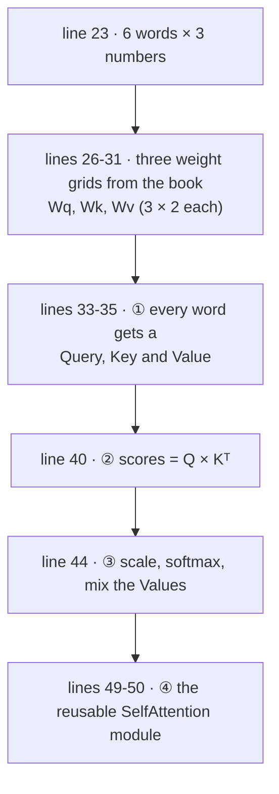
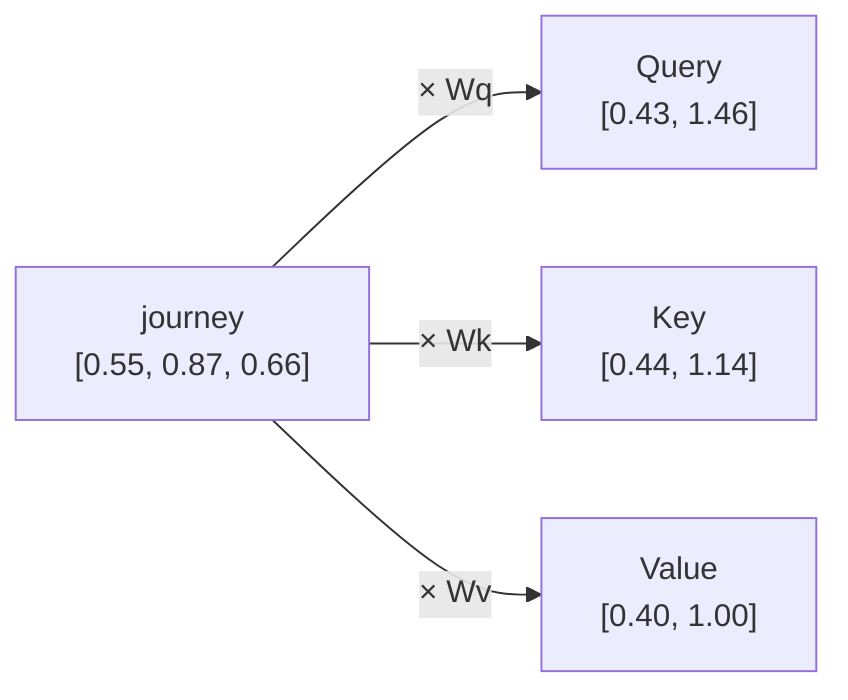
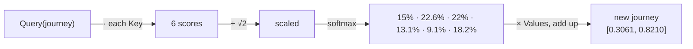
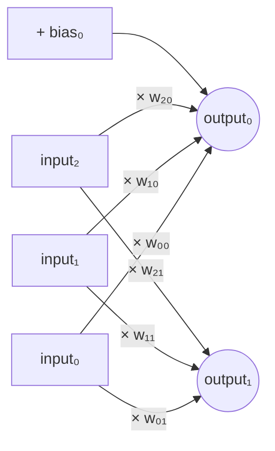
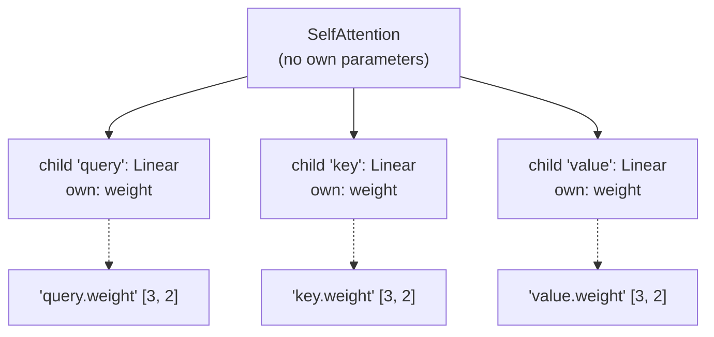

# Line by line: `Step06_SelfAttention`

**Run it:** `./run.sh 6` · **Code:** [`Step06_SelfAttention.java`](../../src/main/java/com/tinygpt/examples/Step06_SelfAttention.java), and the classes it uses: [`SelfAttention`](../../src/main/java/com/tinygpt/attention/SelfAttention.java), [`Linear`](../../src/main/java/com/tinygpt/nn/Linear.java), [`Module`](../../src/main/java/com/tinygpt/nn/Module.java) · **Idea first:** [4. Attention](../04-attention.md) · **Book:** 3.4

← [Step 5](step05-simple-attention.md) · [All walkthroughs](README.md) · Next: [Step 7 →](step07-causal-attention.md)

Every output on this page is **real**. This step uses **the book's own weights**, so the numbers also match the book.

---

## 🗺️ The whole program on one page



**What's new since step 5?** In step 5, "how similar are two words?" was fixed. Here three **learnable** grids decide **what to look for**, **what to show**, and **what to hand over**. Training can tune them.

---

# Part A · `Step06_SelfAttention.java`

## Lines 26-31 · the book's weights

```java
            NDArray wQuery = manager.create(new float[][]{
                    {0.29611194f, 0.51656228f}, {0.25167072f, 0.68855679f}, {0.07397246f, 0.86652195f}});   // ◀ Wq [3, 2]
            NDArray wKey = manager.create(new float[][]{
                    {0.13657987f, 0.10247904f}, {0.18405646f, 0.72644675f}, {0.31525391f, 0.68710667f}});   // ◀ Wk [3, 2]
            NDArray wValue = manager.create(new float[][]{
                    {0.07563531f, 0.19663817f}, {0.31641197f, 0.40174013f}, {0.11856830f, 0.82739538f}});   // ◀ Wv [3, 2]
```

🗣️ Three grids, each **3 rows × 2 columns**: they turn a word's 3 numbers into 2. Normally they'd start random (line 49 shows that); we copy the book's values so you can compare.

---

## Lines 33-35 · Query, Key and Value for every word

```java
            NDArray queries = inputs.matMul(wQuery);   // ◀ [6, 3] × [3, 2] = [6, 2]
            NDArray keys = inputs.matMul(wKey);        // ◀ [6, 2]
            NDArray values = inputs.matMul(wValue);    // ◀ [6, 2]
```

🗣️ Each word makes **three different summaries** of itself:

| | asks | 🌍 in a library |
|---|---|---|
| **Query** | "what am I looking for?" | the question you ask the librarian |
| **Key** | "what do I contain?" | the label on each book's spine |
| **Value** | "what do I hand over if I'm picked?" | what's inside the book |

🔢 **Check by hand**, Query for "journey" `[0.55, 0.87, 0.66]`, first number (column 0 of Wq):

```
0.55 × 0.2961 + 0.87 × 0.2517 + 0.66 × 0.0740
=  0.1629     +   0.2190      +   0.0488      =  0.4306  ✅ (the book's query_2 is [0.4306, 1.4551])
```

All of them (rounded):

| word | Query | Key | Value |
|---|---|---|---|
| Your | 0.2309, 1.0966 | 0.3669, 0.7646 | 0.1855, 0.8812 |
| **journey** | **0.4306, 1.4551** | 0.4433, 1.1419 | 0.3951, 1.0037 |
| starts | 0.4300, 1.4343 | 0.4361, 1.1156 | 0.3879, 0.9831 |
| with | 0.2355, 0.7990 | 0.2408, 0.6706 | 0.2393, 0.5493 |
| one | 0.2983, 0.6565 | 0.1827, 0.3292 | 0.1492, 0.3346 |
| step | 0.2568, 1.0533 | 0.3275, 0.9642 | 0.3221, 0.7863 |



---

## Line 40 · scores: each Query against every Key

```java
            NDArray scores = queries.matMul(keys.transpose());   // ◀ [6, 2] × [2, 6] = [6, 6]
```

🗣️ Like step 5, but now it's **Query · Key**, not word · word. A word's question is compared with every word's label.

🔢 **Check by hand**, journey's question vs journey's label:

```
Query(journey) · Key(journey) = 0.4306 × 0.4433 + 1.4551 × 1.1419 = 0.1909 + 1.6616 = 1.8524  ✅
```

```
[[0.9231, 1.3545, 1.3241, 0.791 , 0.4032, 1.133 ],   ← Your's question vs every label
 [1.2705, 1.8524, 1.8111, 1.0795, 0.5577, 1.544 ],   ← journey's
 ...
```

---

## Line 44 · percentages and mixing

```java
            NDArray context = SelfAttention.attend(queries, keys, values);   // ◀ see Part B for each line
```

```
3) Context vectors (book: [[0.2996, 0.8053], [0.3061, 0.8210], ...]):
[[0.2996, 0.8053],
 [0.3061, 0.821 ],    ← journey: matches the book ✅
 [0.3058, 0.8203],
 [0.2948, 0.7939],
 [0.2927, 0.7891],
 [0.299 , 0.804 ]]
```

The three moves inside `attend`, for "journey":

| move | Your | journey | starts | with | one | step |
|---|---:|---:|---:|---:|---:|---:|
| scores (line 40) | 1.2705 | 1.8524 | 1.8111 | 1.0795 | 0.5577 | 1.5440 |
| ÷ √2 = ÷ 1.414 | 0.8984 | 1.3098 | 1.2806 | 0.7633 | 0.3944 | 1.0918 |
| softmax → % | 15.0% | 22.6% | 22.0% | 13.1% | 9.1% | 18.2% |

Then mix the **Values** with those percentages:

```
0.150 × 0.1855 + 0.226 × 0.3951 + 0.220 × 0.3879 + 0.131 × 0.2393 + 0.091 × 0.1492 + 0.182 × 0.3221  =  0.3061  ✅
```



---

## Lines 49-50 · the reusable module

```java
            SelfAttention module = new SelfAttention(manager, 3, 2);   // ◀ random Wq, Wk, Wv inside
            System.out.println("... output shape " + module.forward(inputs).getShape());   // ◀ (6, 2)
```

🗣️ The same thing packed into a class, with **random, learnable** weights inside three `Linear` layers. 6 words × 3 numbers in, 6 words × 2 numbers out.

---

# Part B · the classes it uses

## `SelfAttention`

```java
public class SelfAttention extends Module {

    public SelfAttention(NDManager manager, int inputDim, int outputDim) {
        query = child("query", new Linear(manager, inputDim, outputDim, false));   // ◀ 1 · Wq
        key = child("key", new Linear(manager, inputDim, outputDim, false));       // ◀ 1 · Wk
        value = child("value", new Linear(manager, inputDim, outputDim, false));   // ◀ 1 · Wv
    }

    public NDArray forward(NDArray inputs) {
        return attend(query.forward(inputs), key.forward(inputs), value.forward(inputs));   // ◀ 2
    }

    public static NDArray attend(NDArray queries, NDArray keys, NDArray values) {
        NDArray scores = queries.matMul(keys.transpose());                 // ◀ 3
        long keyDim = keys.getShape().getLastDimension();                  // ◀ 4
        NDArray weights = scores.div(Math.sqrt(keyDim)).softmax(-1);       // ◀ 5
        return weights.matMul(values);                                     // ◀ 6
    }
}
```

| ◀ | what it does | with our numbers |
|---|---|---|
| 1 | Three `Linear` layers with no bias (`false`): exactly "multiply by Wq/Wk/Wv". `child(...)` registers each one, so its weights count as learnable. | 3 grids of `[3, 2]` |
| 2 | Make Q, K and V, then run the recipe. | |
| 3 | Every Query · every Key. | `[6, 6]` |
| 4 | How many numbers each Key has: the **last** number in its shape. | 2 |
| 5 | Divide by √2, then softmax along each row (`-1` = last direction). | rows of percentages |
| 6 | Mix the Values. | `[6, 2]` |

### Why divide by √(key size)? (◀5)

With more numbers per Key, dot products get **bigger** (more things added up). Big scores make softmax **all-or-nothing**: one word gets ~100% and the rest ~0%. Then training gets stuck, because tiny changes don't move anything.

| scores | softmax |
|---|---|
| 1, 2 | 27%, 73% (a nice blend) |
| 10, 20 (10× bigger) | 0.005%, 99.995% (all-or-nothing) |

Dividing by √(size) keeps scores at a sensible size. GPT-2 uses 64 numbers per head, so it divides by 8.

---

## `Linear` · multiply by a learnable grid

```java
public class Linear extends Module {

    public Linear(NDManager manager, int inFeatures, int outFeatures, boolean useBias) {
        float limit = (float) (1.0 / Math.sqrt(inFeatures));                          // ◀ 1
        weight = parameter("weight",
                manager.randomUniform(-limit, limit, new Shape(inFeatures, outFeatures), DataType.FLOAT32));   // ◀ 2
        bias = useBias ? parameter("bias", manager.zeros(new Shape(outFeatures))) : null;                     // ◀ 3
    }

    public NDArray forward(NDArray input) {
        NDArray output = input.matMul(weight);                     // ◀ 4
        return bias == null ? output : output.add(bias);           // ◀ 5
    }
}
```

| ◀ | what it does | with `Linear(3 → 2)` |
|---|---|---|
| 1 | The size of the random start: ±1/√(inputs). More inputs → smaller starting weights, so outputs don't start out huge. Same as PyTorch. | 1/√3 = ±0.577 |
| 2 | A `[in, out]` grid of random numbers, spread evenly between −limit and +limit, registered as learnable. | `[3, 2]`, values in −0.577 to 0.577 |
| 3 | If asked, an extra list of numbers (one per output), starting at 0. `? :` means "if ... then ... else". | `[0, 0]` |
| 4 | Each output = a weighted sum of all the inputs. | `[6, 3]` × `[3, 2]` = `[6, 2]` |
| 5 | Add the bias, if there is one. | |

🔢 One output number, written out:

```
output₀ = input₀ × w₀₀ + input₁ × w₁₀ + input₂ × w₂₀ + bias₀
```



🌍 A mixing desk: every output slider mixes all the input channels, and the knobs (weights) set how much of each. Training turns the knobs.

---

## `Module` · the parent of every model part

Every layer (`Linear`, `Embedding`, `SelfAttention`, ..., the whole `GPTModel`) `extends Module`. A module keeps two lists:

```java
    private final Map<String, NDArray> ownParameters = new LinkedHashMap<>();   // ◀ my learnable grids, by name
    private final Map<String, Module> children = new LinkedHashMap<>();         // ◀ the smaller modules inside me
    private boolean training = true;                                            // ◀ training mode on/off
```

`LinkedHashMap` = a name → thing table that **remembers the order** things were added. That order matters when saving and loading.

### `parameter` · "this grid is learnable"

```java
    protected NDArray parameter(String name, NDArray values) {
        values.setRequiresGradient(true);   // ◀ 1 · ask the engine to work out how to nudge it
        ownParameters.put(name, values);    // ◀ 2 · remember it under a name
        return values;
    }
```

◀1 is what makes training possible: during [training](step-tinygpt-training.md), the engine works out the **gradient** (which way to nudge) for every grid marked like this.

### `child` · "this module lives inside me"

```java
    protected <M extends Module> M child(String name, M module) {
        children.put(name, module);   // ◀ remember it under a name
        return module;                // ◀ hand it back, so we can write: query = child("query", new Linear(...))
    }
```

`<M extends Module>` means "works with any kind of Module, and gives back the same kind".

### `namedParameters` · every learnable grid, with its full name

```java
    public Map<String, NDArray> namedParameters() {
        Map<String, NDArray> all = new LinkedHashMap<>(ownParameters);                 // ◀ 1 · mine first
        children.forEach((childName, child) ->
                child.namedParameters().forEach((name, array) ->                       // ◀ 2 · ask each child
                        all.put(childName + "." + name, array)));                      // ◀ 3 · put its name in front
        return all;
    }
```

🔢 For `new SelfAttention(manager, 3, 2)`:



It **calls itself** on each child (that's called *recursion*), so it works for any depth. On the full GPT-2 it finds names like `blocks.0.attention.query.weight`. [Step 12](step12-load-gpt2.md) uses these names to load OpenAI's numbers into the right places.

### The rest

```java
    public List<NDArray> parameters() {
        return new ArrayList<>(namedParameters().values());                  // ◀ the same, without names (for the optimizer)
    }

    public long parameterCount() {
        return parameters().stream().mapToLong(NDArray::size).sum();         // ◀ add up every grid's size: 3×2 × 3 = 18
    }

    public void setTraining(boolean training) {
        this.training = training;                                            // ◀ switch myself...
        for (Module child : children.values()) {
            child.setTraining(training);                                     // ◀ ...and everything inside me
        }
    }

    public boolean isTraining() {
        return training;                                                     // ◀ Dropout asks this (step 7)
    }
```

---

## 🧠 What this step teaches

- Each word makes a **Query** (what I want), a **Key** (what I have) and a **Value** (what I give), using three learnable grids.
- Scores = Query · Key, **÷ √size**, softmax, then mix the **Values**.
- `Linear` = multiply by a learnable grid (+ bias). `Module` keeps track of every learnable grid by name.

## 🧪 Try it yourself

1. Line 44: replace `attend` with the step 5 recipe (no ÷ √2). How much do the percentages change?
2. Line 49: print `module.namedParameters().keySet()`. You'll see `[query.weight, key.weight, value.weight]`.
3. Line 49: print `module.parameterCount()`. It's 18 (3 grids × 3 × 2).
