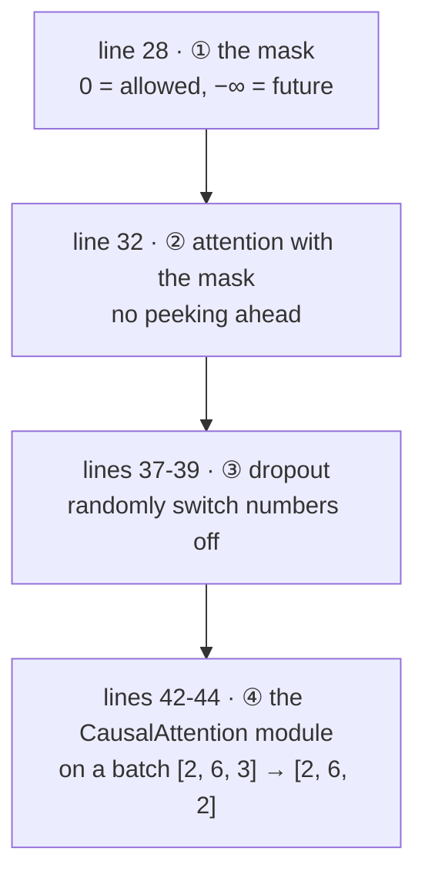
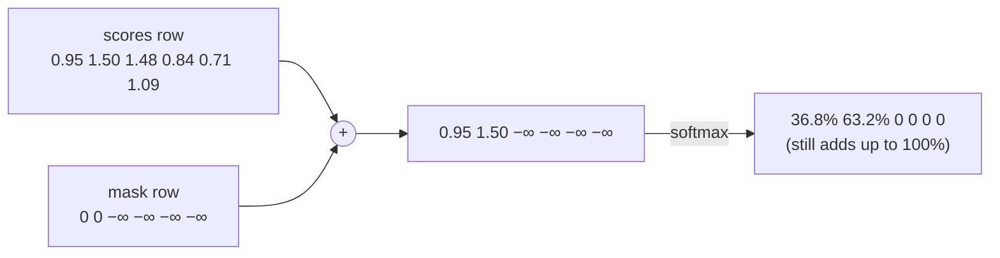
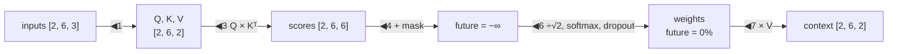
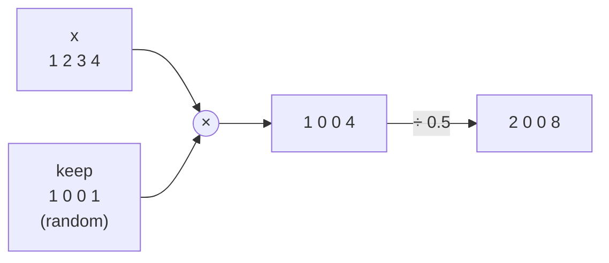

# Line by line: `Step07_CausalAttention`

**Run it:** `./run.sh 7` · **Code:** [`Step07_CausalAttention.java`](../../src/main/java/com/tinygpt/examples/Step07_CausalAttention.java), and the classes it uses: [`CausalAttention`](../../src/main/java/com/tinygpt/attention/CausalAttention.java), [`Dropout`](../../src/main/java/com/tinygpt/nn/Dropout.java) · **Idea first:** [4. Attention](../04-attention.md) · **Book:** 3.5

← [Step 6](step06-self-attention.md) · [All walkthroughs](README.md) · Next: [Step 8 →](step08-multi-head-attention.md)

Every output on this page is **real**: it's what `./run.sh 7` prints with seed 123.

---

## 🗺️ The whole program on one page



**Why?** A GPT learns by guessing the **next** word. If, while guessing, it could look at the next word, it would just copy it: like taking a test with the answers showing. So each word may only look at **itself and the words before it**.

---

# Part A · `Step07_CausalAttention.java`

## Line 28 · the mask

```java
            NDArray mask = CausalAttention.causalMask(manager, 6);   // ◀ a [6, 6] grid
```

```
            Your  journey starts  with   one   step     ← being looked at
Your     [   0,   -inf,  -inf,  -inf,  -inf,  -inf ]
journey  [   0,     0,   -inf,  -inf,  -inf,  -inf ]
starts   [   0,     0,     0,   -inf,  -inf,  -inf ]
with     [   0,     0,     0,     0,   -inf,  -inf ]
one      [   0,     0,     0,     0,     0,   -inf ]
step     [   0,     0,     0,     0,     0,     0  ]
   ↑ doing the looking
```

🗣️ **0** below and on the diagonal: allowed (the past, and the word itself). **−∞** (minus infinity) above it: the future, hidden.

🌍 Reading a story with a sheet of paper covering everything after the word you're on.

---

## Line 32 · attention with the mask

```java
            NDArray weights = SimpleAttention.scores(inputs)   // ◀ 1 · [6, 6] scores, as in step 5
                    .add(mask)                                // ◀ 2 · future scores become −∞
                    .softmax(-1);                             // ◀ 3 · each row → percentages
```

| ◀ | what happens to the "journey" row |
|---|---|
| 1 | scores: 0.9544, 1.4950, 1.4754, 0.8434, 0.7070, 1.0865 |
| 2 | + mask: 0.9544, 1.4950, **−∞, −∞, −∞, −∞** |
| 3 | softmax: **36.8%, 63.2%**, 0%, 0%, 0%, 0% |

🔢 **Check by hand.** e^(−∞) = 0, so hidden words get exactly 0%. Only 2 numbers are left in the row:

```
e^0.9544 = 2.597     e^1.4950 = 4.459     total = 7.056
Your:    2.597 ÷ 7.056 = 0.368 = 36.8%  ✅
journey: 4.459 ÷ 7.056 = 0.632 = 63.2%  ✅
```

```
[[1.    , 0.    , 0.    , 0.    , 0.    , 0.    ],   ← Your: nothing before it, so 100% on itself
 [0.368 , 0.632 , 0.    , 0.    , 0.    , 0.    ],   ← journey
 [0.2284, 0.3893, 0.3822, 0.    , 0.    , 0.    ],
 [0.2046, 0.2956, 0.2915, 0.2084, 0.    , 0.    ],
 [0.1753, 0.225 , 0.2269, 0.157 , 0.2158, 0.    ],
 [0.1385, 0.2184, 0.2128, 0.142 , 0.0988, 0.1896]]   ← step: sees everything (it's last)
```

👀 All zeros are **above the diagonal**, and every row still adds up to 100%.

**Why −∞ and not just setting the percentage to 0 afterwards?** If we zeroed percentages *after* softmax, the rows wouldn't add up to 100% any more. Adding −∞ *before* softmax makes softmax share out the full 100% among the allowed words only.



---

## Lines 37-39 · dropout

```java
            Dropout dropout = new Dropout(0.5f);                                  // ◀ switch off 50%
            System.out.println(dropout.forward(manager.ones(new Shape(6, 6))));   // ◀ try it on a grid of 1s
```

```
[[0., 2., 0., 2., 0., 2.],
 [0., 0., 0., 2., 0., 2.],
 [0., 0., 0., 0., 0., 2.],
 [0., 2., 2., 2., 2., 2.],
 [0., 2., 0., 2., 2., 0.],
 [2., 2., 2., 2., 2., 0.]]
```

🗣️ Each number is randomly **switched off** (→ 0) or **kept and doubled** (→ 2). Here 19 of 36 were kept: about half, as asked.

**Why double the survivors?** With half the numbers gone, the total would halve. ×2 (= 1 ÷ (1 − 0.5)) keeps the total about the same: 19 × 2 = 38, close to the original 36.

**Why switch numbers off at all?** So the model can't rely too much on one particular word or connection. It has to spread what it learns. This fights **overfitting** (memorising instead of learning).

🌍 A football team practising with random players sitting out each day: everyone has to learn to play, nobody can rely on one star.

Dropout only happens **in training**. When the model is used for writing, it's switched off.

---

## Lines 42-45 · the `CausalAttention` module on a batch

```java
            NDArray batch = NDArrays.stack(new NDList(inputs, inputs));               // ◀ [2, 6, 3]
            CausalAttention attention = new CausalAttention(manager, 3, 2, 0.0f);     // ◀ 3 → 2, no dropout
            NDArray context = attention.forward(batch);                               // ◀ [2, 6, 2]
```

```
4) CausalAttention on a batch (2, 6, 3) -> (2, 6, 2)
```

🗣️ Step 6's self-attention + the mask + dropout, packed into one class that handles a whole **batch** (2 sentences here).

---

# Part B · the classes it uses

## `CausalAttention`

### The constructor

```java
    public CausalAttention(NDManager manager, int inputDim, int outputDim, float dropoutRate) {
        query = child("query", new Linear(manager, inputDim, outputDim, false));   // ◀ Wq
        key = child("key", new Linear(manager, inputDim, outputDim, false));       // ◀ Wk
        value = child("value", new Linear(manager, inputDim, outputDim, false));   // ◀ Wv
        dropout = child("dropout", new Dropout(dropoutRate));                      // ◀ new: dropout
    }
```

The same as [`SelfAttention`](step06-self-attention.md#selfattention), plus a `Dropout`.

### `forward`

```java
    public NDArray forward(NDArray inputs) {                                        // inputs [2, 6, 3]
        NDArray queries = query.forward(inputs);                                   // ◀ 1 · [2, 6, 2]
        NDArray keys = key.forward(inputs);                                        // ◀ 1
        NDArray values = value.forward(inputs);                                    // ◀ 1

        int tokens = (int) inputs.getShape().get(1);                               // ◀ 2 · 6
        NDArray scores = queries.matMul(keys.transpose(0, 2, 1));                  // ◀ 3 · [2, 6, 6]
        NDArray masked = scores.add(causalMask(inputs.getManager(), tokens));      // ◀ 4

        long keyDim = keys.getShape().getLastDimension();                          // ◀ 5 · 2
        NDArray weights = dropout.forward(masked.div(Math.sqrt(keyDim)).softmax(-1));   // ◀ 6
        return weights.matMul(values);                                             // ◀ 7 · [2, 6, 2]
    }
```

| ◀ | what it does | shape |
|---|---|---|
| 1 | Query, Key and Value for every word in every sentence. | `[2, 6, 2]` each |
| 2 | How many words: position 1 of the shape. | 6 |
| 3 | Every Query · every Key, **per sentence**. `transpose(0, 2, 1)` flips only the last two directions of the Keys (`[2, 6, 2]` → `[2, 2, 6]`) and leaves the sentence direction alone. | `[2, 6, 6]` |
| 4 | Add the `[6, 6]` mask. It's reused for both sentences (broadcasting, see [step 4](step04-embeddings.md#line-54--add-them-together)). | `[2, 6, 6]` |
| 5 | Numbers per Key. | 2 |
| 6 | ÷ √2, softmax per row, then dropout on the percentages. | `[2, 6, 6]` |
| 7 | Mix the Values. | `[2, 6, 2]` |



### `causalMask` · building the grid

```java
    public static NDArray causalMask(NDManager manager, int tokens) {
        float[][] mask = new float[tokens][tokens];              // ◀ 1 · a grid of zeros
        for (int row = 0; row < tokens; row++) {                 // ◀ 2 · each row...
            for (int col = row + 1; col < tokens; col++) {       // ◀ 3 · ...from just right of the diagonal to the end
                mask[row][col] = Float.NEGATIVE_INFINITY;        // ◀ 4 · = −∞
            }
        }
        return manager.create(mask);                             // ◀ 5 · Java grid → NDArray
    }
```

🔢 For 3 tokens:

| row | ◀3 columns filled | row becomes |
|---|---|---|
| 0 | 1, 2 | `[0, −∞, −∞]` |
| 1 | 2 | `[0, 0, −∞]` |
| 2 | none (3 isn't < 3) | `[0, 0, 0]` |

`new float[3][3]` starts filled with zeros, so only the −∞s need writing. `MultiHeadAttention` ([step 8](step08-multi-head-attention.md)) uses this same method.

---

## `Dropout`

```java
public class Dropout extends Module {
    private final float rate;                                          // ◀ the share to switch off, e.g. 0.5

    public Dropout(float rate) {
        this.rate = rate;
    }

    public NDArray forward(NDArray x) {
        if (!isTraining() || rate == 0f) {                             // ◀ 1
            return x;
        }
        NDArray keep = x.getManager()
                .randomUniform(0f, 1f, x.getShape())                   // ◀ 2
                .gte(rate)                                             // ◀ 3
                .toType(x.getDataType(), false);                       // ◀ 4
        return x.mul(keep).div(1f - rate);                             // ◀ 5
    }
}
```

🔢 With `x = [1.0, 2.0, 3.0, 4.0]` and rate 0.5:

| ◀ | what it does | result |
|---|---|---|
| 1 | Not training, or rate 0? Do nothing. `\|\|` means "or". | (skipped in training) |
| 2 | A random number between 0 and 1 for each position. | `[0.71, 0.32, 0.18, 0.93]` (example) |
| 3 | `gte` = "greater than or equal to": is it ≥ 0.5? | `[yes, no, no, yes]` |
| 4 | Turn yes/no into 1/0. | `[1, 0, 0, 1]` |
| 5 | Multiply (switches off the 0s), then ÷ (1 − 0.5) = ×2. | `[2.0, 0.0, 0.0, 8.0]` |



---

## 🧠 What this step teaches

- **Causal** = only look at the past. A mask adds **−∞** to future scores, so softmax gives them **0%**.
- Rows still add up to 100%, and the first word can only look at itself.
- **Dropout** randomly switches numbers off during training (and scales up the rest), so the model can't lean on any one thing.

## 🧪 Try it yourself

1. Line 28: print `causalMask(manager, 3)`.
2. Line 37: try `Dropout(0.1f)`. Most numbers survive, as 1.111 (= 1 ÷ 0.9).
3. Line 32: remove `.add(mask)`. You get step 5's weights back, with no zeros.
