# Line by line: `Step08_MultiHeadAttention`

**Run it:** `./run.sh 8` · **Code:** [`Step08_MultiHeadAttention.java`](../../src/main/java/com/tinygpt/examples/Step08_MultiHeadAttention.java) and the class it uses, [`MultiHeadAttention.java`](../../src/main/java/com/tinygpt/attention/MultiHeadAttention.java) · **Idea first:** [4. Attention](../04-attention.md) · **Book:** 3.6

← [Step 7](step07-causal-attention.md) · [All walkthroughs](README.md) · Next: [Step 9 →](step09-gpt-model.md)

Every number on this page is **real**: it's what the code prints with random seed 123. You can check most of them with a calculator.

---

## 🗺️ The whole program on one page

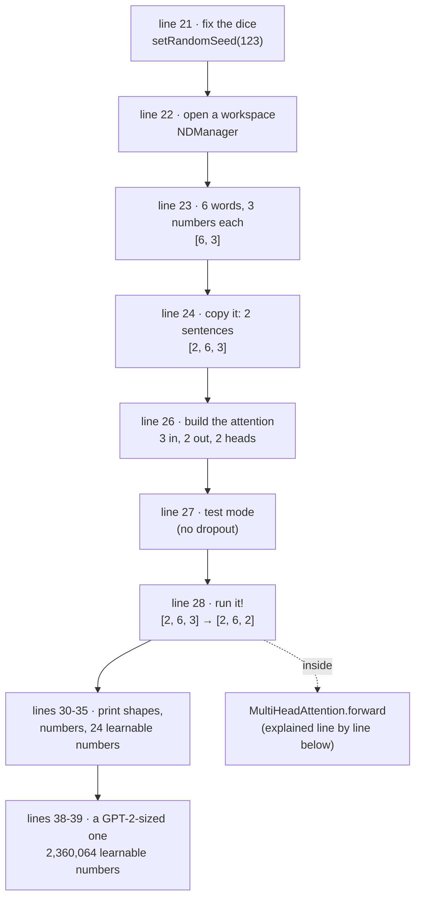

The program is **Part A** below. The interesting work happens inside `attention.forward(batch)`, which is **Part B**.

---

# Part A · `Step08_MultiHeadAttention.java`

## Lines 1-8 · package and imports

```java
package com.tinygpt.examples;                  // ◀ this file lives in the "examples" folder

import ai.djl.engine.Engine;                   // ◀ the engine: PyTorch, running under Java
import ai.djl.ndarray.NDArray;                 // ◀ a grid of numbers (a "tensor")
import ai.djl.ndarray.NDArrays;                // ◀ helpers that work on several grids (we use stack)
import ai.djl.ndarray.NDList;                  // ◀ a list of grids
import ai.djl.ndarray.NDManager;               // ◀ the workspace that owns the grids' memory
import com.tinygpt.attention.MultiHeadAttention; // ◀ our own class (Part B)
```

🗣️ `import` means "I'm going to use these classes". Only the last one is ours. The rest come from DJL, the library that does fast maths.

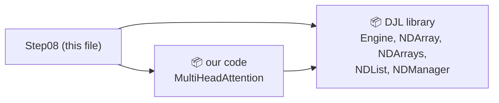

---

## Lines 18-20 · the class and `main`

```java
public class Step08_MultiHeadAttention {       // ◀ the program's name
    public static void main(String[] args) {   // ◀ Java starts running here
```

🗣️ `./run.sh 8` finds this class and calls `main`. Everything below runs from top to bottom, once.

---

## Line 21 · fix the dice

```java
        Engine.getInstance().setRandomSeed(123);   // ◀
```

🗣️ The attention starts with **random** numbers inside (line 26). Setting the **seed** makes the "random" numbers the same on every run, so you'll see exactly the numbers on this page.

🌍 Like shuffling a deck of cards in exactly the same way every time.

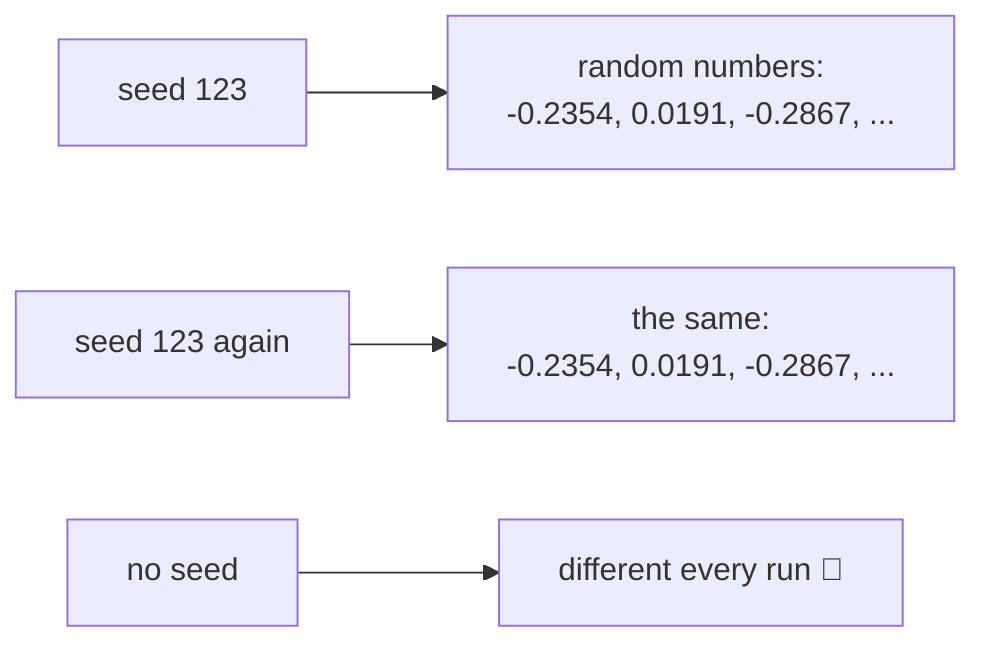

---

## Line 22 · open a workspace

```java
        try (NDManager manager = NDManager.newBaseManager()) {   // ◀
```

🗣️ Grids of numbers live in memory that Java can't clean up on its own (it belongs to PyTorch). The `NDManager` **owns** every grid we make, and `try ( ... )` frees all of them at the closing `}` on line 40.

🌍 A tray at a canteen: everything you take goes on the tray, and you return the whole tray at the end.

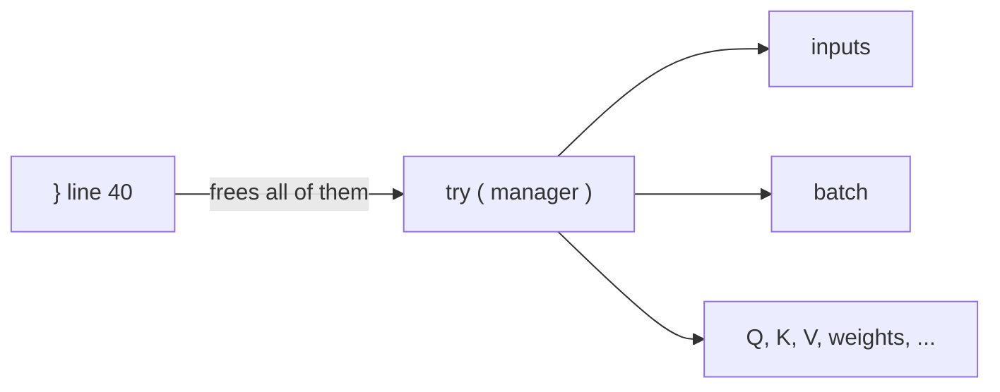

---

## Line 23 · our sentence: 6 words × 3 numbers

```java
            NDArray inputs = Step05_SimpleAttention.sentence(manager);   // ◀
```

🗣️ Borrows the book's tiny example sentence from Step 5: **"Your journey starts with one step"**, where each word is already a list of 3 numbers (its embedding, see [3. Embeddings](../03-embeddings.md)).

| word | number 1 | number 2 | number 3 |
|---|---:|---:|---:|
| Your | 0.43 | 0.15 | 0.89 |
| journey | 0.55 | 0.87 | 0.66 |
| starts | 0.57 | 0.85 | 0.64 |
| with | 0.22 | 0.58 | 0.33 |
| one | 0.77 | 0.25 | 0.10 |
| step | 0.05 | 0.80 | 0.55 |

**Shape: `[6, 3]`**: 6 rows (words), 3 columns (numbers per word).

---

## Line 24 · two sentences in one box

```java
            NDArray batch = NDArrays.stack(new NDList(inputs, inputs));   // ◀ [2 sentences, 6 words, 3 numbers]
```

🗣️ Real models work on **several sentences at once** (a *batch*). `stack` puts two `[6, 3]` grids on top of each other, making one `[2, 6, 3]` block. Here both are the same sentence, just to show the shape.

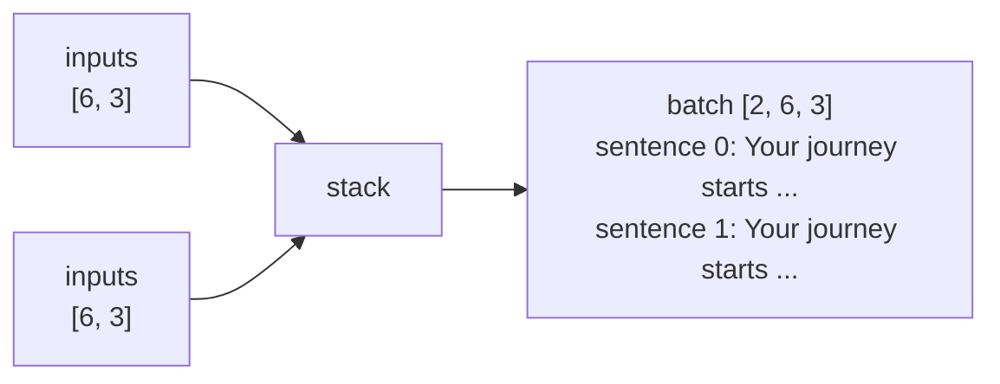

🔢 Reading a shape: `[2, 6, 3]` = **2** sentences × **6** words × **3** numbers. Because the two sentences are identical, the two output blocks you'll see printed later are identical too.

---

## Line 26 · build the multi-head attention

```java
            MultiHeadAttention attention = new MultiHeadAttention(manager, 3, 2, 2, 0.0f, false);   // ◀
```

| argument | value | meaning |
|---|---|---|
| `manager` | | the workspace from line 22 |
| `inputDim` | **3** | each word comes in as 3 numbers |
| `outputDim` | **2** | each word goes out as 2 numbers |
| `numberOfHeads` | **2** | 2 heads, so each head gets 2 ÷ 2 = **1** number |
| `dropoutRate` | **0.0** | never switch numbers off |
| `qkvBias` | **false** | Q, K and V have no "+ bias" part |

🗣️ This runs the **constructor** (explained in [Part B, lines 46-57](#lines-46-57--the-constructor-building-the-parts)). It creates 4 small weight grids, filled with random numbers.

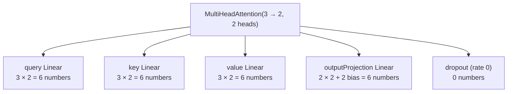

Total: 6 + 6 + 6 + 6 = **24 learnable numbers**. Line 34 prints exactly that.

---

## Line 27 · test mode

```java
            attention.setTraining(false);   // ◀
```

🗣️ In **training** mode, dropout randomly switches off some attention weights (see [Dropout](../classes/3-nn.md#dropout)). We only want to **look** at the result, so we turn training off. (With rate 0.0 dropout does nothing anyway, but it's a good habit.)

---

## Line 28 · run it

```java
            NDArray context = attention.forward(batch);   // ◀  [2, 6, 3] → [2, 6, 2]
```

🗣️ The big moment: every word looks back at the words before it, through 2 heads, and comes out as a new list of 2 numbers that mixes in information from those earlier words.

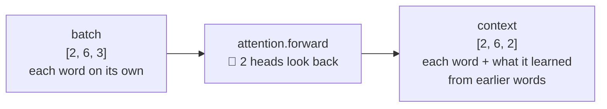

How it does this is [Part B](#part-b--inside-multiheadattentionforward).

---

## Lines 30-33 · print what happened

```java
            System.out.println("Input  " + batch.getShape() + "  (2 sentences, 6 words, 3 numbers each)");  // ◀
            System.out.println("2 heads, each 1 number wide, glued back together:");                       // ◀
            System.out.println("Output " + context.getShape());                                             // ◀
            System.out.println(context);                                                                    // ◀
```

Real output:

```
Input  (2, 6, 3)  (2 sentences, 6 words, 3 numbers each)
2 heads, each 1 number wide, glued back together:
Output (2, 6, 2)
[[[ 0.1902, -0.1218],    ← Your
  [ 0.1465, -0.1496],    ← journey
  [ 0.1299, -0.1584],    ← starts
  [ 0.1117, -0.1416],    ← with
  [ 0.0801, -0.1413],    ← one
  [ 0.0906, -0.1323]],   ← step
 [[ 0.1902, -0.1218],    ← sentence 1: the same, because the input was the same
  ...
```

---

## Line 34 · count the learnable numbers

```java
            System.out.println("Learnable numbers in this module: " + attention.parameterCount());   // ◀ 24
```

🗣️ `parameterCount()` adds up the sizes of all weight grids: 6 + 6 + 6 + 4 + 2 = **24**. These are the numbers that training would nudge.

---

## Lines 37-39 · the same thing at GPT-2's size

```java
            // GPT-2 size: 12 heads of 64 numbers = 768
            MultiHeadAttention gpt2Size = new MultiHeadAttention(manager, 768, 768, 12, 0.1f, false);   // ◀
            System.out.println("A GPT-2-sized attention ... has " + String.format("%,d", gpt2Size.parameterCount()) + " ...");  // ◀
```

🗣️ Same class, bigger numbers: 768 numbers per word, 12 heads of 768 ÷ 12 = **64** each.

| part | our tiny one | GPT-2 size |
|---|---:|---:|
| query | 3 × 2 = 6 | 768 × 768 = 589,824 |
| key | 6 | 589,824 |
| value | 6 | 589,824 |
| output (+ bias) | 4 + 2 = 6 | 589,824 + 768 = 590,592 |
| **total** | **24** | **2,360,064** |

`String.format("%,d", ...)` just adds the commas. And GPT-2 small has **12** of these, one in every transformer block.

---

## Line 40 · close the workspace

```java
        }   // ◀ end of try: the manager frees every grid we made
```

---

# Part B · inside `MultiHeadAttention.forward`

`forward` takes **every** sentence, word and head at once. To keep the pictures small, we'll follow **sentence 0** and look closely at **one word, "journey"** (word 1).

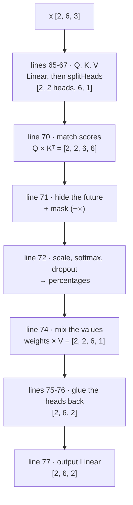

---

## Lines 46-57 · the constructor: building the parts

```java
    public MultiHeadAttention(NDManager manager, int inputDim, int outputDim, int numberOfHeads,
                              float dropoutRate, boolean qkvBias) {
        if (outputDim % numberOfHeads != 0) {                                        // ◀ 1
            throw new IllegalArgumentException("outputDim must be divisible by numberOfHeads");
        }
        this.numberOfHeads = numberOfHeads;                                          // ◀ 2
        this.headDim = outputDim / numberOfHeads;                                    // ◀ 3
        query = child("query", new Linear(manager, inputDim, outputDim, qkvBias));   // ◀ 4
        key = child("key", new Linear(manager, inputDim, outputDim, qkvBias));       // ◀ 4
        value = child("value", new Linear(manager, inputDim, outputDim, qkvBias));   // ◀ 4
        outputProjection = child("outputProjection", new Linear(manager, outputDim, outputDim, true));  // ◀ 5
        dropout = child("dropout", new Dropout(dropoutRate));                        // ◀ 6
    }
```

| ◀ | what it does | with our numbers |
|---|---|---|
| 1 | The heads must share the output numbers **evenly**. `%` is "remainder after dividing". | 2 % 2 = 0 ✅ (3 heads would fail: 2 % 3 = 2) |
| 2 | Remember how many heads. | 2 |
| 3 | How many numbers each head gets. | 2 ÷ 2 = **1** |
| 4 | Three [Linear](../classes/3-nn.md#linear) layers: each turns a word's 3 numbers into 2. `child(...)` registers them, so their weights count as learnable. | 3 grids of `[3, 2]` |
| 5 | One more Linear at the end, to mix what the heads found. It always has a bias. | `[2, 2]` + bias `[2]` |
| 6 | The dropout part, used in line 72. | rate 0 |

🌍 Splitting 2 output numbers among 2 heads is like sharing 12 sweets among 3 friends: it only works if it divides evenly.

The random starting weights (seed 123):

```
query.weight [3, 2]       key.weight [3, 2]        value.weight [3, 2]
[-0.2354, 0.0191]         [-0.4196, -0.4590]       [-0.4900, -0.3503]
[-0.2867, 0.2177]         [-0.3648,  0.2615]       [-0.2120, -0.1135]
[-0.4919, 0.4232]         [-0.2133,  0.2161]       [-0.4404,  0.3780]
  ↑head 0  ↑head 1          ↑head 0  ↑head 1         ↑head 0  ↑head 1
```

**Column 0 of every grid belongs to head 0, column 1 to head 1.** That's how one big Linear secretly holds both heads.

---

## Lines 62-63 · read the sizes

```java
        long batch = x.getShape().get(0);        // ◀ 2 sentences
        int tokens = (int) x.getShape().get(1);  // ◀ 6 words
```

🗣️ `x` has shape `[2, 6, 3]`. Position 0 of the shape is the number of sentences, position 1 the number of words. We need both to reshape later.

---

## Lines 65-67 · make Q, K, V and split them into heads

```java
        NDArray queries = splitHeads(query.forward(x), batch, tokens);   // ◀ "what am I looking for?"
        NDArray keys = splitHeads(key.forward(x), batch, tokens);        // ◀ "what do I contain?"
        NDArray values = splitHeads(value.forward(x), batch, tokens);    // ◀ "what do I share if picked?"
```

Each line does **two** things.

### `query.forward(x)`: one Linear for all heads

Each word's 3 numbers × the `[3, 2]` weight grid = 2 numbers.

🔢 **Check by hand**, Query for "Your" `[0.43, 0.15, 0.89]`, head 0 (column 0 of `query.weight`):

```
0.43 × -0.2354  +  0.15 × -0.2867  +  0.89 × -0.4919
=   -0.1012     +    -0.0430      +    -0.4378      =  -0.5821  ✅
```

The real results for sentence 0:

| word | Q head 0 | Q head 1 | K head 0 | K head 1 | V head 0 | V head 1 |
|---|---:|---:|---:|---:|---:|---:|
| Your | −0.5821 | 0.4176 | −0.4250 | 0.0341 | −0.6345 | 0.1688 |
| journey | **−0.7036** | 0.4793 | **−0.6890** | 0.1176 | **−0.7446** | −0.0419 |
| starts | −0.6928 | 0.4668 | −0.6858 | 0.0989 | −0.7414 | −0.0542 |
| with | −0.3804 | 0.2702 | −0.3743 | 0.1220 | −0.3761 | −0.0181 |
| one | −0.3022 | 0.1115 | −0.4357 | −0.2665 | −0.4744 | −0.2603 |
| step | −0.5117 | 0.4079 | −0.4302 | 0.3051 | −0.4363 | 0.0996 |

### `splitHeads(...)`: cut the columns into heads

```java
    private NDArray splitHeads(NDArray x, long batch, int tokens) {
        return x.reshape(batch, tokens, numberOfHeads, headDim)   // ◀ [2, 6, 2] → [2, 6, 2 heads, 1]
                .transpose(0, 2, 1, 3);                            // ◀ → [2, 2 heads, 6, 1]
    }
```

🗣️ `reshape` doesn't change any number. It only **re-labels** the 2 numbers per word as "2 heads × 1 number".
`transpose(0, 2, 1, 3)` swaps positions 1 and 2 of the shape, so the heads come **before** the words. Now each head has its own little `[6 words, 1]` grid and can work on its own.

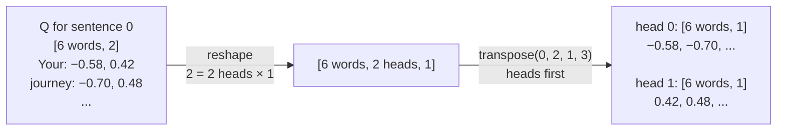

🌍 A class sheet with two columns, "maths mark" and "art mark", cut into two separate sheets: one for the maths teacher, one for the art teacher.

---

## Line 70 · match scores: how well does each word fit each other word?

```java
        NDArray scores = queries.matMul(keys.transpose(0, 1, 3, 2));   // ◀ [2, 2, 6, 1] × [2, 2, 1, 6] = [2, 2, 6, 6]
```

🗣️ For every pair of words (and in every head), multiply "what I'm looking for" (Q) by "what you contain" (K). A bigger number means a better match.
`keys.transpose(0, 1, 3, 2)` turns each head's K from a column `[6, 1]` into a row `[1, 6]`, so `matMul` makes a full **6 × 6 table**.

🔢 **Check by hand**, head 0, "journey" looking at "Your" and at itself:

```
journey → Your:     Q(journey) × K(Your)    = −0.7036 × −0.4250 = 0.2991  ✅
journey → journey:  Q(journey) × K(journey) = −0.7036 × −0.6890 = 0.4848  ✅
```

Head 0's full table (sentence 0). Row = the word doing the looking, column = the word being looked at:

| looks at → | Your | journey | starts | with | one | step |
|---|---:|---:|---:|---:|---:|---:|
| **Your** | 0.247 | 0.401 | 0.399 | 0.218 | 0.254 | 0.250 |
| **journey** | 0.299 | 0.485 | 0.483 | 0.263 | 0.307 | 0.303 |
| **starts** | 0.294 | 0.477 | 0.475 | 0.259 | 0.302 | 0.298 |
| **with** | 0.162 | 0.262 | 0.261 | 0.142 | 0.166 | 0.164 |
| **one** | 0.128 | 0.208 | 0.207 | 0.113 | 0.132 | 0.130 |
| **step** | 0.218 | 0.353 | 0.351 | 0.192 | 0.223 | 0.220 |

**Problem:** "Your" has a score for "journey", a word that comes **later**. When the model writes text, later words don't exist yet. Line 71 fixes this.

---

## Line 71 · hide the future

```java
        NDArray masked = scores.add(CausalAttention.causalMask(x.getManager(), tokens));   // ◀
```

🗣️ The mask is a `[6, 6]` grid: **0** where looking is allowed (the word itself and earlier words), **−∞** above the diagonal (later words). Adding 0 changes nothing; adding −∞ makes the score −∞.

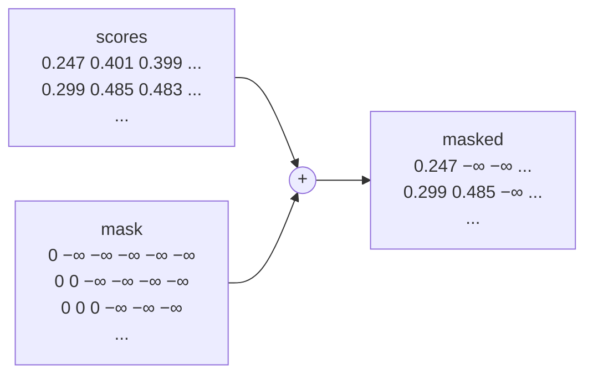

| looks at → | Your | journey | starts | with | one | step |
|---|---:|---:|---:|---:|---:|---:|
| **Your** | 0.247 | ❌ −∞ | ❌ −∞ | ❌ −∞ | ❌ −∞ | ❌ −∞ |
| **journey** | 0.299 | 0.485 | ❌ −∞ | ❌ −∞ | ❌ −∞ | ❌ −∞ |
| **starts** | 0.294 | 0.477 | 0.475 | ❌ −∞ | ❌ −∞ | ❌ −∞ |
| ... | | | | | | |
| **step** | 0.218 | 0.353 | 0.351 | 0.192 | 0.223 | 0.220 |

🌍 Taking a test where the answers to later questions are covered with tape.

---

## Line 72 · turn scores into percentages

```java
        NDArray weights = dropout.forward(masked.div(Math.sqrt(headDim)).softmax(-1));   // ◀
```

Read it **from the inside out**: three steps.

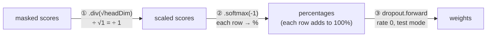

| step | what it does | why |
|---|---|---|
| ① `div(Math.sqrt(headDim))` | divides every score by √(numbers per head) | with many numbers per head (64 in GPT-2) the scores get big, and softmax would put almost 100% on one word. Here √1 = 1, so nothing changes. |
| ② `softmax(-1)` | along the last direction (each row): eˢᶜᵒʳᵉ ÷ the row's total | turns any scores into percentages that add up to 100%. e^(−∞) = 0, so **hidden words get 0%** |
| ③ `dropout.forward` | in training, randomly zeros some weights | stops the model leaning on one word. Off here. |

🔢 **Check by hand**, the "journey" row: scores 0.2991 and 0.4848.

```
e^0.2991 = 1.3487      e^0.4848 = 1.6238      total = 2.9725
Your:    1.3487 ÷ 2.9725 = 0.4537 = 45.4%   ✅
journey: 1.6238 ÷ 2.9725 = 0.5463 = 54.6%   ✅   (adds up to 100%)
```

Both heads' weights (sentence 0):

**Head 0**

| looks at → | Your | journey | starts | with | one | step |
|---|---:|---:|---:|---:|---:|---:|
| **Your** | 100% | | | | | |
| **journey** | 45.4% | 54.6% | | | | |
| **starts** | 29.4% | 35.3% | 35.3% | | | |
| **with** | 23.9% | 26.4% | 26.4% | 23.4% | | |
| **one** | 19.4% | 21.0% | 21.0% | 19.1% | 19.5% | |
| **step** | 16.0% | 18.3% | 18.2% | 15.5% | 16.0% | 16.0% |

**Head 1**

| looks at → | Your | journey | starts | with | one | step |
|---|---:|---:|---:|---:|---:|---:|
| **Your** | 100% | | | | | |
| **journey** | 49.0% | 51.0% | | | | |
| **starts** | 32.6% | 33.9% | 33.6% | | | |
| **with** | 24.6% | 25.2% | 25.0% | 25.2% | | |
| **one** | 20.0% | 20.2% | 20.2% | 20.2% | 19.4% | |
| **step** | 16.4% | 17.0% | 16.8% | 17.0% | **14.5%** | **18.3%** |

👀 The two heads already pay attention a little **differently** (look at "step": head 1 likes "one" less and itself more). These weights are still random. After training, each head learns its own job, for example "find the subject" or "find the last adjective".

"Your" always gives 100% to itself: it's the first word, so there's nothing earlier to look at.

---

## Line 74 · mix the values

```java
        NDArray context = weights.matMul(values);   // ◀ [2, 2, 6, 6] × [2, 2, 6, 1] = [2, 2, 6, 1]
```

🗣️ Each word's new value = **a blend of the V values** of the words it looked at, using the percentages as the recipe.

🔢 **Check by hand**, "journey", head 0: 45.4% of V(Your) + 54.6% of V(journey)

```
0.4537 × −0.6345  +  0.5463 × −0.7446
=    −0.2879      +     −0.4068        =  −0.6947  ✅
```

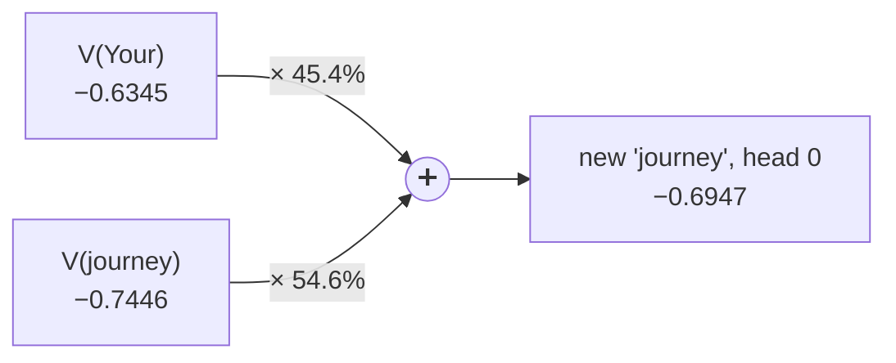

🌍 A smoothie: 45% banana, 55% mango. The taste (the new number) depends on the recipe (the weights).

Results for sentence 0, each head separately:

| word | head 0 | head 1 |
|---|---:|---:|
| Your | −0.6345 | 0.1688 |
| journey | −0.6947 | 0.0614 |
| starts | −0.7111 | 0.0226 |
| with | −0.6312 | 0.0129 |
| one | −0.5995 | −0.0397 |
| step | −0.5766 | −0.0111 |

---

## Lines 75-76 · glue the heads back together

```java
        NDArray merged = context.transpose(0, 2, 1, 3)                    // ◀ [2, 2 heads, 6, 1] → [2, 6, 2 heads, 1]
                .reshape(batch, tokens, (long) numberOfHeads * headDim);  // ◀ → [2, 6, 2]
```

🗣️ This is `splitHeads` **backwards**: `transpose` puts the words first again, and `reshape` turns "2 heads × 1 number" back into 2 numbers per word, **side by side**.

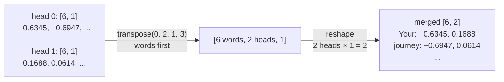

🌍 The maths teacher and the art teacher hand back their sheets, and the two columns are put back on one class sheet.

---

## Line 77 · the output Linear: let the heads share

```java
        return outputProjection.forward(merged);   // ◀ [2, 6, 2] × [2, 2] + bias = [2, 6, 2]
```

🗣️ Until now, head 0 and head 1 never saw each other's results. This last Linear mixes the two columns, so each output number can use **what both heads found**.

🔢 **Check by hand**, "Your": merged = `[−0.6345, 0.1688]`, `outputProjection.weight` = `[[−0.1668, 0.2270], [0.5000, 0.1317]]`, bias = `[0, 0]`

```
output 1:  −0.6345 × −0.1668  +  0.1688 × 0.5000  =  0.1058 + 0.0844  =  0.1902  ✅
output 2:  −0.6345 ×  0.2270  +  0.1688 × 0.1317  = −0.1440 + 0.0222  = −0.1218  ✅
```

These are exactly the first two numbers the program prints: `[ 0.1902, -0.1218]`. 🎉

---

## 🧩 One word's whole trip

Following **"journey"** in sentence 0 from start to finish:

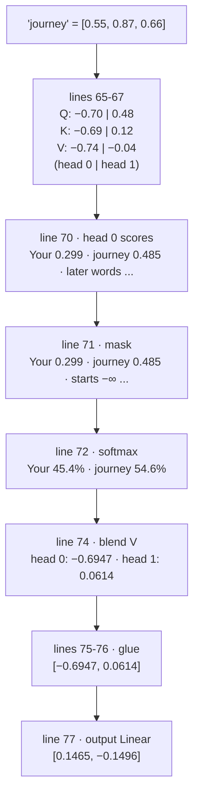

The shapes at each line, for the whole batch:

| line | grid | shape | meaning |
|---|---|---|---|
| 24 | `batch` | `[2, 6, 3]` | 2 sentences × 6 words × 3 numbers |
| 65 | `queries` (also keys, values) | `[2, 2, 6, 1]` | sentences × **heads** × words × numbers per head |
| 70 | `scores` | `[2, 2, 6, 6]` | sentences × heads × "looker" × "looked at" |
| 71-72 | `masked`, `weights` | `[2, 2, 6, 6]` | same, now percentages |
| 74 | `context` | `[2, 2, 6, 1]` | each head's blend |
| 75-76 | `merged` | `[2, 6, 2]` | heads glued side by side |
| 77 | result | `[2, 6, 2]` | after the heads have shared |

---

## 🧪 Try it yourself

In `Step08_MultiHeadAttention.java`:

1. Line 26: change `2, 2` to `4, 2` (4 numbers out, 2 heads of 2). Output becomes `[2, 6, 4]` and learnable numbers become 3×4×3 + 4×4 + 4 = **56**.
2. Line 26: try `2, 3` (2 numbers, 3 heads). Line ◀1 of the constructor throws *"outputDim must be divisible by numberOfHeads"*.
3. Line 21: change the seed to 7. All the numbers change, but the **shapes** and the **0% above the diagonal** stay the same.
4. Line 24: stack `inputs` with a different grid, e.g. `inputs.mul(2)`. Now the two output blocks differ.

## 📖 Related

- The idea, with simpler pictures: [4. Attention](../04-attention.md)
- The class summary: [MultiHeadAttention](../classes/4-attention.md#multiheadattention)
- The one-head versions it builds on: [`SelfAttention`](../classes/4-attention.md#selfattention), [`CausalAttention`](../classes/4-attention.md#causalattention)
- Where it's used next: inside every [TransformerBlock](../classes/5-model.md#transformerblock)
