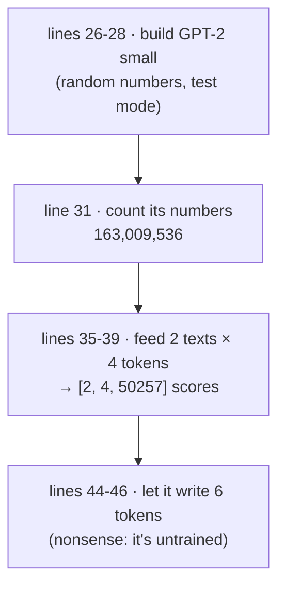
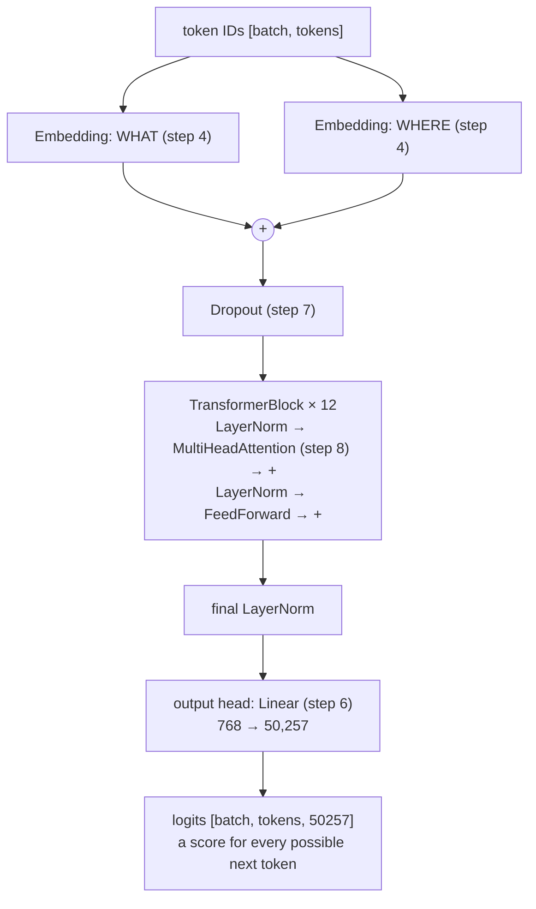
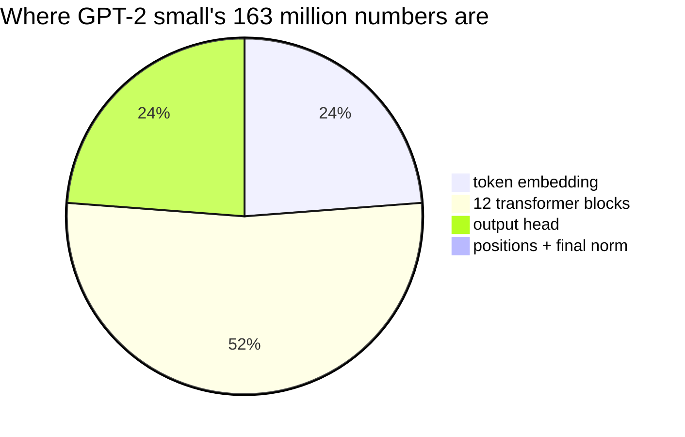
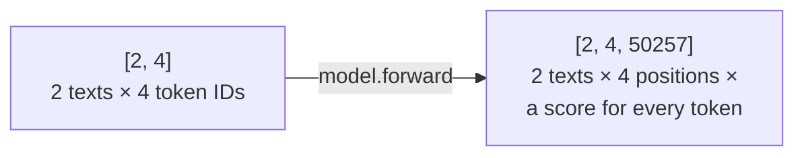
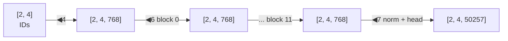
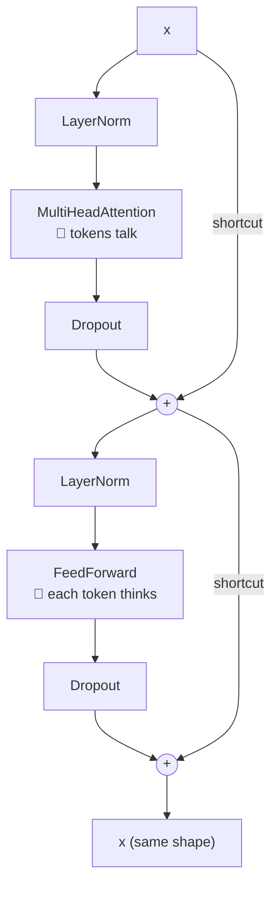
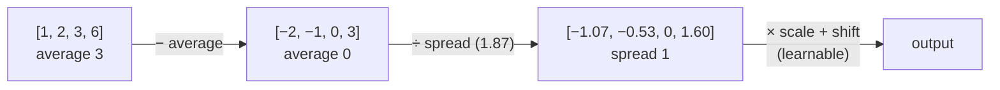
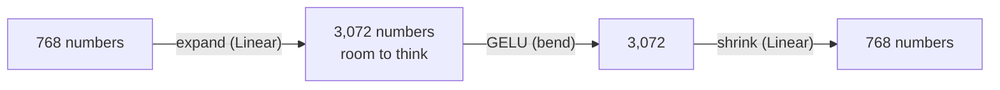
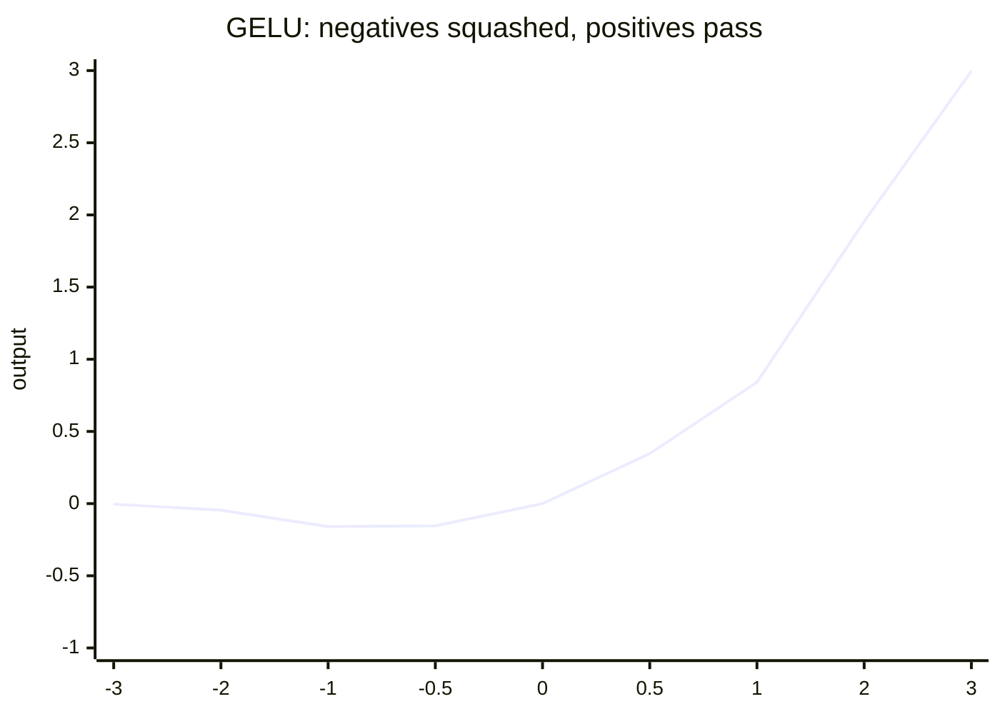

# Line by line: `Step09_GPTModel`

**Run it:** `./run.sh 9` (needs about 1 GB of memory) · **Code:** [`Step09_GPTModel.java`](../../src/main/java/com/tinygpt/examples/Step09_GPTModel.java), and the classes it uses: [`GPTConfig`](../../src/main/java/com/tinygpt/model/GPTConfig.java), [`GPTModel`](../../src/main/java/com/tinygpt/model/GPTModel.java), [`TransformerBlock`](../../src/main/java/com/tinygpt/model/TransformerBlock.java), [`LayerNorm`](../../src/main/java/com/tinygpt/nn/LayerNorm.java), [`FeedForward`](../../src/main/java/com/tinygpt/nn/FeedForward.java), [`GELU`](../../src/main/java/com/tinygpt/nn/GELU.java) · **Idea first:** [5. The GPT model](../05-gpt-model.md) · **Book:** 4.1–4.7

← [Step 8](step08-multi-head-attention.md) · [All walkthroughs](README.md) · Next: [Step 10 →](step10-loss.md)

Every output on this page is **real**: it's what `./run.sh 9` prints with seed 123.

---

## 🗺️ The whole program on one page



**Everything from steps 2-8 comes together here:** tokens ([2](step02-byte-pair-encoding.md)) → embeddings ([4](step04-embeddings.md)) → multi-head attention ([8](step08-multi-head-attention.md)) → ... → a score for every possible next token.



---

# Part A · `Step09_GPTModel.java`

## Lines 22-23 · fix the dice, load the tokenizer

```java
        Engine.getInstance().setRandomSeed(123);       // ◀ the same random model every run
        BpeTokenizer tokenizer = new BpeTokenizer();   // ◀ GPT-2's tokenizer (step 2)
```

## Lines 26-28 · build GPT-2 small

```java
            GPTConfig config = GPTConfig.GPT2_SMALL;          // ◀ 1 · the size settings
            GPTModel model = new GPTModel(manager, config);   // ◀ 2 · build every part, with random numbers
            model.setTraining(false);                         // ◀ 3 · test mode: no dropout
```

| ◀ | what it does |
|---|---|
| 1 | Picks GPT-2 small's settings: 50,257 tokens, reads up to 1,024 tokens, 768 numbers per token, 12 heads, 12 blocks. [Part B: GPTConfig](#gptconfig--all-the-size-settings) |
| 2 | Builds the whole model: about **163 million** random numbers (~650 MB of memory). [Part B: GPTModel](#gptmodel--the-whole-brain) |
| 3 | Switches dropout off in every part (`setTraining` goes through all the children, see [Module](step06-self-attention.md#module--the-parent-of-every-model-part)). |

## Lines 30-32 · how big is it?

```java
            System.out.println("GPT-2 small: " + config);                                                         // ◀
            System.out.printf("Total learnable numbers: %,d   (book: 163,009,536)%n", model.parameterCount());   // ◀
```

```
GPT-2 small: GPTConfig[vocabularySize=50257, contextLength=1024, embeddingDim=768, numberOfHeads=12, numberOfLayers=12, dropoutRate=0.1, qkvBias=false]
Total learnable numbers: 163,009,536   (book: 163,009,536)
```

🔢 Where **163,009,536** comes from (every part, counted by hand):

| part | sum | numbers |
|---|---|---:|
| token embedding | 50,257 × 768 | 38,597,376 |
| position embedding | 1,024 × 768 | 786,432 |
| **one block:** 2 LayerNorms | 2 × (768 + 768) | 3,072 |
| · attention (Q, K, V, output + bias) | 4 × 768 × 768 + 768 | 2,360,064 |
| · feed forward (expand + shrink, with biases) | 768 × 3,072 + 3,072 + 3,072 × 768 + 768 | 4,722,432 |
| **12 blocks** | 12 × 7,085,568 | 85,026,816 |
| final LayerNorm | 768 + 768 | 1,536 |
| output head | 768 × 50,257 | 38,597,376 |
| **total** | | **163,009,536** ✅ |

**Why is GPT-2 called "124M" then?** OpenAI's GPT-2 **reuses** the token embedding table as the output head (*weight tying*). Without the second copy: 163,009,536 − 38,597,376 = **124,412,160**.



---

## Lines 35-39 · feed it two texts

```java
            int[][] batch = {
                    tokenizer.encode("Every effort moves you"),   // ◀ [6109, 3626, 6100, 345]
                    tokenizer.encode("Every day holds a")         // ◀ [6109, 1110, 6622, 257]
            };
            NDArray logits = model.forward(manager.create(batch));   // ◀ [2, 4] → [2, 4, 50257]
```

```
Input:  2 texts x 4 tokens
Output: (2, 4, 50257)  -> a score for each of the 50,257 possible next tokens, at every position
```

🗣️ For **every position**, the model gives **50,257 scores**: one for each token that could come next. These raw scores are called **logits**.

| position | the model has read | its 50,257 scores answer |
|---|---|---|
| 0 | Every | what comes after "Every"? |
| 1 | Every effort | what comes after "Every effort"? |
| 2 | Every effort moves | ... |
| 3 | Every effort moves you | what comes after "you"? ← used for writing |

Thanks to the causal mask ([step 7](step07-causal-attention.md)), position 1 can't see "moves" or "you", so all 4 quizzes from [step 3](step03-sliding-window.md) are answered at once.



---

## Lines 44-46 · let the untrained model write

```java
            TextGenerator generator = new TextGenerator(model, tokenizer, manager, 123);   // ◀ the writer (step 11)
            System.out.println("   " + generator.generateGreedy("Hello, I am", 6));       // ◀ add 6 tokens
```

```
   Hello, I amás503 work hol riddledtaker
```

🗣️ `generateGreedy` repeats 6 times: run the model, pick the token with the **highest** score at the last position, add it, go again ([step 11](step11-sampling.md) shows how).
The result is nonsense because every number is still **random**. Training (`./run.sh train`, [walkthrough](step-tinygpt-training.md)) or loading GPT-2's real numbers ([step 12](step12-load-gpt2.md)) fixes that.

---

# Part B · the classes it uses

## `GPTConfig` · all the size settings

```java
public record GPTConfig(
        int vocabularySize,   // ◀ how many different tokens exist (50,257)
        int contextLength,    // ◀ the longest text it can read at once (1,024 tokens)
        int embeddingDim,     // ◀ numbers per token (768)
        int numberOfHeads,    // ◀ attention heads per block (12)
        int numberOfLayers,   // ◀ transformer blocks stacked (12)
        float dropoutRate,    // ◀ share switched off in training (0.1 = 10%)
        boolean qkvBias) {    // ◀ do Q, K, V have a bias? (OpenAI's GPT-2: yes)

    public static final GPTConfig GPT2_SMALL = new GPTConfig(50257, 1024, 768, 12, 12, 0.1f, false);   // ◀ the book's GPT-2
    public static final GPTConfig TINY = new GPTConfig(50257, 64, 128, 4, 4, 0.1f, false);             // ◀ ours: trains in seconds
}
```

| | GPT2_SMALL | TINY | effect of making it bigger |
|---|---:|---:|---|
| contextLength | 1,024 | 64 | reads longer texts |
| embeddingDim | 768 | 128 | richer description of each token |
| numberOfHeads | 12 | 4 | more "ways of looking" |
| numberOfLayers | 12 | 4 | more rounds of thinking |
| numbers in total | 163 million | 13.7 million | smarter, but slower |

A `record` is a class that just holds values. Java writes `config.embeddingDim()` and the other getters for us.

---

## `GPTModel` · the whole brain

### The constructor

```java
    public GPTModel(NDManager manager, GPTConfig config) {
        this.config = config;
        tokenEmbedding = child("tokenEmbedding", new Embedding(manager, config.vocabularySize(), config.embeddingDim()));       // ◀ 1
        positionEmbedding = child("positionEmbedding", new Embedding(manager, config.contextLength(), config.embeddingDim())); // ◀ 2
        dropout = child("dropout", new Dropout(config.dropoutRate()));                                                         // ◀ 3
        for (int i = 0; i < config.numberOfLayers(); i++) {
            blocks.add(child("blocks." + i, new TransformerBlock(manager, config)));                                           // ◀ 4
        }
        finalNorm = child("finalNorm", new LayerNorm(manager, config.embeddingDim()));                                         // ◀ 5
        outputHead = child("outputHead", new Linear(manager, config.embeddingDim(), config.vocabularySize(), false));          // ◀ 6
    }
```

| ◀ | part | GPT-2 small shape |
|---|---|---|
| 1 | WHAT each token is | table `[50257, 768]` |
| 2 | WHERE it is | table `[1024, 768]` |
| 3 | dropout on the input | |
| 4 | 12 blocks, named `blocks.0` ... `blocks.11` | |
| 5 | one last tidy-up | `[768]` scale + `[768]` shift |
| 6 | 768 numbers → 50,257 scores | grid `[768, 50257]` |

The names (`"tokenEmbedding"`, `"blocks.0"`, ...) become the start of every parameter name, e.g. `blocks.0.attention.query.weight`.

### `forward` · token IDs in, scores out

```java
    public NDArray forward(NDArray tokenIds) {                                           // [2, 4]
        int tokens = (int) tokenIds.getShape().get(1);                                   // ◀ 1 · 4
        if (tokens > config.contextLength()) {                                           // ◀ 2
            throw new IllegalArgumentException("Input has " + tokens + " tokens but contextLength is " + config.contextLength());
        }

        NDArray positions = tokenIds.getManager().arange(tokens);                        // ◀ 3 · [0, 1, 2, 3]
        NDArray x = tokenEmbedding.forward(tokenIds)                                     // ◀ 4 · [2, 4, 768]
                .add(positionEmbedding.forward(positions));                              // ◀ 4 · + [4, 768]
        x = dropout.forward(x);                                                          // ◀ 5
        for (TransformerBlock block : blocks) {
            x = block.forward(x);                                                        // ◀ 6 · 12 times, still [2, 4, 768]
        }
        return outputHead.forward(finalNorm.forward(x));                                 // ◀ 7 · [2, 4, 50257]
    }
```

| ◀ | what it does | shape |
|---|---|---|
| 1 | Count the tokens in each text. | 4 |
| 2 | Too long? There are only 1,024 position rows, so stop with a clear message. | |
| 3 | The positions 0, 1, 2, 3. | `[4]` |
| 4 | WHAT + WHERE, exactly like [step 4](step04-embeddings.md#line-54--add-them-together). | `[2, 4, 768]` |
| 5 | Dropout (does nothing in test mode). | `[2, 4, 768]` |
| 6 | 12 blocks, one after another. Each **keeps the shape**, so they stack like LEGO. | `[2, 4, 768]` |
| 7 | Tidy up, then turn each 768-number list into 50,257 scores. | `[2, 4, 50257]` |



### `save` and `load` · keep the learned numbers

```java
    public void save(Path file) throws IOException {
        Files.createDirectories(file.toAbsolutePath().getParent());      // ◀ 1 · make the folder (e.g. models/) if needed
        try (OutputStream out = Files.newOutputStream(file)) {
            new NDList(parameters()).encode(out);                        // ◀ 2 · write every grid, in order
        }
    }

    public void load(Path file) throws IOException {
        List<NDArray> parameters = parameters();                         // ◀ 3 · this model's grids, in the same order
        try (InputStream in = Files.newInputStream(file);
             NDManager temp = parameters.getFirst().getManager().newSubManager()) {   // ◀ 4 · a temporary workspace
            NDList saved = NDList.decode(temp, in);                      // ◀ 5 · read the saved grids
            if (saved.size() != parameters.size()) {                     // ◀ 6 · different model? stop
                throw new IOException("Saved model does not match this config");
            }
            for (int i = 0; i < saved.size(); i++) {
                parameters.get(i).set(saved.get(i).toByteBuffer());      // ◀ 7 · copy saved numbers into grid i
            }
        }
    }
```

🗣️ `save` writes every learnable grid to one file, **in parameter order**. `load` reads them back in the same order and copies each into place. ◀4: the read-in copies live in a temporary workspace, freed straight after copying, so memory isn't used twice.

Used by `./run.sh train` (saves `models/tinygpt.params`) and the chat programs.

---

## `TransformerBlock` · talk, then think

```java
    public TransformerBlock(NDManager manager, GPTConfig config) {
        norm1 = child("norm1", new LayerNorm(manager, config.embeddingDim()));                    // ◀ tidy before attention
        attention = child("attention", new MultiHeadAttention(manager, config.embeddingDim(), config.embeddingDim(),
                config.numberOfHeads(), config.dropoutRate(), config.qkvBias()));                 // ◀ step 8
        norm2 = child("norm2", new LayerNorm(manager, config.embeddingDim()));                    // ◀ tidy before thinking
        feedForward = child("feedForward", new FeedForward(manager, config.embeddingDim()));      // ◀ each token thinks
        dropShortcut = child("dropShortcut", new Dropout(config.dropoutRate()));                  // ◀ dropout before adding back
    }

    public NDArray forward(NDArray x) {
        x = x.add(dropShortcut.forward(attention.forward(norm1.forward(x))));      // ◀ 1 · TALK
        x = x.add(dropShortcut.forward(feedForward.forward(norm2.forward(x))));    // ◀ 2 · THINK
        return x;
    }
```

Read each line **from the inside out**:

| ◀ | inside out | in plain words |
|---|---|---|
| 1 | `norm1(x)` → `attention` → `dropShortcut` → **`x.add(...)`** | tidy up, let the tokens **talk to each other**, then **add the result to the original** |
| 2 | `norm2(x)` → `feedForward` → `dropShortcut` → **`x.add(...)`** | tidy up, let each token **think on its own**, then **add the result to what it had** |



### Why `x.add(...)`? The shortcut

The attention and feed-forward parts only compute a **change**, which is **added** to what was already there.

🔢 With 2 numbers (made-up, to show the idea):

```
x                         = [1.00, 2.00]
attention says "change by" [0.10, -0.30]
x after ◀1                = [1.10, 1.70]     ← the original is kept, plus a small correction
```

🌍 Keeping your original notes and only writing corrections in the margin. After 12 blocks of corrections, nothing important has been lost.

It also helps **training**: the "how to improve" signal can flow straight back through the `+` to the early blocks. Without shortcuts, a deep model learns very slowly (book 4.4).

---

## `LayerNorm` · keep the numbers a steady size

```java
    private static final float EPSILON = 1e-5f;                          // ◀ 0.00001, avoids ÷ 0

    public LayerNorm(NDManager manager, int embeddingDim) {
        scale = parameter("scale", manager.ones(new Shape(embeddingDim)));    // ◀ learnable, starts at 1
        shift = parameter("shift", manager.zeros(new Shape(embeddingDim)));   // ◀ learnable, starts at 0
    }

    public NDArray forward(NDArray x) {
        int[] lastAxis = {-1};                                                // ◀ 1 · work along each token's own list
        NDArray mean = x.mean(lastAxis, true);                                // ◀ 2 · its average
        NDArray variance = x.sub(mean).square().mean(lastAxis, true);         // ◀ 3 · how spread out it is
        NDArray normalized = x.sub(mean).div(variance.add(EPSILON).sqrt());   // ◀ 4 · centre, then resize
        return normalized.mul(scale).add(shift);                              // ◀ 5 · learnable adjust
    }
```

🔢 **Check by hand** with `[1, 2, 3, 6]`:

| ◀ | sum | result |
|---|---|---|
| 2 · average | (1 + 2 + 3 + 6) ÷ 4 | **3** |
| 3 · minus average | | −2, −1, 0, 3 |
| 3 · squared | | 4, 1, 0, 9 |
| 3 · variance = average of those | 14 ÷ 4 | **3.5** |
| 4 · ÷ √3.5 = ÷ 1.871 | | **−1.069, −0.535, 0, 1.604** ✅ (the real output) |
| 5 · × scale (1) + shift (0) | | unchanged at the start |

Now the numbers average **0** and have spread **1**, whatever size they were before.

`true` in `mean(lastAxis, true)` keeps the shape `[..., 1]` so the subtraction lines up with every number.



🌍 A sound engineer adjusting the volume so nothing is too loud or too quiet. ◀5 lets the model pick a different volume if it helps.

**Why?** After many blocks of adding things up, the numbers could grow huge or shrink to nothing, and training would break. LayerNorm keeps them steady.

---

## `FeedForward` · each token thinks on its own

```java
    public FeedForward(NDManager manager, int embeddingDim) {
        expand = child("expand", new Linear(manager, embeddingDim, 4 * embeddingDim, true));   // ◀ 768 → 3,072
        shrink = child("shrink", new Linear(manager, 4 * embeddingDim, embeddingDim, true));   // ◀ 3,072 → 768
    }

    public NDArray forward(NDArray x) {
        return shrink.forward(GELU.apply(expand.forward(x)));   // ◀ expand → bend → shrink
    }
```



🗣️ Attention lets tokens **share**; feed forward lets each token **work on** what it gathered. It's done separately for every token, with the same weights. The widening to 4× gives it more room, like spreading your notes out on a big table before summarising them again.

---

## `GELU` · the bend

```java
    private static final double SQRT_2_OVER_PI = Math.sqrt(2.0 / Math.PI);   // ◀ 0.7979

    public static NDArray apply(NDArray x) {
        NDArray inner = x.add(x.pow(3).mul(0.044715f)).mul(SQRT_2_OVER_PI);  // ◀ 1 · 0.7979 × (x + 0.044715 × x³)
        return x.mul(0.5f).mul(inner.tanh().add(1f));                        // ◀ 2 · 0.5 × x × (1 + tanh(inner))
    }
```

🗣️ **Positive numbers pass through** (almost unchanged), **negative numbers are squashed to near 0**, with a smooth curve in between. The formula is GPT-2's.

Real values:

| x | −3 | −2 | −1 | −0.5 | 0 | 0.5 | 1 | 2 | 3 |
|---|---:|---:|---:|---:|---:|---:|---:|---:|---:|
| **GELU(x)** | −0.004 | −0.045 | −0.159 | −0.154 | 0 | 0.346 | 0.841 | 1.955 | 2.996 |



🔢 **Check by hand**, x = 1: inner = 0.7979 × (1 + 0.0447) = 0.8336; tanh(0.8336) = 0.6823; 0.5 × 1 × 1.6823 = **0.841** ✅

**Why bend at all?** Two `Linear` layers in a row with nothing between them are the same as **one** Linear (multiplying twice = multiplying once by a different grid). The bend lets the model learn curvy, "if this, then that" patterns, not just straight lines.

---

## 🧠 What this step teaches

- A GPT = **embeddings → 12 × (talk + think) → scores for every next token**.
- Each block: LayerNorm → attention → **+ shortcut**, then LayerNorm → feed forward → **+ shortcut**. The shape never changes, so blocks stack.
- GPT-2 small has **163,009,536** numbers (124M with weight tying), all random until trained.

## 🧪 Try it yourself

1. Line 26: use `GPTConfig.TINY`. Count the numbers (13.7 million) and see how much faster it runs.
2. Line 37: try a text longer than 4 tokens. The output shape follows: `[2, tokens, 50257]`, but both texts must be the same length.
3. Line 46: change the seed on line 22. The nonsense changes.
