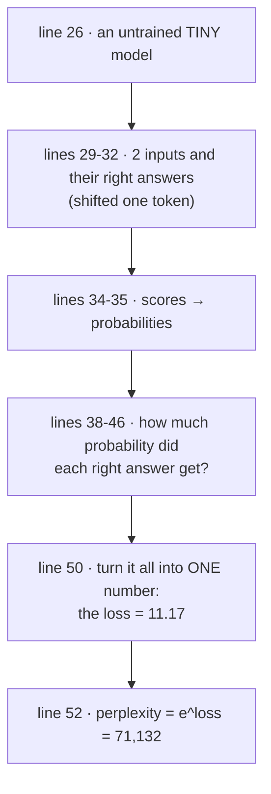
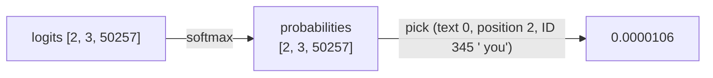
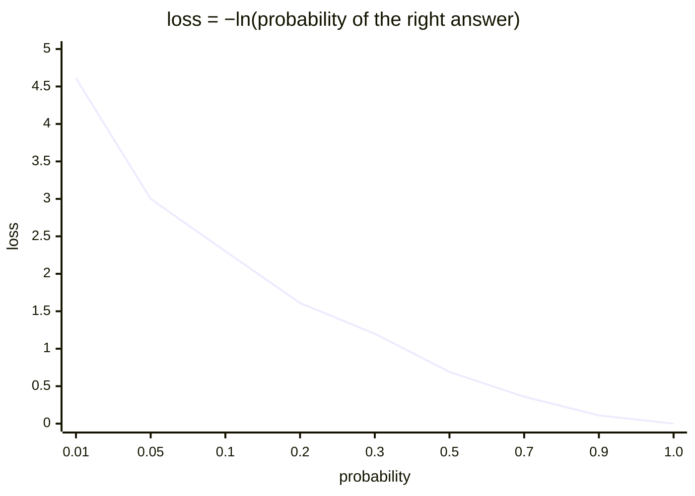
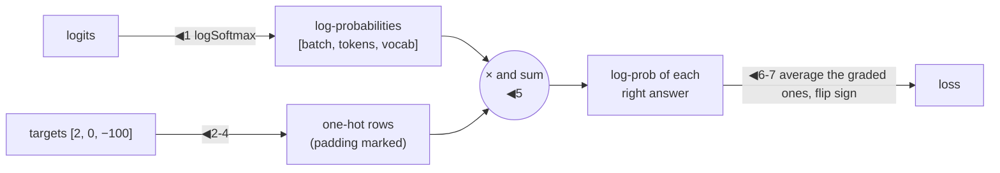

# Line by line: `Step10_Loss`

**Run it:** `./run.sh 10` · **Code:** [`Step10_Loss.java`](../../src/main/java/com/tinygpt/examples/Step10_Loss.java) and [`Loss.java`](../../src/main/java/com/tinygpt/training/Loss.java) · **Idea first:** [6. Training](../06-training.md) · **Book:** 5.1

← [Step 9](step09-gpt-model.md) · [All walkthroughs](README.md) · Next: [Step 11 →](step11-sampling.md)

Every output on this page is **real**: it's what `./run.sh 10` prints with seed 123.

---

## 🗺️ The whole program on one page



**Why?** To improve, the model needs to know **how wrong** it is, as **one number**. Training then nudges the weights to make that number smaller. That number is the **loss**.

---

# Part A · `Step10_Loss.java`

## Lines 26-27 · an untrained model

```java
            GPTModel model = new GPTModel(manager, GPTConfig.TINY);   // ◀ 13.7 million random numbers
            model.setTraining(false);                                  // ◀ no dropout
```

## Lines 29-32 · inputs and their right answers

```java
            String[] inputs = {"every effort moves", "I really like"};               // ◀ what it reads
            String[] targets = {" effort moves you", " really like chocolate"};      // ◀ the right next words
            int[][] inputIds = {tokenizer.encode(inputs[0]), tokenizer.encode(inputs[1])};    // ◀ [2, 3]
            int[][] targetIds = {tokenizer.encode(targets[0]), tokenizer.encode(targets[1])}; // ◀ [2, 3]
```

🗣️ The book's example. Just like [step 3](step03-sliding-window.md), each target is the input moved **one token to the right**:

| position | read so far | right answer |
|---:|---|---|
| 0 | every | ·effort |
| 1 | every effort | ·moves |
| 2 | every effort moves | ·you |
| 0 | I | ·really |
| 1 | I really | ·like |
| 2 | I really like | ·chocolate |

---

## Lines 34-35 · scores → probabilities

```java
            NDArray logits = model.forward(manager.create(inputIds));   // ◀ [2, 3, 50257] scores
            NDArray probabilities = logits.softmax(-1);                 // ◀ each position's 50,257 scores → %
```

🗣️ For each of the 6 positions, softmax turns 50,257 scores into probabilities that add up to 1 (100%) ([softmax explained in step 5](step05-simple-attention.md#line-41--turn-scores-into-percentages)).

---

## Lines 38-46 · how much did the right answer get?

```java
            for (int text = 0; text < 2; text++) {                                          // ◀ each text
                for (int position = 0; position < 3; position++) {                          // ◀ each position
                    int correct = targetIds[text][position];                                // ◀ the right token's ID
                    float probability = probabilities.getFloat(text, position, correct);   // ◀ its probability
                    System.out.printf(...);
                }
            }
```

🗣️ `getFloat(text, position, correct)` reads **one** number out of the `[2, 3, 50257]` block: the probability the model gave the right answer.

```
   after "every"                correct = " effort"    probability = 0.0000226
   after "every effort"         correct = " moves"     probability = 0.0000124
   after "every effort moves"   correct = " you"       probability = 0.0000106
   after "I"                    correct = " really"    probability = 0.0000078
   after "I really"             correct = " like"      probability = 0.0000130
   after "I really like"        correct = " chocolate" probability = 0.0000257
   A random guess out of 50,257 tokens would be 1/50257 = 0.0000199
```

👀 All about **0.00002**, the same as picking blindly from 50,257 tokens. The untrained model knows **nothing**. A trained model would give "you" something like 0.3.



---

## Line 50 · ONE number: the cross-entropy loss

```java
            float loss = Loss.crossEntropy(logits, manager.create(targetIds)).getFloat();   // ◀ 11.1723
```

🗣️ For each position: take the probability of the right answer, apply **−ln** (minus the natural log), then **average** all 6.

🔢 **Check by hand:**

| right answer | probability | −ln(probability) |
|---|---:|---:|
| ·effort | 0.0000226 | 10.70 |
| ·moves | 0.0000124 | 11.30 |
| ·you | 0.0000106 | 11.46 |
| ·really | 0.0000078 | 11.76 |
| ·like | 0.0000130 | 11.25 |
| ·chocolate | 0.0000257 | 10.57 |
| **average** | | **11.17** ✅ |

```
Cross-entropy loss: 11.1723   (lower is better, perfect = 0)
```

### Why −ln?

| probability given to the right answer | −ln | meaning |
|---:|---:|---|
| 1.00 (certain and right) | **0** | perfect |
| 0.90 | 0.11 | very good |
| 0.50 | 0.69 | okay |
| 0.01 | 4.61 | bad |
| 0.00002 | ~10.8 | knows nothing |



- Being **sure and right** costs nothing.
- Being **unsure** costs a bit.
- Giving the right answer **almost no chance** costs a lot.

🌍 A quiz where you bet on your answer: a confident right answer costs nothing, a hedge costs a little, and betting against the right answer costs a lot.

---

## Line 52 · perplexity: the loss as "how many choices"

```java
            System.out.printf("Perplexity e^loss:  %,.0f ...", Math.exp(loss));   // ◀ e^11.17 = 71,132
```

🗣️ e^loss turns the loss back into something easy to picture: **the model is as unsure as if it were choosing between about 71,132 tokens.** (A little worse than an even guess among all 50,257, because the random model is slightly wrong in a confident way.)

| | loss | perplexity |
|---|---:|---:|
| knows nothing (every token equal) | ln(50,257) = 10.8 | 50,257 |
| this untrained model | 11.17 | 71,132 |
| TinyGPT after training (on its own story) | ~0.8 | ~2 |

---

# Part B · `Loss.crossEntropy` line by line

```java
    public static final int IGNORE = -100;   // ◀ "don't grade this position" (padding, chapter 7)

    public static NDArray crossEntropy(NDArray logits, NDArray targets) {
        NDArray logProbabilities = logits.logSoftmax(-1);                                      // ◀ 1
        NDArray graded = targets.gte(0);                                                       // ◀ 2
        NDArray safeTargets = targets.mul(graded.toType(targets.getDataType(), false));       // ◀ 3
        NDArray oneHot = safeTargets.oneHot((int) logits.getShape().getLastDimension());      // ◀ 4
        NDArray correctLogProbability = logProbabilities.mul(oneHot).sum(new int[]{-1});      // ◀ 5
        NDArray weights = graded.toType(DataType.FLOAT32, false);                             // ◀ 6
        return correctLogProbability.mul(weights).sum().div(weights.sum()).neg();             // ◀ 7
    }
```

🔢 Follow it with a tiny vocabulary of **5 tokens**, 1 text, 3 positions, targets `[2, 0, -100]` (the last one is padding). The log-probability values are made up, to keep it small:

| ◀ | what it does | result |
|---|---|---|
| 1 | `logSoftmax` = ln(softmax), in one safe step. Each position gets 5 log-probabilities (all ≤ 0). | pos 0: `[−2.1, −1.9, `**`−0.4`**`, −2.5, −3.0]`<br/>pos 1: `[`**`−1.2`**`, −0.9, −2.0, −1.8, −2.2]`<br/>pos 2: `[...]` |
| 2 | Which targets are real? `gte(0)` = "≥ 0". | `[yes, yes, no]` |
| 3 | Turn −100 into 0, so the next line doesn't break. (It won't be counted anyway.) | `[2, 0, 0]` |
| 4 | A **one-hot** row for each target: all zeros except a 1 at the right token. | pos 0: `[0, 0, 1, 0, 0]`<br/>pos 1: `[1, 0, 0, 0, 0]`<br/>pos 2: `[1, 0, 0, 0, 0]` |
| 5 | Multiply and add up each row: **picks out** the right token's log-probability. | `[−0.4, −1.2, (ignored)]` |
| 6 | 1 for graded positions, 0 for padding. | `[1, 1, 0]` |
| 7 | Sum the graded ones ÷ how many there are, then flip the sign. | −(−0.4 − 1.2) ÷ 2 = **0.8** |



**Why −100?** In [chat training](finetune-and-chat.md), texts of different lengths are padded to the same length. The padding isn't real text, so it shouldn't be graded. −100 is the same "skip me" number PyTorch uses.

**Why `logSoftmax` and not `softmax().log()`?** Probabilities like 0.0000001 can round down to 0 in a computer, and ln(0) = −∞ would break training. `logSoftmax` works it out without going through tiny numbers.

---

## 🧠 What this step teaches

- The **loss** is one number for "how wrong": the average of **−ln(probability given to the right answer)**.
- Untrained ≈ **10.8** (a blind guess among 50,257). Perfect = **0**.
- **Perplexity** = e^loss ≈ "how many tokens the model is unsure between".
- Training = make the loss go down ([TinyGPT walkthrough](step-tinygpt-training.md)).

## 🧪 Try it yourself

1. Line 30: change "chocolate" to another word. The probability stays about 0.00002: untrained, everything is a blind guess.
2. After `./run.sh train`, load `models/tinygpt.params` here (`model.load(...)`) and test text from the story. The loss drops a lot.
