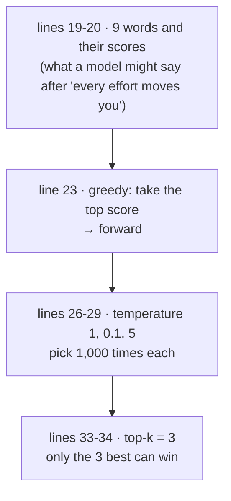
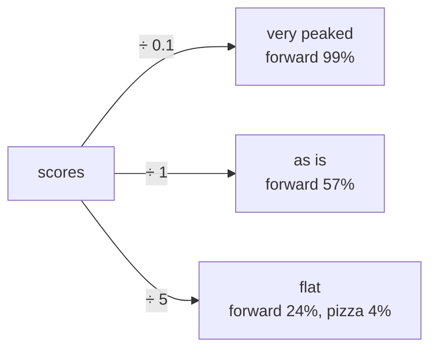
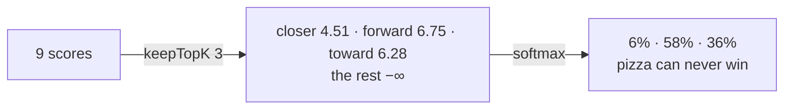
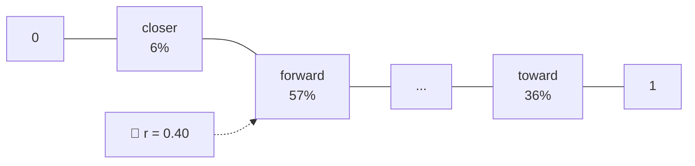
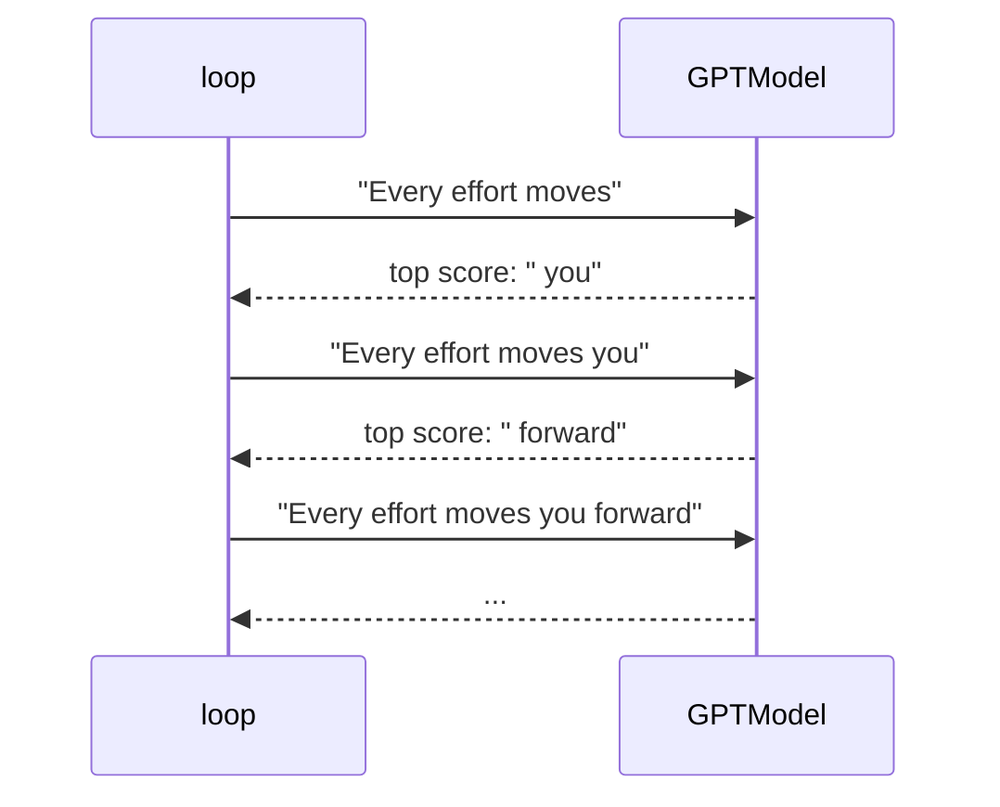

# Line by line: `Step11_Sampling`

**Run it:** `./run.sh 11` · **Code:** [`Step11_Sampling.java`](../../src/main/java/com/tinygpt/examples/Step11_Sampling.java) and [`TextGenerator.java`](../../src/main/java/com/tinygpt/generation/TextGenerator.java) · **Idea first:** [7. Writing text](../07-generating-text.md) · **Book:** 4.7, 5.3

← [Step 10](step10-loss.md) · [All walkthroughs](README.md) · Next: [Training TinyGPT →](step-tinygpt-training.md)

Every output on this page is **real**: it's what `./run.sh 11` prints. This step needs **no model**: it uses 9 made-up scores, so every percentage can be checked.

---

## 🗺️ The whole program on one page



**Why?** The model gives a score to **every** possible next token. Something has to **choose** one. How we choose changes the writing a lot: always the top one is safe but boring, picking at random can be creative or silly.

---

# Part A · `Step11_Sampling.java`

## Lines 19-20 · the scores

```java
    private static final String[] WORDS = {"closer", "every", "effort", "forward", "inches", "moves", "pizza", "toward", "you"};
    private static final float[] SCORES = {4.51f, 0.89f, -1.90f, 6.75f, 1.63f, -1.62f, -1.89f, 6.28f, 1.79f};   // ◀
```

🗣️ The book's example: pretend the model read "every effort moves you" and only knows 9 words. These are its scores (logits) for the next word.

| word | closer | every | effort | **forward** | inches | moves | pizza | toward | you |
|---|---:|---:|---:|---:|---:|---:|---:|---:|---:|
| score | 4.51 | 0.89 | −1.90 | **6.75** | 1.63 | −1.62 | −1.89 | 6.28 | 1.79 |
| softmax % | 6.1% | 0.2% | 0.0% | **57.2%** | 0.3% | 0.0% | 0.0% | 35.8% | 0.4% |

---

## Line 23 · greedy: always the highest score

```java
        System.out.println("Greedy ...: \"" + WORDS[TextGenerator.argMax(SCORES)] + "\"");   // ◀ "forward"
```

🗣️ `argMax` returns the **position** of the biggest score: 6.75 is at position 3, which is "forward". Greedy picking gives the **same** answer every time.

🌍 Always ordering your favourite dish: never disappointed, never surprised.

---

## Lines 26-29 · temperature

```java
        for (float temperature : new float[]{1f, 0.1f, 5f}) {                              // ◀ try 3 temperatures
            printCounts(sampleThousandTimes(TextGenerator.softmax(SCORES, temperature)));  // ◀ % → pick 1,000 times → count
        }
```

🗣️ Instead of always taking the top word, **draw** one at random, with the softmax percentages as the odds. **Temperature** changes the odds first: every score is divided by it.

| temperature | scores ÷ T | effect | forward | toward | closer | pizza |
|---|---|---|---:|---:|---:|---:|
| **0.1** | ×10: gaps become huge | almost always the top word | 99.1% | 0.9% | 0.0% | 0.0% |
| **1** | unchanged | the model's own odds | 57.2% | 35.8% | 6.1% | 0.0% |
| **5** | ÷5: gaps shrink | much more even | 24.2% | 22.0% | 15.5% | **4.3%** |

Real counts out of 1,000 draws:

```
Temperature 1.0               Temperature 0.1              Temperature 5.0
   closer     69  ###            forward   992  #####...      closer    176  ########
   every       3  #              toward      8  #             every      81  ####
   forward   563  ##########...                               effort     42  ##
   inches      5  #                                           forward   223  ###########
   toward    357  #################                           inches     79  ###
   you         3  #                                           moves      44  ##
                                                              pizza      55  ##     ← "every effort moves you pizza"!
                                                              toward    222  ###########
                                                              you        78  ###
```

The counts are close to the percentages (563 ≈ 57.2% of 1,000), as expected for random draws.



🌍 Temperature is like how adventurous you're feeling at a restaurant: low = your usual dish, high = anything on the menu.

---

## Lines 33-34 · top-k: only the best k may win

```java
        printCounts(sampleThousandTimes(TextGenerator.softmax(TextGenerator.keepTopK(SCORES, 3), 1f)));   // ◀
```

🗣️ `keepTopK(SCORES, 3)` keeps the 3 best scores and sets the rest to **−∞**, so softmax gives them **0%**. You still get some variety, but nothing silly.

| word | closer | **forward** | **toward** | everything else |
|---|---:|---:|---:|---:|
| after top-3 | 6.1% | 57.8% | 36.1% | 0% |
| real count / 1,000 | 71 | 570 | 359 | 0 |



**Together:** temperature makes it creative, top-k keeps it sensible. The [talk bot](finetune-talk-and-talk.md) uses temperature 0.7 with top-k 40.

---

## Lines 37-52 · `sampleThousandTimes`: how a random pick works

```java
    private static int[] sampleThousandTimes(float[] probabilities) {
        Random random = new Random(123);                      // ◀ 1 · seeded, so you see the same counts
        int[] counts = new int[probabilities.length];
        for (int draw = 0; draw < 1000; draw++) {
            double r = random.nextDouble();                   // ◀ 2 · a random number from 0 to 1
            double cumulative = 0;
            for (int i = 0; i < probabilities.length; i++) {
                cumulative += probabilities[i];               // ◀ 3 · running total
                if (r < cumulative || i == probabilities.length - 1) {   // ◀ 4 · r falls in this word's slice?
                    counts[i]++;
                    break;
                }
            }
        }
        return counts;
    }
```

🗣️ Lay the percentages end to end on a ruler from 0 to 1. Throw a dart (◀2) and see whose slice it lands in.

🔢 With temperature 1 (rounded): closer 0.00–0.061, every 0.061–0.063, effort ~0, **forward 0.063–0.635**, ..., toward ~0.642–0.998, ...

- r = 0.40 → falls in **forward**'s slice.
- r = 0.75 → falls in **toward**'s slice.



The `|| i == probabilities.length - 1` part catches tiny rounding gaps: if the total is 0.9999999 and r is 0.99999995, the last word gets it.

## Lines 54-61 · `printCounts`

```java
                System.out.printf("   %-8s %4d  %s%n", WORDS[i], counts[i], "#".repeat(Math.max(1, counts[i] / 20)));   // ◀ one # per 20 picks
```

Only words that were picked at least once are printed.

---

# Part B · `TextGenerator` line by line

This is the class that makes a real model **write**. The methods above (argMax, softmax, keepTopK) are its building blocks.

## The constructor

```java
    public TextGenerator(GPTModel model, Tokenizer tokenizer, NDManager manager, long seed) {
        this.model = model;            // ◀ which brain
        this.tokenizer = tokenizer;    // ◀ text ⇄ numbers
        this.manager = manager;        // ◀ workspace for the grids
        this.random = new Random(seed);// ◀ dice for sampling (seeded = repeatable)
    }
```

## `generateGreedy` and `generate`

```java
    public String generateGreedy(String prompt, int maxNewTokens) {
        return generate(prompt, maxNewTokens, 0f, 0);                                        // ◀ temperature 0 = greedy
    }

    public String generate(String prompt, int maxNewTokens, float temperature, int topK) {
        return prompt + continuation(prompt, maxNewTokens, temperature, topK, NO_STOP_TOKEN); // ◀ prompt + new text
    }
```

## `continuation` · the writing loop

```java
    public String continuation(String prompt, int maxNewTokens, float temperature, int topK, int stopTokenId) {
        boolean wasTraining = model.isTraining();
        model.setTraining(false);                                                        // ◀ 1

        int[] ids = tokenizer.encode(prompt);                                            // ◀ 2
        int promptLength = ids.length;
        for (int step = 0; step < maxNewTokens; step++) {
            float[] scores = nextTokenScores(ids);                                       // ◀ 3
            int next = temperature <= 0f ? argMax(scores) : sample(scores, temperature, topK);   // ◀ 4
            if (next == stopTokenId) {                                                   // ◀ 5
                break;
            }
            ids = Arrays.copyOf(ids, ids.length + 1);                                    // ◀ 6
            ids[ids.length - 1] = next;
        }

        model.setTraining(wasTraining);                                                  // ◀ 7
        return tokenizer.decode(Arrays.copyOfRange(ids, promptLength, ids.length));      // ◀ 8
    }
```

| ◀ | what it does |
|---|---|
| 1 | Switch dropout off while writing (and remember the old mode). |
| 2 | Prompt → token IDs. |
| 3 | Run the model; keep only the 50,257 scores for the **last** position. |
| 4 | Choose: greedy if temperature ≤ 0, otherwise sample. `? :` = if/else. |
| 5 | If the model chose the "stop" token (e.g. `<\|endoftext\|>` for the chat bot), finish early. |
| 6 | Make the list one longer and put the new token at the end. |
| 7 | Put the training mode back as it was. |
| 8 | Decode only the **new** tokens (after the prompt). |

🔢 What the loop does with GPT-2 (book example):



**Autoregressive:** each new token is added to the input, and the model is asked again.

## `nextTokenScores` · run the model once

```java
    private float[] nextTokenScores(int[] ids) {
        int contextLength = model.config().contextLength();
        int[] window = ids.length > contextLength
                ? Arrays.copyOfRange(ids, ids.length - contextLength, ids.length)   // ◀ 1 · too long? keep the newest
                : ids;

        try (NDScope ignored = new NDScope()) {                                     // ◀ 2 · free the temporary grids afterwards
            NDArray input = manager.create(new int[][]{window});                    // ◀ 3 · [1, tokens]: a batch of one
            NDArray logits = model.forward(input);                                  // ◀ 4 · [1, tokens, 50257]
            return logits.get(0, window.length - 1).toFloatArray();                 // ◀ 5 · the last position's scores
        }
    }
```

| ◀ | why |
|---|---|
| 1 | TinyGPT can only read 64 tokens. After writing 70, it looks at the most recent 64. |
| 2 | Each call makes big grids (scores for 50,257 tokens at every position). `NDScope` frees them as soon as we've copied out what we need. |
| 5 | Only the **last** position predicts the token after the text. The other positions predict tokens we already have. |

## `argMax`, `keepTopK`, `softmax`, `sample`

```java
    public static int argMax(float[] scores) {
        int best = 0;
        for (int i = 1; i < scores.length; i++) {
            if (scores[i] > scores[best]) {
                best = i;                    // ◀ remember the position of the biggest so far
            }
        }
        return best;
    }

    public static float[] keepTopK(float[] scores, int topK) {
        if (topK <= 0 || topK >= scores.length) {
            return scores;                                   // ◀ 0 = keep everything
        }
        float[] sorted = scores.clone();
        Arrays.sort(sorted);                                 // ◀ smallest → biggest
        float threshold = sorted[sorted.length - topK];      // ◀ the k-th biggest score
        float[] result = scores.clone();
        for (int i = 0; i < result.length; i++) {
            if (result[i] < threshold) {
                result[i] = Float.NEGATIVE_INFINITY;         // ◀ below it → −∞ → 0%
            }
        }
        return result;
    }
```

🔢 `keepTopK` with k = 3: sorted = `[−1.90, −1.89, −1.62, 0.89, 1.63, 1.79, 4.51, 6.28, 6.75]`; threshold = sorted[9 − 3] = sorted[6] = **4.51**. Everything below 4.51 becomes −∞.

```java
    public static float[] softmax(float[] scores, float temperature) {
        float max = ...;                                                   // ◀ 1 · the biggest score (6.75)
        for (int i = 0; i < scores.length; i++) {
            exp[i] = Math.exp((scores[i] - max) / temperature);            // ◀ 2 · e^((score − max) ÷ T)
            sum += exp[i];
        }
        for (int i = 0; i < scores.length; i++) {
            probabilities[i] = (float) (exp[i] / sum);                     // ◀ 3 · ÷ the total
        }
    }
```

🔢 **Check by hand** at temperature 1. Subtracting the max (◀1) makes the biggest e^ exactly 1, so nothing can overflow:

| | forward | toward | closer | others |
|---|---:|---:|---:|---:|
| score − 6.75 | 0 | −0.47 | −2.24 | ≤ −4.96 |
| e^(that) | 1.000 | 0.625 | 0.107 | 0.016 together |
| ÷ 1.748 | **57.2%** ✅ | **35.8%** ✅ | **6.1%** ✅ | 0.9% |

Subtracting the max **doesn't change** the percentages (it's the same as multiplying top and bottom by the same number), but it avoids e^1000 = "infinity".

`sample` is the dart-throw from `sampleThousandTimes` above, using the generator's own seeded `random`.

---

## 🧠 What this step teaches

- **Greedy** = always the top score: repeatable, but dull and repetitive.
- **Sampling** = draw at random using the percentages as odds.
- **Temperature** < 1 sharpens the odds, > 1 flattens them.
- **Top-k** removes everything but the k best options.
- `TextGenerator` repeats: run the model → choose → add → repeat, until it has enough tokens or sees the stop token.

## 🧪 Try it yourself

1. Line 26: add temperature `0.5f`. Between 0.1 and 1?
2. Line 34: try `keepTopK(SCORES, 1)`. It always picks forward: same as greedy.
3. After `./run.sh train`, run `./run.sh generate "I had always"` and compare greedy with temperature 1.4, top-k 25 in `TinyGPT.java`.
