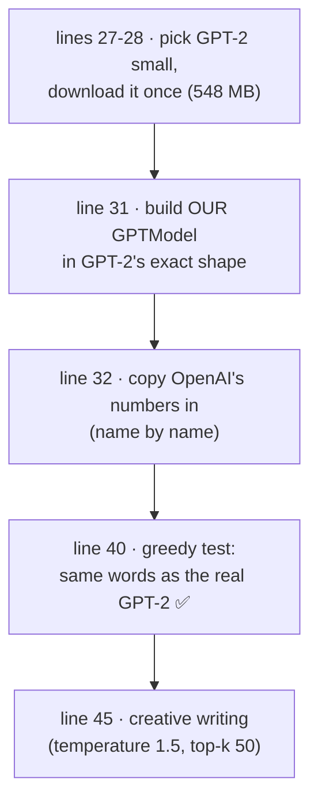
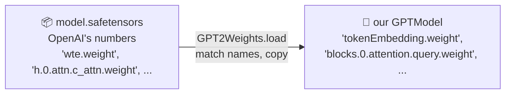
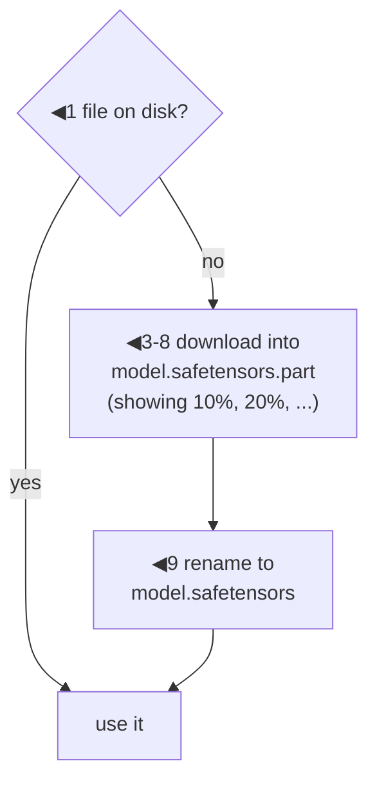
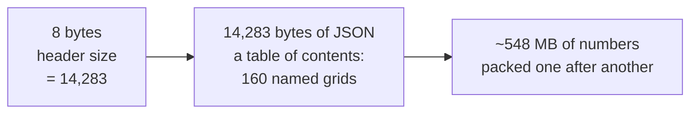
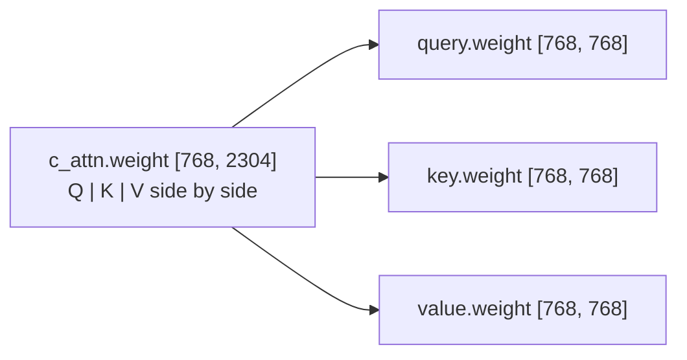

# Line by line: `Step12_LoadGPT2`

**Run it:** `./run.sh 12` (downloads 548 MB the first time) · **Code:** [`Step12_LoadGPT2.java`](../../src/main/java/com/tinygpt/examples/Step12_LoadGPT2.java), and the classes it uses: [`GPT2Size`](../../src/main/java/com/tinygpt/pretrained/GPT2Size.java), [`Downloads`](../../src/main/java/com/tinygpt/pretrained/Downloads.java), [`SafeTensors`](../../src/main/java/com/tinygpt/pretrained/SafeTensors.java), [`GPT2Weights`](../../src/main/java/com/tinygpt/pretrained/GPT2Weights.java) · **Idea first:** [9. Chat with GPT-2](../09-chat-with-gpt2.md) · **Book:** 5.5

← [Training TinyGPT](step-tinygpt-training.md) · [All walkthroughs](README.md) · Next: [FineTune and Chat →](finetune-and-chat.md)

Every output on this page is **real**: it's what `./run.sh 12` prints, and the file details come from the real downloaded file.

---

## 🗺️ The whole program on one page



**Why?** Training GPT-2 took OpenAI weeks on many GPUs. Our `GPTModel` ([step 9](step09-gpt-model.md)) has **exactly the same design**, so we can **borrow** their trained numbers. 🏠 Like moving into a furnished house instead of building every chair yourself.

---

# Part A · `Step12_LoadGPT2.java`

## Lines 27-28 · choose a size and download it

```java
        GPT2Size size = GPT2Size.SMALL;                          // ◀ 1 · 124M, the smallest GPT-2
        Downloads.ifMissing(size.url(), size.weightsFile());    // ◀ 2 · download once, then reuse
```

| ◀ | what it does | real values |
|---|---|---|
| 1 | Pick GPT-2 small: its settings, its web address and its file name. [Part B: GPT2Size](#gpt2size--small-or-medium) | |
| 2 | If `models/gpt2/model.safetensors` isn't on disk yet, download it. [Part B: Downloads](#downloads--fetch-once-keep-forever) | from `https://huggingface.co/openai-community/gpt2/resolve/main/model.safetensors`, 548,105,171 bytes |

---

## Lines 31-33 · build our model, fill it with GPT-2's numbers

```java
            GPTModel model = new GPTModel(manager, size.config());   // ◀ 1 · our model, GPT-2's shape, random numbers
            GPT2Weights.load(model, size.weightsFile());             // ◀ 2 · overwrite every number with OpenAI's
            System.out.printf("Loaded OpenAI's GPT-2 small into our GPTModel: %,d numbers%n%n", model.parameterCount());
```

```
Loaded OpenAI's GPT-2 small into our GPTModel: 163,037,184 numbers
```

🔢 Why 163,037,184 and not step 9's 163,009,536? OpenAI's Query, Key and Value **have a bias** (`qkvBias = true`): 12 blocks × 3 × 768 = **27,648** extra numbers.



---

## Line 40 · ✅ the proof: same words as the real GPT-2

```java
            System.out.println("  " + generator.generateGreedy("I enjoy walking with my cute dog", 30).replace("\n", " "));   // ◀
```

```
Greedy:
  I enjoy walking with my cute dog, but I'm not sure if I'll ever be able to walk with my dog. I'm not sure if I'll ever be able to walk
```

🗣️ Hugging Face's text-generation guide shows exactly this greedy output for GPT-2. **Word for word the same** means our Java model does **the same maths** as the real GPT-2. If even one number were in the wrong place, the words would be different.

It also shows the **weakness of greedy** ([step 11](step11-sampling.md)): it loops, "I'm not sure if I'll ever be able to walk..." twice.

## Line 45 · creative writing

```java
            System.out.println("  " + generator.generate("Every effort moves you", 25, 1.5f, 50).replace("\n", " "));   // ◀ the book's settings
```

```
Temperature 1.5, top-k 50:
  Every effort moves you further backward. There also exists one of those small circles: self-tourism . For them, the good world's
```

Real English, but it just **continues** text. To answer questions it needs fine-tuning: [FineTune walkthrough](finetune-and-chat.md).

---

# Part B · the classes it uses

## `GPT2Size` · small or medium

```java
public enum GPT2Size {
    SMALL("gpt2", "small (124M)", new GPTConfig(50257, 1024, 768, 12, 12, 0.0f, true)),          // ◀ 1
    MEDIUM("gpt2-medium", "medium (355M)", new GPTConfig(50257, 1024, 1024, 16, 24, 0.0f, true)); // ◀ 1

    public String url() {
        return "https://huggingface.co/openai-community/" + name + "/resolve/main/model.safetensors";   // ◀ 2
    }
    public Path weightsFile()   { return Path.of("models", name, "model.safetensors"); }   // ◀ 3 · models/gpt2/model.safetensors
    public Path chatModelFile() { return Path.of("models", name + "-chat.params"); }       // ◀ 3 · models/gpt2-chat.params
    public Path talkModelFile() { return Path.of("models", name + "-talk.params"); }       // ◀ 3 · models/gpt2-talk.params

    public String toString() { return label; }                                              // ◀ 4 · prints "small (124M)"

    public static GPT2Size fromArgs(String[] args) {
        return args.length > 0 && args[0].equalsIgnoreCase("medium") ? MEDIUM : SMALL;      // ◀ 5
    }
}
```

| ◀ | what it does |
|---|---|
| 1 | An `enum` is a fixed list of choices. Each one carries its name on Hugging Face, a label for printing, and its settings. Dropout is **0** (we load, not pretrain) and `qkvBias` is **true** (OpenAI's design). |
| 2 | Where OpenAI's numbers are hosted. |
| 3 | Where files go on disk. All under `models/`, which git ignores. |
| 4 | So `"Fine-tuning GPT-2 " + size` prints a friendly label. |
| 5 | `./run.sh finetune medium` → MEDIUM; anything else → SMALL. |

| | SMALL | MEDIUM |
|---|---:|---:|
| numbers per token | 768 | 1,024 |
| heads | 12 | 16 |
| blocks | 12 | 24 |
| download | 548 MB | ~1.5 GB |

---

## `Downloads` · fetch once, keep forever

```java
    public static Path ifMissing(String url, Path file) throws IOException, InterruptedException {
        if (Files.exists(file)) {
            return file;                                                                     // ◀ 1 · already have it
        }
        Files.createDirectories(file.toAbsolutePath().getParent());                          // ◀ 2 · make models/gpt2/
        Path partial = file.resolveSibling(file.getFileName() + ".part");                    // ◀ 3 · model.safetensors.part
        System.out.println("Downloading " + url);

        HttpClient client = HttpClient.newBuilder().followRedirects(HttpClient.Redirect.NORMAL).build();   // ◀ 4
        HttpResponse<InputStream> response = client.send(HttpRequest.newBuilder(URI.create(url)).build(),
                HttpResponse.BodyHandlers.ofInputStream());
        if (response.statusCode() != 200) {                                                  // ◀ 5 · 200 = "OK"
            throw new IOException("Download failed with HTTP " + response.statusCode() + ": " + url);
        }
        long total = response.headers().firstValueAsLong("content-length").orElse(-1);      // ◀ 6 · file size, for %

        try (InputStream in = response.body(); OutputStream out = Files.newOutputStream(partial)) {
            byte[] buffer = new byte[1 << 16];                                               // ◀ 7 · 65,536 bytes at a time
            ...
            for (int read; (read = in.read(buffer)) != -1; ) {
                out.write(buffer, 0, read);                                                  // ◀ 8 · save each piece
                ...print "10%", "20%", ...
            }
        }
        Files.move(partial, file, StandardCopyOption.REPLACE_EXISTING);                      // ◀ 9 · done: rename
        return file;
    }
```



| ◀ | why |
|---|---|
| 3 & 9 | Download to `.part` first, and rename only at the end. If the download is stopped halfway, there's no half-finished `model.safetensors` that would look complete next time. |
| 4 | Hugging Face sends you on to a storage server (a *redirect*), so we follow redirects. |
| 7 | `1 << 16` = 2¹⁶ = 65,536. Reading in pieces means the 548 MB never has to fit in memory at once. |

---

## `SafeTensors` · reading Hugging Face's file format

### What's in the file (real numbers)



Real entries from the table of contents:

| name | shape | data_offsets (start, end) |
|---|---|---|
| `wte.weight` | [50257, 768] | 287,209,472 → 441,598,976 |
| `wpe.weight` | [1024, 768] | 267,533,312 → 270,679,040 |
| `h.0.attn.c_attn.weight` | [768, 2304] | 270,682,112 → 277,760,000 |
| `h.0.mlp.c_fc.weight` | [768, 3072] | 115,546,112 → 124,983,296 |
| `h.0.attn.bias` | [1, 1, 1024, 1024] | (a mask, not a weight: we skip these 12) |

🔢 Check: wte = 441,598,976 − 287,209,472 = 154,389,504 bytes ÷ 4 bytes per number = **38,597,376** = 50,257 × 768 ✅

### `open` · read the table of contents

```java
    public static SafeTensors open(Path file) throws IOException {
        try (FileChannel channel = FileChannel.open(file, StandardOpenOption.READ)) {
            ByteBuffer sizeBytes = ByteBuffer.allocate(8).order(ByteOrder.LITTLE_ENDIAN);       // ◀ 1
            channel.read(sizeBytes, 0);
            long headerSize = sizeBytes.getLong(0);                                             // ◀ 1 · 14,283

            ByteBuffer headerBytes = ByteBuffer.allocate((int) headerSize);
            channel.read(headerBytes, 8);                                                       // ◀ 2 · the JSON, right after
            JsonObject header = JsonParser.parseString(new String(headerBytes.array(), StandardCharsets.UTF_8)).getAsJsonObject();

            long dataStart = 8 + headerSize;                                                    // ◀ 3 · where the numbers begin
            ByteBuffer data = channel.map(FileChannel.MapMode.READ_ONLY, dataStart, channel.size() - dataStart)
                    .order(ByteOrder.LITTLE_ENDIAN);                                            // ◀ 4
            return new SafeTensors(data, header);
        }
    }
```

| ◀ | what it does |
|---|---|
| 1 | Read the first 8 bytes as one whole number. **Little-endian** = the smallest byte comes first, which is how this format (and most computers) store numbers. |
| 2 | Read the JSON table of contents and parse it with Gson. |
| 3 | Offsets in the table count from **here**, not from the start of the file. |
| 4 | **Memory-map** the numbers: the operating system loads pieces from disk only when we read them, instead of copying 548 MB into memory up front. |

The constructor then stores each entry's shape and offsets, skips `__metadata__`, and refuses anything that isn't 32-bit floats (`F32`).

### `get` · one grid by name

```java
    public Tensor get(String name) {
        Entry entry = entries.get(name);                                                   // ◀ 1 · look it up
        float[] values = new float[(int) ((entry.end - entry.start) / Float.BYTES)];       // ◀ 2 · bytes ÷ 4 = how many numbers
        data.slice((int) entry.start, (int) (entry.end - entry.start))                     // ◀ 3 · just this grid's bytes
                .order(ByteOrder.LITTLE_ENDIAN)
                .asFloatBuffer().get(values);                                              // ◀ 4 · read them as floats
        return new Tensor(name, entry.shape, values);
    }
```

🌍 A book's contents page says "Chapter 3: pages 40-52". `get` turns straight to those pages.

---

## `GPT2Weights` · putting each number in the right place

### `load` · OpenAI's names → our names

```java
    public static void load(GPTModel model, Path safetensorsFile) throws IOException {
        SafeTensors file = SafeTensors.open(safetensorsFile);
        Map<String, NDArray> ours = model.namedParameters();                 // ◀ 1 · all 197 of our grids, by name
        Set<String> filled = new HashSet<>();                                // ◀ 2 · ticked off as we go
        int dim = model.config().embeddingDim();

        copy(ours, filled, "tokenEmbedding.weight", file.get("wte.weight").values());        // ◀ 3
        copy(ours, filled, "positionEmbedding.weight", file.get("wpe.weight").values());

        for (int i = 0; i < model.config().numberOfLayers(); i++) {          // ◀ 4 · each of the 12 blocks
            String h = "h." + i + ".";                                       //      OpenAI: "h.0."
            String b = "blocks." + i + ".";                                  //      ours:   "blocks.0."
            copy(ours, filled, b + "norm1.scale", file.get(h + "ln_1.weight").values());
            ...
        }
        ...
        Set<String> missing = new HashSet<>(ours.keySet());
        missing.removeAll(filled);
        if (!missing.isEmpty()) {                                            // ◀ 5 · did every part get numbers?
            throw new IllegalStateException("These parts got no GPT-2 numbers: " + missing);
        }
    }
```

The name map (block 0 shown; the other 11 are the same with a different number):

| OpenAI's name | → our name | what it is |
|---|---|---|
| `wte.weight` | `tokenEmbedding.weight` | WHAT table |
| `wpe.weight` | `positionEmbedding.weight` | WHERE table |
| `h.0.ln_1.weight` / `.bias` | `blocks.0.norm1.scale` / `.shift` | LayerNorm 1 |
| `h.0.attn.c_attn.weight` [768, 2304] | `blocks.0.attention.query` / `key` / `value.weight` | **cut into 3** |
| `h.0.attn.c_proj.weight` | `blocks.0.attention.outputProjection.weight` | attention output |
| `h.0.ln_2.weight` / `.bias` | `blocks.0.norm2.scale` / `.shift` | LayerNorm 2 |
| `h.0.mlp.c_fc.weight` | `blocks.0.feedForward.expand.weight` | 768 → 3,072 |
| `h.0.mlp.c_proj.weight` | `blocks.0.feedForward.shrink.weight` | 3,072 → 768 |
| `ln_f.weight` / `.bias` | `finalNorm.scale` / `.shift` | final LayerNorm |
| `wte.weight` **turned sideways** | `outputHead.weight` | reused (weight tying) |

◀5 is a safety net: if we forgot a part, it would still hold **random** numbers and the output would be nonsense, so we stop with a clear list instead.

### Two shape tricks

**① `splitColumns`: OpenAI keeps Q, K and V in one grid.** `c_attn.weight` is **[768, 2304]**: Query, Key and Value side by side (3 × 768 = 2,304 columns). We cut it into 3 grids of [768, 768]:

```java
    static float[][] splitColumns(float[] grid, int rows, int columns, int pieces) {
        int width = columns / pieces;                                    // ◀ 2304 ÷ 3 = 768
        float[][] result = new float[pieces][rows * width];
        for (int r = 0; r < rows; r++) {                                 // ◀ each row...
            for (int p = 0; p < pieces; p++) {                           // ◀ ...cut into 3 pieces
                System.arraycopy(grid, r * columns + p * width, result[p], r * width, width);   // ◀ copy piece p of row r
            }
        }
        return result;
    }
```

🔢 Tiny version: 2 rows × 6 columns, 3 pieces:

```
grid:  row 0 [ a b | c d | e f ]      Q: [a b]    K: [c d]    V: [e f]
       row 1 [ g h | i j | k l ]  →      [g h]       [i j]       [k l]
```



**② `transpose`: the output head is the token table turned sideways.**

```java
    static float[] transpose(float[] grid, int rows, int columns) {
        float[] result = new float[grid.length];
        for (int r = 0; r < rows; r++) {
            for (int c = 0; c < columns; c++) {
                result[c * rows + r] = grid[r * columns + c];   // ◀ number at (row r, col c) moves to (row c, col r)
            }
        }
        return result;
    }
```

🔢 `[[1, 2, 3], [4, 5, 6]]` (2 × 3) → `[[1, 4], [2, 5], [3, 6]]` (3 × 2).

`wte` is [50257, 768] (one row per token); our output head multiplies by [768, 50257]. Same numbers, turned sideways. **Why reuse it?** The table that says "this token means *this*" (going in) works well for "this meaning is probably *that* token" (going out).

### `copy` · put one grid in place, safely

```java
    private static void copy(Map<String, NDArray> ours, Set<String> filled, String name, float[] values) {
        NDArray target = ours.get(name);
        if (target == null) {                                              // ◀ 1 · a name we don't have
            throw new IllegalStateException("Our model has no part named " + name + ". Use the config from GPT2Size.");
        }
        if (target.size() != values.length) {                              // ◀ 2 · wrong size
            throw new IllegalStateException(name + ": expected " + target.size() + " numbers, got " + values.length);
        }
        target.set(FloatBuffer.wrap(values));                              // ◀ 3 · overwrite our numbers
        filled.add(name);                                                  // ◀ 4 · tick it off
    }
```

Checks ◀1 and ◀2 catch the most common mistake: building the model with the wrong config (e.g. `GPT2_SMALL` without `qkvBias`).

---

## 🧠 What this step teaches

- A trained model is just **numbers in named grids**. If your design matches, you can load someone else's.
- `.safetensors` = a size, a JSON table of contents, then the numbers.
- Loading = **match names** (`h.0.ln_1.weight` → `blocks.0.norm1.scale`), fix shapes (**split** Q/K/V, **transpose** the output head), and **check** nothing is missed.
- Same greedy words as the real GPT-2 = proof that our maths is right.

## 🧪 Try it yourself

1. Line 27: `GPT2Size.MEDIUM` (1.5 GB download). Is the greedy text different?
2. Line 40: your own prompt. GPT-2 knows a lot of facts from the web, but it rambles.
3. Comment out the `outputHead` line in `GPT2Weights.load`. The safety check (◀5) stops it with the missing name.
